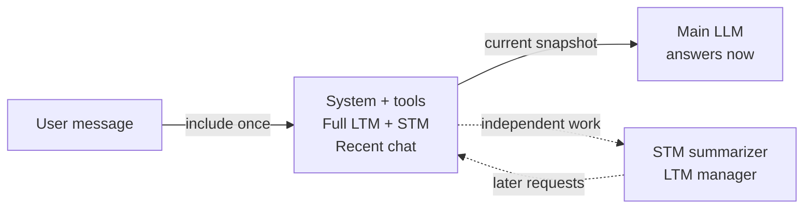
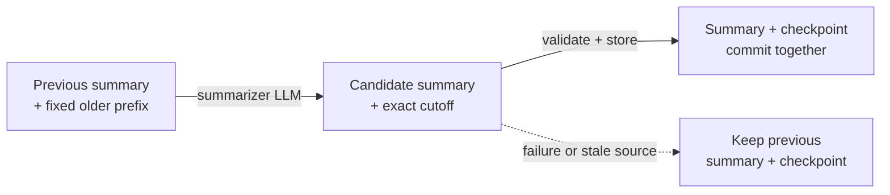
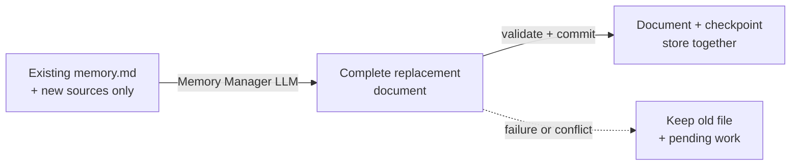

## 1. How the two memories work together

One uses **short-term memory (STM)** to follow the current conversation and **long-term memory (LTM)** to remember useful personal context across conversations.

| | STM: conversation context | LTM: lasting personal context |
| --- | --- | --- |
| Contains | A rolling summary plus recent messages | Background, preferences, interests, projects and goals |
| Scope | One conversation | One owner, across conversations |
| Maintained by | A background summarizer | A separate Memory Manager LLM |
| Stored as | Encrypted session state and full transcript | One encrypted logical `memory.md` document |

### What happens on every chat turn?

1. Accept the user's message and preserve it in conversation history.
2. Assemble the main model's input from system instructions, tools, the **complete existing LTM**, the valid STM summary if present, and all messages not covered by that summary. Include the current message once.
3. Generate the answer using that available snapshot. Background maintenance runs independently; the answer never waits for a new summary or LTM rewrite.
4. Once a background update is stored, a later model request can use it. A request already running continues with its original snapshot.

**Figure 1 — Current V1, runtime view for engineers.** Solid arrows show information flow; dotted arrows schedule independent work. The owner authorizes processing on the selected model runtime. Memory persists encrypted; this figure does not grant an agent permission to read or write it. Source anchors: `agent-chat-workspace.tsx`, `one_adk/chat_memory.py`, `chat-memory-runtime.ts`.

**Storage detail:** `memory.md` is a readable Markdown document inside the existing encrypted `one_memory` record. It is not a plaintext file written to the server's filesystem. V1 sends the full document; it uses no vector search or Wiki retrieval.

<!-- pdf:page-break -->

## 2. STM: when and how compaction happens

At first, there is no summary: the model receives the complete current conversation. As the conversation grows, older messages are summarized so that recent discussion can remain verbatim.

### Count the entire context budget

**Budget used = system instructions + tools + full LTM + STM summary + unsummarized messages + current input + response allowance.**

Start compaction at approximately **75% of the selected model's context window**. This is not 75% of chat messages alone. For an illustrative 100,000-token window, start near 75,000 tokens including the response allowance. This example is not a production model limit.

Before a model call, the runtime uses a conservative estimate, calibrated against previous provider usage when available. Provider-reported input tokens reconcile the estimate afterward. Known models have explicit limits; unknown models use a labelled conservative fallback. The trigger is approximate, not exact tokenization.

**Figure 2 — Current V1, STM update view for engineers.** The summarizer receives an owner-scoped conversation prefix; encrypted session storage owns the commit. The main answer does not wait at any step. Source anchors: `one_adk/chat_memory.py`, `encrypted_session_service.py`.

### Preserve recent messages and advance safely

- Keep at least the latest **four user turns**, with their associated messages, verbatim. Keep queued inputs and tool exchanges together rather than splitting a running interaction.
- Combine the previous valid summary with only the newly selected older prefix. The checkpoint moves only to the last event actually summarized and successfully stored.
- Messages arriving during the job remain outside its fixed cutoff. A source change or late resumption cannot make uncovered messages disappear.
- If a job fails, keep the previous summary and checkpoint. At the hard context limit, temporarily use the newest fitting complete turn groups alongside the valid summary. **The full stored transcript is never deleted.** A single input that itself exceeds the provider's limit still cannot fit.

**Compaction shortens the model's working context. It does not rewrite or erase conversation history.**

<!-- pdf:page-break -->

## 3. LTM: incremental updates to memory.md

The Memory Manager maintains one consolidated personal profile. It rewrites the complete document, preserving useful existing facts while adding new information, correcting changed facts and removing outdated or duplicate information.

### What triggers an update?

| Trigger | Current V1 behavior |
| --- | --- |
| Accumulated input tokens | Trigger at an initial configurable **12,000 tokens** since the last acknowledged LTM update |
| Explicit owner request | Trigger for remember/save/forget requests |
| New chat or conversation switch | Flush eligible pending messages in the background |
| Inactivity | Trigger after **five minutes**, while the app is open and unlocked |

Count the **whole request's input tokens**, including repeated system instructions, tools, LTM and conversation context. Output tokens and reserved output capacity are not part of this LTM counter. A long prompt can cross the threshold by itself; several short turns can accumulate toward it. The initial 12k setting is tunable, not a measured optimum.

**Figure 3 — Current V1, LTM processing and storage boundary for engineers.** The model proposes text; the authorized app writer performs the encrypted commit. A model response alone proves no save. Source anchors: `chat-memory-runtime.ts`, `chat_memory_manager.py`, `markdown-memory.ts`.

### Exactly what the manager receives

Send **the existing document plus new, unprocessed role-attributed messages**. Do not resend the entire historical conversation, system prompt or tools as extraction evidence. Owner statements establish personal facts; assistant text only helps interpret the conversation. Credentials, invented assistant claims and another person's consent-scoped information are excluded.

Use a fixed batch and separate per-conversation progress. Commit the new document and its checkpoint together. Retire only the input-token usage covered by that successful update; messages and usage arriving during the job remain pending. Never reset the counter just because the LLM returned successfully.

**Size control:** the manager targets a compact 16,000-token document within a 24,000-token preparation budget. Storage has a hard 96,000-character limit; tokens and characters are different units. Compact redundant wording, and reject an oversized result rather than silently truncate useful facts. Very long sources are processed as exact ordered chunks.

<!-- pdf:page-break -->

## 4. A concrete example and the failure rules

### One conversation, two independent checkpoints

Assume LTM currently says “Prefers tea” and “Project Aurora uses Python.” There is no STM summary yet. These are synthetic example facts.

| Step | Main conversation | Background memory work |
| --- | --- | --- |
| 1 | User: “I now prefer coffee.” Main LLM sees the current LTM plus this new statement and can respond immediately. | Suppose this request uses 7,000 input tokens. Keep the source pending. |
| 2 | User: “Aurora is due on December 12.” The unsummarized history still carries the preference correction. | Another 6,000 input tokens takes the counter to 13,000. Start LTM extraction. |
| 3 | The conversation can continue while the manager runs. | Send current LTM plus only the two new source messages. Replace tea with coffee, add the deadline and preserve Python. |
| 4 | User: “I also prefer short answers.” | This arrival is outside the running job's snapshot. Keep it and its request usage pending. |
| 5 | A later request receives the successfully stored new LTM and the available conversation context. | On write acknowledgment, checkpoint only the covered sources and usage. Do not clear the newer arrival. |

Later, when the **whole context** approaches 75%, STM summarizes an older conversation prefix. That summary is conversation context; LTM remains the lasting personal profile. Updating one does not advance the other's checkpoint. Neither an answer already in progress nor an earlier prompt is retroactively changed.

### Engineering rules that prevent lost information

| Situation | Required behavior |
| --- | --- |
| Summary generation, validation or storage fails | Keep both the previous STM summary and its checkpoint. |
| LTM generation, validation or storage fails | Keep the existing Markdown, source checkpoints and unacknowledged token count. Retry pending work on a later eligible trigger. |
| New messages arrive during either job | Keep a fixed source cutoff. New arrivals belong to a later batch. |
| An owner manually edits or forgets information | Advance the edit generation and withdraw older pending sources so a stale rewrite cannot undo that change. |
| Another writer changes the document | Compare the expected revision and document. Reject the stale replacement and prepare again against current memory. |
| Owner changes or the vault locks | Retire pending plaintext operations and prevent late writes under stale authority. Pending LTM work is retained encrypted for recovery. |

**Checkpoint means “successfully processed through this boundary.”** STM stores a summary cutoff with source validation. LTM tracks processed source IDs per conversation and covered request IDs. This is the engineering equivalent of separate `last_processed_message_id` checkpoints; it is not one shared cursor for both jobs.

The owner-scoped LTM writer survives navigation from Chat to Memory. Closing or suspending the app can pause LTM maintenance; a five-minute idle trigger is not a promise of server-side work after the app closes.

<!-- pdf:page-break -->

## 5. Team ownership and future work

### Shared engineering responsibility

**Every engineer who owns an agent should make that agent contribute useful, authorized information to the owner's LTM through the shared memory-writing path.** Memory integration is part of the agent's responsibility, rather than something only the chat team maintains.

This is the **team integration requirement**. In the current V1 implementation, the chat path is integrated; Gmail, Calendar and other specialist migrations remain separate work. Do not interpret this guide as proof that every agent already writes to the new path.

For each agent integration, its engineer should:

1. Identify which observations are durable personal context, and which are temporary tool results. Keep facts attributed to the correct person and source; apply the owner's consent and processing rules.
2. Submit new observations with stable source IDs, owner scope and a processed-source checkpoint. Retrying the same event must not create duplicate memory.
3. Use the common writer to consolidate against the latest LTM. Do not overwrite the shared document directly or maintain a competing personal profile.
4. Preserve existing facts, correct only supported changes, honor owner edits/Forget, and handle failures and conflicting updates. Check these behaviors before considering the integration complete.

For example, a Calendar agent may contribute an owner-confirmed recurring work preference. It should not turn every temporary event, another attendee's private details, or an assistant's suggestion into a lasting fact about the owner.

### Future work — Wiki-based LTM

Evolve the single Markdown profile into a **linked Wiki**: an index plus focused pages for background, preferences, projects and other useful topics. Design how pages are updated and retrieved under a context budget, while keeping attribution, consent and owner edits intact. V1 currently sends one complete document; selective Wiki-page retrieval is future work.

### Future work — version control and multiple agents

Add **version history and coordinated updates** so multiple agents can contribute without overwriting one another. Each proposed change should identify its source agent and base revision. The shared writer should check that revision, serialize or reconcile conflicts, and record a new version only after a successful commit.

Keep an auditable history of what changed, where it came from and which version it replaced. Support owner inspection and rollback, with encryption and access controls preserved. Version control here does not require putting plaintext personal memory into a shared Git repository.

**Delivery order:** reliable single-document memory first; agent integrations through the shared writer next; then linked Wiki pages and explicit collaborative version history. Current revision checks prevent stale replacements, but they are not yet a complete Wiki or user-facing version-history system.

### Implementation pointers

V1 implementation reviewed on 4 November 2026. Engineers can inspect these sources in the working tree:

- `consent-protocol/hushh_mcp/one_adk/chat_memory.py` — STM budget, snapshots and background summarization.
- `hushh-webapp/lib/agent/chat-memory-runtime.ts` — LTM triggers, incremental sources and accounting.
- `hushh-webapp/lib/pkm/markdown-memory.ts` — encrypted document replacement and owner-edit fencing.
- `consent-protocol/hushh_mcp/services/chat_memory_manager.py` — bounded LTM rewrite request.

Maintained architecture reference: [Memory workspace](https://github.com/hushh-labs/hushh-research/blob/main/docs/reference/architecture/memory-workspace.md). This guide describes the local V1 implementation; deployment and full browser-flow verification are separate checks.
