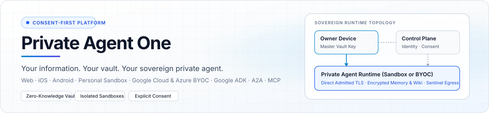
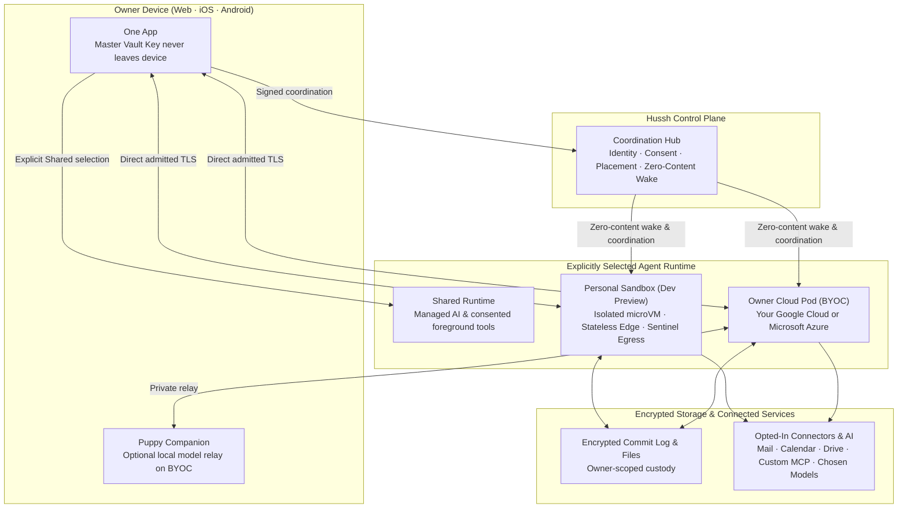

<p align="center">
  <picture>
    <source media="(prefers-color-scheme: dark)" srcset="docs/assets/brand/hussh-one-hero-dark.svg" />
    <source media="(prefers-color-scheme: light)" srcset="docs/assets/brand/hussh-one-hero-light.svg" />
    
  </picture>
</p>

<p align="center">
  
  
  
  
  
  
  
  <a href="https://discord.gg/fd38enfsH5"></a>
</p>

> [!IMPORTANT]
> **Hussh is your personal agent platform for the digital world: trusted by design, consent-first by default, and accountable only to you.**
> Hussh is the platform; **One** is your private agent. Every design decision follows the [Personal Data Agent identity](docs/product/principles/agent-ontology.md#personal-data-agent-founder-identity): duty of care, discretion, explicit consent, and your information as your private capital.

One helps you remember, organize, and act across your digital life on Web, iOS, and Android. Connect the services you choose, keep your sovereign Vault encrypted on your own device, and choose where your agent runs: our **Shared runtime**, your own cloud (**Google Cloud** or **Microsoft Azure BYOC**), or an isolated **Personal Sandbox** (Dev preview).

[Explore the product](docs/product/README.md) · [Read the architecture atlas](docs/architecture/README.md) · [Browse all documentation](docs/README.md)

## Visual Map



See the [architecture atlas](docs/architecture/README.md) for system, sequence, hosting, and information-boundary views.

## Platform capabilities and maturity

| Capability | Status | What a person gets and where the boundary sits |
| --- | --- | --- |
| **One & Specialist Agents** | `Live` | One root agent coordinates finance (Kai), mail, calendar, documents, location, and sharing through explicit consent gates. |
| **Zero-Knowledge Personal Vault** | `Live` | Client-side encrypted personal capital unlocked strictly on the owner's device; the master key never leaves the device. |
| **Shared Runtime** | `Live` | Instant managed onboarding with consented foreground tools and managed updates. |
| **Owner-Cloud Pods (GCP & Azure BYOC)** | `Live` | Dedicated private agent inside your own Google Cloud project or Azure subscription with owner-approved release upgrades and Puppy local-model relay. |
| **Personal Sandbox & Autonomous Prep** | `Preview` | Single-use isolated sandboxes on Dev with stateless TLS edge routing, default-deny Sentinel egress, ~3s warm wakes, lossless multi-cloud cutover, 6-surface prompt-injection quarantine, and quiet offline preparation. |
| **Files & Personal Wiki** | `Live` | Dedicated encrypted file explorer and personal wiki workspace; private Files requires a supported private pod or sandbox. |
| **Computer Use (Browser)** | `Preview` | Owner-controlled browser inside a qualified private pod container with explicit cloud, image, model, and lifecycle gates. |

Review the [private-agent north star](docs/product/principles/private-agent-requirements.md) for custody, recovery, revocation, and erasure requirements, and [operational acceptance](docs/operations/acceptance/private-agents.md) for how source capabilities differ from installed verification.

## Quick start

```bash
git clone https://github.com/hushh-labs/hushh-research.git
cd hushh-research
./bin/hushh bootstrap
./bin/hushh doctor --mode local
```

Run each local runtime component in its own terminal:

```bash
./bin/hushh proxy --mode local
./bin/hushh backend --mode local --reload
./bin/hushh web --mode local
```

See [Getting started](docs/development/guides/getting-started.md) for prerequisites, [environment profiles](docs/operations/environments.md) for backend selection, and the [standalone protocol workflow](consent-protocol/README.md) for backend-only work.

## Repository map

| Home | Responsibility |
| --- | --- |
| [hushh-webapp](hushh-webapp) | Next.js, React, and Capacitor app for Web, iOS, and Android |
| [consent-protocol](consent-protocol) | FastAPI runtime, PKM, consent protocol, ADK agents, and MCP server |
| [packages](packages) | Shared packages and developer integrations (`@hushh/mcp`) |
| [docs](docs/README.md) | Five-pillar human and technical documentation atlas |
| [.agents](.agents/README.md) | Portable coding-agent instructions, skills, workflows, and evaluations |

## Read next

| Audience | Start here |
| --- | --- |
| **Understand One** | [Product overview](docs/product/README.md) · [Capabilities](docs/product/capabilities.md) · [Architecture atlas](docs/architecture/README.md) |
| **Contributors** | [Contributor guide](contributing.md) · [Repository map](docs/development/repository-map.md) · [Testing guide](TESTING.md) |
| **Operators** | [Operations hub](docs/operations/README.md) · [CI & release governance](docs/operations/releases/ci.md) · [Environments](docs/operations/environments.md) |
| **Documentation authors** | [Documentation standard](docs/development/documentation.md) · [Brand contract](docs/operations/brand-and-compatibility-contract.md) |

<details>
<summary><strong>For coding agents: start here (operating contract, one-hop index, and rules)</strong></summary>

1. Read [AGENTS.md](AGENTS.md) and [`.agents/instructions.md`](.agents/instructions.md) first; they are the single portable operating contract for every coding agent.
2. Read [llms.txt](llms.txt) for a one-hop machine discovery map of canonical product, architecture, contract, and operational docs.
3. Orient and route recurring tasks through [`.agents/README.md`](.agents/README.md) and `./bin/hushh agents route-task <workflow-id>`.
4. Never create vendor-specific agent directories (`.claude`, `.codex`, `.qwen`) or duplicate instruction copies.
5. Sign commits with `git commit -s` and pass local pre-PR checks (`./bin/hushh docs verify`, affected backend/frontend gates) before pushing. Main, UAT, and production promotion retain separate release authority.

</details>

First-party code is licensed under [Apache-2.0](LICENSE).
