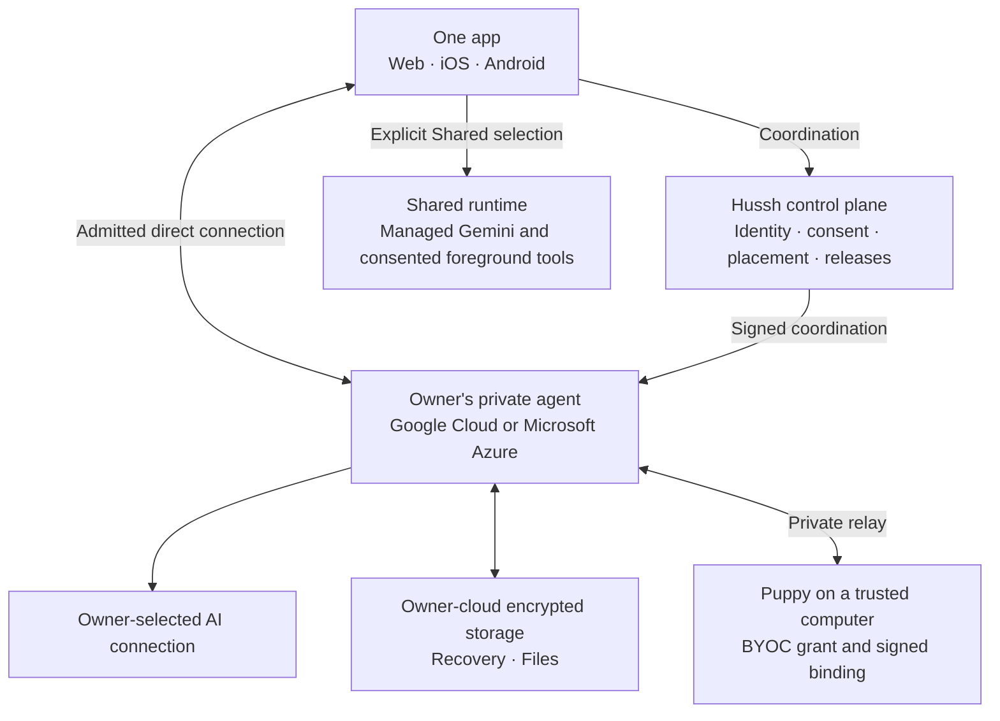

# Hussh Research

**One: a private agent built around owner choice, encrypted information, and explicit consent.**

This monorepo contains the web and native apps, agent runtime, consent protocol,
and deployment tooling. People can use the Shared runtime or connect a private
agent in their own Google Cloud or Microsoft Azure environment.

Start with the [Founder/CTO readiness decision](docs/reference/quality/adk-orchestration-docs-audit.md)
for verified journeys, serving evidence, and release prerequisites. Capability
availability depends on hosting, consent, provider access, and the installed release.

## Visual Map



See the [architecture index](docs/reference/architecture/README.md) for detailed
system, runtime, flow, deployment, and information-boundary views.

## Product boundaries

- **One** coordinates specialists through the existing ADK, consent, and action contracts.
- **Files** has a dedicated explorer and specialist. Shared Files uses browser-side
  encryption and remains subject to its pilot gates; private Files requires a supported pod.
- **Puppy** uses a trusted device and owner-approved private relay on BYOC.
- **Updates** are managed for Shared. Private-pod installation requires approval for
  the exact release, followed by recovery and installed-version verification.
- **Computer Use** remains gated per cloud until native sandbox isolation qualifies.
  A configured pod alone does not make the browser capability available.

The [private-agent north star](docs/reference/architecture/private-agent-north-star.md)
owns custody, processing consent, recovery, revocation, and erasure requirements.
The readiness decision records their implementation and live verification separately.

## Repository

| Home | Responsibility |
| --- | --- |
| [hushh-webapp](hushh-webapp/) | Next.js, React, and Capacitor experience for Web, iOS, and Android |
| [consent-protocol](consent-protocol/) | FastAPI, PKM, consent, ADK agents, and MCP |
| [packages](packages/) | Shared packages and developer integrations |
| [docs](docs/) | Current contracts, guides, operations, vision, and explicit future designs |
| [.agents](.agents/README.md) | Authored development instructions, skills, workflows, and engineering lanes |

## Quick start

```bash
git clone https://github.com/hushh-labs/hushh-research.git
cd hushh-research
./bin/hushh bootstrap
./bin/hushh doctor --mode local
```

For local development, run each component in its own terminal:

```bash
./bin/hushh proxy --mode local
./bin/hushh backend --mode local --reload
./bin/hushh web --mode local
```

See [Getting started](docs/guides/getting-started.md) for prerequisites and
[environment profiles](docs/guides/environment-model.md) for backend selection.
The protocol package also supports its [standalone workflow](consent-protocol/README.md).

## Read next

| Audience | Start here |
| --- | --- |
| Founder / CTO | [Readiness decision](docs/reference/quality/adk-orchestration-docs-audit.md) · [architecture](docs/reference/architecture/README.md) · [vision](docs/vision/README.md) |
| Contributors | [Contributor guide](contributing.md) · [project map](docs/project_context_map.md) · [testing](TESTING.md) |
| Operators | [Operations index](docs/reference/operations/README.md) · [CI](docs/reference/operations/ci.md) |
| Coding agents | [AGENTS.md](AGENTS.md) · [development system](.agents/README.md) |

First-party code is Apache-2.0. Sign commits with `git commit -s` and follow the
existing verification and release gates. Main, UAT, and production promotion retain
separate authority.
