# Consumer scope commerce

## Visual Map

```mermaid
flowchart LR
  tariff["Owner exact-scope tariff"] --> review["Existing request and owner approval"]
  review --> quote["Human buyer reviews exact quote"]
  quote --> reserve["Reserve funded balance"]
  reserve --> seal["Owner prepares canonical v2 ciphertext"]
  seal --> stage["Stage before fixed activation T"]
  stage --> access["Consent-gated access until exact expiry"]
  access --> settle["Term completion or early revocation"]
  settle --> ledger["Earnings, refundable balance and obligations"]
  ledger --> drain["OIDC drain and isolated Stripe provider"]
```



## Status and authority

This is the canonical package implementation reference. Dated deployment
observations below have their own explicit evidence boundary.
Checked-in code implements a USD funded-balance and owner tariff lane for existing
consented scope requests. Source checks, focused contracts and isolated local
PostgreSQL acceptance establish the bounded behavior below; they do not establish Stripe acceptance, connected-account readiness,
complete Sandbox/live financial acceptance, native browser returns, or legal/tax
approval. Both reviewers' signed funding settlements and platform capital on
shared Dev and an automatic payout from matured terms are separately verified
below; they do not prove complete paid delivery or the acceptance sequence.

### Current Dev evidence — 2026-10-17 UTC

The governed [application release](https://github.com/hushh-labs/hushh-research/actions/runs/39050162065)
and [backend/pod publication](https://github.com/hushh-labs/hushh-research/actions/runs/39052082764)
completed successfully at `7b0d4c2a225d3093d5f5944201468480d3a5fba4`.
Both shared Dev services independently served that exact source at 100% traffic.
Its exact `CI Status Gate` passed. Memory → Saved exposes category and eligible
whole-bundle **Sharing & price**; Payments and earnings retains separate purchase
balance, information-access earnings and document/answer earnings.

Existing signed funding remains $10.50 per reviewer and cumulative tagged capital
is $15. Do not repeat those operations. The fresh canonical rehearsal obtained
normal owner approvals, exact buyer confirmations, funded reservations and
recipient-bound sealed exports for $0.01, $4.50 early revocation and $4.50 manual
maturity. All three passed pre-activation retrieval denial. Their original terms
have now ended without successful browser delivery proof. The one-cent term was
`2026-10-17T18:06:07.720Z` through `2026-10-17T19:06:07.720Z`; timestamps and
financial records remain unchanged. Buyer nonuse is not refundable. Exact browser
delivery, revocation refunds and the manual/automatic acceptance sequence
remain unverified. Fresh provider readback at `2026-10-17T22:37:41.482086Z`
verified an $8.19 automatic weekly withdrawal from those matured terms, including
its transfer, simulated bank payout and actual fee receipts. This proves that
bounded payout, not successful UI delivery or live bank settlement.
The [same-source admission pause](https://github.com/hushh-labs/hushh-research/actions/runs/39057104575)
completed successfully, retaining reconciliation and access enforcement. A
[governed same-source resume](https://github.com/hushh-labs/hushh-research/actions/runs/39074407311)
completed successfully. One bounded fresh $0.01 delivery rehearsal reuses existing
funds. Its first preflight stopped before creating a request or spending because
the operator verifier expected payout-style `withdrawal_id` metadata on a transfer.
The corrected verifier checks the production transfer's `scope_operation_id` and
both saved/returned canonical transfer groups; it changes no provider records or
financial writers. Actual receipt predicates, 23 nearest tests, an original-code
failure control and independent source review establish that correction. Fresh
provider/ledger readback verifies balanced liabilities, settled backing and fee
conservation. The same rehearsal then reserved and sealed one cent, passed
pre-activation denial, and became active at `2026-10-17T22:51:11.130Z`, with its
original expiry at `2026-10-17T23:51:11.130Z`. Recipient delivery exposed a concrete
read-projection defect: PostgreSQL returns a hyphenated UUID while authenticated
AAD retains the same UUID's original compact spelling. The exact binding guard
therefore suppresses the export. The source correction preserves the original AAD
spelling only for matching v2 UUID identities; it never rewrites ciphertext, AAD,
expiry or financial records. All 59 nearest tests pass, including different-ID
denial without a read receipt; the original projection fails the regression.
A read-only check of that actual Dev row passes every existing binding predicate
with the corrected local projection. Deployment and browser decryption remain
unverified. No replacement purchase was made for this diagnosis.
Live activity remains disabled.

Two rehearsal assumptions required correction: the informational release dialog
must be acknowledged through its normal **Got it** control, and Profile deliberately
collapses identical shared sections. The corrected verifier requires the same
person and exact scope in the visible representative, then verifies the unchanged
original purchase's request, term, recipient and exact decrypted payload separately.
It preserves strict original-request checks without that crypto adapter. All 20
nearest tests pass, including wrong-person/scope, revoked-original and missing-adapter
negatives; the original representative assertion fails its regression control.
The root checkpoint handoff preserves every byte and records its hash separately
from the corrected verifier and unchanged application/crypto source bindings.
This is verifier evidence, not completed financial acceptance or a new deployment.

The connector-domain repair at `4c1ab89ecc294f8c21a3f2162ed9d5d2e9d4b8ee`
passed local core, 42 focused checks and all 25 hosted CI jobs. Its deployment is
held until the financial rehearsal hands back the shared environment. One's
owner OAuth and authenticated account/balance reads remain acceptance work.

### Earlier Dev observations

The primary's normal application recipient setup on October 17 created its key
inside the encrypted vault and verified public registration; the operator observed
no private key. Both reviewers' funding returns passed separate cold recovery.
An earlier unreserved request's quote expired during headless dialog diagnosis;
its original timestamps and authorization were preserved, never extended. The
fresh run reuses existing balances. An unapproved synthetic denial-control request
still requires owner decline during cleanup. A prior connector snapshot returned
404; that observation alone does not exclude a legacy combined blob, whose
compatibility remains the normal application loader's responsibility.

A request-review attempt exposed pointer obstruction at the footer. Source
inspection also identified pending-summary bookkeeping events that discard the
selected information and close review. These are separate interface defects;
a successful keyboard-open observation does not prove ordinary pointer access.
The request-draft correction passes all 49 nearest profile cases and an
original-code failure control; required Back behavior passes 472 cases, generated
UI contracts and typecheck pass. This correction is not yet deployed. The
setup-only rehearsal also incorrectly selected a one-hour option absent from the
profile screen; its unapproved denial-control request uses the offered one-day
option. Paid acceptance still requires the approved one-hour terms.

The next canonical financial attempt stopped before purchase because Dev returned
PKM 500 and readiness 429 responses. Cloud Run independently recorded instance
capacity rejection at the configured three instances / 40 concurrent requests.
The listener sampled 32 shared notification subscriptions for two users on one
instance; this aggregate includes consent, Feed and direct messages and does not
attribute all subscriptions to one endpoint. Reconciliation remained fresh, with
zero pending provider events, backing shortfall or unbalanced journals.

The source repair extends Feed's existing per-worker admission budget to consent
and message streams, bounds their lifetimes, rechecks original owner authority,
and closes subscriptions after eviction, disconnect or failed body sends. Web
consent streams use the existing shorter proxy lease and honor bounded busy
retry delays. All 67 nearest backend stream/message cases, 19 notification client cases, and
stream type checks pass. The integrated frontend passes 187 focused cases, all
472 Back cases, generated UI contracts and TypeScript. Two original-defect
controls reject missing response cleanup and ignored coalescing maximum wait. The former
scheduler-sensitive payout timing test is replaced by a deterministic queued
maximum-wait case; exact debounce/cap arithmetic and payload coverage remain.
This repair is not yet deployed. Main integration preserves migration bodies and
rollbacks; the canonical manifest and all environment contracts verify head 406. The integration pin is main `fd3b00b3c160a5473efcbd32f139df8b6ccc7a7d`;
concurrent Puppy controls and BYOC cleanup tests remain intact. Four authored
capability descriptions retain hosting-aware AI choices and private-cloud
account-deletion prerequisites. Exact-revision rejection declarations cover the
two main graph predecessors (`8845cf8eae4a24fb` and `bae648fb1e85fb89`);
current compatible workflow runs are not silently reinterpreted. Existing
evolution declarations and execution guards remain unchanged.

Root checkout integration `750db14051173801f3e79573297db24fda15714e`
also preserves shared-branch `09f3d53a10725c982d65c008ece594732d42a4ff`.
Its extracted stream/checkpoint helpers and production deployment dependencies
are reused. The previous core completed frontend checks and 21,237 backend
cases but failed eleven Drive/Azure fixture and dependency checks. The combined
source passes all 48 nearest recovery/negative-control cases, all 472 Back cases
and 14 monitoring provisioner tests. The Azure story now supplies explicit,
provider-bound consent to the real checkpoint validator. No consent or hosting
guard is bypassed. Seventeen independently reviewed size observations preserve
all earlier baseline rows and unchanged budgets; each additional-line negative
control still fails. Combined core, hosted CI, Dev promotion and paid delivery
remain required. The two clean, preserved worktrees last changed over five days
ago were removed; implementation remains on the original root branch.

The `2026-10-17T12:34:30Z` read-only provider preflight verifies the same funding
and capital totals, balanced liabilities, settled backing and conserved fees.
The existing signed-in browser displays an enabled price-review control for the
inactive one-cent approval; this diagnostic does not establish a purchase or
replace canonical same-session encrypted delivery acceptance. A later headless diagnostic reaches the same Consent query with
an unlocked vault and a mounted but empty sharing-review panel, without a read
error. The source now retries an empty, error-free initial financial read every
15 visible seconds using a newly captured session; retired payloads remain
withheld. The nearest 33 commerce-panel cases pass, including initial vault and
authentication retirement, stale-result rejection and fresh-read recovery. This bounds the source correction; the exact
runtime retirement cause and deployed recovery remain to be verified. The
original polling condition fails both regression cases in an isolated,
in-memory negative control. The source change passes 472 Back cases and
TypeScript. A normal Refresh attempt on the previous deployed build did not
recover the control; successful request/readiness HTTP responses alone therefore
do not establish a usable review. No purchase was confirmed in that diagnostic.

The final-main core attempt at `da6b4cdb8dec60f569c8e242ed7c37155e172622`
stopped at the architecture-size ratchet before protocol/web stages. Independent
review bound all 148 size occurrences to exact source, parent revisions and
occurrence ranks: 129 replacements and 19 additions retain all 2,835 prior
baseline entries and history. No production measurement exceeds every supplied
parent. All 26 retained production deltas were inspected; the sole above-parent
test growth protects initial-session retirement. The accepted debt remains
visible under unchanged 500/250/80 budgets, scanner and exclusions. Each of the
148 individual one-line growth controls is still rejected. This is a bounded
debt qualification, not completed core, release or financial acceptance.
UI behavior, core, hosted CI and governed Dev deployment remain required before
resuming the preserved financial checkpoint.

The private agent still has no verified Stripe OAuth account/balance connection.
At `2026-10-17T16:05Z`, correlated server frames traced normal owner connection
attempts to `get_mutation_sharing_impact`: an existing grant without an
authoritative request ID blocks the encrypted `runtime_secrets` configuration
save before OAuth begins. The installed atomic commit function matches its
canonical migration; the failing path does not reach that function. The root
repair excludes canonical internal-only domains from external sharing-impact
inspection through the shared private-scope predicate. All 42 nearest service
and policy cases pass, and restoring the original
condition fails the focused internal-domain regression. Missing grant lineage
still refuses mutations of shareable information. This repair is not deployed;
owner OAuth and authenticated reads remain required.

Earlier source inspection found that Firebase subject classification
also decoded `pst1` pod-session claims, permitting a provider sign-in challenge to
refresh and replay with Firebase authority. The client correction excludes pod
sessions from Firebase recovery and invalidation while retaining the existing pod
renewal authority. Focused positive and original-code negative controls establish
this boundary, and the client correction is included in the deployed `5b493370ae`
source; authenticated owner OAuth remains unverified.
Dashboard sign-in, SDK configuration and this owner tool connection are separate.
Refunds, maturity, withdrawals, bank payouts and the synthetic PII story remain
unaccepted. Physical iOS acceptance remains with the device lane. Shared Chrome
and other agents' tabs remain open; no new debugger transport was opened.

### Historical Dev evidence — 2026-10-15 UTC

At `2026-10-15T04:54:04Z`, fresh authenticated Stripe reads confirm both reviewers'
information-access Connect accounts have completed details, enabled payouts,
active transfers, manual schedules and an eligible USD bank destination, with
no remaining due fields. Funding remains $10.50 per reviewer and cumulative
platform capital remains $15. Provider/ledger matching, balanced liabilities,
settled backing and fee conservation pass; no new financial action was submitted.
The original shared Chrome connection and its unlocked owner observation remain
active. This clears onboarding readiness; it does not prove a scope purchase,
delivery, refund, maturity or bank payout.

Source `05e5fcd17b05` passed the full canonical local core in 1,088 seconds and
was pushed to the original infrastructure branch with normal hooks. Its
[full hosted CI](https://github.com/hushh-labs/hushh-research/actions/runs/38678860603)
is terminal: protocol, all Vitest shards, web-core, integration, MCP, iOS and
Android passed; the WebKit History motion sampler alone blocked promotion.
The bounded drawer correction defers eager layout-dependent autofocus while
preserving early Tab, Shift+Tab and Escape admission and modal ownership; six
keyboard/layering unit cases pass. A controlled-interpolation diagnostic passed
both engines and eight broken-motion controls, but was superseded during normal
composition with the developer's concurrent browser fix. The retained collector
uses trusted Playwright input and real RAF/timer geometry; its caller preserves
the original sub-100 ms onset and settled geometry assertions. Local Chromium and WebKit results do not establish hosted performance acceptance: the retained `a2b1e87d6e` run failed Linux History timing. The fixed budgets now belong to the mandatory macOS performance lane; Linux retains geometry and gesture cancellation. Neither collector proves physical presented-frame latency or FPS.

Normal merges `b1ddad85be8d` and `de4f5aa20056` incorporate main through
`ef703daa8981` in the existing verification checkout, including its three-file
UAT connection-budget update. The root branch and ten independently hash-verified
unrelated edits remain preserved. Focused integrated checks pass 478 backend/CI
cases, 47 corrected frontend cases, 34 setup-admission cases, 462 Back cases and
40 UAT deployment contracts. The fresh capacity pack passes 13 cases. Final
preservation review identified a missing Calendar access-review dialog and its
private cancellation busy-state release; the nearest Calendar/Profile pack now
passes 52 cases. Runtime/settings/capability revision controls pass 59 cases.
Native Profile Back now uses the existing pane-scoped review authority; physical
native behavior remains a separate handoff.
The integration archives and relocates only the unapplied private migration
tail to 349–355, retaining main's owners and exact SQL/rollback bodies.
Independent review qualifies exact size-only integration debt under unchanged
500/250/80 architecture budgets; it does not establish deployed correctness.
Setup semantic retirements name only incoming revision `5dd05b725c815199` for
three hosting-aware descriptions; all eight predecessor refs and prior retirements
remain. The unused Tavily runtime getter/map was removed to preserve main's native
research provider path. A subsequent deployment-coverage check exposed its
remaining packed selector, parser case and optional secret mount. These unused
bindings are retired together; no active backend caller was found. The existing
empty-default omission negative control now uses the declared Drive Picker
binding, preserving coverage enforcement without adding exceptions.
The subsequent normal merge also preserves root `a2b1e87d6e89` and its three
browser-test corrections without replacing the broader main integration.
UI-contract verification and the architecture ratchet pass on the composed source.
No database mutation or Dev promotion follows from this local composition.
Root was fast-forwarded to the normally merged candidate `66b9364ba434` with all
ten unrelated preservation hashes unchanged. TypeScript and generated UI checks
pass. The first composed core run found two stale migration hyperlinks in this
reference; both now point to the registered 350 migration and rollback, without
changing either SQL body or weakening the docs gate.
Shared Dev still serves `5c2d1483aa06`; final merged core, hosted CI, deployment
and reviewer financial acceptance remain open.

A fresh registry read at `2026-10-15T04:24Z` confirms the primary's Azure pod is
provisioned in its selected subscription and records `byok_per_turn`. It has no
paired model deployment/environment/role. This is a maintenance gap, not a
request to reconnect Azure. Read-only quota/model evidence identifies a supported
GA Azure OpenAI candidate; no billing upgrade or model mutation is claimed.

The bounded model-maintenance implementation now reuses the existing registry
lease and compare-and-set publication. Its immutable plan binds the owner,
subscription, pod incarnation, identity, image and exact writable configuration.
Provider intents precede writes; uncertain outcomes reconcile by readback rather
than repeating mutations. Only the paired model environment and revision suffix
may change. Mode publication requires authenticated runtime recovery and actual
managed-identity inference. Ordinary image upgrades cannot settle this lease.
The focused maintenance, real-Postgres fencing, recovery and transport pack passes
140 cases, and explicit type checking passes all four maintenance/transport
modules. Machine-route admission is checked before reservation or provider writes.
The initial admin preflight failed Google machine-token permission with HTTP 403.
After explicit authorization, a one-hour OIDC-only grant admitted the existing
runtime identity once provider permissions propagated. At `2026-10-15T06:06:32Z`,
the primary's existing Azure pod completed the model repair and verified actual
managed-identity inference; its mode is `user_azure_mi`, using paired OpenAI
`gpt-5-mini` version `2025-08-07`. Runtime recovery and registry publication passed.
The temporary permission was removed immediately afterward. No subscription
upgrade or Stripe financial mutation occurred. Encrypted synthetic Memory
preparation has resumed through the existing unlocked owner session.

The resumed proposal reaches Azure Responses but returns HTTP 400 and the safe
`PKM_PROPOSAL_UNAVAILABLE` response. Authenticated owner status identifies the
installed pod as `2026.10-dev.19+e04b76c61433.fa018342`; it predates the existing
schema-normalization correction in this branch. An offline replay rejects that
installed serializer's actual Memory schema and validates the candidate's schema
without changing the authored information contract. All 98 provider/Responses
cases pass. The installed source defect is established; attributing the provider's
generic 400 to its exact rejected field remains qualified. Publish a CI-qualified
immutable pod image through the normal release workflow, use the existing
owner-approved update, verify recovery, and repeat the same proposal. No encrypted
fixture save or scope purchase is claimed by this failed attempt.

The next build removes the qualification-only reuse pin, which otherwise skips
the pod build and republishes that older image. The release descriptor retains
its existing predecessor and additionally admits the exact installed `fa018342`
digest as a compatible offer. Independent source review binds installed source
`e04b76c61433` to candidate `81824cf2e99e`: thirteen encrypted persistence,
recovery, migration and admission modules are byte-identical; both descend from
the tombstone-aware floor. Historical AI-selection v1 remains readable with the
same HKDF/AAD, and the added Azure endpoint is optional. Existing recovery,
Azure update, public connector configuration and schema-wire tests qualify the
offer separately from installation. Canonical core remains required on the final
descriptor candidate. This does not establish an installed image: owner approval,
fresh Microsoft authority, durable handoff, exact digest and encrypted recovery
remain mandatory, followed by the same Memory proposal.

The release pack exposed an 8,764-character inline model probe, beyond the
unchanged 8,000-character argument budget. Its body moves byte-for-byte into
`scripts/deploy/verify-managed-vertex-runtime.sh`; the same build step passes all
16 required environment bindings explicitly. Candidate identity, synthetic-only
requests, cleared secrets, positive UAT receipts, voice checks, bounded logging
readback and cleanup remain unchanged. Existing release and deployment checks
pass 162 cases, including invalid/partial receipt refusal and the argument budget.
The stale candidate's in-progress core was stopped after this independent failure
was established; it is not counted as a successful run. The final candidate still
requires the complete canonical core and exact-source hosted CI.

The composed core's subsequent blockers were a main-imported implicit Mermaid
node and an outdated platform-skill inventory hash. The diagram now declares its
node; the independently reviewed skill diff changes one freshness comment only,
and retains its pending-review classification. These corrections preserve the
checks. Final integrated core and hosted CI remain required before Dev promotion.

Fresh main `40b717f69040` is composed on the preserved branch with its owner-review
World Model changes. The integration forwards bounded job inputs, admits private
placement before default enrollment, retains invitation request-time authority and
blocks implicit reviewer background writes while preserving explicit actions.
All 175 prior semantic retirements and eight workflow predecessor references
remain. Three independently reviewed same-version setup retirements additionally
bind incoming main revision `710bd535b7febc69`: the hosting-aware connection choice
and return-to-hub completion intentionally reject paused Gemini-only semantics.
The exact-revision gate caught these after the normal merge; no wildcard or
unrelated action retirement was added.
The later core run also caught stale ordering in the three database readiness
projections. Their owning capability, onboarding and scope-commerce generators
now agree. Table/column/function sets, schema heads and migration SQL are unchanged.
The final focused packs pass 71 backend, 106 frontend and 461 Back cases;
TypeScript and generated UI parity pass. Independent source/AST review qualifies
exactly ten inherited or composed size measurements under unchanged architecture
budgets. This is source qualification, not Dev or financial acceptance.

Candidate `69d1f729fbd5` passed the canonical core in 2,894 seconds and was
pushed on the existing branch. Its
[full CI](https://github.com/hushh-labs/hushh-research/actions/runs/38660426398)
failed on Gemini settings race fixtures and WebKit History motion sampling;
protocol, MCP, web-core, integration, iOS and Android passed. No Dev promotion
occurred. The corrected fixtures wait for actual provider dispatch and reset
queued mocks. History observes real geometry through RAF and a bounded timer,
retaining latency, intermediate-motion and unchanged-Chat checks. Chromium and
WebKit reject a forced zero-duration transition. This is geometry continuity
proof, not compositor FPS. A repeat local positive run under shared-host load
failed the unchanged latency/motion assertions; no passing final replay is
claimed. Candidate `8b5e6ea3cea2` then passed the canonical core in 1,111 seconds,
including 19,255 protocol unit cases and 1,154 serial database cases. Its
[full CI](https://github.com/hushh-labs/hushh-research/actions/runs/38669698592)
failed the WebKit History motion contract, blocking promotion. A focused
diagnostic found the panel open in a visible document but its animation still
pending with no start time. An isolated WebKit document also delayed rendering;
these observations do not establish a production CSS defect. Connections now
uses one worker and records RAF/timer and pending-animation diagnostics without
changing its onset, duration or geometry requirements. The Mail fixture waits
for initial pane arrival before measuring its unchanged centering contract;
44px checks retain strict layout dimensions and the existing numeric precision
allowance. All four affected geometry cases pass across Chromium and WebKit.
Serialization still requires exact-source CI verification; no release is claimed.

The next headless counterpart run authenticated and unlocked normally, but its
strict network guard refused automatic encrypted Memory writes before any
reviewer action. No rejected write was forwarded. The correction applies the
existing reviewer policy at source-projection, checkpoint-recovery, onboarding
and ticker-sync entry points. Reads and in-memory rendering remain available;
ordinary explicit saves retain their existing authority. Optional effect fences
also protect deferred recovery and onboarding work. This does not establish
cancellation of independently running upgrades.

The focused regression pack passed 197 cases, the extended persistence/port
pack passed 139 and Back passed 460. Against the previous implementation, 13
restricted-policy cases fail while the authorized positive control passes.
Independent review qualifies exactly seven existing module spans with source
hashes; architecture budgets and unrelated ceilings remain unchanged. Final
core, CI and deployed reviewer acceptance remain required. The interrupted core
on `6eee8ca0f6e1` was superseded and is not a passing candidate receipt.

Read-only checks at `2026-10-15T03:18Z` still find the primary without a paired
OpenAI deployment/environment/role or eligible information-access payout account;
the counterpart remains ready. Funding, capital, backing and balanced liabilities
are unchanged. The existing shared Chrome transport remains connected. No new
financial action or Dev promotion occurred in this correction.

The subsequent consumer-path audit found intake substituted a fallback handle
for the current PKM registry handle, causing paid review to reject ordinary
person requests. Intake now retains that exact handle; public catalog rows keep
their existing shape, and handle rotation invalidates the catalog revision.
The nearest service and PostgreSQL packs pass 199 cases. The old intake/catalog
fail two regressions while absent-handle compatibility passes. Both consumer and
developer variants prove approval and a one-cent quote without a usable export;
the consumer variant removes all developer mappings. This is not funded-delivery
or deployed financial acceptance.

Core on `eef733e19c8f` finished with 19,263 protocol cases passing and five
model-configuration fixture failures. Tests that intentionally override local
model projects or locations must declare the local environment; hosted profiles
remain centrally pinned. The final candidate requires a fresh core and CI run.
All 63 focused configuration cases pass, including hosted-profile and
cross-project refusal controls; no production configuration guard changed.

Read-only Azure checks also found a same-subscription trial option: GPT-5-mini
`2025-08-07`, GlobalStandard, reports unused quota while the default Luna models
report zero. This avoids assuming that billing must change, but does not prove
deployment. Choosing it requires a recorded owner configuration repair through
the existing maintenance/custody boundary; image-only approval is insufficient.
No model, role, pod configuration or billing change has been made.

The existing Chrome process and shared tabs are preserved. Before an interrupted
turn, a task-owned background page proved the primary's ordinary Firebase owner,
visible cold vault challenge, unlock and same-session Saved/Add and information-
payout navigation. The primary's information-access setup button was visible and
enabled; readiness remained false. Task-client reconnection is checked separately
from browser and vault continuity; earlier receipts do not prove a current lease.
A retiring route could throw after Playwright had already handled it, terminating
the task client. The correction keeps the lease retired and never forwards or
retries the request when refusal delivery fails. All 19 reviewer guard tests pass;
the old handler fails the extended retirement regression.

The reviewer guard supports narrowly admitted private Memory preparation against
the current authenticated, canonically verified signed pod endpoint. Endpoint,
route, callback and asynchronous owner-retirement controls passed 77 focused
frontend and 19 Node cases. The actual private request passed the guard but returned
HTTP 400 at model admission. No encrypted fixture or paid purchase was submitted.

Registry-bound Azure inspection at `2026-10-15T02:26:43Z` found the primary's
provisioned pod had no OpenAI deployment, model environment or account-scoped
OpenAI User role. Its selected subscription ending `052f9` is Free Trial, and the
inspected default-model quota is zero. The counterpart's `one-chat` deployment,
matching environment and role work and remain unchanged. Azure uses paired
OpenAI by default; GCP uses paired Gemini. A vault backup is not model admission.

The setup correction makes default Azure OpenAI account/deployment steps required:
a quota refusal stops before pod deployment or publication, preserves custody for
retry and records actionable quota guidance. Explicit model-free plan rendering
and existing owner BYOK overrides remain separate contracts. This correction does
not repair an existing provisioned pod. The primary needs usable owner-subscription
quota, then a bounded model/role/environment recovery under the existing owner
JIT and handoff authority. No billing upgrade, quota request, cross-owner model
substitution or destructive setup replay has been performed.

At `2026-10-15T02:34:46Z`, source-bound database and provider reads confirmed
both reviewers' document/answer payout accounts have submitted details, an
eligible USD bank and enabled payouts. These are distinct from information-access
accounts and use automatic scheduling. The primary information-access account
still requires individual name, bank and terms; the counterpart is eligible with
manual scheduling. Funding remains $10.50 per reviewer and platform capital $15;
provider/ledger agreement, balanced liabilities, settled backing and fee
conservation pass. A completed document-bank setup must not be reported as scope
payout eligibility or adopted across settlement authorities.

Full CI at `9275686586fc` passed protocol, MCP, web-core, all three web unit
shards, iOS and Android, but browser contracts blocked release. Browser shard 1
stopped during dependency installation with `ECONNRESET`. Wallet Sharing's
recipient locator ambiguously matched two legitimate sections; the correction
selects the exact outgoing history row and passes all three viewport cases.
History's WebKit sampling raced initial painting and residual touch-cancel
overrides. The fixture now requires a painted closed baseline and released inline
motion before sampling. Chromium and WebKit pass; forcing zero-duration motion
still fails the intermediate-frame guard. Latency, final geometry, unchanged
Chat position and revocation assertions remain intact. Candidate `69d1f729fbd5`
passed core; successful exact-source full CI remains required before Dev promotion.

New main `1df8063040b4` was fetched and assessed separately from this frozen
payment release. The integration exposes a migration identity collision:
historical `335_pwm_provider_budget` is byte-identical to incoming
`340_pwm_provider_budget`, while incoming Drive SQL reuses 335. An uncommitted
trial merge was aborted; the existing branch and all ten protected workspace
hashes remain unchanged. Future normal integration requires explicit execution
and rollback mapping, preservation of head 348 and the 60 manual Dev entries,
plus review of changed placement and retained-revision capacity policies. No
combined-release qualification is claimed. The complete read-only Dev ledger
observation at `2026-10-15T01:32:47Z` contains 60 applied parked manual entries,
with no accepted IDs 335–348 or baseline markers. Preserve all 60 entries;
the earlier 57-entry count is historical. Source archival and replay qualification
remain required before adopting main's canonical 335/340 identities.

Reviewer roles below refer to the canonical environment-wired subjects. A
Firebase identity read on 2026-10-14 corrected reversed email labels in the
operator's earlier browser helpers; funding and account records were not
changed. Resolve each session's subject before interpreting a ready-account
screenshot or submitting an action. The ready-account screenshot is consistent
with the eligible counterpart; it does not establish primary eligibility.

Candidate `5c2d1483aa0691134c72615b244da7c3bc0e1747` passed the canonical core
in 615 seconds and [full CI](https://github.com/hushh-labs/hushh-research/actions/runs/38560243913),
including iOS, Android and every frontend shard. Its
[shared-Dev release](https://github.com/hushh-labs/hushh-research/actions/runs/38563449251)
completed successfully. Independent serving readback at `2026-10-14T12:45:40Z`
verified both services at 100% of that exact source. The release artifact reports
successful parity, provenance, semantic, database-contract and required reviewer
BYOK gates. This proves the shared application release, not a private-pod image
publication or complete financial acceptance.

At `2026-10-14T12:46:36Z`, the primary's authenticated document-bank read
returned HTTP 200 in test mode. No document account is bound yet; **Link bank**
is visible and enabled, and the original unlocked vault remains available.
The dedicated Connect credential and signed connected-event secret are mounted
on Dev, with the exact `https://dev.one.hussh.ai` return origin. The former
`PAYOUT_UNAVAILABLE` read is corrected. A successful document-bank hosted
click/return is still required; scope payout eligibility does not prove it.

The counterpart's headless rehearsal on this release verifies cold authentication
and unlock, warm **Payments and earnings** navigation, normal Profile dismissal
and Memory's visible **Saved** and **Add** tabs, without a Sharing tab. Both
queued release notices are dismissed through their ordinary **Got it** controls.
Vault continuity is retained throughout. The prior overlay-ordering regression
is no longer reproduced. Normally encrypted synthetic fixtures and scope
delivery remain separate acceptance work.

The provider/ledger observation at `2026-10-14T14:17:12Z` confirms the Sandbox
account/test pin, $10.50 funded per reviewer, $15 tagged operating capital,
matching receipts, balanced liabilities, settled backing and conserved fees.
Do not repeat those funding payments or Topups. The counterpart's
information-access payout account is eligible. The primary still requires
individual name, USD bank destination and terms completion. Its fresh hosted
setup has reached Stripe's embedded form in a task-owned background Chrome tab;
opening or advancing that form is not an eligibility receipt.

All 17 aggregate Monitoring metrics were verified at `2026-10-14T13:02:03Z`,
with fresh worker/provider observations and no shortfall, unbalanced journals,
receipt failures or unresolved work. No paid scope purchase, revocation refund,
maturity, withdrawal or bank payout has yet been accepted. One's authenticated
Stripe account/balance reads and the physical iOS handoff remain outstanding.

An additional source correction makes incomplete information-access payout
setup discoverable through **Set up information-access payouts** instead of
burying it under a withdrawal label. Eligible accounts retain the withdrawal
label and account-management control. Readiness guidance names the same
**Payments and earnings** destination; existing action identifiers retain their
meaning with additive search aliases. Focused frontend checks pass 69 cases,
and generated UI contracts pass all 460 Back behavior cases and parity checks.
Candidate `038f0426aa967b67404dc9c34c79b7edffd997c8` includes this correction
and passes the canonical core in 649 seconds: 19,251 protocol cases, the serial
database contracts, web-core, MCP package and integration gates. It is pushed
on the existing branch. Exact-source CI and Dev release remain required.

The subsequent candidate `9275686586fc73c84bada77c7af832c387beef21` passes
the canonical core in 636 seconds, preserving the reviewed main composition.
Its [exact-source full CI](https://github.com/hushh-labs/hushh-research/actions/runs/38585978734)
was dispatched; a queued or running workflow is not a release receipt.

Normal Profile **Memory** navigation was found to open the existing inspection
pane rather than the Saved/Add workspace. The source correction adds one
**Saved and Add** row above the living-memory inspection, navigating through
the existing `/one/pkm` owner. Its Saved view owns sharing and prices; Add owns
information preparation. No second controller, store or route is introduced.
The focused 72 cases, typecheck, all 460 Back cases and generated UI parity
pass. This correction still requires exact-candidate core, CI and Dev release.

At `2026-10-14T14:52:35Z`, both private Azure runtimes were independently
observed without `APP_FRONTEND_ORIGIN`; the counterpart also lacked the public
Sandbox pin. Shared Dev deployment does not install owner-pod software or repair
its environment. At that observation, the qualification-only reuse pin published
the earlier `e04b76c61433` image. The October 15 release preparation above removes
that pin and qualifies its exact predecessor for the next build. Follow the canonical
[pod update runbook](../../../docs/reference/operations/dev-pod-first-light-runbook.md)
to qualify the exact predecessor, remove the reuse pin for the next application
image build, publish the immutable image and complete ordinary owner approval,
Microsoft authorization and durable handoff. Do not patch Azure environment
values outside that authority. Callback absence is verified; the earlier generic
Stripe sign-in failure was not localized to a request stage and remains unproved.

### Main composition in verification — 2026-10-14 UTC

The subsequent normal merge includes main `5d4b7c51df`: Wallet Add artwork and
field alignment, plus the reviewed WebKit geometry precision correction.
No payment or scope contract changes arrive in this delta. The combined candidate
retains all 460 Back behavior cases; its core, exact-source CI and release are
separate from the earlier `038f0426aa96` receipt.

The infrastructure branch integrates main `20d6afafc8f4` normally, preserving
existing shared history and ten independently hashed unrelated workspace files.
The composition retains main's source-freshness, prepared-answer and wallet
improvements together with private placement, current-owner response admission,
and the canonical script-based backend deployment. WorkOS bindings use that
existing deployment script and remain disabled by default. No incoming numbered
migration changes the release head 348 or the registered SQL/rollback bodies.

Bulk consent revocation now ends every outstanding owner-sold paid term through
the existing transactional termination and refund authority, including unpaid,
reserved, preparing and future-activation purchases. Active-token enumeration
alone cannot cover those terms. Selection holds the commerce gate and preserves
the canonical request-before-purchase lock order; it neither erases financial
history nor refunds purchases where the authenticated owner is only the buyer.
Single paid-grant revocation uses the same authority. Recovery remains available
when new paid admission is disabled. Focused PostgreSQL, lifecycle, handshake,
SDK and deployment checks pass 186 cases; exact-candidate core, CI and deployment
are still required for this composition.

The first exact-composition core at `48e303b902ba` stops on 38 architecture
findings. Independent production and test/CI review qualifies precisely 36
inherited or bounded-union size measurements with immutable source hashes.
Historical findings and multiplicity remain intact, and 36 future-growth negative
controls still reject increases. The two remaining findings receive source fixes:
WorkOS configuration loading moves inside its executable `main`, and consent
termination uses cohesive helpers behind the existing service facade, reducing
that class to 249 lines. Its affected 140 tests pass. Budgets, scanner, exclusions
and mandatory core/CI gates are unchanged. These qualifications record retained
size debt; they do not establish deployment or financial acceptance.

The subsequent core at `6a325eb5e342` passes web-core and 19,246 backend
cases, then reports three answer-fixture placement failures and two stale
product-agent registry checks. The added narrower-answer fixture now declares
its Shared hosting state; production private-placement refusals remain unchanged.
The canonical registry generator restores the authored paid-answer subagent
instruction in both package copies. All 63 affected answer and registry cases
pass, including hosting-change refusal and both model-parameterized freshness
checks.

The next normal integration includes main `f39f14ab006d`, retaining its verified
encrypted receipt promotion, preferred-name Settings handoff, drawer material
and pending-retention recovery changes. Existing owner/vault, warm-cache,
late-page cancellation, motion and geometry cases survive the reviewed unions.
Seven frontend files pass 190 focused cases. The new seven-case retention suite
and three-case analytics-retry suite pass and are added to their existing CI
entrypoints. Independent review qualifies only 15 exact incoming or union size
occurrences, with all 15 future-growth negative controls retained. These are
source checks; final exact-candidate core, CI and Dev release remain required.

Main's separate WorkOS offboarding still resolves directory events by email and
organization without a verified stable directory-to-SSO-person binding. The IAM
owner must qualify delayed-event/email-reuse behavior before enabling that lane.
This default-off feature is not payment acceptance evidence.

At `2026-10-14T13:23:16Z`, a fresh provider observation retains the same funded
balances, capital and balanced financial checks. The counterpart remains eligible;
the primary's individual, bank and terms requirements remain incomplete. The
reviewer's ready-account screenshot therefore does not establish primary
eligibility, matured earnings, or any accepted scope purchase.

### Earlier qualification and failure evidence — 2026-10-14 UTC

Candidate `7dffd92928fd53f1ce167a9e8491cc48304e36f9` passed canonical core
in 581 seconds and all 25 jobs of [full CI](https://github.com/hushh-labs/hushh-research/actions/runs/38497133647).
The [shared-Dev release](https://github.com/hushh-labs/hushh-research/actions/runs/38499266500)
completed successfully. Independent serving readback verified both services at
100% of that source. Release artifacts report successful parity, provenance,
semantic and database-contract gates; both migration guards report no violations.
These checks qualify the release, not complete financial acceptance.

The primary's owner-bound Azure continuation and first browser-encrypted vault
setup are complete. Cold authentication/unlock and warm Payments navigation pass.
Both reviewers have exactly $10.50 funded through their approved $0.50 and $10
Sandbox payments. At `2026-10-14T03:07:02Z`, canonical provider/ledger readback
verified the account/test pin, matching receipts, balanced liabilities, settled
backing and conserved fees. Tagged operating capital totals $15 ($5 original,
$10 supplemental), below the cumulative $25 cap. Do not repeat those payments
or Topups. No paid scope purchase or withdrawal has yet been accepted.

The primary's $10 Checkout completed through the normal auxiliary-window return:
the hosted window closed and the original document retained its unlocked vault.
The earlier $0.50 Checkout required separate cold recovery of the same unpaid
intent; it is not normal warm-return evidence. At `2026-10-14T05:03:49Z`, a
read-only provider check confirmed that primary Connect onboarding still requires
individual identity, bank and terms completion. The counterpart's information-access
payout account is eligible with a verified USD destination and manual schedule.
One's authenticated Stripe reads and the real-clock
purchase/refund/maturity/payout cases remain outstanding.

Dev's document-bank read returned `PAYOUT_UNAVAILABLE` because neither its
Connect credential nor a legacy payment credential was mounted. Its exact
`APP_FRONTEND_ORIGIN` already matches `https://dev.one.hussh.ai`; changing an OAuth
callback alone cannot fix this configuration failure. The enabled bank row
retries the failed document check instead of opening an unverifiable provider link.
The correction uses optional Dev-local `STRIPE_CONNECT_SECRET_KEY` and
`STRIPE_CONNECT_TEST_WEBHOOK_SECRET` bindings with test mode, without UAT fallback
or enabling document purchases. Existing financial mappings remain intact.
At `2026-10-14T03:18:53Z`, fixed-target operator setup verified the dedicated
Sandbox's account/test mode and provisioned both independent Dev secret slots,
the exact backend connected-event endpoint and runtime secret access. No existing
Dev document mappings were found, no financial action was submitted, and UAT was
untouched. Mounting these slots still requires the verified candidate's normal
Dev release. Read-only serving checks at `2026-10-14T07:35:40Z` still show the
earlier candidate at 100% and no mounted document-bank Connect credential.
Provider setup is not yet a successful bank click/return receipt.

The primary's Memory navigation initially retained the open Payments sheet.
Normal **Close Profile** followed by same-document navigation reveals exactly
**Saved** and **Add**, no Sharing tab, and the Saved sharing controls with vault
continuity. This is browser evidence for the primary; counterpart dismissal and
normally encrypted synthetic scope preparation remain acceptance work.

The counterpart rehearsal independently reproduced a modal ordering defect:
the release notice's overlay intercepted both Payments Close and its own
**Got it** control. The correction defers the cosmetic notice while the canonical
Profile pane query is active, then resumes the pending notice after normal pane
dismissal. Eight real-modal browser cases pass across the configured engines and
device profiles. The immutable preceding implementation fails the notice-first
negative control. Deployed counterpart readback is still required.

Main `bde1f59750e6` is integrated through normal merge `f2497f751021` on the original infrastructure branch. Its initial Contacts lifecycle joins the preserved private-cloud, phone, saved-AI and finance finalization contracts. Cold Contacts admission now uses the existing bounded bootstrap retry/recovery; a focused hang case includes rollout enabled and a positive root-setup latch. Combined onboarding checks pass 64 frontend cases, 27 authentication/terminal cases and 157 backend cases. All 451 Back cases pass. Migration 337 fits the existing gap; release head remains 348, and registered SQL bodies, rollback mappings and preservation receipts remain unchanged. Ten unrelated workspace file hashes are preserved. The predecessor `851740c92185` passed canonical core in 663 seconds. Core at `56107607463e` stopped on exactly 32 size-only findings from the integration. Independent backend and frontend review qualifies those frozen spans in the architecture baseline: 30 existing value-only replacements and two incoming function occurrences, with source hashes and both parent revisions. Every unrelated finding and historical receipt remains intact; budgets 500/250/80, scanner and exclusions remain unchanged, and a future-growth negative control still fails. This records retained debt, not architectural compliance or deployment acceptance.

Canonical core passed at `91710cc09bb9` in 693 seconds. Its full CI run [38544416323](https://github.com/hushh-labs/hushh-research/actions/runs/38544416323) exposed two initial-interaction fixture races: Files clicked New folder before its serialized reads settled, and document review opened the price decision before its initial effects settled. The fixtures now await enabled controls; price opening also completes its asynchronous React update. All 123 nearest cases pass. Removing package revision/digest retirement makes the corrected price-replacement case fail, preserving that consent boundary. Product behavior, assertions, timeouts and architecture budgets are unchanged. Newer main `7bb54b45f772` was independently inspected and has no payment, backend, migration, deployment or private-processing dependency for this bounded bank release. The corrected candidate still requires core, full CI and exact serving readback; no new Dev release or paid-purchase acceptance is implied.

Candidate `2c2e43c7e3e` passed canonical core in 658 seconds. Its
[full CI](https://github.com/hushh-labs/hushh-research/actions/runs/38548657131)
exposed one further Files fixture race: File settings was clicked before loading
settled. The correction awaits the enabled control and proves withdrawal after
provider loss without permitting re-enablement once mutation busy state clears.
Removing the provider-loss guard fails the corrected negative control. Separately,
private Memory preparation now forwards the existing effect-retirement callback
through pod admission; the predecessor sends one unwanted proposal and fails the
zero-dispatch regression. The nearest combined checks pass 31 cases. Borrowed
reviewer sessions now compose the canonical harness with selected-page guards,
app-observed auth/vault generations and targeted cleanup; 18 harness and 12
bootstrap cases pass. Warm observations remain distinct from visible unlock and
cold recovery. This correction still requires its own core, exact-source full CI
and serving verification; no new purchase or deployment is implied.

Main `4e92edf790ba` is integrated through normal merge `0948a34c7499` on
the original infrastructure branch, including published teammate work at
`810733d7fcea`. The composition preserves owner-retirement guards, Wallet revoke
controls, private Calendar processing and exact payment-source separation while
retaining incoming Password presentation, compact card details and confirmation
Back behavior. The nearest checks pass 259 frontend cases, 460 Back cases,
18 reviewer cases and nine CI-lane cases; typecheck and generated UI contracts
pass. Independent source/hash review qualifies only 14 inherited or composed
module-size ceilings. Existing findings, history, scanner and 500/250/80 budgets
remain intact, and a future-growth negative control still fails. Ten unrelated
workspace hashes remain unchanged. Exact-candidate core, full CI, Dev serving
readback and the reviewer purchase/refund/maturity/withdrawal receipts remain
required; this source integration is not payment acceptance.

Main `9f017ef6fcde` was merged normally into the existing infrastructure branch.
The first combined core run passed web-core and 19,071 protocol cases, but failed
the unchanged Cloud Build argument-size gate. Extracting the identical native
public-client resolver into its deploy-script owner restores the size contract;
prebuilt deployments skip source loading and native secret discovery. Focused
build contracts and Dev/UAT source-free negative controls pass. Candidate
`d1d7417c0922` passed canonical core in 622 seconds. Concurrent branch revision
`e7005fca8c8b` was integrated normally, preserving native, AI and Files ownership.
The combined `325e9dd7912d` passed canonical core in 602 seconds and was pushed
on the original branch. Its [full CI](https://github.com/hushh-labs/hushh-research/actions/runs/38514216895)
failed in the full web/browser and iOS lanes, so the release watcher correctly
refused deployment. Migration head 348, the separate private-lane 959 append and
the original preservation receipt remain unchanged.

The corrective draft updates stale setup, provider, Profile and private-command
fixtures against their current owners, while retaining vault, assessment and
no-fallback negative controls. It splits two existing Swift UI-test expressions
without changing their geometry/identity assertions; Swift parsing passes, while
full compilation remains a CI requirement. A browser probe independently found
Tailwind's generic `transform` utility overriding History's closed translation.
Removing that conflicting utility retains authored transforms, gesture authority
and native fencing. Closed-pose admission proves the 48px shadow clearance before
motion; geometry checks distinguish full mobile panes from bounded desktop cards.
Focused backend checks pass 250 cases and the corrected frontend fixtures pass
68 cases. These results are source qualification, not a new Dev deployment.
All 451 Back behavior cases pass; the eight mounted Chat connectors cases pass
in Chromium and WebKit. A local WebKit motion sample exceeds the unchanged
100ms onset requirement on the contended host; CI remains the timing authority.

Candidate `b45f02a0282c` passed the canonical core in 600 seconds. Its
[full CI](https://github.com/hushh-labs/hushh-research/actions/runs/38532350365)
passed the full web shards, protocol and third browser shard, while the first
two browser shards exposed stale Connectors dismissal and mobile Profile
fixtures; iOS was still running at the recorded observation. No deployment was
admitted. The corrected fixtures independently hit-test the desktop scrim,
exercise mobile Close and Escape/reopen, and use the production Profile frame's
finite exit animation. All 18 affected Chromium/WebKit cases pass without
changing production motion or timing requirements. WebKit viewport height is
bounded to one 1/64 CSS-pixel layout unit. The reviewer harness also now awaits
asynchronous pre-navigation admission; all 33 nearest cases pass, and the
original unawaited implementation fails the new admission negative controls.
The completed correction still requires its own core and exact-source full CI.

The same hosted run subsequently finished with one failing native artwork test:
its former 15-entry inventory and two accent expectations lag the current
generated 17-entry Profile menu and World Model accent. The nearest test now
asserts the exact authored IDs, retains bundled-image/template and unknown-ID
negative controls, and includes the current accent. Swift parsing and native
static/Siri parity pass; full XCTest remains required in the next exact-source CI.

The fresh aggregate Monitoring observation at `2026-10-14T08:12:13Z` verifies
all 17 metrics, a worker completion at `08:12:03Z`, timestamped provider backing,
and no shortfall, unbalanced journals, receipt failures or unresolved work.
The primary's fresh normal onboarding attempt retained the opener's unlocked
vault, but Stripe's visible human-verification frame intercepted submission.
No eligibility or purchase is inferred from that attempt. The document-bank
Retry and this separate information-access onboarding requirement have different
owners; neither authorizes bypassing the provider challenge or synthesizing an
eligibility receipt.

A read-only observation at `2026-10-14T04:31:05Z` established that both existing
private Azure runtimes lack `APP_FRONTEND_ORIGIN`; the counterpart also lacks the
public Sandbox test pin. The hub's correct Dev origin does not supply a pod's
local OAuth callback. The corrective draft carries these validated public values in fresh rendering
and the existing owner-approved update. Missing values require the approved
handoff; mismatched bindings fail closed. Accepted update receipts freeze public
configuration for read-only recovery, independent of later hub settings. Legacy
helper calls preserve prior configuration without admitting a repair. No SDK or webhook
credential belongs in a private pod. This is a verified prerequisite for One's
separate Stripe OAuth, not evidence that the OAuth route is missing.
The final Azure replacement check revalidates configuration after the durable
Files checkpoint, immediately before the provider write. Its negative control
proves that a changed origin prevents replacement without losing recovery state;
all 39 focused Azure cases pass.

The accompanying source change adds **Manage payout account** inside the
information-access withdrawal disclosure. Its empty-body authenticated
`POST /api/scope-commerce/payouts/manage` resolves only the caller's current scope
account, checks platform/mode/source binding, validates an Express login link and
rechecks the binding before handoff. Login links are not journaled and do not move
money. The existing management-window fence keeps the original vault session in
memory. Focused backend and UI negative controls pass; these new changes still
require complete-candidate verification, CI and deployment before runtime acceptance.

Cloud Monitoring readback after release found all 17 aggregate metrics present,
fresh worker/provider observations and zero backing shortfall, unbalanced journals,
receipt failures or unresolved/uncertain work. Observe these again after purchases
and withdrawals. Physical iOS remains the separate device-agent handoff; live
activity remains disabled behind the existing provider, country, cost and tax gates.

### Latest main composition — 2026-10-13 UTC

The next test-only main update `a8ebcb86b2c8` corrects stale four-story
onboarding selectors. All 49 affected cases pass, retaining early voice refusal,
shared tap/voice sign-in authority, final-button ripple, exact invitation returns
and refusal to claim or bootstrap keys before sign-in. The preceding exact
candidate `465ed16fefb7` passed canonical core in 605 seconds. The completed
composition still requires its own exact-candidate core, hosted CI and Dev release.

The subsequent integration merges main `519a8bac6cdf` normally into the same
infrastructure branch at `7c6f0fcebbaf`. It preserves the incoming capacity
workflows and responsive onboarding, the existing final authentication button,
early voice refusal, and the canonical theme tokens. All 25 nearest onboarding
component cases and 451 Back cases pass; type checking and regenerated Back,
Search, action and topology verification pass. The preceding exact candidate
`c5628d9ff6ef` passed canonical core in 592 seconds. The newly composed candidate
still requires its own core, hosted CI and Dev release evidence.
The independent source review qualifies exactly 17 inherited capacity/retention
measurement spans; all 2567 previous occurrences, review history, detector and
budgets remain intact. All 77 existing capacity/retention cases pass. Measurement
qualification does not establish UAT behavior or Sandbox financial acceptance.

Main's following referral-replay fix `bea28e6d40f8` is merged normally at
`88c984f8825d`; all 42 migration-authority cases pass against an owned synthetic
PostgreSQL cluster. The 308-entry release manifest, head 348, all 14 task SQL
bodies, active private SQL and original preservation receipt remain unchanged.
The exact-source review qualifies five inherited measurement spans while
preserving the prior 17-span review and all history. The adapter changes only
the pinned historical referral replay, preserves policy rows and references,
and creates no migration receipts or new policy activation. Its observed UAT
v3 policy approval is recorded in [PR #7924](https://github.com/hushh-labs/hushh-research/pull/7924):
on 2026-10-14 the requesting organization admin ratified the exact active policy
and fingerprint for that release. This public approval is separate from the
synthetic fixture proof; the historical writer remains unknown.

The incoming UAT capacity work has a separate recovery gap: PR #7920 adds a
third deployment job, while the hygiene-only retention verifier admits exactly
the historical two-job receipt. A tag-cleanup-only failure on the new workflow
can therefore remain blocked. This fails closed and has no Dev workflow
consumer. Preserve the incoming implementation; the UAT capacity/retention owner
must prove both historical and current job receipts with failure controls before
claiming that recovery complete. This finding does not authorize a second UAT
implementation or rollout in the shared-Dev payment lane.

The fresh read-only observation at `2026-10-14T00:58:52Z` confirms that the primary
already selected Azure subscription ending `052f9`, which is enabled and has
its target resource group and registered Container Apps provider. One still
records the prior failed registration job and a pending, unbound private agent;
the counterpart's private Azure binding remains provisioned. The supported
setup-page Retry preserves the existing subscription and Files selection and
renews the owner's Microsoft authorization. A failed worker retains no delegated
credential for a credentialless restart. Current source accepts regional
registration in progress and retains later resource admission. Azure CLI access
does not substitute for the owner callback. The existing Chrome transport still
refuses this client with HTTP 403, without any browser or tab changes.

The same infrastructure branch now composes main `06180616be38`, including its
Personal World Model and canonical managed-AI profiles. Main migrations 335–336
remain intact; the seven unaccepted task registrations move to 342–348 with
identical forward/rollback SQL. Release and schema contracts use head 348;
private migrations and the original preservation receipt remain unchanged.
The immediately preceding candidate `78e118a69a76` passed canonical core in
585 seconds. The new composition has passed 201 focused backend checks,
66 frontend checks, 451 Back cases, 123 Files/Azure/runtime-provider cases,
12 Chromium/WebKit layout cases, type checking and regenerated UI contracts;
its completed-candidate core and hosted CI are still required.

The subsequent main Wallet presentation update `bd4e93bec540` is also merged
normally on this branch. Its Profile typography and icons retain the branch's
owner/vault retirement guards and receipt-only copy history; all 57 affected
frontend cases pass, with zero architecture regressions. The canonical financial
rehearsal now opens Payments and earnings and its existing withdrawal/refund
disclosures, reusing signed funding receipts rather than submitting them again.

Main's subsequent onboarding update `ae85461ceb8e` is merged normally on the
same branch. The composed flow retains early voice refusal, exact invitation
returns and authentication boundaries, and restores the final sign-in action's
shared button primitive. The three nearest component contracts pass 25 cases;
all 451 Back cases, generated UI verification, type checking and the 157-screen
cache contract pass. The architecture ratchet reports zero regressions.

Core exposed two configuration-verification defects before completion. Files
project selection now uses its canonical runtime-settings getter with identical
custody and explicitly approved Dev-bridge validation; 160 focused cases pass.
The deployment secret parser recognizes shell empty-default bindings, with 12
focused cases and a negative control proving missing-lane enforcement. Existing
secret omission policy, gate authority and architecture budgets are unchanged.
The verification clone's main reference is aligned to the root repository for
the final exact-candidate run; earlier failed attempts remain failure evidence.
The getter now returns an explicit string when both project variables are unset;
67 focused cases, focused type checking and its configuration ownership gate pass.
The independent review retains the existing 1383-line measurement and all prior
architecture findings; no ceiling or authority policy changes.

The fresh read-only Dev observation at `2026-10-14T00:09:51Z` still serves source
`49074b1f72a1`, preserves all 59 private migration receipts with no baseline,
and records two funding payments, zero purchases and zero withdrawals. A
headless counterpart check proves normal authentication and vault unlock;
navigation to the consolidated payment destination timed out on this older
release. It is not warm payment-screen acceptance. The existing shared Chrome
connection refuses this client with HTTP 403; no browser restart, tab closure,
credential extraction or financial action was performed by these checks.
The follow-up uses the authored Payments pane destination, preserving exact
arrival and owner/vault continuity. It verifies warm vault continuity, but the
new consolidated heading remains unverified on the older serving source. The
canonical financial rehearsal uses this same ordinary pane destination while
retaining the exact opaque hosted-return URL and financial admission checks.
A primary headless read at `2026-10-14T00:31Z` confirms the same selected Azure
subscription and failed provisioning job; no subscription reselection or
provider flow was submitted. IAM-authenticated Monitoring verifies all 17
aggregate metrics at `2026-10-14T00:26:19Z`, with fresh worker/provider observations,
zero backing shortfall, zero unbalanced journals and zero receipt failures.

Research now uses existing private-placement admission before checkpoint reads,
provider dispatch and result release. Invitation requests revalidate the owner
and vault session after asynchronous key preparation; claims evaluate expiry
after database lock waits. Exact owner-token lineage uses the claim's current
transaction. Owner-GCP ADC follows the rendered owner project and matching CMEK
custody, while shared managed AI retains the environment profile. Files binding
retains the capability's explicitly approved Dev model bridge
and rejects generic, mismatched or malformed project overrides; the general
model factory remains pinned to its verified runtime topology. The immutable
incoming source fails the corresponding placement, invitation-retirement,
expiry and owner-ADC regression controls. Account reset retains financial
fences and performs one sealed-packet purge.

The read-only owner-target Azure observation on 2026-10-13 finds the primary's
selected subscription enabled with all six providers registered, but its setup
remains failed with `PROVIDER_REGISTRATION_PENDING` and no deployed private
runtime or usable vault. Selection is retained; a fresh owner-bound Azure return
is required because its provisioning credential was memory-only. The
counterpart's private runtime and vault remain active. Existing two funding
settlements and the $5 Sandbox Topup must not be repeated. Reviewer purchases,
withdrawals and One's authenticated Stripe account/balance reads remain
unverified. These source checks do not complete financial acceptance.

### Main integration verification — 2026-10-13 UTC

The current continuation integrates main `03fb1e66eeff` on the same
infrastructure branch. Main Drive migrations 332–334 remain intact; the seven
unaccepted task registrations move from 332–338 to 335–341 with identical
forward and rollback SQL. Schema contracts use head 341. The read-only Dev
observation at `2026-10-13T21:08:57.998900+00:00` confirms the same 59 private
receipts, no accepted canonical 327–341 entries and no baseline. It still records
two funding payments, zero purchases and zero withdrawals; settled funding and
capital must not be repeated.

Incoming Drive collection, facts and packet workers now use the existing private
placement admission before claiming work, obtaining credentials or reading
information, and revalidate it at processing boundaries. Owner-self packet
catalog reads have the same guard; the existing consented cross-owner listing
authority remains separate. All 224 nearest backend checks pass; the tightened
nine-case boundary check passes, while all eight private/unknown refusal cases
fail against the immutable unguarded incoming source. Locked-dependency frontend
checks pass 196 cases, and the combined Back pack passes 450 cases. The next core
run exposed schema column-order drift and phone fixtures missing the current
ownership lookup. Restored canonical ordering and narrowly corrected fixtures
pass 250 focused checks, preserving occupied-number and owner-mismatch controls.
The erasure inventory now proves seven existing Drive FK cascades. A separate
reset gap is corrected in the existing cleanup transaction: sealed packet keys,
versions and listings are erased after financial fences; 34 packet/retention
checks pass, and the immutable predecessor fails the reset negative control.
Candidate `19aec8b2ccca` passes the complete core bundle: 18,991 protocol cases,
1,122 PostgreSQL cases, web-core, MCP package and integration/PKM gates. The four
newer main commits add Wallet fixes without migration or Stripe changes; their
merged validation passes 43 frontend and 73 backend cases. A keyboard-only
focus bar preserves the icon-only Next control's visible focus while ordinary
navigation remains plain. Candidate `cf015e024143` also passes canonical core:
19,007 protocol and 1,122 PostgreSQL cases, plus web-core, MCP and integration.
Hosted full Vitest shards, web-core and Android pass; targeted browser checks
expose a duplicated synthetic AuthService export and an obsolete Wallet History
selector, while the Node leg exposes stale generated Feed markup. The focused
corrections preserve the complete synthetic auth boundary and named History
panel assertions; Feed markup is regenerated from the real component. Main's
subsequent recipient-view privacy fix is included, with 27 nearest cases passing.
The affected browser checks pass 34 cases, followed by all six Wallet cases
against the final named selector. Back remains 450 passing cases; architecture
reports zero new or worsened findings without baseline changes. Candidate
`7bb280ddcdd2` passes the complete local core bundle in 555 seconds: 19,007
protocol cases, 1,122 PostgreSQL cases, web-core, MCP and integration. Hosted
full Vitest shards, protocol, web-core, Android, MCP and integration pass. Both
failed browser shards expose the same stale sprite-renderer assumptions after main's native Rive
integration: its test passes a wrapper to canvas APIs and its fixture omits
the committed RIV/WASM assets. All four affected Chromium/WebKit cases fail
on the unchanged candidate. The bounded fixture correction serves exact local
assets and samples the entire DPR-sized canvas without changing its buffer;
it retains state, geometry, transparency, animation, HD fallback and lifecycle
pause/resume checks. All four corrected cases pass in 7.6 seconds. Fresh
exact-candidate core/CI and Dev/financial/OAuth acceptance remain required.

Read-only observations at `2026-10-13T22:37:23.750278+00:00` retain all 59
private migration receipts and zero baselines. All 56 active private manifest
entries match their applied hashes; the extra 937–939 rows remain historical
consumer-MCP receipts. Shared Dev uses release replay, which validates shape
without writing canonical migration receipts. Monitoring at
`2026-10-13T22:37:20.971659+00:00` verifies the enabled reconciliation scheduler
and fresh provider observations, with zero journal imbalance, backing shortfall
or receipt failures. Primary Azure setup still reports
`PROVIDER_REGISTRATION_PENDING` with no vault; provider registration now reads
Registered, but a fresh owner OAuth return remains necessary. The counterpart's
private Azure runtime is verified at installed source `e04b76c61433`.
Its authenticated Stripe catalog remains documentation-only and unverified;
SDK account receipts do not establish One's OAuth or account-tool acceptance.

The preceding continuation integrated main `460a68d4b908` through normal merge
`49d29b86ac99` on the preserved infrastructure branch. Main migrations 327–331
remain intact; the seven task registrations move from 327–333 to 332–338 with
all fourteen forward/rollback bodies byte-identical. Active consumers and schema
contracts use head 338. Read-only target evidence at
`2026-10-13T17:38:33.037952+00:00` finds 59 applied private-Dev receipts (900–958),
no accepted canonical 291 or 327–338 entries, and no baseline. The original
preservation receipt remains unchanged. Release replay and schema checks remain
required; this source relocation does not authorize rewriting accepted history.
Main migration 330 has no rollback registration, an inherited recovery gap.

The combined `39a5477aca6a` core run passed 18,870 protocol cases and exposed
five missing route classifications, one missing Shared-placement test fixture
and an unused frontend test import. The narrow corrections retain production
admission and all permission-write negative controls. Feed presentation controls
are owner metadata authority; delivery acknowledgements and invitation rotation
remain person-to-person network operations. All 97 nearest checks pass. Fresh
combined core and hosted CI remain required before Dev deployment.

Candidate `80df81d7e2ce` passed canonical core in 587 seconds. The combined
source preserves separate scope, document and answer financial contracts and
fixes obsolete Memory publication after bounded encrypted-write retries. Consent
stream errors are read before transport cleanup; unconfigured receipt logos keep
merchant domains out of implicit third-party requests. Focused negative controls
and fresh combined core/CI qualify these boundaries before deployment.

Latest Memory reads distinguish stable absence from repeated invalidation and
reject exhausted retries; vault retirement stops further reads. Background
refreshes consume failures at the existing service boundary. Wallet QR revocation
retains transactional old-link refusal and activity reset while fencing delayed
authentication and settlement to the current owner visit and card surface.
Forty-eight nearest cases and nine handoff cases pass. Broken controls permit
retired QR writes, publish late success, or leave two background rejections
unhandled. These source checks do not establish provider financial acceptance.
The Memory interface retains **Saved** and **Add** with exact-scope sharing and
pricing in Saved; private memory.md remains excluded from commercial exports.

The continuation incorporates main `4d067d6ce126` through the existing branch.
Search preserves curated presentation order while projecting labels, aliases,
discovery and availability from the generated action contracts. Payment aliases
remain reachable; signed-out payment navigation and destinations requiring an
unselected client remain blocked. All 66 nearest checks pass; the five discovery
and guard regressions fail against the incoming copied catalog.

Candidate `fc086b8b1449` passed the full local core bundle in 542 seconds. Hosted
frontend, browser, iOS and Android checks passed; protocol CI exposed a
nondeterministic receipt test that changed only ignored Base64 padding bits.
The corrected fixture flips an authenticated ciphertext byte. All 65 nearest
receipt cases pass; a fixed synthetic nonce reproduces the previous failure,
and bypassing authentication fails the corrected test. Production receipt
authorization is unchanged. The combined candidate requires fresh core and CI.

Shared Dev serves backend `49074b1f72a1` and frontend `e04b76c61433` at full
traffic, observed at `2026-10-13T10:02:19Z`. A read-only headless counterpart
journey at `2026-10-13T11:02:12Z` follows the authored payouts-pane redirect,
renders its heading and preserves the unlocked owner vault. The previous
path-only expectation incorrectly treated this redirect as failed navigation.
This establishes pane access, not the newer payment interface or financial
acceptance. Monitoring observations are fresh; no reviewer purchase or payout
is claimed by these checks.

The continuation incorporates main `f34f995d16d2` through a normal merge on the
existing infrastructure branch. Its answer-resolution lease remains migration
326; this lane's registrations move from 326–332 to 327–333 with identical
forward and rollback SQL. The target-bound Dev readback at
`2026-10-13T06:51:06.907108+00:00` found no accepted canonical 326–333 receipts or
baseline. The original preservation receipt remains unchanged; a separate
relocation receipt records the verified mapping. Generated release contracts
use head 333. Release-time receipt checks remain authoritative.

The browser database upgrades either shipped version-2 layout to version 3,
retaining ciphertext, onboarding stores and durable-resource generation fences.
Its single database-opening owner preserves blocked-upgrade and version-change
closure; the existing cache API remains compatible. Private-pod chat uses the
same closed receipt-tool admission as shared chat, with owner/conversation-bound
encrypted continuation checks before agent construction. These are source and
focused regression findings, not deployed reviewer acceptance. Funding and
capital are not repeated; purchases, payouts and One's authenticated Stripe
reads still require runtime evidence.

Focused checks pass 29 encrypted-cache cases, 17 private-pod route cases,
98 chat-client cases and 170 affected receipt/native cases. Removing either
owner or conversation identity guard fails the valid-continuation regression;
retaining version 2 fails both cache-upgrade controls. Independent review
qualifies 48 inherited main/composed architecture occurrences, preserving the
unchanged detector, budgets, duplicate occurrences and unrelated measurements.
The database and admission leaves introduce no new size finding. Full core,
hosted CI and exact-candidate Dev verification remain required.

Latest main `3d30e32f4618` is also integrated normally, preserving current avatar
and wallet presentation. Recipient-bound Profile sharing and Wallet-wide Manage
controls remain reachable alongside card history; these distinct authorities
are not replaced by the preview carousel. UTF-8 punctuation is normalized, and
the incoming `wallet.add` graph revision has an explicit authored retirement.
The current-owner artwork fence remains intact. The read-only headless
counterpart probe verifies normal authentication, visible vault unlock and
private Azure placement; its pod model diagnostic returns 503, so provider
reachability and deployed private Memory execution remain unverified.

The combined core run identified outdated private-stream test owners, an
unclassified answer-resolution retry and an unused avatar import. The corrected
fixtures assert both owner-access checks; the retry is classified as the existing
person-to-person request flow, which processes requester questions and public
scope labels without granting information access. The nearest ingress and
inventory/resolver checks pass 63 and 36 cases respectively. Required full core
and hosted CI must pass on the corrected candidate before deployment.

The full core bundle passes on `42f90f3cb47c` (540 seconds), including 18,675
parallel protocol cases, 1,028 PostgreSQL cases and the selected PKM upgrade gate.
Its hosted browser jobs expose an obsolete inline History anchor after the
imported native opener changed. The corrected fixture reads the authored opener
and fails on missing or ambiguous anchors; all 40 affected Chromium/WebKit cases
pass, including the existing geometry negative controls.
The combined Profile contract follows the canonical Payments and earnings
composition while retaining one bank-return owner and source-specific answer
returns. Circle chat lifecycle assertions wait for initialization and retirement
effects; their connection-count guarantees are unchanged. Both nearest files
pass all 11 cases. Required gates are retained.

Dev's owner-authorized private model diagnostic reports a relay `ReadTimeout`.
The relay's five-second status budget was shorter than uncached identity
acquisition (10 seconds) followed by the provider probe (20 seconds). Diagnostics
now use a 35-second network-phase budget; ordinary status reads retain five
seconds, registry-selected addresses, authentication and redirect refusal.
All 23 nearest relay/diagnostic/timeout cases pass, and restoring the short
diagnostic budget fails the regression. This source correction still requires
exact-candidate core/CI and deployed provider verification; a later healthy Azure
replica does not establish request-time model access.

Normal integration of main `1d691714135e` retains the existing infrastructure
branch, prepared-answer settlement ownership and timed scope-access authority.
The combined interface continues to use one Payments and earnings destination;
funds stay attributed to their original subsystems. Scope funding and the tagged
capital receipts are reconciled before any new provider action.

Focused checks pass 186 provider/answer cases and 123 retrieval/review cases.
Memory schemas are normalized and validated before Azure provider dispatch,
without changing model choice or private-owner placement. Failed materialized
exports cannot be replaced by a matching private fact; wildcard projections
retain eligible siblings while excluding blocked leaves. Existing encrypted
slices must carry current admission qualification or rebuild. Removing each
materialized-export, leaf or legacy-slice guard fails its protected regression.
Real deployed provider behavior remains to be verified.

The prior candidate `9644d2ecdd` passed its non-browser CI jobs, but its browser
job exhausted 30 minutes and failed a stale History inset assertion. Required
browser coverage now uses three validated shards, preserving all engine lists,
retries and the aggregate gate. Actual collection proves disjoint, complete
partitions of 664 Chromium, 586 WebKit and 158 mobile Chromium cases. Node checks
and Mermaid rendering execute once. Focused History and preference geometry
checks pass in Chromium and WebKit. Full core, terminal hosted CI, Dev promotion,
reviewer purchase/payout receipts and One's authenticated Stripe reads remain
required before issue #7587 can close.

The continuation also integrates main `b2e22e286b08` through a normal merge,
preserving Drive's explicit owner-review requirement before automatic sharing or
new Checkout. No migration registration or SQL changed between the two incoming
main revisions. All 447 Back cases, UI contract verification and 108 affected
web cases pass. The bounded Drive run passed 585 cases and exposed one synthetic
fixture without a hosting selection; the corrected fixture and nearest migration
suite pass all 35 cases without changing production placement enforcement.
Existing trigger and constraint replay assertions moved intact into the existing
migration test owner. Independent review qualifies 52 inherited Drive size spans;
all unrelated measurements, duplicate occurrences, budgets and future-growth
checks remain enforced. The combined candidate still requires full core and
terminal hosted CI before Dev promotion and financial acceptance.

Answer payout onboarding now uses the same fenced hosted-return mechanism while
retaining its distinct settlement owner and mode. Correlated answer and document
returns use separate opaque markers; neither refreshes scope onboarding. Warm
returns preserve the initiating vault session, while cold returns require normal
authentication and unlock and offer answer-specific fresh-link recovery. Bank
management retires a prepared destination after owner or vault changes. Focused
checks pass 198 backend cases and 117 web cases across six suites; type checking
and architecture regression checks pass. Removing the pending-management
retirement guard fails its focused regression without changing source files.
All 447 Back cases pass after contract regeneration. Full core, hosted CI and
deployed warm/cold behavior remain completion gates.

The bounded authored workflow predecessor list retains the committed
`9644d2ecdd` branch history after main integration. Its eight workflow definitions
match the current definitions; its qualified revision policies contain every
surviving contribution from the replaced predecessor. Existing exact retirements,
ancestor admission, semantic checks and the eight-reference limit remain intact.
Generated mirrors are derived from this authored list rather than patched.

### Shared Dev checkpoint — 2026-10-12 UTC

The existing `claude/hushh-infrastructure-analysis-7o991c` branch is the integration
owner; PR #7555 and issue #7587 remain active. The remote pod-release and Android
corrections are preserved. Main `337c4759e1b2` was merged normally at `9e5e58982b1c`;
the continuation incorporates main through `073333ee70` and the concurrent branch's
`49074b1f72` through normal merges. Shared
history, unrelated workspace edits and the frozen migration preservation receipt
remain intact. Main's 315–325 registrations retain their existing numbers. This lane's six
registrations move to 326–331 with byte-identical forward and rollback SQL;
the original preservation receipt remains unchanged and a separate relocation
receipt records the new mapping. No environment receipt may be
fabricated: private-lane 900–958 records do not prove release-schema absence.

| Surface | Current source contract | Acceptance boundary |
| --- | --- | --- |
| Memory | Saved/Add; exact-section sharing and price in Saved; Payments and earnings link | Deployed consumer journey still required |
| Account | One navigation entry to `/one/profile/payouts` | Exact-candidate Dev promotion pending |
| Payments and earnings | Separate Purchase balance, Information-access earnings and Document/answer earnings; concise disclosures and full receipts | Existing balances remain owned by their original ledgers |
| Hosted returns | Exact Account/Payouts compatibility; source/attempt-bound opaque hints; warm initiating document retained; cold auth/unlock retained | Browser/native Sandbox return acceptance remains pending |
| Connect | Scope uses individual consumer defaults; document/answer creation preserves historical intent and prepares unconfigured individual profiles before hosted links | Historical accounts retained; cross-source compatibility cannot be inferred from owner identity |
| Private processing | Cached research and final release recheck current owner placement | Primary owner callback verified; private provisioning awaits provider registration |
| One Stripe MCP | Separate owner OAuth, current-binding account proof and constrained balance read | Authenticated Dev reads remain pending; host ChatGPT connector is not a prerequisite |

Issue #7587 owns this integration and Sandbox acceptance. Issue
[#7819](https://github.com/hushh-labs/hushh-research/issues/7819) owns the prepared-answer
contract; it is related work, not a duplicate timed-access implementation.

| Responsibility | Existing authority |
| --- | --- |
| Provider transport and hosted links | Replaceable Stripe adapters and shared onboarding-link validation; retain each caller's credentials and retry intent |
| Document and prepared-answer sales | Existing PKM settlement, shared webhook and payout service; one purchase delivers one answer |
| Timed information access | Scope-commerce quotes, journal, staging, access checks and reconciliation; payment never expands consent |
| Payment interface | Existing Payouts route composes labelled source projections; no merged balance or replacement ledger |

Latest merge checks pass 83 graph/payout cases and 53 profile/Wallet cases;
the preceding selection passed 187 backend/Postgres cases apart from two graph
performance fixtures, now repaired without losing merged-history coverage.
Earlier checks pass 106 backend/Postgres cases and 96 client/callback cases;
the earlier hosted-return selection passes 114 cases. The account-binding race
regression fails on all three conflicting actual-predecessor cases while its
matching replay passes. Both cached private-placement cases fail on the actual
incoming predecessor. The 447 Back cases pass; generated contract parity,
complete core, exact-source hosted CI and Dev promotion must still complete.
Source receipts never establish completed consumer purchases or bank payouts.

The concurrent reconnect work retains the original request-key deadline and
canonical pod cancellation authority. Stop admission now carries the captured
owner generation and vault epoch through hosting selection, pod admission and
the final web/native HTTP dispatch check. Retirement cannot route an old Stop
through a successor session; same-owner cancellation and detach behavior remain
covered. This source boundary does not prove process-loss recovery or an owner
pod image upgrade.
The 207 client/HTTP cases pass. Seven retirement cases fail against actual
incoming source while the ordinary cancellation control passes. Final-dispatch
coverage lives in the existing direct-pod test owner rather than expanding the
oversized generic fetch suite.

Latest-main integration preserves prepared-answer payment ownership. Incoming
profile-review normalization now retains model citations and semantic metadata
so the existing owner-selection fidelity gate can reject mismatches. All 128
structure-agent cases pass; the three focused fidelity cases fail on the actual
incoming predecessor. At that earlier checkpoint, Soul-backed answers used exact domain-bound scopes
and retained structured values. Incoming main now permits current owner-labelled
facts after successful canonical admission or verified absence; the leaf and
failed-materialized-export checks above bound that behavior. All 66 answer/identity/cache
cases pass. Shared synthetic fixtures retain the original assertions without
duplicate test setup. No migration or financial-source authority changed.

The first root core attempt stopped on unrelated concurrent documentation-tool
edits scanning ignored drafts. Those edits and drafts remain preserved. An
existing clean verification checkout qualifies the exact committed candidate;
its stale main reference and two frontend lint failures were corrected before
the next full core run. No required gate is skipped or weakened.

The `22a555ca6b` core run passed web-core and 18,534 protocol cases, but failed
five protocol cases. Exact Wallet sharing/reference routes and the canonical
owner-bound encrypted checkpoint adapter were missing from their inventories;
the Voice project test lacked its explicit Shared-hosting fixture, and its deploy
assertions still targeted the pre-extraction build file. The precise registrations
and fixture/assertion corrections preserve the scanners, private-hosting refusals
and UAT-only project/probe checks. All 108 focused protocol cases pass after
correction. Stripe's tools screen now opens the existing Payments and earnings
pane directly, retaining Back to its origin; all 16 connection cases and 447 Back
cases pass. The final exact-candidate core and hosted CI remain required.

Source-aware payout admission now checks existing document bindings, creation
receipts and concurrent insert winners against active and retained scope
attribution, including another owner's exact account ID. Migration 332 adds
read-only attribution and transaction-locked admission functions to the existing
stores. It adds no ledger and rewrites no financial records; the original
326–331 SQL, rollbacks and preservation receipt remain unchanged. Generated
release contracts require both functions and release head 332.

Scope account creation remains separate because document settlement's automatic
payout/balance attribution cannot currently prove compatibility with scope
settlement's manual, source-backed withdrawals. Compatible document, prepared-
answer and Drive callers retain their existing shared payout authority. Existing
account IDs, provider creation bodies and retry keys are preserved. Unknown
retained mode, failed lookup or policy-filtered visibility refuses adoption;
it does not invent an account or reinterpret protected earnings.

The guard serializes competing exact-account claims under READ COMMITTED and
rejects unsupported snapshot isolation. Retained seller routing is a financial
projection, not a new account-admission authority; erasure can archive existing
routing and detach its owner while obligations continue. Rollback removes only
the new guards/functions after new paid admission is disabled.

All 110 focused payout, provenance and PostgreSQL cases pass, including both
race directions, separate-account/mode controls, retained erased routing,
restricted-role visibility, historical account erasure and rollback. Five
conflicting admission cases fail against actual predecessor `a09ee218b7`, while
three positive controls pass. The data-model audit classifies all 295 tables,
release/schema generators agree on head 332, and the architecture ratchet has
zero new regressions. The inherited Gmail workflow helper baseline is qualified
against exact incoming source/AST; budgets and unrelated entries are unchanged.
The final full core, hosted CI and Dev promotion remain required.

Candidate `590de3153e` passes governance and web-core, but protocol preflight
rejects an interpolated SQL identifier in the new attribution adapter. That
query is replaced with fixed, authored SQL statements and bound values;
the focused security scan passes without an exception or weakened gate.
Full core is rerun against the corrected exact candidate before any push.

The latest legal/proxy selection passes all 41 cases, preserving the published
October 12 Terms/Privacy versions, private-route indexing and strict hosted
returns. The 447 Back cases pass on the combined source. Exact action retirement
records retain both entry-handoff and card-scanning behavior; source contracts
are regenerated together rather than selecting standalone branch digests.

The last qualified Dev observation at `2026-10-13T00:14:00Z` served source `e04b76c614` and retained two funding records,
three journals, zero purchases and zero withdrawals. Counterpart funding totals
$10.50 ($0.50 plus $10), and the tagged $5 operating Topup was already settled;
never repeat either. Reconcile fresh provider/application receipts before any
new action. Reviewer cumulative funding caps remain $20 each, capital $25,
refunds do not replenish caps, and live activity remains disabled.

Microsoft consent does not establish Azure setup. The latest headless continuation
preserves shared Chrome and the original memory-only owner session, with narrowly
admitted provider navigation. The exact Azure callback shell owns its signed-out
refusal instead of forwarding OAuth parameters through login; completion retains
server Firebase identity, original owner/state and PKCE checks. The primary owner callback completed with authenticated HTTP 200 and the
approved subscription. Provisioning then stopped at
`PROVIDER_REGISTRATION_PENDING`; the canonical six Azure provider registrations
were requested in that subscription. Source inspection identified a false global
registration wait: Microsoft's regional registration contract permits
`Registering`, while subsequent ARM resource calls still verify availability and
authorization. The applier now follows that contract and retains bounded refusal
for unregistered or unverifiable providers. Private provisioning and vault initialization
remain acceptance requirements.

The remaining lifecycle is both reviewer roles, one-cent reservation/preparation/
activation, early-revocation refund, real one-hour maturity, explicit and automatic
withdrawal, separate transfer/bank-payout receipts, original-source funding refunds,
financial conservation and One OAuth reads. Physical iOS evidence belongs to the
active device lane; physical Android is the agreed follow-up. The issue stays
In Progress until the required acceptance receipts pass. Prior dated checkpoints
remain available in this file's version history.

## Price and access terms

- **1 USD = 100 Hussh coins**: one coin represents one USD cent. Prices,
  balances, quotes, refunds and withdrawals display coins beside USD. The
  authoritative ledger and provider contracts retain integer USD cents and
  micro-USD cost allocations; fractional costs retain four decimal coin places.
  This presentation introduces no second ledger or exchange-rate authority.
- A tariff binds `(owner, scope_handle, machine_scope)`. Several leaf scopes can
  share a registry handle; handle-only lookup and broad domain fallback are not
  pricing authority.
- The owner selects free or a USD base price from $0.01 to $1,000 and a base term.
  The server prorates the base price to the approved duration, rounds through
  integer accounting, and rejects a buyer total above $1,000. Existing purpose,
  duration review and refresh policy remain authoritative.
- Funding through hosted Checkout accepts $0.50 to $1,000; the UI suggests $10.
  Scope purchases can use $0.01 from the funded balance. Funding never approves
  information or authorizes an automatic purchase.
  These amounts are 50 to 100,000 coins, suggested 1,000 coins, and a one-coin
  minimum purchase. Funding and tariff inputs explicitly accept USD.
- The initial fee policy has zero platform commission. Versioned fee policy and
  attributable provider/payout costs are separate from the base tariff. The owner
  bears nonreturned processing costs; no UI estimate replaces the reviewed server
  cost preview.
- The seller must complete eligible Stripe onboarding before paid admission.
  Net withdrawal must meet both the $0.50 minimum and configured country/cost
  floor. Earnings become available at term completion, not at approval or staging.
- Early owner revocation returns unused calendar time to refundable buyer balance.
  Nonuse does not create a refund. Revocation remains available during settlement
  uncertainty; unrecovered costs can create seller debt. Source balance refunds
  return principal without an extra requester fee.
- Cancellation before activation restores the complete reservation and its
  original funding-fee allocation. It creates no consumer fee debt. Once access
  starts, unused-time refunds retain actual nonreturned processing costs against
  consumer earnings.

The [migration](../../db/migrations/401_consumer_scope_commerce.sql) owns tariff,
quote, purchase, wallet, funding-lot, reservation, immutable journal/posting,
provider-operation and financial-obligation tables. These are financial/workflow
metadata, not another PKM store. SQLite/offline behavior is not accounting proof.

## Consent and encrypted fulfillment

[Paid admission](../../hushh_mcp/consent/paid_admission.py) resolves owner, payer,
app, exact scope, purpose, duration, refresh policy, source revisions and recipient
key from existing request authority. Buyer-supplied opaque identifiers cannot
select a different owner, scope or recipient.

1. Owner approval creates inactive paid authorization awaiting payment. The
   frontend branches before export decryption; it does not fabricate an Active
   grant after this approval.
2. A human reviews a frozen authoritative quote and confirms its exact identifier.
   The accounting service reserves funded balance idempotently.
3. The owner device builds the exact canonical export. The server fixes grant and
   export identity, recipient fingerprint, source revisions, future activation T
   and exact expiry; the client does not recompute an expiry from its own clock.
4. The owner encrypts and wraps using canonical consent envelope v2/X25519, then
   stages ciphertext before T. Scope, key, ciphertext/AAD integrity and source
   freshness checks precede delivery. Paid exports cannot use the historical
   marketplace P-256 path or broaden into a domain wildcard.
5. Access readers independently enforce consent and paid activation/expiry.
   Preparation failures or late fulfillment remain workflow/financial states;
   a staging response is not permission to read before T.

The owner exporter is
[scope-commerce-export.ts](../../../hushh-webapp/lib/consent/scope-commerce-export.ts).
Vault-session generation fences prevent staging after lock/signout. Buyer
marketplace reads use the existing `OneKycClientZkService` v2 decrypt helper and
vault-protected connector recovery; no second buyer key store is introduced.
Legacy free envelopes remain compatibility reads only. Ordinary vault keys and
owner tokens stay in browser process memory; no provider return carries them.

## API and reachable UI

[The route owner](../../api/routes/scope_commerce.py) exposes `/api/scope-commerce`
with snake-case JSON and no-store responses. Firebase identifies financial
account/tariff/quote/purchase callers. Vault-owner authority identifies owner
approval, export context, preparation, staging and revocation callers.
The [encrypted fulfillment routes](../../api/routes/scope_commerce_exports.py)
share the existing middleware and [public contracts](../../api/routes/scope_commerce_contracts.py);
they retain the same URLs and owner authority.

| API family | Purpose |
| --- | --- |
| `GET /readiness` | Caller-scoped, read-only free-sharing controls, configured/persisted platform state, seller eligibility and admission capabilities. No wallet bootstrap or provider call. |
| `GET /account` | Funded, reserved/frozen balances, pending/available earnings, debt, seller eligibility, refundable funding lots and the same readiness projection. Reading an absent wallet returns zero balances without creating it. |
| `GET /activity?view=purchases\|sales\|transactions&limit=25&cursor=...` | Owner/payer-bound read-only history, default 25/max 100, opaque keyset paging; no bootstrap writes or provider calls. |
| `GET /sandbox-readiness?app_origin=...` | Configured reviewer-only read-only environment/persistent pin/schema attestation. Reports new admission separately, including during a pause. |
| `GET /tariffs?scope_handle=...&machine_scope=...`, `POST /tariffs` | Exact leaf tariff lookup/update with owner identity and idempotency. |
| `GET /requests/{id}`, `POST /requests/{id}/approve` | Existing request binding/status and inactive owner paid approval. |
| `POST /quotes`, `POST /purchases`, `GET /purchases/{id}` | Review frozen price, explicit human confirmation and status. |
| `GET /purchases/{id}/export-context`, `POST /purchases/{id}/prepare`, `POST /purchases/{id}/stage` | Owner-only exact v2 export fulfillment. |
| `POST /purchases/{id}/cancel`, `POST /purchases/{id}/revoke` | Buyer cancellation before activation; vault-owner revocation at any time, with authoritative balance reconciliation. |
| `POST /funding/checkout`, `POST /onboarding` | Hosted Checkout or connected-account onboarding. |
| `GET /withdrawals/preview`, `POST /withdrawals` | Reviewed current costs/minimum/net, then confirmed withdrawal. |
| `POST /funding/{id}/refund-preview`, `POST /funding/{id}/refund` | Review and confirm unused funding principal return. |

Transfer confirmation binds the reviewed `preview_token`; changed costs or
liabilities require another review. The
[typed client](../../../hushh-webapp/lib/services/scope-commerce-service.ts)
validates monetary units and exact request/tariff bindings. Web uses the
[Next proxy](../../../hushh-webapp/app/api/scope-commerce/[...path]/route.ts);
Capacitor uses the existing direct backend transport through `ApiService`.

An expired frozen quote is terminal. The buyer requests access again so the
owner can approve new terms; refreshing status does not issue another price.

Tariff controls live in existing My Information sharing rows. Payments and earnings at `/one/profile/payouts` holds
funding, onboarding, source-specific earnings, withdrawals and refunds; Account
contains one navigation entry. Human payment/preparation
review is `/one/consent?commerceRequestId=<opaque-request-id>`, linked from existing
Profile, Chat request review, marketplace and Consent surfaces. No new top-level
router or agent spending tool is created.

Owner review displays the agreed gross price and server-attributed processing
cost/net earnings in micro-USD precision, including negative net earnings. Payment
withdrawal history distinguishes transfer to a connected account from confirmed
bank payout; pending, failed or uncertain status never becomes a success message.

Memory has two workspace tabs: Saved and Add. Saved combines browsable memories,
exact-section sharing switches, saved tariff values and a canonical earnings summary.
Category rows expose **Sharing & price** without opening a record. The domain view
and chat's bundle review reuse the same listing and tariff controls. Eligible whole
bundles have their own exact price from current owner discovery; that price does not
replace or cascade into section prices. Financial and other restricted areas retain
their section-only policy. Listing remains a separate explicit visibility change;
opening a review or saving a price never grants recipient access. Owner scope
discovery supplies authoritative handles across web, iOS and Android. Source and
focused checks cover these controls; deployed reviewer acceptance remains required.
Dev release `f378a75b55880c67dcc112d75445b46bf2e53e31` passed
[full hosted branch validation](https://github.com/hushh-labs/hushh-research/actions/runs/39010035938)
and the [shared-Dev deployment](https://github.com/hushh-labs/hushh-research/actions/runs/39013356059)
on 2026-10-17. Backend `consent-protocol-00176-945` and frontend
`hushh-webapp-00149-7qg` serve that source at 100% traffic on
`https://dev.one.hussh.ai`. Provenance, runtime parity, schema, semantic smoke
and selected reviewer unlock/navigation checks passed. The separately selected
PostgreSQL/PKM preservation lane was not required by the release selector and did
not run. The subsequent test-only UTC fixture correction at `7847a611ed` passed
the complete local core: 21,031 parallel backend, 1,449 PostgreSQL and 396
integration cases, plus the web, MCP, governance and secret gates. This local
result is not a claim that that later commit is deployed.

Read-only, same-session Dev browser checks reached Saved/Add, category-level
Sharing & price, an eligible whole-bundle tariff and a 393px-wide price editor
for both reviewers, with vault continuity and no listing, tariff, consent or
payment writes. The primary passed the complete smoke. The counterpart's
critical-read gate failed on `GET /api/pkm/memory/mutation-impact`: a read-only
consent-lineage check confirmed one active matching free grant without an
authoritative request ID. The existing fail-closed guard and its negative test
remain intact; that grant was not reset, revoked or relabelled to make the test
pass. Authoritative lineage recovery remains separate acceptance work.
As of 2026-10-17 08:01 UTC, the read-only Dev ledger still records no scope
purchases for either reviewer. Existing $10.50 funding per reviewer and tagged
capital must not be repeated. The general-Sandbox attestation was renewed on 2026-10-17 after the owner's
sign-in confirmation, authenticated Dashboard Sandbox1/account-row inspection,
and independent read-only SDK verification of the exact test account. Existing
tagged operating capital totals $15; no further capital or funding was submitted
for that verification.

The paid reviewer harness defaults to requiring complete release-ledger evidence.
Shared Dev deliberately uses the declared replay/minimum-schema deployment lane,
so its truthful `sandbox-readiness.schema_head` is null. An explicit operator-only
`verifySharedDevSchema` adapter may freshly execute the unchanged canonical
`dev_minimum_schema` guard against the serving application's bound database.
The harness validates complete table/function results, no skipped database check,
account/origin, current source, contract/checker digests and verification freshness.
Resume checkpoints bind the same source, database and protected configuration
fingerprint. The operator excludes only the explicit new-provider-admission
pause/resume flag from that fingerprint; it freshly verifies the current secret
version on every invocation. Policy/account/database changes still refuse resume; observed
release head remains separate from the expected contract head. Missing, stale or
mismatched evidence refuses the run. This QA adapter grants no migration, consent
or financial authority; production/isolated-preview ledger checks and migration
249's cutover requirements remain unchanged. The first corrected-target run passed
all 238 Dev table and 97 function checks, both reviewer authentication/unlock
flows and application Sandbox pin checks. It then observed a deployed 401 at the
public client-connector read, before any tariff, consent or purchase write.
The extracted GET/POST handlers incorrectly combined Firebase authentication
with the existing vault-owner bearer contract and treated a Firebase UID string
as token metadata. The correction uses the documented vault-owner dependency
and retains requested-owner matching, missing/revoked refusal and public-key-only
storage. Focused route tests mount the actual router and exercise those boundaries.
A deployed rerun remains required; no paid exchange is inferred from this fix. Paid purchase/delivery, refunds,
maturity, payouts, PII exchange and the private agent's authenticated Stripe
reads remain unaccepted; existing owner-pod releases are preserved.
Prices apply to the selected bundle or section, not just one opened memory. Its wallet
link opens Payments and earnings; missing seller setup leads to Connect onboarding there. Checkout
funds buyer balances. Stripe MCP owner OAuth remains a separate read-tool connection.
The Memory and PKM Structure agent manifests describe these boundaries; organizing
information never sets a tariff, authorizes refresh or activates information access.
One's authored instruction delegates recorded financial facts to the same Memory
specialist's canonical read port. Direct consent request lists remain consent
projections, not payment history. Both instructions distinguish inactive owner
approval, buyer reservation, preparation, fixed scheduled activation, current
access and earnings maturity. Missing or incomplete commercial reads remain
unknown. No conversation tool gains a financial or fulfillment action. These
instruction corrections require their own release; the installed private-pod
image must be qualified separately. Source contract checks do not establish live
model behavior or an owner's current MCP authorization.
Unavailable section manifests show an explicit sharing-check failure with an
in-place retry; they never imply that the owner has no shareable information.

The Founder Wiki's June 12
[consent reverse-auction article](https://wiki.hushh.ai/wiki/concepts/consent-reverse-auction)
is `current_state_vs_north_star_drift` for this lane. Its proposed AP2/UCP auction,
automatic agent bidding and 10–20% commission do not describe the current Stripe
funded-balance implementation. The bounded proposed correction is to preserve
that future design and add the current platform-charge/separate-Connect-transfer
lane, zero starting commission, display coins, human quote confirmation, signed
settlement evidence and pending acceptance boundary. Offer metadata and a supplied
settlement reference cannot prove payment. No Wiki publication was performed.

Account has Purchases, Sales and Transactions filters with counterpart, readable
scope, gross price, costs, net, refunds, term/maturity and next required action.
Consent shows the recipient/application, available balance/shortfall, fulfillment
deadline and fixed scheduled activation. Visible pending work refreshes every
15 seconds and on focus; generation fences reject stale account/request/vault
responses. Polling never purchases, funds or prepares information.

Known negative net earnings require an explicit owner acknowledgement bound to
the current immutable purchase, recipient, allocation and fee policy. Both
preparation and staging verify the binding under the canonical transaction gate;
the existing consent audit records each phase once. Changed allocations require
a new review. Terminal purchases carry no actionable acknowledgement prompt.

Hosted Checkout uses `checkout.stripe.com`; onboarding uses `connect.stripe.com`.
Both authenticated link responses include `return_url`, bound to the exact
opaque operation identity. Web preopens a provider window from the trusted click;
a blocked window stops before provider preparation. The original document retains
its memory-only vault key. A same-origin matched callback emits only an advisory
attempt/purpose/deadline hint, then closes; the initiating document cleans up its
own records and refreshes authenticated status. Session retirement closes only
the owned window and rejects late preparation. No key, credential or owner identity
is written to callback storage.
Native opens the system `Browser` and consumes a trusted App Link to
`/one/profile/account?commerceReturn=1&commerceAttemptId=<opaque-attempt-id>`.
The arrival closes the browser and refreshes server status; it proves no payment
or consent. Web cold returns may require normal reauthentication/re-unlock.
Onboarding refresh adds only `commerceAction=onboarding_refresh`; unknown or
duplicate parameters fail closed. Account offers an explicit authenticated fresh
link action with a new attempt identity. A browser return never creates a link.

### Sharing when payments are unavailable

Free sharing requires owner consent but no payment provider. Exact free tariff
lookup and an explicit owner reset to free remain available when commercial
admission is disabled or Stripe has not been configured. Tariff controls require
their canonical database schema; legacy unpriced sharing does not depend on
creating a wallet or completing Connect onboarding. Resetting a tariff changes
new requests only and never rewrites an accepted quote or purchase.

The versioned readiness response separates `free`, `platform`, `seller` and
`capabilities`. Platform status is `disabled`, `unconfigured`, `unverified` or
`ready`; seller status is `not_onboarded`, `not_eligible` or `eligible`. The
`configured_and_persisted` verification scope describes local configuration and
stored account evidence, not a fresh provider availability probe. Clients use
these capabilities and safe reason codes for setup guidance rather than treating
the legacy `enabled` flag as permission to purchase.

When the bounded Sandbox policy is present, only its two reviewers can start
onboarding, funding, positive tariffs, quotes, owner approval or reservations.
Both stored seller and payer identities must pass admission for a paid purchase.
Caller readiness disables new paid capabilities for everyone else while preserving
truthful platform status and free controls. Policy changes do not block existing
consent enforcement, preparation of reserved terms, refunds or reconciliation.

A positive saved tariff stays positive when provider setup is missing. Quotes,
paid approval, reservations and funding fail closed; the client never exports
that information as a free fallback. Ordinary free requests retain ordinary
Consent review. Account keeps existing balances, obligations and history visible
during an admission pause. Reconciliation, expiry and revocation remain separate
from admission, and no read endpoint performs a bootstrap mutation.

One's Personal Information specialist reads canonical earnings, commercial
readiness and bounded activity through the existing marketplace read port. Its
shared-runtime caller and private-pod owner feed use the verified current owner;
neither accepts a caller-selected subject. Only commercial metadata reaches the
specialist. Estimates remain explicitly hypothetical, and preparation, funding,
purchase confirmation, source refunds and withdrawals stay in authenticated
human interfaces.

## Provider and reconciliation

[The commercial facade](../../hushh_mcp/services/scope_commerce/service.py)
composes tariff, quote, activation and financial operons. All mutations share
the canonical transaction gate and append-only journal; lifecycle modules do
not create separate balance or consent authorities. Connector route composition
is registered through the existing backend server and
[connector_routes.py](../../api/routes/connector_routes.py), preserving route
order, prefixes and distinct Drive payment contracts.

[Provider service](../../hushh_mcp/services/scope_commerce/provider_service.py)
persists idempotent operational bindings before provider I/O and reconciles
uncertain results rather than crediting an unverified response. Isolated SDK and
webhook secrets belong to this lane; Drive credentials never provide fallback.
Checkout allows eligible card and Stripe Link methods. A completed but unpaid
session credits nothing. Asynchronous failures require the current, exactly
bound closed checkout and zero-received failed/canceled PaymentIntent; stale
failure notices cannot cancel canonically paid funding. Reconciliation handles
the same failure without relying on webhook arrival. Optional
[Link checkout](https://docs.stripe.com/payments/link/checkout-link) accelerates
funding; consent, exact quote confirmation and ledger authority remain unchanged.
Country configuration includes USD currency, minimum, retention, attributable
fixed/basis-point cost and residual-resolution evidence. Live mode additionally
requires acceptance/account/country/retention/tax approval references and fee
configuration evidence. References are rollout gates, not proof that an operator
has completed the referenced review.

Operating liquidity has a separate, provider-attested journal path. An operator
can tag a platform [Stripe top-up](https://docs.stripe.com/api/topups/object)
with `payment_kind=scope_commerce_operating_capital`. Reconciliation retrieves
that exact top-up and its available, exact-source
[balance transactions](https://docs.stripe.com/api/balance_transactions/list),
then records capital, actual costs and reversals once. It credits no requester
balance or consumer earnings. The application exposes no capital creation API;
an aggregate provider balance increase never establishes capital provenance.

New payment activity requires the platform account's actual default USD currency
and manual payout schedule. Automatic platform payouts could remove backing for
refundable terms. Reconciliation and already-authorized revocation remain
available if this configuration changes. Provision verified operating capital
before pilot funding, and resolve shortfall alerts before further outflows.

Transfer admission protects all commercial liabilities, unearned refundable
principal and incremental platform fee headroom against both actual provider
cash and ledger-attributed commercial backing. Other Stripe balances, including
the separate Drive contract, cannot silently cover a commercial shortfall.

Paid consumer admission also checks the provider account's actual default USD
currency and default USD bank account, standard payout support, account status
and unresolved verification requirements. A country matrix alone does not make
an incompatible bank eligible. Small aged earnings require the approved residual
resolution procedure and remain visible recovery obligations until resolved;
they are never presented as a completed withdrawal.

The PostgreSQL ledger stores a persistent provider account and sandbox/live mode
pin in `scope_commerce_environment`. Its trusted adapter binding checks actual
provider identity against configured identity; accounting refuses a different
account/mode or an unbound ledger with historical journal entries. Changing
flags or credentials cannot turn sandbox credit into live purchasing power.
Use a separately provisioned ledger/environment for a different account or mode.

[The worker](../../api/routes/scope_commerce_work.py) is
`POST /api/internal/scope-commerce-work/drain?limit=20` (maximum 50) with a 55-second
budget. It requires Google OIDC with the exact
`SCOPE_COMMERCE_DRAIN_AUDIENCE` and an allowlisted dedicated account from
`SCOPE_COMMERCE_DRAIN_SCHEDULER_SERVICE_ACCOUNTS`. There is no shared-token fallback
or new-purchase enable flag on financial reconciliation. A five-minute schedule
supports term settlement, provider recovery and the provider's weekly payout
cadence; obligations/uncertain operations/unbalanced journals produce counts-only
attention signals. Attributed-backing shortfalls also produce a count-only
alert before any withdrawal is requested. A timeout leaves durable work for
another run.

Optional financial Monitoring shares that 55-second deadline and cannot turn a
committed settlement into a failure response. It publishes IAM-protected global
gauges with only the backend service label: attributed backing, liabilities,
recovery debt, fee reserves/unallocated costs, unresolved work, overdue retry age,
receipt/journal failures and worker freshness. Provider balance is included only
after a fresh verified account/mode read, with a verification timestamp; an
unverified read sets the verification flag to zero without inventing a balance.
HTTP responses and logs remain counts-only.

Received events and transfer recoveries retain durable due times. Failed
operations and account reviews advance their retry timing so an early poison
row cannot monopolize successive bounded drains. Original receipt timestamps
and unresolved obligations remain available for review.

The worker also mirrors committed paid consent events into the existing optional
[signed receipt chain](../../hushh_mcp/services/consent_audit_chain_service.py).
It reads committed canonical audit events on a separate connection, after money
transactions finish. Event-ID replay cannot duplicate a receipt; a rolled-back
event creates none. A missing configured signing key produces a receipt failure
signal without changing the financial journal or inventing an unsigned receipt.

After reviewed cloud authority, use the existing environment's project, region,
backend origin and dedicated scheduler identity. This command is documentation;
no scheduler was created by the source change:

```bash
gcloud scheduler jobs create http scope-commerce-drain \
  --project="$COMMERCE_PROJECT" --location="$COMMERCE_REGION" \
  --schedule='* * * * *' --time-zone=UTC \
  --uri="$COMMERCE_BACKEND_ORIGIN/api/internal/scope-commerce-work/drain?limit=20" \
  --http-method=POST --attempt-deadline=60s \
  --oidc-service-account-email="$COMMERCE_DRAIN_SERVICE_ACCOUNT" \
  --oidc-token-audience="$COMMERCE_DRAIN_AUDIENCE"
```

The isolated rehearsal uses the one-minute drain above so the five-minute
telemetry-absence alert is meaningful. Normal term/payout policy is unchanged.
Provision Monitoring through the existing setup authority, scoped to the preview
services and its project-owned runtime identity:

```bash
PROJECT_ID="$COMMERCE_PROJECT" BACKEND_SERVICE="$COMMERCE_BACKEND_SERVICE" \
FRONTEND_SERVICE="$COMMERCE_FRONTEND_SERVICE" DASHBOARD_ID=scope-commerce-sandbox \
OBS_COMMERCE_ONLY=true OBS_COMMERCE_RUNTIME_SA_EMAIL="$COMMERCE_RUNTIME_SERVICE_ACCOUNT" \
bash deploy/observability/setup_gcp_observability.sh
```

This grants only `roles/monitoring.metricWriter` to that exact runtime identity,
creates the runtime-owned metric descriptors, and provisions dashboard/Console
alerts without analytics datasets, email delivery or scheduler mutation. Enable
`SCOPE_COMMERCE_MONITORING_ENABLED` and set its project/service fields through the
existing structured runtime policy. No cloud Monitoring setup is established by
these source changes.

Configure the same exact audience and identity in reviewed runtime policy before
calling the worker. Verify deployed identity, terminal response, bounded retries,
obligation age and imbalance alerts before accepting operational readiness.

## Configuration, erasure and rollback

[Environment and secrets](../../../docs/reference/operations/env-and-secrets.md)
owns configuration provenance. Nonsecret lowercase `scope_commerce_*` values travel
in `BACKEND_RUNTIME_CONFIG_JSON`; country objects hydrate as JSON. SDK and webhook
keys use distinct literal `SCOPE_COMMERCE_STRIPE_SECRET_KEY` and
`SCOPE_COMMERCE_STRIPE_WEBHOOK_SECRET` mounts, plus the separate
`SCOPE_COMMERCE_STRIPE_CONNECT_WEBHOOK_SECRET`. Platform and connected-account
events require distinct signed endpoint keys and matching event-account scope.
Missing connected-event configuration stops new paid admission while existing
platform reconciliation remains available. A single Stripe CLI signing key is
accepted only with explicit CLI mode and a verified test-only sandbox policy.
No frontend payment secret is needed.

The runtime-secret generator delegates typed policy to the import-safe
[runtime policy adapter](../../../scripts/ops/scope_commerce_runtime_policy.py),
with explicit cloud-read ports, and preserves current commerce policy by default. Its
optional `--scope-commerce-policy-file` accepts only reviewed nonsecret typed
keys and preserves omitted reconciliation settings. It refuses malformed or
unverifiable existing configuration before writes. The file is an operator
input, not a reason to publish real configuration or credentials into source.

The existing account erasure transaction joins the accounting service through
[sync_bridge.py](../../hushh_mcp/services/scope_commerce/sync_bridge.py).
Erasure revokes access and clears encrypted staging under the existing
transaction; opaque financial obligations/journal evidence remain for settlement
and approved retention. Retention and provider-side erasure need independent
operational evidence before claiming complete deletion.

Pause new admission with `SCOPE_COMMERCE_ENABLED=false` and
`SCOPE_COMMERCE_PROVIDER_ENABLED=false`, while retaining account/country/cost,
OIDC drain policy and provider secrets so refunds/payouts/recovery can finish. Account
returns `managed_balances` and retains existing funds controls during rollback.
[Schema rollback](../../db/migrations/rollback/401_consumer_scope_commerce.rollback.sql)
refuses to discard posted journals, obligations or provider operations; after
financial use, preserve the schema and roll back compatible application behavior.

## Isolated sandbox rehearsal

The dedicated general Sandbox requires independent interactive Stripe OAuth and
SDK account/mode verification. Stripe distinguishes
[general Sandboxes from the test-mode sandbox](https://docs.stripe.com/sandboxes).
A `sk_test_` prefix or successful Balance read
establishes test mode, not general Sandbox isolation. Keep a dated operator
attestation of the chosen Sandbox and separately verify its account against the
database pin. This rehearsal requires `dashboard_general_sandbox` evidence.
Anonymous CLI sandboxes remain a distinct supported option for generic provider
operations; the fixed preview and reviewer runner reject them for this rehearsal.

The server requires `SCOPE_COMMERCE_SANDBOX_POLICY_REQUIRED=true` and a typed
policy with exactly the two verified reviewer subjects, account identity, USD
rehearsal caps of 2,000 cents gross funding per reviewer and 2,500 cents operating
capital. Reserved/uncertain attempts consume the cap; refunds do not restore it.
The policy uses the existing transaction gate and funding records, never another
balance table. Country policy is US-only. Live mode stays disabled.

The working-tree [Dev deployment workflow](../../../.github/workflows/deploy-dev.yml)
defines a fixed `scope-commerce-sandbox` target. Its default remains shared Dev.
The definition on `main` lacked this target when inspected on 2026-10-07;
working-tree support alone cannot authorize a preview deployment.
The [target contract](../../../scripts/deploy/commerce-preview-target.py) pins:

| Resource | Dedicated binding |
| --- | --- |
| Cloud Run backend / frontend | `consent-protocol-commerce-sandbox` / `hushh-webapp-commerce-sandbox` |
| Full application database and DB role | `scope_commerce_sandbox` on the existing Dev SQL instance; schema-only initialization through release head 283 |
| Runtime / scheduler identity | `commerce-sandbox-runtime` / `commerce-sandbox-scheduler` in `hushh-pda-dev` |
| Secret namespace | `SCOPE_COMMERCE_SANDBOX_`; every preview mount uses this namespace with no shared-secret fallback |

The two exact HTTPS origins come from the dedicated services' `status.url`, then
must match the prefixed backend URL, frontend origin and runtime policy. Preview
admission checks resources, policy, mounts and the existing database pin before
traffic promotion. Post-promotion failures select the existing rollback lanes.
The source retains actor/WIF authority, main-owned workflow definition, exact
CI-green candidate, migration, provenance and rollback gates. Pod publishing,
unrelated ingestion and analytics are disabled for this target.

Provision the dedicated resources, distinct DB credentials/signing/vault/payment
bindings, full schema and provider-attested account pin first. Do not clone UAT
records. Both configured Firebase subjects must already exist and be active;
readiness verification cannot create an account. For controlled initialization of
the fresh dedicated database, supply the dedicated migration login through `DB_*`
in process memory. First attest that the dedicated database has no owner, vault,
consent or commercial records. The historical foundation is required before the
numbered release migrations; `--init` alone fails at migration 039 on a fresh
database. Follow the existing [baseline procedure](../../../docs/reference/one/agent-chat-migration-baseline.md)
and [controlled-bootstrap policy](../../../docs/reference/operations/migration-governance.md).
From `consent-protocol`, apply the exact selected revision's
[legacy foundation](../../db/legacy/init_legacy_schema.sql) transactionally, then
use the canonical runner:

```bash
PGUSER="$DB_USER" PGPASSWORD="$DB_PASSWORD" PGHOST="$DB_HOST" \
  PGPORT="$DB_PORT" PGDATABASE="$DB_NAME" PGSSLMODE=disable \
  psql --single-transaction --set=ON_ERROR_STOP=1 --file=db/legacy/init_legacy_schema.sql
DEV_TARGET=scope-commerce-sandbox GCP_PROJECT_ID=hushh-pda-dev \
  DB_NAME=scope_commerce_sandbox .venv/bin/python db/migrate.py --init
```

The existing migration authority validates the fixed target/project/database
before connecting. It applies the canonical release lane and excludes the parked
pod tail for this target; explicit `--dev-extra` is rejected. Shared Dev keeps its
existing parked lane. The `psql` example assumes an owned local Cloud SQL proxy;
it is not permission to disable transport protection on a remote connection.
Never apply the legacy foundation to a populated or shared database, skip numbered
migrations, or change their checksums. The dated preparation receipt below records
execution against the fresh preview database. Migration 201 installs the canonical deletion-guard event
trigger and requires Cloud SQL's operator-controlled `cloudsqlsuperuser`
authority. Replay repeats that requirement on each deployment. Keep this
capability on the fixed `scope_commerce_sandbox_migrator` login, stored only in
prefixed `MIGRATOR_DB_USER` / `MIGRATOR_DB_PASSWORD` secrets. The workflow injects
these into `DB_*` only for the migration subprocess; resource verification,
schema checks and application mounts retain the runtime credentials. Neither
migration secret may be mounted into a service, including through an alias or
secret volume. Shared Dev's credential behavior is unchanged.

The runtime login `scope_commerce_sandbox` must have no superuser, role/database
creation, replication, RLS bypass, privileged role membership or ownership of
another database. Preserve its ownership of the dedicated application's public
tables, excluding the migration ledger: existing default-deny RLS relies on
owner access. The migration operator must be able to manage those objects while
the runtime cannot assume the migrator role. Verify ownership after initialization
and replay; a new migration that leaves another table owner blocks release until
the owning operator resolves it. Keep the elevated event trigger and its canonical
security-definer functions under their required operator authority.

Initialization uses replay and does not create a schema-head ledger receipt.
Complete the existing value-free [preservation/restore procedure](../../../scripts/ops/db_preservation_manifest.py)
and [verified baseline procedure](../../db/migration_authority.py) against this
schema-only database before admission. A fabricated head-283 marker or changing
initialization to ledger mode without a verified baseline is not permitted.
After those prerequisites and
the workflow definition on `main` are verified, dispatch the existing workflow:

```bash
gh workflow run deploy-dev.yml --ref main \
  -f ref="$COMMERCE_SOURCE_REF" -f sha="$COMMERCE_GREEN_SOURCE_SHA" \
  -f scope=all -f target=scope-commerce-sandbox -f build_pod_image=false
```

This is reproducible source setup. The resource preparation readback below
records the bounded preparation performed; no application deployment is claimed.

[The operator CLI](../../../scripts/ops/scope_commerce_sandbox.py) separates
GET-only `preflight` from explicit `--execute` account pinning, webhook setup and
capital provisioning. SDK credentials and DSN stay in environment/process memory.
Webhook secrets flow directly to precreated, approved Secret Manager destinations.
The exact prefixed preview destinations require the development project,
matching Sandbox policy, persistent account/test-mode pin and fresh
`dashboard_general_sandbox` operator attestation; account-specific destinations
remain supported. Private ignored
state contains only bounded intent identifiers and
timestamps; uncertain capital attempts remain reserved, and expired provider
idempotency windows require reconciliation before another submission.

Preflight checks actual provider identity, signed-source settlement receipts,
capital provenance, original-source refunds, attributed treasury backing and
balanced journals. Canonical `funding_fee_conservation()` verifies funding
allocation independently; successful transfer/payout costs require their actual
provider receipts. Its `feeConservationScope` is explicit and
`liveCostModelVerified` remains false. Manual versus weekly selection comes from
immutable server-authored withdrawal journal kind; a UUID cannot prove origin.
Historical reservations without that kind remain unverified.

[The resumable browser runner](../../../.agents/skills/reviewer-app-testing/scripts/verify-reviewer-scope-commerce.mjs)
uses canonical primary/counterpart sessions and bounded mutation callbacks. Its
`--help` lists private fixture/binding/state inputs. Synthetic exact scopes must
first be initialized by normal browser encryption. The runner checks the target's
authenticated readiness, schema head, pin and exact origin before any mutation.
Every quote, negative cost, withdrawal and source refund requires a separate
reported opaque `--approve-action`; hosted funding/onboarding stay explicit human
Account actions. Browser evidence never substitutes for native OS returns.

Run each reviewer as buyer and seller, funding $0.50 then the larger funded
balance before issuing 15-minute quotes. Prove one-cent activation, an early
revocation with a larger partial refund and one-hour maturity using real app time.
Pause new provider admission before manual maturity while keeping reconciliation
running, then resume for the other seller's automatic selection. A complete term
takes about 65 minutes including preparation. Stripe test clocks do not advance
consent time. Persist sanitized assertions only; no vault keys, passphrases,
protected screenshots, decrypted information or hosted Checkout URLs.

[Native artifact preparation](../../../hushh-webapp/scripts/native/prepare-scope-commerce-sandbox-links.mjs)
emits exact-origin association documents and sandbox build overrides into a fresh
ignored directory. Its frozen iOS/Android application IDs have their own Firebase,
OAuth, provisioning and signing prerequisites. Serve both association documents
at the preview HTTPS origin without redirects. Production host trust is unchanged;
generation, static checks or web geometry do not establish physical-device paid
acceptance. Cold native recovery requires fresh authentication and vault unlock.

Cleanup disables admission, preserves reconciliation and existing obligations,
then removes only task-owned preview/scheduler/webhook/native resources after
their retained evidence and financial obligations are resolved. Never delete
shared UAT services, reviewer vaults or journal history to reset a rehearsal.

## Connector and Wiki evidence

On 2026-10-06 the existing Hussh Consent tools were available, and a fresh
authenticated Founder Wiki search/read succeeded. The
[public reverse-auction article](https://wiki.hushh.ai/wiki/concepts/consent-reverse-auction)
describes an autonomous auction/AP2 direction and a future commission. The current
accepted implementation uses explicit human purchase confirmation, a Stripe-backed
ledger and zero Hussh commission. Record this as `current_state_vs_north_star_drift`:
the owning `docs-sync` workflow should qualify the article's mechanism and economics
sections with this current implementation and its deployment evidence boundary.
The read-only connector verification did not publish a Wiki change.

The official [Stripe connector](https://chatgpt.com/plugins/plugin_connector_690ab09fa43c8191bca40280e4563238)
was available but remained uninstalled/unconnected. Sandbox OAuth connection,
account/environment readback and real financial rehearsal require operator setup.
Connector OAuth authorization is separate from the application's Stripe SDK and
webhook secrets; configure those through environment/Secret Manager. No sandbox
or live payment movement is established by connector availability.

The application now provides owner OAuth setup and explicit Stripe readiness in
shared and private connector surfaces. A reviewed registration-only contract and
public PKCE discovery support the official endpoint; the dedicated preview uses
its exact configured application origin through the existing per-owner OAuth
path, not the operator UAT registration. One's endpoint policy applies equally to
custom aliases and private-pod connections. Only allowlisted documentation tools
with live read-only annotations may run. Account/API/analytics tools remain
blocked until a reviewed authenticated provider contract can prove account and
environment. The initial integration excludes payment writes and rejects SDK
keys and account-impersonation headers as substitutes for OAuth. See
[curated MCP connector ownership](../../../docs/reference/one/curated-mcp-connectors.md#stripe).

## Verification boundary

On 2026-10-06 the complete focused commercial bundle passed 140 checks against an
explicit isolated local PostgreSQL database: accounting, treasury, provider
receipts, sandbox budgets, paid API/delivery/lineage/receipt admission, worker and
MCP projection contracts. Separate frontend dashboard and native suites passed,
including 22 browser geometry cases and six focused UIKit/SwiftUI checks across
fresh iPhone and iPad simulators. Preference discovery and preparation both admit
iPhone iOS 26+ in Debug and Release; iPad retains the authored fallback. Physical
interaction and a rebuilt Release wrapper remain unverified.
The complete protocol verification stage passed Ruff, mypy, Bandit, generated
contract checks, 16,171 parallel tests and 392 serial tests (380 total skips),
plus the test-file import gate.
The frontend core production build, integration bundle (154 frontend and 380
backend contracts), migration/schema head 283, surface map, native plugin parity
and packed MCP runtime checks passed. All 36 deployment-contract files registered
in canonical CI passed 830 checks with two existing skips; the preview-specific
selection passed 203 checks. The architecture ratchet reported zero regressions. These are local
source and fixture results, not external financial or deployed acceptance.

A broader deployment probe also found 21 failures in two unregistered legacy
test files: removed simulation-phone APIs/stale guards and an obsolete inline
generated-package staging assumption. Those files are outside the canonical CI
selection and were preserved; their failures are separate from the active
deployment contract results.

The earlier history secret scan passed. The continuation corrected two gate
classification defects without relaxing their underlying checks. The shareable
link gate recognizes only individually proven source bytes through one ignored
provenance receipt; 2,590 files across six preserved source copies validated.
Unlisted, changed or unproved files retain all existing export-link rules, and
malformed or unsafe provenance fails closed. Two normal reruns still report 15
violations in nine unrelated operator drafts. Those drafts were preserved.
The MCP package freshness gate now compares generated bytes to their canonical
source without mutating stale files or requiring a clean Git tree. Its focused
CLI regression passed all eight package tests, including stale and missing
negative controls for all three projections. No architecture baseline was changed.
The deployment runtime check also recognizes the exact selected secret namespace
while retaining the unprefixed shared form. Its focused regression rejects missing
bindings, different source secrets and unreviewed prefix variables. One's generated
capability graph, product registries and joined runtime topology are regenerated
from their owning sources.

The package install audit reports the existing development-only `source-map-js`
1.2.1 dependency, unchanged from the active branch's HEAD. Its
[indexed-source-map denial-of-service advisory](https://github.com/advisories/GHSA-68fv-2mgg-jv7q)
is a separate dependency-maintenance item; this implementation did not change the
package lock or apply an unrelated dependency upgrade.
A deploy requires the governed workflow
definition on `main`, an exact CI-green source revision and its ordinary authority
checks; the dirty development tree is not a deploy candidate.

The readiness/connector continuation verified 201 focused backend cases and a
separate 28-case PostgreSQL request/delivery/receipt/workflow selection. A further
focused 43-case metadata/security run and the final missing-schema
free/paid/unauthorized PostgreSQL regression passed. The frontend sharing and
account selection passed 52 cases. Connector checks passed 192 backend cases,
followed by the final 32-case Stripe admission run and seven Stripe UI cases.
The full configured backend type check passed across 316 source files. Integration
passed 154 frontend and 380 backend cases; the final architecture scan inspected
6,325 files with zero new or worsened findings. These selections overlap and are
not an additive acceptance total.

Two continuation packed-runtime runs exceeded the unchanged 15-second startup
limit. A read-only paired import probe measured current/HEAD Python source at
16.06/20.01 seconds wall versus 1.861/1.878 seconds process CPU under host load
averages near 31. The added commercial modules were small pure helpers; the
public boot graph loaded no Stripe, One or commercial provider/core subsystem.
These observations support host contention as the immediate failure cause, but
do not turn a failed packed stdio check into a pass. The subsequent exact-gate
rerun below supplies the completed package evidence.

On 2026-10-07 the complete package verification passed, including packed stdio
initialization, public tool listing and a tool call with that original 15-second
limit unchanged. The CLI's eight contract cases and all three generated
projection checks also passed. The temporary HEAD comparison fixture was removed
after its ownership and source hashes were verified; no lint rule or ignore was
changed to hide it.

The final frontend type check, full lint and production build passed. The broader
backend run also exposed a synthetic MCP binding without its required endpoint;
the nearest helper now supplies a harmless HTTPS endpoint, and all 40 external
read-boundary cases passed without changing production policy or assertions.
An earlier runner invocation incorrectly supplied the commerce database as
`ONE_COMMAND_TEST_DATABASE_URL`; connector fixtures rejected that target before
connecting. The corrected invocation keeps only the commercial test DSN and
uses the existing private connector PostgreSQL fallback with required server
binaries. Direct `ONE_COMMAND_TEST_DATABASE_URL` consumers remain a separate CI
database coverage boundary; local fallback skips are not complete CI PostgreSQL
parity. The database guard and canonical manifest are unchanged.

On 2026-10-07 the canonical backend manifest completed with 16,246 parallel and
440 serial cases passing, 336 aggregate skips, followed by a successful import
check of every test file. These lanes are disjoint; focused selections above
overlap this total. The local commercial PostgreSQL database was removed after
the runner completed and its connections closed. The skipped direct CI database
cases still require the canonical isolated CI service; this is not full CI
PostgreSQL parity or provider acceptance.

The complete run exposed a stale capability-matrix scanner after the marketplace
read port moved behind its compatibility import. The generator now follows only
that explicit absolute reexport through an import-safe source-analysis helper,
records the extracted owning source and regenerates both matrix copies. An
unwired class or deceptive relative import cannot establish runtime capability.
The final matrix selection passed all 16 cases, with zero disagreements and no
live-evidence claim. The final architecture ratchet inspected 6,326 files with
zero new or worsened findings; no baseline or gate was weakened.

Earlier connector-panel probes reported Drive/catalog-loading failures without
a complete baseline classification. A fresh complete connector-panel run passed
all 81 cases on the current branch. These are component contracts with mocked
services, not real OAuth, protected browser or native acceptance.

Dedicated Cloud Run/database/secret provisioning, the general Sandbox's account
attestation and OAuth readback, Firebase email-to-subject verification, real
signed webhook settlement, reviewer browser payments and physical iOS/Android
paid returns remain outstanding. The available Firebase Admin lookup returned
403, and host plugin discovery still reports Stripe unconnected despite the
operator's authorization message. No external financial movement or shared
development/UAT changes were performed in this implementation phase. Live
admission stays disabled; sandbox capability and payout simulations do not prove
[live Connect eligibility or bank settlement](https://docs.stripe.com/connect/testing).

Verified local PostgreSQL checks include
[store acceptance](../../tests/services/test_scope_commerce_store_postgres.py)
for balanced append-only journals, staging transaction rollback, early revocation,
fee debt/replay and erasure preserving obligations, plus
[provider acceptance](../../tests/services/test_scope_commerce_provider_integration_postgres.py)
for durable provider-operation replay, signed funding credit/forged amount
rejection, erased-owner refund recovery, payout reversal and changed preview
refusal. The provider fixture is synthetic; a real local database proves the
transaction boundary without establishing live Stripe financial movement.

The 2026-10-07 Stripe activation continuation verified public provider OAuth
discovery against the pinned registration contract. The One Stripe widget now
distinguishes saved sign-in from a human-triggered, authenticated documentation
catalog check; it rechecks configuration revision and retains owner/vault fencing.
It never promotes account or payment capability from sign-in. The dedicated
preview selects one worker and one service/revision instance, checked before
traffic promotion, to constrain process-local OAuth routing. These settings do
not provide durable recovery across restarts or rollouts. Activation instructions
and the remaining account/environment contract live in the
[canonical Stripe connector reference](../../../docs/reference/one/curated-mcp-connectors.md#stripe).

This continuation passed 131 frontend connector/OAuth/settings/handoff cases,
55 deployment and connection-budget cases, 41 backend Stripe admission/OAuth
cases, full frontend typechecking, focused frontend lint, and focused Python lint.
The architecture ratchet found no new or worsened findings. Standalone app
verification now also binds its receipt to the checked revisions receiving 100%
traffic through the existing canonical resolver; no-traffic template checks alone
are insufficient. Cloud Run reads using the active CLI identity were
permission-denied for both dedicated services. The ADC fallback could not attest
the same principal and did not perform a target read. No deployed OAuth session,
dedicated Sandbox identity, authenticated provider catalog, payment or settings
mutation was verified in this continuation.
[Capital and funding receipt contracts](../../tests/services/test_scope_commerce_provider_receipts_postgres.py)
also prove source, environment, retry timing and custody failure controls.

Database suites use the existing serial `*_postgres.py` lane. Pure adapter and
signature contracts remain in the parallel unit lane. This preserves the
repository's protection against shared PostgreSQL migration-catalog races.

### Current preparation and evidence, 2026-10-07

The operator supplied a replacement dedicated Sandbox and reported its MCP
setting enabled. SDK GET checks at 17:53 UTC matched that account, test mode,
US/USD, enabled charges/payouts and manual platform payout scheduling. These
checks do not establish an MCP OAuth session or authenticated tool catalog.
The dedicated SDK key was stored only in the prefixed Secret Manager secret
`SCOPE_COMMERCE_SANDBOX_SCOPE_COMMERCE_STRIPE_SECRET_KEY`; its latest version
was enabled. No checkout, connected account, webhook, capital or payout was
created by these checks.

ADC was attested as the explicitly authorized deployment principal before
Cloud API access. At 18:24 UTC, provider readback confirmed the two dedicated
service-account identities and `scope_commerce_sandbox` database creation.
Account IDs use Google-compatible lengths. This database has not been migrated
or populated: dedicated least-privileged DB credentials, full release schema,
financial environment pin and runtime IAM remain prerequisites. No dedicated
Cloud Run services were present during the authorized read. The main-owned
workflow target and a committed CI-green candidate remain deployment gates;
there is no attested preview callback URL yet.
The canonical Firebase lookup resolved both operator-selected reviewers to
existing, enabled, distinct subjects and matched backend/frontend auth project
configuration. This read-only lookup stored no subject, passphrase or wrapper
artifact and establishes no browser unlock or isolated fixture acceptance.

The frontend now displays 100 coins per USD throughout commercial reviews.
Account source refunds include returned purchase credits against the original
funding source, respecting concurrent refund holds and frozen funds. Stripe
catalog labels invalidate on owner configuration changes and focus. Reviewed
runtime-manifest promotion retains the OAuth pins without enabling account
tools. The focused backend/deployment bundle passed 140 cases; the five
frontend commercial/native/connector files passed 100 cases, including exact
coin formatting, fee precision and unchanged USD confirmation payloads.

Sandbox native admission requires both explicit application identities, a
bundled exact HTTPS origin and debug builds. Hosted association responses
reuse the artifact generator's two exact Account/OAuth paths; invalid or missing
pins fail closed. Native sync uses the same profile resolver as the web build.
Android unit checks, the iOS simulator test build and 12 assertions against the
actual pure Swift admission policy passed. Installed OS associations, physical
reviewer returns and the complete financial rehearsal remain unverified.
The native web export compiled with explicit synthetic local public identity;
this is build evidence, not a dedicated preview registration or return rehearsal.

The local core entrypoint stopped at a preserved source-snapshot provenance
failure: its receipt references the missing `original-root-wip/.claude` source
under the unrelated BYOC preservation workspace. That evidence needs restoration
by its owning workflow; no receipt, exclusion or gate was weakened. Earlier
independent draft-link failures remain separate from commerce acceptance.
Run separately without altering the failing gate, protocol passed 16,313 parallel
and 442 serial tests (336 skipped), including strict lint/type checks and all
test-file imports. Web-core lint/type/build, the MCP package projection/packed
runtime checks, and integration passed. Integration included 154 frontend
contracts and 380 backend PKM compatibility checks. The architecture ratchet
reported zero new or worsened findings. Local disposable commerce DB cleanup
completed after the tests; cloud preparation resources remain for acceptance.

Keep the task-created Cloud database, identities and SDK secret for the pending
rehearsal. After acceptance and obligation reconciliation, cleanup removes only
the dedicated services/schedule, provider webhook endpoints, sandbox DB/role,
dedicated identities and prefixed secrets. Verify no service or unresolved
financial obligation depends on each resource before deletion. Disposable local
test schemas/database and ignored build logs carry no provider acceptance.

Additional backend contracts exercise paid consent admission and bounded worker
identity/budget. Frontend tests protect
exact quote confirmation, leaf tariff binding, positive/negative amounts,
reviewed cost tokens, inactive paid approval and hosted URL/return handling.
Runtime policy tests prove JSON hydration and rollback preservation; static
native/service/design/docs/surface-map checks cover shared source contracts.
These checks do not replace deployed PostgreSQL/migration acceptance, real provider events,
regional account/country approval, hosted webhook replay, account erasure with
outstanding obligations, or same-session native return/key continuity rehearsal.

### Bootstrap, account verification and native compatibility continuation

The fixed-target preview now has an explicit bootstrap phase in the existing
main-owned Dev workflow. Cloud Build produces an immutable, nonroot, standard-library
responder from the checked source. It returns provisioning status with HTTP 503
and has no application imports, database, credentials or payment capabilities.
Bootstrap verifies project ancestry and IAM privacy before creating only the
missing dedicated services. It reads exact HTTPS origins from Cloud Run, rejects
wrong resources and preserves application baselines. Failed first releases remain
private and unavailable; subsequent application releases use the existing rollback.
The workflow definition must land through normal governance before dispatch.
This source change has not provisioned the services or established a callback URL.

Stripe catalog refresh remains discovery-only. The explicit shared and owner-pod
`POST /api/connectors/{connector_id}/mcp/verify` uses the current owner-encrypted
configuration and the governed transport to inspect both account and balance
receipts. Its supported schema profile closes account arguments to the pinned
test account and balance arguments to `GetBalance` with empty parameters. Both
reads must satisfy the existing review policy before dispatch. Account, credential,
configuration, catalog or environment changes invalidate the ephemeral proof.
Only approved account status and integer USD available/pending amounts leave the
provider boundary; account payloads are not stored in frontend readiness state.
Unsupported live schemas or unverifiable receipts retain documentation access
and disable account tools. The profile and synthetic receipts are contract evidence,
not proof of the hosted provider's current authenticated schemas. The host still
reports its official Stripe connector uninstalled; interactive OAuth and readback
remain required independently of application SDK credentials.

Native Appearance and accent controls now admit iOS 17+ iPhones and iPads. Accent
color, label and menu opener form one control; older versions use system styling
and iOS 26 uses glass styling. Preparation constructs the supported control before
committing slot state. Owner, revision, privacy, geometry and retirement fences
remain intact. A simulator test build passed, and two focused UIKit contracts passed
on an iPad running iOS 26.2. Xcode could not supply the requested older simulator
runtimes; iOS 17/18 execution, VoiceOver, installed app links, physical buyer/seller
journeys and keyboard/rotation/background transitions remain acceptance work.
Physical Android acceptance remains a separate follow-up.

Three missing preservation sources were restored from independently hash-matched
copies without changing the preservation receipt. Unrelated draft-link failures
in the shared working tree remain separate from this implementation. A detached
validation checkout selects commerce and its required dependencies while preserving
the development branch and unrelated BYOC edits. Focused release, bootstrap and
erasure checks passed all 58 cases. After the final ownership corrections, the
staged candidate passed `scripts/ci/orchestrate.sh core` in 336 seconds: 16,350
parallel backend tests and 395 serial tests passed, with 137 and 246 skips
respectively. Web lint/type/build, MCP package checks and integration passed;
integration included 380 backend PKM compatibility cases. The skipped database
cases retain their CI-service requirement. Hosted browser/full-suite CI remains
required against the exact committed source before promotion.

No funding, purchase, Connect onboarding, capital, transfer, payout or financial
webhook mutation was performed in this continuation. Keep live admission disabled
and issue #7587 In Progress until both reviewer receipt sets, physical iOS journeys
and One's authenticated reads pass. The existing dedicated database, identities
and SDK secret remain preparation resources. Cleanup must disable new paid admission
first and preserve reconciliation, access enforcement and financial history until
all obligations resolve; remove only task-owned resources afterward.

Hosted full-scope CI for source `18c3db9ab3b03e07d070eeba70e0031ff74f3059`
stopped at its pinned Gitleaks 8.24.2 scanner before browser execution. An
isolated public-schema reproduction confirmed that its only reported value
was the numeric JSON Schema bound `maxLength=32`. The scanner now exempts only
anchored numeric length bounds, matching the existing Pydantic-bound policy.
A focused negative control requires real credentials in the same input, and
values with a numeric-bound prefix, to remain detectable. No file or credential
rule was excluded. Exact-source hosted CI remains a deployment prerequisite.

The main-owned preview definition is isolated from the existing unrelated draft
PR. Its four-path candidate passed the repository core bundle in 268 seconds.
Ordinary review and landing are still required before preview bootstrap can be
dispatched. SDK authorization does not establish host connector OAuth, One's
provider receipt verification, or either reviewer's payment acceptance.

The final local core rerun passed in 355 seconds using CI's pinned Gitleaks
8.24.2, including the public-bound negative controls and historical source scan.
The main-owned definition is proposed in [PR #7613](https://github.com/hushh-labs/hushh-research/pull/7613),
whose initial head was `dc14752d1a2cea4a857948f63d3d50534426cd39`. Ordinary independent review
is required; the existing draft PR remains unchanged. The approved ADC principal
can read the dedicated database, but its dedicated login role is not yet present.
No role, schema or financial mutation is implied by that inventory read.

A final database authority review identified and corrected the fixed-preview
credential split. The verifier rejects privileged runtime roles, cross-database
ownership, missing application-table ownership and migration-secret mounts.
The real workflow subprocess test proves migration credentials are scoped to the
migration process and that a wrong runtime identity prevents migration dispatch.
Database roles, grants, schema initialization and verified baseline evidence
still require actual operator provisioning; no database mutation was performed.

The final frozen application candidate passed the repository core bundle in
402 seconds with CI's pinned scanner. The final main-owned definition passed
core in 279 seconds and retains all 21 focused deployment-contract cases.
The alias admission controls passed 19 focused cases; the two frontend fixtures
passed 15 cases after providing authenticated owner context and reading the
extracted provider-identity component. The earlier hosted run's two failing
frontend shards supplied those regression findings and was superseded; exact-head
hosted CI remains required. The independent mount review found no remaining
bypass in its inspected boundary. These are source checks, not cloud-role,
provider-payment or physical-device acceptance.

### Dedicated database and hosted verification readback — 2026-10-08 UTC

The following dated readback supersedes earlier statements that dedicated database
roles, initialization and baseline authorization remained unperformed. It does
not establish application deployment or financial acceptance.

Using the verified approved ADC principal, preparation created distinct dedicated
runtime and migration credentials in the prefixed Secret Manager namespace.
The runtime identity has Cloud SQL client access and access to its two runtime
database secrets; migration credentials are not runtime mounts. The runtime
database role has no elevated role flags or privileged role membership and owns
the dedicated database and its 256 application tables. The migration ledger is
operator-owned and runtime-readable. Canonical elevated deletion guards retain
their migration-operator authority.

The isolated database was initialized from source
`0fc173151d9b67449278315295a46fd8121aff70` using the exact legacy foundation
and canonical release replay through 283. It contains no owner, vault or financial
journal records; 29 canonical reference rows are schema initialization output.
No UAT records were copied. A version-matched PostgreSQL 15 logical backup was
restored into a task-owned rehearsal clone and passed the unchanged exact
preservation comparison, including row digests, catalog and foreign-key checks.
PostgreSQL dump deparsing initially changed eight CHECK expressions and one partial
index expression. Only those clone objects were reconstructed from original
migration expressions; no source rows, numbered migration checksums or comparison
rules were changed. Verified restore evidence authorized the canonical
`baseline:283` marker. The rehearsal clone was then removed. The sanitized baseline
receipt is dated `2026-10-08T05:55:59Z`; private backup/evidence artifacts remain
under the ignored candidate workspace for retained verification and cleanup.

At `2026-10-08T05:59:31Z`, the application SDK adapter verified
`acct_1UNyyyLsJU9ZDBZX`, `livemode=false`, US/USD and manual platform payout
scheduling. The canonical service bound that account and environment to the
dedicated database with new paid admission disabled. Runtime ownership, privileges
and baseline 283 were independently read back with the runtime login. This is a
configuration write with zero financial mutations. Test-mode identity alone does
not establish general-Sandbox isolation: the operator's selected dedicated Sandbox
still needs the prescribed dated `dashboard_general_sandbox` preflight evidence.

The four-path main-owned deployment definition at
`97f2b89169b9790d30105849ec54fe8e2f431ebd` passed its focused contracts, local
core bundle and [hosted CI](https://github.com/hushh-labs/hushh-research/actions/runs/37730570000).
[PR #7613](https://github.com/hushh-labs/hushh-research/pull/7613) remains open
with independent review required. Auto-merge is enabled; it has no merge-queue
entry. No preview service, exact HTTPS callback, application release, webhook or
scheduler has been provisioned. The main-owned workflow must land before dispatch.

[Hosted source CI at `0fc173`](https://github.com/hushh-labs/hushh-research/actions/runs/37730644356)
passed protocol, full frontend shards, web-core/browser contracts, MCP, integration,
Android, governance and secret checks. Its iOS lane failed one keyboard observer
fixture because a synchronous main-actor wait prevented asynchronous registration.
Commit `2f47a849af133c96df827e9a345083b32b4ee21f` changes only that test to an
asynchronous wait, preserving the timeout and assertions. The focused test passed
on an owned iPhone simulator running iOS 26.2. Exact-head hosted CI remains a release
gate; a later canceled run supplied no native acceptance. Older iOS execution,
VoiceOver, physical iPhone/iPad journeys and financial returns remain unverified.
The isolated negative control logged the expected failing assertion after removing
the production dismissal guard, but its Xcode runner timed out after the test.
The guard was restored byte-for-byte in `finally`; a fresh focused run then passed
with Xcode exit zero. This establishes regression sensitivity while retaining the
negative-control runner timeout as a verification limitation. The owned simulator
is disposable; it contains non-authorizing CI fixtures and no reviewer vault.

The subsequent [shared-branch CI run](https://github.com/hushh-labs/hushh-research/actions/runs/37734694027)
at `48721ce9c246bc3f1a40bbf2c14997c565d6da63` was still running at readback
and had two failed full-Vitest shards. Other concurrent branch changes are outside
the frozen source's successful local core evidence; no exact-head green release
claim is made. The final workspace documentation check passed its operational
path/contract checks and failed shareable-link checks in unrelated ignored operator
drafts and preservation copies. Those artifacts and their gates were preserved.

Fresh authenticated read-only Hussh Consent discovery and Founder Wiki reads
succeeded without changing either connection or publishing content. Official host
Stripe discovery still reports the connector uninstalled; SDK identity checks do
not establish host OAuth or One's authenticated account/balance verification.
One's callback remains `<preview HTTPS origin>/one/profile/connectors/oauth/return`
until the workflow discovers the real service origin.

No funding, purchase, onboarding, capital, transfer, payout or financial webhook
mutation has occurred. Both reviewer receipt sets, explicit human financial
confirmations, physical iOS acceptance, One's authenticated reads and aggregate
Cloud Monitoring readback remain required. Preserve
[#7587 Consumer-controlled paid scope access and Stripe sandbox acceptance](https://github.com/hushh-labs/hushh-research/issues/7587)
as In Progress. Keep live payments disabled, retain reconciliation and access
enforcement, and preserve the original development branch and unrelated work.

The three inherited frontend CI regressions were subsequently corrected in
`abc151afc7f2923b59c16aeb2a8ac879366553e5`: Files retains its official
256-unit vector fallback while registered launcher artwork retains 64-unit
checks; the dashboard no longer asserts retired positional palette attributes;
the native audit removes an unused backend fallback while preserving canonical
environment resolution and prebuilt backend/Firebase identity validation.
Independent static review found no weakened active contract. All three focused
test files passed 28 cases with two platform-specific skips.

A clean detached checkout at that published commit passed the repository core
bundle in 380 seconds using CI's pinned scanner and non-authorizing process-level
fixtures. Protocol passed 16,549 parallel and 396 serial cases, with 137 and 249
skips respectively, followed by every-test import verification. Web lint,
typecheck/build, MCP projections/packed runtime and integration passed, including
380 backend PKM compatibility cases. Earlier fresh-checkout invocations stopped
before backend tests because required CI signing/vault fixtures were omitted;
the completed run supplied the exact fixture contract without application secrets.
The skipped direct-database cases retain their hosted CI-service requirement.
Full hosted CI on the concurrently advanced shared branch remains independent
release evidence. A fresh reviewer identity lookup under the approved ADC still
returned HTTP 403; no Firebase permission or reviewer fixture was changed.

### Admin execution and release 284 readback — 2026-10-08 UTC

This dated execution supersedes the earlier open-PR, reviewer-permission and
baseline-283-only statements above. It does not establish payment acceptance.

The explicitly authorized Admin SOP landed
[PR #7613](https://github.com/hushh-labs/hushh-research/pull/7613) at
`ee409d16770006947de76811cc8a045b9048bec0` after live exact-head protection,
checks, mergeability and unresolved-thread verification. This was an Admin queue
bypass. [Main post-merge smoke](https://github.com/hushh-labs/hushh-research/actions/runs/37741784219)
passed before preview dispatch. The merged temporary deployment-definition
branch and its clean worktree were removed after ancestry preservation checks.
The developer remains on `claude/hushh-infrastructure-analysis-7o991c`.

[Application CI](https://github.com/hushh-labs/hushh-research/actions/runs/37738518079)
passed at `eff9466572b9d2b150566b1471ef1a5dfdec097f`, including native and
frontend lanes. The dedicated database then advanced through that source's
canonical production release manifest to 284, preserving the historical
`baseline:283` marker. A checksummed PostgreSQL 15 backup, disposable restore
and unchanged exact catalog, row and foreign-key comparison authorized
`baseline:284`. Only differing disposable-clone deparser expressions were
reconstructed from authored migration DDL. Source records, migration checksums
and comparison gates were preserved. Runtime application-table ownership was
read back; the clone was removed. The sanitized receipt dated
`2026-10-08T08:30:29Z` records zero financial transactions. Schema initialization
copies no shared-environment records.

[Preview deployment](https://github.com/hushh-labs/hushh-research/actions/runs/37742197280)
has three failed attempts before application promotion: inherited-IAM read
denial, dedicated runtime service-account use denial, then Cloud Run v2's
always-allocated CPU default with the 256 MiB bootstrap. Actual resource-scoped
read permissions and service-account-use permissions were provisioned without
ancestry policy-write or project-wide service-account-use grants. The canonical
bootstrap now sets `resources.cpuIdle=true`; safe failure receipts contain only
fixed codes, stages and bounded HTTP statuses. A paused preview accepts unknown
cost configuration only when both new-commerce and provider admission are
explicitly false; active US country-policy requirements remain intact.

The reviewed root snapshot `3ab8992ec034f6bfc13de31d254519badabc6719` passed
the core bundle in 413 seconds with the pinned scanner and public CI fixtures.
Its [hosted CI](https://github.com/hushh-labs/hushh-research/actions/runs/37749515091)
initially passed frontend/native lanes but failed a voice test's fixed-sleep
card-arrival assumption before cancellation was sent. Its second attempt passed
at `2026-10-08T09:14:37Z`; the initial failure remains recorded. The separately
committed deterministic arrival/FIFO cancellation barrier preserves row,
resolution, model-event and close assertions. No deployment gate was waived.

The approved ADC principal provisioned a dedicated Firebase Auth Viewer identity
for the existing identity project. Its newly issued credential is stored only
in the preview's prefixed Secret Manager namespace, with dedicated runtime
access; neither existing credentials nor reviewer records were replaced. Both
reviewers were verified enabled. A separate Firebase iOS app was registered for
`com.hushh.app.scopecommerce.sandbox`, with verified project/bundle identity and
native Google client configuration. A dedicated Android Firebase app was also
registered for `com.hussh.app.scopecommerce.sandbox`, and its actual local debug
certificate SHA-1/SHA-256 fingerprints were registered using the provider enum
contract. Existing app settings were preserved. The
dedicated runtime's Vertex prerequisites and the actual build identity's scoped
secret/service-account access were verified. New signing and vault values are
isolated; provider credentials remain separate from MCP OAuth.

Aggregate commerce metric descriptors and the dedicated runtime metric-writer
grant were provisioned through the existing commerce-only monitoring setup.
The first alert-policy creation encountered the provider's metric propagation
delay. An idempotent retry completed the commerce-only alert and isolated
dashboard setup without analytics, shared dashboards or scheduler changes.
Runtime time-series readback remains pending. No synthetic worker-freshness or
provider-balance observations were published.

At readback the physical iPhone remains paired but disconnected, and the physical
iPad is unavailable. Simulator presence does not establish physical acceptance.
Official host Stripe remains uninstalled at the last discovery. There is still
no verified frontend HTTPS callback or serving application. Human OAuth/device
prompts and exact financial confirmations remain interactive steps; routine
engineering checkpoints require no renewed merge/deploy permission.

[The subsequent preview run](https://github.com/hushh-labs/hushh-research/actions/runs/37756894407)
created the IAM-private backend bootstrap but stopped before frontend creation:
Cloud Run v2 returned a short traffic revision identifier where the inspector
expected a fully qualified resource. The observed backend origin is
`https://consent-protocol-commerce-sandbox-aqahj4iyha-uc.a.run.app`; it serves only
the inert bootstrap, and anonymous readback returned 403. No application traffic
or payment activity was promoted. The source fix `8578a22c340d598f9ba29ffc7b221bec17ee6fc2`
normalizes only the exact service's valid short identifier, preserves full
resource-parent checks and bootstrap ready-revision checks, and allows an
application's explicitly serving baseline to differ from its latest ready
candidate. All 43 focused tests passed; the actual short-response fixture fails
against the old helper. Private readback independently verified the existing
bootstrap's revision, image digest and runtime identity.

The new core run exposed growth in a concurrently committed evaluation helper.
Its synthetic context/admission/provenance contract was extracted into an
import-safe helper behind the existing harness facade; the new admission test
moved into its bounded owning file. The architecture ratchet passed with zero
new or worsened findings, without baseline changes, and 66 focused tests passed.
This is required release-dependency repair, not payment acceptance evidence.

Continue using the main-owned `deploy-dev.yml` workflow with the fixed
`scope-commerce-sandbox` target and an exact CI-green SHA reachable from the
preserved branch. Retry resource provisioning idempotently; never dispatch the
old source to bypass the corrected bootstrap. Derive both HTTPS origins from
the actual services before creating webhook endpoints, the exact drain audience,
association documents and native builds. Unknown Connect costs leave paid
admission closed while free owner-approved sharing remains available.

Retain the private backup/evidence and isolated credentials while obligations
remain. Cleanup first disables new paid activity and retains reconciliation,
access enforcement and financial history. Remove disposable clones only after
verified receipts; remove dedicated preview OAuth registrations, Firebase app,
Auth service-account key and secret access only when they are no longer needed.
Never alter shared identity registrations, environments or existing Stripe
integrations during cleanup. Keep #7587 In Progress until both reviewers'
financial receipts, physical iOS journeys and One's authenticated reads pass.

### Preview provisioning and release-contract correction — 2026-10-08 UTC

This readback supersedes the earlier missing-origin and pending candidate-check
statements. Exact application source `2ce5159da9aca7edea4c6ad40c349ea92f7315a0`
passed the local core bundle and
[full hosted CI](https://github.com/hushh-labs/hushh-research/actions/runs/37760192984),
including native and browser gates. The first corrected-bootstrap
[release run](https://github.com/hushh-labs/hushh-research/actions/runs/37763016855)
provisioned both IAM-private services and quarantined them after the expected
missing-environment check. Cloud Run returned these exact origins:

- Backend: `https://consent-protocol-commerce-sandbox-aqahj4iyha-uc.a.run.app`
- Frontend: `https://hushh-webapp-commerce-sandbox-aqahj4iyha-uc.a.run.app`
- Owner OAuth callback: `https://hushh-webapp-commerce-sandbox-aqahj4iyha-uc.a.run.app/one/profile/connectors/oauth/return`

Dedicated secrets, public native identities, reviewer cohort, account/test-mode
pin and signed platform/Connect webhook endpoints were subsequently configured.
The canonical resource verifier passed at `2026-10-08T10:28:13Z`. The exact
frontend hostname was added to Firebase authorized domains while preserving all
existing domains. Both paid-admission switches remain false; unknown costs are
not treated as zero. The scheduler has not been activated and runtime monitoring
observations remain unverified.

The subsequent
[application release](https://github.com/hushh-labs/hushh-research/actions/runs/37763775324)
failed before application promotion at the database gate. That workflow checked
the shared-Dev contract against a deliberately release-only preview. The two
notification-checkpoint functions belong exclusively to parked migration 956;
shared Dev continues to require them, while this preview must use the full
`prod_core_schema.json` contract at both gates and for application readiness.
An additional required name, `remove_domain_summary_key`, exists only in
historical migration 013, targets retired `world_model_index_v2`, and has no
current caller. Its stale requirement was removed from the three authored
contracts, without introducing unused mutation authority or replaying legacy or
parked SQL. The corrected full release contract passed a read-only check against
the actual isolated database with zero violations and zero writes. Exact release
head, baseline, runtime privileges, current PKM functions and provider pin remain
required. Focused tests execute both workflow contract selectors and reject a
missing preview contract rather than falling back to shared Dev.

Native web export, Capacitor sync and an unsigned iOS product compile succeeded
for the exact preview identities/origins. The signed build failed because Xcode
has no authenticated Apple account and the available wildcard provisioning
profile lacks Associated Domains. This is not installed-device acceptance.
Physical transport, device automation, both owner OAuth grants, reviewer
financial journeys and One's authenticated account/balance reads remain pending.
Do not use SDK identity readback as an OAuth receipt or persist reviewer vault
passphrases to enable hosted test authentication. Keep issue #7587 In Progress.


### Admin repair and human admission evidence — 2026-10-08

Workflow-only PR [#7620](https://github.com/hushh-labs/hushh-research/pull/7620)
landed through the authorized Admin queue bypass at
`5d441f01e2125626d51793b256fbc947fab4b186`. PR validation
[37769019500](https://github.com/hushh-labs/hushh-research/actions/runs/37769019500)
and exact-landed-SHA post-merge smoke
[37770431818](https://github.com/hushh-labs/hushh-research/actions/runs/37770431818)
both succeeded. Intentional frontend/native path skips belong to the workflow-only
repair; they do not replace full application verification.

The application repair at `11441511d` passed its protocol, serial, web-core and
MCP stages. Its integration stage initially failed because concurrent validation
checkouts shared a mutable Python environment. Separate frozen environments fixed
that operator setup error; the affected canonical integration rerun passed all
380 tests, and the independent pod cold-import regression passed. The original
failed command is retained; this is affected-stage recovery, not a claim that the
original core invocation exited successfully.

The canonical reviewer harness now supports explicitly selected
`REVIEWER_AUTH_MODE=human_authenticated` with canonical UID-only bindings.
Normal Google sign-in and vault unlock remain human actions. The bridge contains
no injected credential, and wrong/missing/lost identity, authentication reverification
or vault relocking invalidates admission. An owner-bound visible challenge is
required before accepting an unlocked session; cold recovery uses a new context.
The exact application/provider binding, synthetic fixtures, action admission and
cumulative financial caps still apply. This mode is never an automatic fallback
from failed credential-pair authentication. Apple provider exchanges remain outside
the human rehearsal allowlist. See the canonical
[reviewer preflight](../../../.agents/skills/reviewer-app-testing/references/human-reviewer-authentication.md).

Focused reviewer tests and the reviewer skill gate passed; a removed live-mode
manual-login guard caused the negative control to fail as expected. These source
checks do not prove browser provider sign-in, physical iOS acceptance, One OAuth,
funding settlement, purchases, maturity, transfers or bank-payout simulation.
Both paid-admission switches remain disabled pending the existing account-cost
policy decision and deployment/acceptance gates. No financial action was submitted.


The final reviewer-focused selection passed 128 tests across 11 files. The
analytics repair preserves `events.ts` exports, the single sanitizer and
`validate(summary)` entrypoint, extracting existing action declarations,
governed-value checks and credential-free stream checks into import-safe leaves.
The unchanged analytics verification passed 151 tests plus all three offline
Android stream/package/export acceptance tests. Corresponding governed-string
cases moved into one focused file and remain included in `verify:analytics`.
The architecture baseline is unchanged; inherited-main growth is repaired in
source rather than reclassified as accepted debt. These analytics checks are
local contract proof, not a claim of new deployed GA4 or BigQuery observations.


### Exact-candidate deployment verification — 2026-10-08

Application `9ab8233a44c652881aa4555b1cb91e7fe7bc8c6a` passed
[full CI 37773844930](https://github.com/hushh-labs/hushh-research/actions/runs/37773844930),
including iOS, Android, all frontend shards and browser contracts. Its exact-source
local core passed in 910 seconds: 16,580 parallel protocol tests, 396 serialized
DB tests, web production build, MCP packaging and 380 integration tests.
The unchanged architecture ratchet reported no new or worsened findings.
The redundant agent-created CI run 37774237256 was cancelled; the successful
original supplies candidate authority. Existing selection skips remain recorded.

The workflow definition remains main-owned and separate from application source.
Main `8cf525dec25664ef45c3a71f77f5cc5c8aa40b52` passed
[smoke 37783442538](https://github.com/hushh-labs/hushh-research/actions/runs/37783442538).
The independently running shared-Dev deployment 37787105038 was initially
misattributed; its Cloud Build target readback corrected that claim. It is
preserved and supplies no Sandbox release evidence.

Explicit preview run
[37788500868](https://github.com/hushh-labs/hushh-research/actions/runs/37788500868)
selected `scope-commerce-sandbox`, scope `all`, pod publication disabled and the
pinned application. Both images, migrations, predeploy schema and runtime identity
passed. Cloud Run rejected service name plus candidate tag exceeding 46 characters,
so the tagged health probe could not run. The release ended `quarantined`, with no
application traffic promoted. Independent readback at `2026-10-08T16:01:07Z`
confirmed both services remain IAM-private inert bootstrap, with no public invoker.

Repair [PR #7633](https://github.com/hushh-labs/hushh-research/pull/7633) uses one
13-character hash of run and attempt for probes and cleanup. All 16 focused tests
passed; the new regression rejects the original workflow. Independent source
review found no blocking issue. Original repair `cfa0f183a` passed local core in
269 seconds. Main then advanced with Wallet migrations 285/286; the same repair
branch was normally merged forward to `7c5712930ed826da9379a4c6b67bdda1b57e6ec7`.
Its focused tests and full local core passed again, in 184 seconds. Separate frozen
environments preserve each source's dependency locks.
[PR CI 37808103502](https://github.com/hushh-labs/hushh-research/actions/runs/37808103502)
passed at the refreshed exact head; frontend/native path skips were intentional
for this workflow-only repair. Cancellation, followed by force-cancellation,
was requested for superseded run 37806072224; its terminal `cancelled` state is verified.
Live branch protection, maintainer authority, clear review threads, mergeability,
freshness and exact head were revalidated. PR #7633 landed through the authorized
Admin queue bypass at `32d87888ab5d597575bea5f03515334051aa2e7a`; no merge-queue
validation is claimed. [Post-merge smoke 37809862688](https://github.com/hushh-labs/hushh-research/actions/runs/37809862688)
passed at that exact main SHA. Explicit preview retry
[37810672905](https://github.com/hushh-labs/hushh-research/actions/runs/37810672905)
used that main-owned definition, pinned application `9ab8233a4`, scope `all` and
pod publication disabled. It failed the exact backend candidate HTTP probe with
403 and finished quarantined. Both Cloud Build application deploys reported
failed public-IAM grants as warnings. Tag, image, source and runtime checks passed;
no application traffic was promoted.

The dedicated DB preparation at `eff9466572b9d2b150566b1471ef1a5dfdec097f` and
application `9ab8233a4` have identical release manifests and migration SQL. Their
base-manifest fingerprint is
`cddd4c2b36f5580c6d213801f3c3df000c04bc9aaef4965ee23d31a41114acd8`.
Main at `8cf525d` differs at migrations 240, 249 and 284, with fingerprint
`2bfea2294d7524a879073b61c20143538cf144cd701d71f9ae0ef6be07d9b00c`;
main subsequently added 285/286. Dev Fast Lane permits the exact CI-green branch
against its matching isolated DB. Do not replay main against it or relabel its
baseline. Future main integration requires full-history reconciliation,
preservation proof and rehearsal; renumbering only 284 is insufficient. Replay
mode does not validate the baseline fingerprint, so matching preparation remains
explicit operator evidence.

Exact-source native static export, Capacitor sync and unsigned compilation passed
at `2026-10-08T13:54:32Z`; Sandbox bundle ID and both preview origins match the
built product. The signing recheck reports Xcode `No Accounts`; iPhone transport
remains disconnected and iPad unavailable. Signing, installation, physical journeys,
both OAuth receipts, reviewer financial actions and payouts remain unverified.
The existing cost-policy evidence/decision and exact human financial confirmations
remain required. Both paid/provider admission switches remain disabled; free
consent and reconciliation retain their independent authority.

An independent source audit of the armed-but-pre-T cancellation path confirmed
full-principal return, inverse journal entry, reservation restoration/release and
fee-basis restoration to the original funding lots. Disputed lots restore to
frozen balance; seller pending earnings and armed debt reverse. At/after T the
calendar-refund rule retains allocated processing costs. Database time, locks and
idempotent journal keys bound replay and stage/revoke races; information admission
requires T through expiry separately. Existing focused PostgreSQL tests cover
these contracts, but this audit executed no new test or deployed transaction.
Real calendar and provider acceptance remain required.

Application `caaa5a82fd9c6e1a620b037fb83e158470c1216e` passed local core
in 450 seconds and [full CI 37817492719](https://github.com/hushh-labs/hushh-research/actions/runs/37817492719),
including iOS, Android and all frontend/browser lanes. [PR #7637](https://github.com/hushh-labs/hushh-research/pull/7637)
landed the private-probe/public-admission definition through the authorized Admin
queue bypass at `f7894bf05a3c51763cefe25313711c4deb4a8e74`; exact-main
[smoke 37818459919](https://github.com/hushh-labs/hushh-research/actions/runs/37818459919) passed.

[Preview release 37821541498](https://github.com/hushh-labs/hushh-research/actions/runs/37821541498)
passed both authenticated candidate probes, exact source/image provenance, schema,
mounts, traffic promotion, public invocation and anonymous HTTP health. Its semantic
readiness checks failed, and the terminal release status was `blocked`.
The verifier required `spec.template.metadata.name`, which the actual Cloud Run
response omits for generated names. It now requires the single 100%-serving revision
to match both observed created/ready revisions and any explicit template name.
Pending, rolled-back and split-traffic templates remain rejected.

A second defect skipped first-release quarantine: continued semantic failures did
not make GitHub's `failure()` true. The workflow now also checks the classifier's
`release_failed` output. Rollback had returned traffic to inert bootstrap revisions
while leaving public invocation enabled. The canonical fixed-target quarantine
helper restored private, secret-free bootstrap at `2026-10-08T18:29:16Z`; independent
cloud readback verified both lanes private at `18:31:05Z`. No application access or
financial activity is claimed for that failed release. Bounded verifier stage and
HTTP-status diagnostics exclude provider exception text, URLs and credentials.

Focused checks passed (115 application/deployment/database-ceiling checks,
27 main-owned deployment checks).
New exact-source core, CI, Admin landing, smoke and preview receipts remain required
for these corrections. Both reviewer Firebase subjects and custom-token transport
were independently verified at `18:30:56Z`; this is readiness infrastructure evidence,
not an unlocked browser session or financial acceptance. The official host Stripe
connector remains uninstalled on the current host readback; enabling Stripe's MCP
setting does not establish host OAuth. Paid/provider admission remains disabled.


## Healthy preview and headless reviewer continuation — 2026-10-08

The prior readiness/quarantine repairs have completed their required gates.
The application continuation passed full CI
[37828686289](https://github.com/hushh-labs/hushh-research/actions/runs/37828686289).
[PR #7639](https://github.com/hushh-labs/hushh-research/pull/7639) landed through the
authorized Admin queue bypass at `cfe633cec9a56944b602cff0e32cb8455066118c`;
[post-merge smoke 37830792541](https://github.com/hushh-labs/hushh-research/actions/runs/37830792541)
passed. [Preview release 37836642806](https://github.com/hushh-labs/hushh-research/actions/runs/37836642806)
finished healthy, with independent Ready/source/100%-traffic checks at 20:23:24Z.

Application `f026ba9eaf54782fcf3d09fd9578a68af1c4ad3f` passed
[full CI 37846374234](https://github.com/hushh-labs/hushh-research/actions/runs/37846374234),
including iOS, Android and all frontend/browser lanes. The current main-owned
definition at `b2fb5b168d87329f15665f4658258de01d10eb70` passed
[smoke 37855824085](https://github.com/hushh-labs/hushh-research/actions/runs/37855824085).
[Preview release 37856141606](https://github.com/hushh-labs/hushh-research/actions/runs/37856141606)
finished healthy: semantic verification passed, postdeploy schema was `ok`, and
both source/image provenance checks passed. Independent Cloud Run readback at
23:12:48Z verified both services Ready, no reconciliation pending, matching
created/ready revisions, exact application source and 100% traffic. Application
invocation is public as required for browser use; the provisioning responders
were IAM-private. This release is deployment evidence, not financial acceptance.

The isolated database retains the approved manifest through migration 284 and
fingerprint above; no shared UAT records or divergent main SQL were replayed.
Signed platform/Connect webhook secrets remain dedicated. The exact scheduler
OIDC audience and existing scheduler identity were read back at 20:33:36Z, and a
real scheduled drain returned HTTP 200 at 20:34Z. The anonymous drain returned
401. The 17 aggregate Cloud Monitoring metrics were independently verified at
22:51:02Z, including fresh worker/provider timestamps, balanced journals and no
unresolved work. Native association documents matched the generated Sandbox
contracts at 20:34:24Z. These observations precede financial activity.

The user selected headless reviewer browser sessions. Both approved Firebase
subjects are enabled Google-only identities; a vault passphrase is not their
Firebase password. The canonical harness now has explicit operator-token
admission, documented in the reviewer authentication reference. It uses a real
Firebase Admin mint with the UAT reviewer claim, the approved operator identity,
fixed preview configuration and both enabled subjects. Token exchange is confined
to one exact-origin main frame/UID and memory-only Firebase persistence. Normal
browser vault challenges precede passphrase input; lost or mismatched identity
invalidates proof and retires admission. No backend mint receipt is fabricated.
This is web-only admission and does not replace physical native authentication.
Both real operator mints passed the live ADC/policy/subject checks and returned
the expected UID and UAT claim through private IPC. Neither source checks nor
these mint receipts establish a deployed headless browser session.

The schema-only preview requires new isolated synthetic vaults and scope fixtures
through ordinary browser encryption. It cannot inherit UAT wrappers, consent,
recipient keys or setup completion. The subsequent physical readback found the iPhone connected, paired, in developer
mode and unlocked; the iPad remains unavailable. The approved development signing
identity exists. After the user signed into Xcode, an admission-only build at
9839980c2d3bc522350ee8bda12ae517fdda5713 passed signing and signature checks.
Installation then rejected an embedded framework whose bundle ID had inherited
a global Sandbox xcconfig override. The generated build plan now declares
separate Debug settings for App, AppTests and AppUITests, and never passes a
global bundle/entitlement override. Keep these settings confined to a disposable
native checkout; embedded framework IDs and Release settings remain unchanged.
The target-scoped admission-only product subsequently passed deep signature,
12 distinct embedded-framework identities and exact association-entitlement
checks, installed on the iPhone, and completed the credential-free attach-only
WebView test at 2026-10-09T00:12:46Z. It observed the public guest screen; this
proves transport and automation admission, not native reviewer authentication,
vault unlock, payment journeys or final-source physical acceptance.

Profile can create a vault independently, but Memory, Connections and Consent
still require genuine cloud, verified-phone and runtime setup. Never inject
setup completion. Prepare recipient keys through the existing browser-generated
and encrypted connector flow before binding fixtures. The visible request
controls retain 24/72/168/720-hour terms and section pricing; the existing bounded
rehearsal submits exact leaf scopes and one-hour terms, which is distinct from
all-UI duration and tariff coverage.
The host Stripe connector remains uninstalled on the inspected host. One's
separate owner OAuth and authenticated account/balance reads remain unverified.

Both paid/provider admission switches remain disabled. No Checkout funding,
purchase, transfer, bank payout or refund is claimed. The business-cost evidence
or explicit synthetic Sandbox cost decision, exact financial confirmations,
physical device prompts and both OAuth receipts remain prerequisites for full
acceptance. Keep issue #7587 In Progress, Android physical acceptance as the
agreed follow-up, and live activation disabled pending the existing Stripe,
monthly Connect-cost, residual, country and tax/reporting gates. Cleanup disables
new admission first and retains reconciliation, access enforcement and financial
history until outstanding obligations resolve.

### Final-source device admission and release-only first run — 2026-10-09 UTC

Application `4bb362472c8fd5006b84780322a3c7d7a6fd7930` passed the local core
bundle in 322 seconds and [full CI 37871540200](https://github.com/hushh-labs/hushh-research/actions/runs/37871540200).
[Release 37873983088](https://github.com/hushh-labs/hushh-research/actions/runs/37873983088)
completed healthy using the existing development branch and main-owned definition
`c68318a63eb064deaacf8cb96941af09892b1d3e`. Independent readback at 02:34:32Z
confirmed both Ready services, exact source, 100% traffic, isolated database,
Sandbox account/test pin and disabled paid/provider admission. A prior dispatch
used a CI tag where the release contract requires a branch; it failed before
cloud authentication and was corrected without changing resources.

The final-source iOS product passed target-scoped signing, distinct embedded
framework identities and exact preview association checks, then installed and
launched on the physical iPhone. Its credential-free attach test passed at
02:26:09Z against the existing app process and one WebView. This supersedes the
admission-only prototype evidence; normal reviewer sign-in, protected navigation,
native preferences and financial returns remain unverified. Physical iPad and
older supported OS coverage remain outstanding. Aggregate Monitoring readback at
02:35:56Z found all 17 expected metrics fresh and no unresolved financial work.

Actual headless operator authentication matched the primary reviewer. Normal
first-run setup exposed a release-schema gap: the parked pod registry and setup
job stores are absent, as are the Shared-choice fields introduced only in parked
migration 955. Read-only database evidence confirmed these facts; no pod placement
or synthetic phone claim existed. An absent optional pod store must be proven
through typed PostgreSQL undefined-table evidence and an independent catalog read.
Existing unreadable stores remain unavailable, and strict provisioning reads
remain strict. Explicit Shared choice never follows from absence alone.

Release migration 287 adds the existing two nullable Shared-choice fields and a
pair constraint without backfill, pod tables, new stores or default owner choices.
Its additive rollback retains choices and the guard so code rollback cannot erase
owner intent or break the parked lane. It deliberately avoids main's separately
occupied 285/286 identifiers; it does not reconcile or replay the already divergent
240/249/284 history. The choice remains non-secret owner setup metadata in the
existing vault row, deleted with that row. Postgres remains authoritative; any
future cache is an observation only and cannot replace a current authority read.
Focused tests cover real release-only PostgreSQL selection, pending placements,
unreadable stores, managed readiness with pod provisioning disabled, replay and
rollback preservation. This correction still requires its own exact-source core,
CI and deployed first-run evidence.

First-run reviewer preparation uses the normal setup surfaces: choose Shared,
verify phone on an explicit `/register-phone?redirect=%2Fone%2Fsetup` visit,
choose managed AI, then Finish setup to open vault creation and recovery. The
route-audit bridge can skip an ordinary phone redirect, but explicit verification
must check the real owner requirement. The verification page disables only that
audit shortcut; known verified/established owners still leave, and unknown
identity remains unavailable until refreshed. Both resolver policy checks share
the current verified claim so a successful refresh can release the form.

Legacy Account Phone URLs redirect to a profile pane on `/one`; unfinished setup
redirects that underlying route to the hub. Opening the pane above the hub still
requires an unlocked vault, so it cannot replace first-run phone verification.
Keep the pane admission fence. After root completion, Account remains the normal
phone-management surface. Synthetic confirmation uses only dedicated prefixed
secrets and fictional numbers, with a genuine authenticated challenge and server
confirmation. No Firebase password, route exemption or setup marker substitutes
for verification. Vault material remains in process/browser memory, with
headless contexts and no protected artifacts.

The first-run correction preserves strict provisioning reads and offloads
placement queries from the event loop. Managed-cloud observation and migration
recovery use the existing authority and recovery ports; their extracted helpers
do not create a new placement decision or persistence system. The real SQL
concurrent-update test uses one shared SQLite connection across worker threads,
retaining its JSON comparison and null-filter assertions.

Headless first-run admission is explicitly opt-in for the setup hub and
Connections only. It verifies the exact authenticated owner and origin plus each
route's actual loaded marker contract; ordinary protected arrival remains exact.
Account also consumes the existing authenticated Sandbox-readiness projection.
Only a verified exact origin, test mode and persisted account pin display the
Sandbox qualification, including in transfer review. Unavailable proof never
blocks existing balances or enables payment controls. Reserves remain estimates,
and zero refund deduction is not evidence of actual provider processing fees.

Focused verification passed 205 hosting/migration/recovery tests, 50 registry
tests and 56 frontend/service/reviewer tests. The release-only PostgreSQL negative
control failed on the former strict read as expected. These are source-level
checks; the next source still needs terminal core/CI/release evidence and normal
first-run, financial, OAuth and physical-device acceptance.

Follow-up phone admission regression checks passed 117 tests across the host
policy, actual post-auth resolver, explicit phone page, revalidation continuity
and route guard. The resolver tests retain ordinary audit behavior, exercise
missing-identity refresh under explicit verification, release known verified
claims and reject unresolved claims. Core and deployed evidence for this
follow-up remain separate from the prior source's successful checks.

The first-run candidate `1ea1d85ea41e986069cafcfa9e55fd0b62735e34` passed
local core in 1510 seconds. Full CI 37882929237 passed browser, frontend shards,
iOS and Android checks but failed the scheduled-mail unavailable-placement
fixture: that fixture dropped the table, which now correctly proves absence.
It now keeps the table present and removes its owner column to exercise genuine
unreadability. The unknown-state and sealed-payload retention assertions remain
unchanged. All 19 scheduled-mail tests passed against disposable PostgreSQL.
The explicit-phone follow-up passed local core in 1549 seconds. Its exact source
`d1e369add14698b7c748680042c862bb99cf9ec5` passed all 18 selected jobs in
[full application CI 37886049379](https://github.com/hushh-labs/hushh-research/actions/runs/37886049379),
including protocol/PostgreSQL, browser checks, all frontend shards, iOS and Android.
Deployed first-run and financial acceptance remain separate evidence gates.

### Dedicated preview release and restart recovery, 2026-10-09

[Release 37887669757](https://github.com/hushh-labs/hushh-research/actions/runs/37887669757)
failed authenticated readiness and rolled back. The physical schema guard passed,
but preview migration replay had not recorded migration 287 in `schema_migrations`;
authenticated readiness correctly reported ledger baseline 284. The canonical
dedicated migrator subsequently applied and recorded pending migration 287 in
ledger mode from the exact CI-green application source. Its checksum matched,
and the existing baseline rows were preserved. Do not replay a divergent `main`
manifest into this pinned preview or relabel a baseline to satisfy readiness.

[Retry 37890131591](https://github.com/hushh-labs/hushh-research/actions/runs/37890131591)
finished successfully with a healthy release artifact: application source `d1e369add14698b7c748680042c862bb99cf9ec5`,
workflow definition `6748aa7b40b587426655b768aad90532fb96eb36`. Independent
2026-10-09 06:54:43 UTC recovery reads confirmed the backend revision
`consent-protocol-commerce-sandbox-00018-jhd` and frontend revision
`hushh-webapp-commerce-sandbox-00017-t7s`, each ready at 100% traffic with the exact
source, dedicated runtime identity and HTTPS origins. The dedicated database
ledger head is 287. Stripe account/test-mode policy and reviewer identities match;
new paid and provider admission remain disabled. Reconciliation and access
enforcement continue independently of admission.

The host restart removed OS-temporary worktrees, processes and local artifacts.
The pinned candidate and migration-workflow correction were recovered from
preserved Git commits into ignored workspace `tmp/` directories. Before any
rehearsal retry, authenticated read-only database inspection established zero
fundings, purchases, journals, withdrawals and provider-operation records. Primary
setup had recorded Shared but no verified phone or vault commitment; counterpart
had an existing Firebase phone but no isolated application vault. No uncertain
financial action was retried. Reviewer preparation must resume through normal
setup and browser encryption, without replacing existing account state.

The preview-only workflow correction selects ledger mode after verified baseline
admission; shared-dev migration replay remains unchanged. Its focused tests and
independent source review passed. Its unchanged serial local core subsequently
passed in 976 seconds at `810932844754dc2e9e193a4afdd2ffb71f41e23a`, including
9,862 protocol tests passed and 98 skipped. [PR #7666](https://github.com/hushh-labs/hushh-research/pull/7666)
tracks the permanent correction. [CI 37902314732](https://github.com/hushh-labs/hushh-research/actions/runs/37902314732)
passed its selected gates, with intentional frontend/native path-lane skips.
Admin SOP landing merged the exact head into main commit
`3e0cfd05402f0619f25d20a88f829f3ea5f4cd84`; [post-merge smoke 37905273461](https://github.com/hushh-labs/hushh-research/actions/runs/37905273461)
passed. This was an Admin queue bypass, not merge-queue execution. The merged
temporary branch and worktree were removed after verifying preservation.
The reviewer transport correction passed the canonical skill
checks (15 tests), including confirmed termination of a SIGTERM-resistant issuer
and an owner-bound cold challenge after 88 seconds. Negative controls fail when
immediate timeout rejection or the old 60-second cold cap is restored. These are
harness proofs, not transaction receipts.

Physical iOS signing, installation and launch previously passed; XCTest stopped
before test-body entry at OS automation admission. After restart, the physical
iPhone is reachable and unlocked and the Sandbox application remains installed.
At 08:00:27 UTC, the rebuilt and signed test runner was installed separately
from the preserved Sandbox application (version 1.4.0, build 69). The documented
destination-artifact attach configuration disabled retained attachments and
selected only the credential-free admission test. XCTest entered the test body,
observed one native WebView, and passed with `NATIVE_AUTOMATION_ADMISSION_CONFIRMED`.
The observed app state is Google sign-in, with neither an unlock gate nor a
protected Chat composer. Automation admission is now proven; reviewer sign-in,
vault admission and buyer/seller acceptance remain outstanding. The application
was neither reinstalled nor reset for this check.

Host plugin discovery still reports the official Stripe connector available but
not installed. Application SDK credentials do not establish its OAuth connection
or the separate owner OAuth connection in One. Both authenticated read proofs,
reviewer financial receipts and physical iOS journeys remain required before
closing issue #7587. Android physical acceptance remains the agreed follow-up.

### Authenticated managed-provider qualification, 2026-10-09

At 07:11 UTC, normal headless verification had durably completed the primary
reviewer's phone challenge and confirmation in the isolated application. Shared
selection remains recorded. No vault creation, root setup completion or financial
action has occurred. Authenticated `GET /api/one/runtime/managed/readiness`
subsequently returned `MANAGED_GEMINI_NOT_READY` with safe status
`permission_denied`; this isolates generation from optional placement-store
observation. That endpoint's coarse status does not establish a missing IAM grant.

Read-only cloud inspection confirmed the exact serving runtime identity and
Vertex binding to `hushh-pda-dev`, enabled billing/API and the prediction role.
The deployment's IAM preflight did not execute the optional generation probe.
Two bounded, secret-free diagnostic executions composed the repository's
canonical provider qualification script in the exact deployed image, under the
same runtime identity and model binding. Only safe classifications were emitted.
The 07:42:42 UTC observation classified all eight probes as
`provider_unavailable`, with account enforcement observed and
`candidate_models_exercised=false`. Successful diagnostic-job execution means the
diagnostic ran; it does not mean model generation passed. No IAM grant, model
change, alternate-project fallback or application traffic change was made.
The settled task-owned diagnostic job was deleted and absence verified at
07:46:46 UTC. Provider billing/account enforcement must clear before normal
managed setup can resume; rerun authenticated readiness and ordinary selection
after that external-state change.

The preview-ledger candidate's first local core run found three existing Drive
release-test subprocess timeouts at the unchanged 20-second deadline. The other
9,859 protocol tests passed and 98 were skipped by their existing contracts.
The nearest complete 15-test file passed at normal priority in 55.44 seconds.
The full core rerun used one worker and the worktree's Python directly,
preserving the same checks and timeouts; it passed all stages in 976 seconds.
The exact candidate was then pushed and PR #7666 opened for required CI and
Admin SOP landing. The first failed run remains part of the verification record.

First-run Firebase identity capture now observes the normal authenticated vault
bootstrap request. Exact-origin capture checks prevent foreign requests or
responses from replacing identity tokens, vault-owner tokens or the observed
vault state. Canonical reviewer checks passed 15/15, independent source review
found no material blocker, and the foreign-origin negative control fails when
those fences are removed. These harness checks do not prove a payment or waive
owner confirmation, onboarding, vault admission or provider readiness.

## Canonical migration lineage after main integration

The integrated release registers commerce as migration 289 and explicit Shared
selection as 290. Their SQL remains unchanged. The original branch-only 284/287
files are retained under `db/legacy/` for dated preview provenance. Existing
preview ledgers using those earlier IDs must remain on their pinned lineage
until separately reconciled; they cannot replay this release as a renaming.
The shared dev ledger was inspected on 2026-10-09 and contains neither old ID.

### Governed Gemini bridge correction, 2026-10-09

The owner selected the existing governed model bridge after native-project
account enforcement. Candidate `c1df401dce0f63633157dbda56bf0d6bbffadf59` pins
only `_GENAI_PROJECT_ID` to `hushh-vertex-personal54`. Application resources,
runtime identity, database, secrets and Stripe policy remain dedicated to the
preview. The bridge is already allowlisted by the existing Cloud Build contract;
do not change the target's native `PROJECT` or substitute another credential.
The deployment executes the selected candidate's substitution script, so
redispatching old d1 cannot apply this correction.

The corrected source passed 54 focused preview/deployment checks; restoring the
native model-project expression fails the negative control. Its first core run
passed 16,650 protocol tests and 400 Postgres tests, then stopped at web typecheck
because a reused dependency tree lacked `@capacitor/browser`. Installing the
candidate's own lockfile corrected that setup error without source or gate
changes. A fresh complete core passed in 730 seconds, including 16,650 protocol
tests, 400 Postgres tests and 380 PKM integration tests. [Full CI 37908803816](https://github.com/hushh-labs/hushh-research/actions/runs/37908803816)
finished with one failure in frontend shard 3/3; all other selected jobs passed.
The requester-card test expected granted progress but observed pending progress
at a synchronous assertion. The consent component and shared reader are unchanged
from the previous green application source; a production regression has not been
established. The follow-up test awaits the initial coordinator promise, verifies
that the next authenticated lookup actually occurs, and waits for its React
publication while later reads remain stalled. A reading phase alone must retain
pending consent. The nearest card/doorbell files passed twice (74 tests per run),
and a temporary phase-derived approval mutation failed that negative control.
The production component was restored byte-for-byte. The follow-up core initially
stopped at the architecture gate because the expanded test increased an already
oversized module. The same test was tightened without module growth or removing
its authority assertions; the architecture gate remains unchanged. Complete core
and terminal CI for this follow-up remain required before deployment. Candidate
`2752b5d9e726747a7c90459eec00a89ce36861e5` subsequently passed the complete core
in 440 seconds. An earlier runner attempt stopped before protocol tests because
the local process omitted CI's synthetic security environment; the successful
run used the tracked CI fixtures, without application credentials or gate changes.
An independently added pod commit remains local and is excluded from the
published candidate. The developer's original branch and unrelated edits remain
preserved.

Same-image/same-runtime bridge qualification attempted all eight generation
probes and failed as `candidate_misconfigured`, without an account-enforcement
signal. One detail-only diagnostic refinement failed because of a malformed
projection; its corrected execution completed and the 08:36:36 UTC readback
confirmed `prediction_permission_denied=true` and
`permission_fault_observed=true`. Generation has not passed. The approved ADC
cannot read bridge IAM; the runtime's governed `roles/aiplatform.user` and
cross-project `roles/serviceusage.serviceUsageConsumer` bindings must be supplied
by bridge administration before qualification and deployment. A false
service-usage denial flag does not independently prove that grant exists.
The completed diagnostic job was deleted and absence verified at 08:37:22 UTC.
No IAM mutation, application promotion, vault commitment or financial action
occurred. Requalify after the permission change, then use the normal fixed-target
release and authenticated managed-readiness checks.

### Private-runtime Stripe pin parity, 2026-10-09

Source review found that freshly rendered private pods omitted the configured
Stripe account/test pin required by the governed verifier. OAuth therefore
remained documentation-only there. The canonical runtime-environment mapper now
projects only a syntactically valid account ID with explicit test mode into the
existing GCP environment contract; owner GCP and Azure inherit that projection.
Unset, malformed or live configuration emits no admitted pin. The hydrated
runtime configuration retains its existing direct-environment precedence.
SDK credentials, webhook secrets, the full runtime configuration and payment
admission flags are not propagated to pods.

The pin declares the expected account; it is not an authenticated account receipt.
Owner OAuth, schema checks, paired account/balance receipts, current configuration
and catalog binding, review policy and tool restrictions remain mandatory.
Existing pods are not updated by a source change; their owning update workflow
must render and verify the configuration before private-runtime acceptance.
No pod rollout or authenticated provider operation has occurred.

The nearest renderer, runtime-map and governed-tool files passed 281 focused
tests. Restoring the missing projection failed all three positive platform
variants while the nine inadmissible cases remained denied. Complete final-source
core subsequently passed in 544 seconds at exact published candidate
`da4b97830474bed49d8e9b0b87ef51ab88aff1bd`, including 400 Postgres tests and
380 PKM integration tests. [Full CI 37918854465](https://github.com/hushh-labs/hushh-research/actions/runs/37918854465)
completed successfully at 11:03:35 UTC: all 18 selected jobs passed, including
iOS, Android, all three frontend shards, targeted browser contracts, backend,
MCP, integration and the final status gate. Event-specific PR gates were
intentionally skipped by their existing workflow conditions. The headless
financial rehearsal uses the exported
canonical runner with a private, role-bound token-provider callback; its generic
CLI does not construct that callback. Hosted financial actions and each exact
quote, withdrawal and source refund remain independent human checkpoints.

Independent preview readback at 10:35:22 UTC still verifies the previous d1
application at 100% traffic, canonical database head 287, disabled paid/provider
admission and zero funding, purchase, journal, withdrawal or provider-operation
records. Primary Shared/phone state is retained; ordinary vault/setup completion
for both reviewers remains outstanding. The read-only task proxy exited. The
original local branch now contains the published candidate through a clean merge;
independent offline-pod work and unrelated edits remain local and preserved.
No deployment, private-pod rollout, account OAuth receipt or payment acceptance
is inferred from source verification. Effective bridge permissions, host/owner
OAuth, physical reviewer sign-in and the explicit Sandbox cost scenario remain
external prerequisites.


### Shared Dev consolidation and Memory pricing — 2026-10-09

The founder selected `dev.one.hushh.ai` as the demo destination and retained
`claude/hushh-infrastructure-analysis-7o991c` as the development branch. This
supersedes the dedicated preview as the active rehearsal destination; earlier
preview receipts remain historical evidence, not current Dev acceptance.

A fresh readback found shared Dev frontend `hushh-webapp-00129-bn5` and backend
`consent-protocol-00151-9x6` serving application source
`e30732de37f21759e86b95027252163319de3d60` at 100% traffic. That source already
contains the legacy Profile-section price editor. The main Memory record's
Sharing dialog omitted it, so the absence was an interface integration gap.
The dialog now reuses the existing editor for exactly one materialized,
registered section. It rejects foreign manifests, ambiguous/missing handles and
missing record paths. Pricing applies to the named whole section; it never
invents per-record pricing, inherits tariffs into descendant scopes, or changes
sharing exposure, consent or refresh authority. The editor is keyed to the owner,
handle, domain and section, preserving existing stale-session checks.

Demo navigation is Memory → open a saved record → Sharing → Sharing price.
Payment setup and activity remain in Profile → Account; requests and approvals
remain in Consent. An unavailable payment provider does not prevent free,
owner-approved sharing or convert saved paid terms to free. Paid controls remain
unavailable until their server capabilities admit them.

The combined branch at `f6ef39f45a93a95cb3be7223ce6ea8ccc84b1a80` failed CI
run [37967146945](https://github.com/hushh-labs/hushh-research/actions/runs/37967146945).
Corrections update existing fixtures to current navigation feedback, the Messages
roster, cohesive Wallet artwork, native palette admission, whole-pane gestures
and disabled native-test configuration. Privacy, cancellation, exact-scope and
layout assertions remain blocking; a failed candidate cannot be deployed.

The dedicated preview retirement preflight at 2026-10-09T17:22:09Z found zero
fundings, purchases, journal entries, withdrawals and provider operations, with
new paid/provider admission already disabled. Retirement removes only the
owned preview services, scheduler, signed webhook endpoints, secret namespace,
isolated database/roles, dedicated identities and exclusive monitoring resources.
The shared SQL instance, shared metrics, reviewer identities, unrelated worktrees
and audit history are preserved. Refresh the financial proof before mutation and
verify exact resource absence afterward. Deploy/readback and retirement receipts
are required before describing consolidation as complete. Live payments and full
financial/native/MCP acceptance remain unverified and issue #7587 stays In Progress.

CI run 37974311685 passed the three full web-test shards, web core, protocol,
Android and generated-contract checks but exposed browser failures. Recovery
wheel checks now hit the resized scrollport; secure Wallet fixtures retain the
same-owner completed introduction after remount. A production Wallet fit defect
captured the entrance animation's 8px translation, then grew the six-card deck
on return. Fit now uses unscrolled layout coordinates including parent borders.
The unchanged scroll-tail bound fails before the source fix and passes after it.
All eight affected Chromium/WebKit checks passed, including a repeat run; full
CI and Dev deployment remain required. No tolerance or real gate was weakened.

Shared Dev payment preparation exposed three lane mismatches: its `dev` runtime
label was absent from the Sandbox allowlist; the rehearsal counted parked
migrations as the release head; and the operator webhook sink could not write
the dedicated commerce secrets mounted by shared Dev. The corrected path admits
test mode on Dev while rejecting production/live mode, proves the exact release
manifest through existing ledger checksum and baseline authority without writes,
and admits only the two commerce webhook destinations at the attested shared
backend callback. Drive secret destinations remain forbidden. Missing release
receipts or checksum drift cannot produce a verified schema head.

Read-only Dev evidence at 2026-10-09T20:16:17Z found both commerce admission flags
off, no commerce provider mounts or account pin, no financial records, and parked
ledger head 957 with release 289 not recorded applied. The primary reviewer had
no vault; the counterpart had an active vault. These are setup prerequisites,
not completed payment stories. Physical iOS work is deferred while another
coding agent operates the devices. Continue both reviewers' authorized web
stories using synthetic, normally encrypted information, signed Stripe receipts
and the existing exact-action confirmation contract. Simulated provider tests
remain separate from hosted transaction and payout acceptance.

The approved Sandbox SDK binding and reviewer policy are staged in shared Dev's
Secret Manager configuration, with both new-activity flags still off. Unrelated
runtime settings remain preserved. Headless admission verifies the serving Dev
revision, its mounted policy/Firebase secret versions, the exact approved reviewer
pair and `hushh-pda` Firebase authority; it rejects production runtime profiles.
Cloud Run's legacy service origin and its exact numbered Dev alias are supported.
Passphrases remain in browser/process memory and normal setup/unlock still applies.

Revocation now retains the exact server timestamp used to calculate the refund.
The browser rehearsal checks that timestamp with microsecond precision and whole
unused seconds, rather than a client-clock tolerance. Focused local verification
passed 108 authentication, delivery and financial cases against isolated PostgreSQL
and 15 harness controls. Expiry denies all four encrypted retrieval surfaces before
an earnings worker settles the term. Full CI, deployed reviewer stories, signed
Sandbox transaction receipts and old preview retirement remain outstanding.


## Shared Dev migration lineage reconciliation — 2026-10-09

The source review against main `c9168bb1debbf613c5ff247931a6bcc570d5adb5`
found collisions at 249, 289 and 290. The release manifest now preserves main's
complete ordered registrations through 291 and registers scope commerce at
292, the explicit Shared choice at 293, and the additive public-profile bridge
at 294. These registrations preserve their SQL and rollback bodies. Exact
prior branch copies, including historical preservation edits, remain under
`db/legacy/scope-commerce-preview-600b975f`; retired preview receipts and images
retain their original identities. No database receipt is renamed or fabricated.

Shared Dev readback at 21:46Z found 58 applied parked receipts, no release
baseline, and zero records in the six inspected commercial tables. Replay does
not establish release receipts. A verified backup, restored clone, source
preservation comparison and canonical release-effect checks remain required
before ledger cutover and paid acceptance. Restoring canonical historical source
is not permission to replay seed updates, delete chat history, or deduplicate
registrations solely to manufacture readiness. The existing chat-push runtime
and its installation/outbox families accompany the canonical schema declarations.

The Memory/Account changes remain source-verified; shared Dev deployment and
reviewer Stripe transactions remain unverified. Payment admission stays disabled.

### Combined candidate and restore qualification — 2026-10-09

Memory Saved/Add, integrated sharing and pricing, the Account earnings/activity
surfaces and the Memory/Structure agent manifests passed full hosted CI at
`890e29975d602a93f8df2a574b63ab7a7207bb52`. The subsequent migration-lineage and
account-erasure candidate `6d64de03b78e78a02683fc5121de355e2b75d8ba` passed the full
local core bundle. It erases both push-registration stores and preserves newer
Drive event types during replay. These checks do not establish deployment or
Stripe settlement.

Frontend-only Dev run
[37998768181](https://github.com/hushh-labs/hushh-research/actions/runs/37998768181)
refused before build or migration: the candidate changes the account-lifecycle
boundary and must deploy with its backend. Preserve that scope guard. The
serving Dev release remains unchanged pending the combined release.

A logical backup restored into the task-owned temporary database, but its exact
comparison refused qualification. The clone selected pgvector 0.8.5 instead of
source 0.8.1; nine catalog objects changed cast representation during SQL
deparse/reparse; operational registry/nonce records changed between the serial
capture and backup. No baseline was recorded and no source database migration
ran. The capture tool now uses a coherent read-only snapshot, supports the same
exported snapshot as the backup and includes column lengths/precision. A real
PostgreSQL concurrency test passes; the original capture fails its negative
control. Extension pinning, bounded clone-only catalog reconstruction and the
original exact comparison remain required. Paid admission and live activity
stay disabled.

The Cloud SQL extension catalog does not offer the source's pgvector 0.8.1 for
new installs. Recovery therefore uses an isolated Linux PostgreSQL 15 image with
pgvector 0.8.1, without changing shared Dev. Its catalog matched after the nine
bounded authored reconstructions. A ticker digest mismatch was independently
proved to be ordering-only: all 10,571 primary-key/row-hash pairs matched and the
current source still matched the original backup snapshot. Source libc collation
2.19 and recovery libc 2.36 ordered those text keys differently. Capture now uses
explicit C ordering for collatable keys, preserves native numeric/UUID ordering
and fixes descending composite bounds. The real PostgreSQL regression detects
the original bug and altered information. Fresh backup/restore qualification is
required; no failed report was rewritten or accepted as baseline evidence.

The existing 056/057 replay-preservation guards remain in the active source.
A negative-control rehearsal against main's older seed bodies failed both
bootstrap replay stability and refreshed/curated-profile preservation. No test
was weakened. These two safety fixes need canonical main alignment before a
shared Dev baseline is frozen; no accepted receipt may be rewritten. Common
141/262 SQL now matches the inspected main history, including the Drive event
allowlist's superset guard.

### Shared Dev release and coherent recovery qualification — 2026-10-09

Combined [Dev release 38000722312](https://github.com/hushh-labs/hushh-research/actions/runs/38000722312)
completed successfully. Backend `consent-protocol-00152-x5w` and frontend
`hushh-webapp-00130-dzb` serve
`6d64de03b78e78a02683fc5121de355e2b75d8ba` with 100% traffic. This deploys Memory
Saved/Add, integrated sharing/pricing, Memory earnings, Account activity and the
Memory/Structure agent boundaries. Payment admission remains disabled; the
serving SDK secret/account policy is pinned to the approved test account, but
platform/Connect webhook mounts, onboarding and financial acceptance remain
outstanding. The persistent ledger pin and dedicated Dev platform/Connect
endpoints were subsequently configured against the selected Sandbox. Their
signing secrets are stored separately in Secret Manager; signed delivery is
not yet verified. Physical native acceptance is deferred
while the separately authorized device session is active.

The fresh coherent v3 backup restored under PostgreSQL 15.18/pgvector 0.8.1 with
exact catalog and full-information parity and zero orphan violations. Canonical
284–294 replayed twice on that task-owned restored clone without changing its
catalog or information. These are local recovery/idempotence proofs, not source
preservation under a write freeze or a shared Dev baseline. Preserve the immutable
backup, both failed earlier comparisons and the exact clone reconstruction recipe.

The portable capture candidate `798fc563e272d9c45c04e7af0b971dc23c52d6da` passed
the full local core bundle. The Saved manifest-read failure/retry candidate
`a052c14d44446639f7a95bf3e431e5d842842525` also passed core and full hosted
[CI 38002601072](https://github.com/hushh-labs/hushh-research/actions/runs/38002601072);
its later changes are not included in the serving release above.
The reviewer operator harness now accepts the synchronizer's serialized UAT
compatibility value while minting only the verified serving Dev authentication
lane. Cross-lane and production admission remain refused; focused authority
and application auth tests pass, with the previous issuer failing the regression.


Headless shared Dev verification passed counterpart authentication, visible cold
vault challenge, unlock, Saved/Add without a Sharing tab, Memory earnings,
Account payments over the current Memory route, same-session vault continuity
and independent cold re-unlock. This reviewer has no synthetic shareable section
yet, so this receipt does not prove price editing or encrypted paid delivery.
The Account compatibility URL redirects to the Profile pane. In-app commerce
links now use the existing pane authority over the current screen and preserve
Back to the originating review; hosted payment return URLs retain their existing
contract. The nearest regression passes and the previous link fails its negative
control. No payment or consent authority was broadened.

The task-owned old preview services, scheduler, webhooks, Firebase registrations,
database/users, prefixed secrets, dedicated identities and bootstrap artifact
package were removed after zero-obligation and foreign-consumer checks. Shared
Dev revisions and unrelated resources were preserved. Audit and preservation
receipts remain; cleanup does not erase financial or release history.

Shared Dev commerce-only Monitoring descriptors, dashboard and Console alerts
were provisioned through the existing setup authority. A dedicated exact-audience
Google OIDC reconciliation scheduler is prepared and paused. Its structured
runtime policy, Monitoring emission policy and webhook-secret mounts await the
next governed release. New paid admission and live activity remain disabled.
The latest root candidate `6cdaea6971ec24da9c6c9e5e10da172b6b9087b0` passed the
full local core bundle; exact-source hosted CI is running. That source includes
another authorized session's environment-enrollment migration 295, which is not
yet deployed. Current Dev's parked migration history still requires genuine
current-source baseline qualification; restore/suffix receipts alone do not
establish an authenticated commercial release head.

### Shared Dev provider maintenance and private Memory preparation — 2026-10-09

[Dev release 38007611500](https://github.com/hushh-labs/hushh-research/actions/runs/38007611500)
passed provenance, runtime parity, schema and semantic gates. Source
`2349b160907fa91bc6adc48951b6cce91fc875a1` serves through backend
`consent-protocol-00154-mjh` and frontend `hushh-webapp-00132-7mn`.
The release contains the Connect environment-enrollment migration 295 and the
independent Azure repair changes. Schema admission does not establish an
authenticated release-manifest baseline. New paid admission and live activity
remain off; reconciliation remains enabled.

Before this release, the dedicated scheduler's authenticated execution succeeded.
Monitoring readback showed fresh worker and verified provider timestamps, with
zero unbalanced journals, backing shortfalls and receipt failures. Unsigned
webhooks and unauthenticated drains were rejected. These empty-ledger observations
do not prove signed funding settlement, a purchase, refund, withdrawal or payout.

Headless owner-bound reads found primary hosting `unplaced`, without a vault,
and counterpart hosting active `byoc`. Both reviewers must use their own clouds,
as explicitly selected by the owner. Historical vault preferences cannot override
current placement; existing owner assignments and information are preserved.
The managed-provider readiness probe now passes, but private processing does not
use that as permission to select Shared hosting.

Source now routes private Memory preparation to the exact app-session door
`POST /api/one/pod/memory/proposals`. Unresolved placement refuses before sending
information; Shared owners retain the hub path. The pod reuses the authored
structure/reconciliation agents with an explicit owner model, held-incarnation
and app-role checks, bounded admission, cancellation and AI-revision fences.
It imports no hub handler and has no commit or database authority. Provider
failure refuses preparation without a managed fallback. The browser obtains
exact-section sharing metadata through the existing owner-authorized metadata
API; missing or malformed metadata refuses review, and active recipients require
confirmation. The existing save flow still encrypts locally and rechecks sharing.

Focused source checks passed 61 frontend and 102 backend tests plus TypeScript.
The source-bound core passed for private Memory commit
`41e84409801d250085f812d4b2fc9c8e0de1611e`; hosted CI and deployment of that
extension remain to be completed. The preceding exact-source
[CI 38006822318](https://github.com/hushh-labs/hushh-research/actions/runs/38006822318)
passed, including browser, iOS and Android checks, at
`6e1f53e4a2c7d0fd8a70fdc0bd2357f6038c1315`. Its later warm navigation changes
and this private Memory extension are not in the serving release above.
Publishing a pod image does not update an existing owner's pod: installation and
owner admission must be verified separately through the existing update workflow.
Reviewer encrypted fixtures, financial acceptance, authenticated Stripe MCP reads
and current-source migration-baseline qualification remain incomplete.

### Release registration reconciliation — 2026-10-09

Upstream `33957f22` publishes Drive migrations 292–294. The earlier shared Dev
source `2349b160` used those identifiers for different scope-commerce, hosting
choice and public-profile SQL. Authenticated readbacks found Dev's 59 parked
receipts, zero UAT release receipts and no production migration ledger. No
surviving environment had accepted a conflicting registration or baseline prefix.
These observations authorize no database write and do not establish a baseline.

The source correction retains upstream Drive 292–294 and environment enrollment
295. The unchanged scope-commerce, hosting-choice and profile-bridge SQL and
rollback bodies are registered as 296–298. The exact earlier Dev manifest and
292–294 bodies are retained under
[`db/legacy/scope-commerce-dev-2349b160`](../../db/legacy/scope-commerce-dev-2349b160/release_migration_manifest.json).
Accepted parked receipts, the 249 compatibility deferral and the 056/057
preservation guards remain unchanged. Release-schema projections and filename
consumers advance together; the information-model contract includes upstream's
Drive families. Drive's separate economics do not change scope commerce's zero
commission or consent contracts.

The release-contract check and static information-model audit pass at head 298,
with no unclassified tables. Combined-source CI, restored-database rehearsal,
deployment and preservation qualification remain required. Imported Drive
migration 293 intentionally leaves its historical locked-quote constraint
`NOT VALID`; qualification must preserve that authored state. The absent 227
rollback file predates this correction in both upstream and the earlier Dev
manifest and is a separate governance issue.

The counterpart's recorded Azure placement matches an accessible subscription
and resource group. The primary has no placement or setup record. Test-phone
specification alone does not prove Dev phone admission or Azure owner OAuth.

### Owner-bound Dev phone rehearsal — 2026-10-09

The designated primary reviewer can use the existing authenticated phone UI
with a temporary, separately stored recorded transport. Its configuration is
restricted to the exact Dev origin, deployment lane/source, approved test
Sandbox and independently configured reviewer pair. Owner-bound challenges
expire after ten minutes and invalidate after configuration rotation; the lane
itself expires within 24 hours. The canonical actor identity service records the
claim. Global Firebase phone registration and the unrelated default reviewer
remain unchanged. See [IAM rollout policy](../../../docs/reference/iam/rollout-and-environments.md).

The 45 focused account phone tests passed, including wrong-owner, wrong-phone,
wrong-code, expired/rotated proof and production/deployment fencing checks.
Source verification does not establish deployed phone enrollment, owner Azure
OAuth or any financial receipt. Those remain acceptance steps after the combined
candidate passes core and hosted CI.

The registration reconciliation passed 82 focused migration checks and an
isolated restore/suffix rehearsal of the retained checksummed backup. Original
columns, financial records and migration receipts were preserved; the historical
Drive quote constraint remains deliberately `NOT VALID`. A second suffix replay
produced exact catalog/record parity, and the disposable container was removed.
This does not authorize a fresh shared-Dev baseline.

The combined core run exposed missing erasure for the imported Drive owner-price
settings. The existing connector-settings cleanup now deletes that owner's
pricing within the existing account transaction and preserves other owners and
durable financial obligations. The 28 focused erasure checks passed, including a
real PostgreSQL owner-isolation regression. Existing advisory erasure-inventory
warnings remain separately visible; no erasure or verification gate was relaxed.
Both reviewers still have zero scope-commerce funding, purchase and payout
records. The task-owned recovery container was gracefully stopped and removed
after verification of the retained backup checksum; this cleanup did not change
the cloud database or establish a baseline.

### Shared Dev replay preservation correction — 2026-10-09

The combined phone, erasure and registration candidate passed the complete local
core bundle and was committed on the existing infrastructure branch as
`a6b6c294`. No deployment or financial acceptance is implied by that result.

An isolated PostgreSQL 15 restoration exposed a separate deployment defect in
the existing full-release replay: historical backfills changed timestamps in
eight tables and replaced an equivalent circle constraint's catalog expression.
Per-file, per-column aggregate attribution retained no protected values. Older
PKM and persona upserts could also replace newer owner state on a later replay.

The correction makes legacy PKM, persona and version-one template seeds
insert-only, excludes legacy segments and paths from established current
domains, and restricts legacy scopes to newly imported domains. A transaction-held
writer lock fences that admission snapshot; legitimate first-run legacy blobs
without manifests remain preserved. Recovery versions fill independently with a source-revision
predicate, and skips updates whose intended values already match. The circle
guard checks relation, column binding, predicate and validation flags before
retaining the existing constraint. The nine original SQL bodies are archived
byte-for-byte in
[`replay-source-a6b6c294`](../../db/legacy/scope-commerce-dev-2349b160/replay-source-a6b6c294/030_pkm_cutover.sql).
Existing applied receipts and the canonical 249 deferral remain unchanged.

The corrected full shared-Dev selection of 268 migrations preserved original
columns and financial history on the checksummed restored clone. Its second full
replay produced exact catalog and record parity. The 28 focused checks passed,
including first import, preservation of current owner choices, refusal to
recreate removed scopes, independent version backfill, and rejection of a wrong
constraint predicate. Negative controls reproduce the old persona and PKM
overwrites. Disposable containers were removed. This qualifies replay behavior
on the retained restoration; it neither creates a baseline nor proves current
source preservation or deployed reviewer transactions. Hosted CI and the Dev
release remain separate gates.

Fresh authenticated Dev readback at 01:48Z found the requested recorded phone
already assigned to an independently active reviewer outside this rehearsal.
The dedicated temporary transport was disabled in Secret Manager at 01:51Z,
without changing Firebase or application records. Enrollment awaits an explicit
fixture choice; deployment must not silently transfer the existing binding.
Headless readback still confirms the counterpart's unlocked private Azure setup
and the primary's absence of a phone, vault or owner-cloud setup. Commerce and
live admission remain disabled; both reviewers have no financial receipts.

### Qualified candidate and reviewer fixture continuation — 2026-10-10 UTC

The replay correction passed the complete local core bundle and independent
source review, then was committed and pushed as `092eb14ed` on the original
infrastructure branch. Full hosted CI found a recorded-save fixture that supplied
proposal responses without establishing the authenticated owner and confirmed
Shared placement now required by Memory preparation. The fixture establishes
those two inputs with scoped, restored spies. Runtime owner and placement checks
and the completion/zero-gap assertions remain intact; the recorded save and
private-routing files pass together (30 tests). A new exact candidate must pass
core and hosted CI before shared Dev deployment.

The founder subsequently requested reuse of the recorded test challenge. At 02:07Z the
dedicated temporary transport was re-enabled with its original expiry and owner/
Sandbox binding. Canonical verified-phone ownership remains unique; a claim would
clear the previous owner's binding. Reusable test OTPs do not permit simultaneous
verified ownership, so no transfer is inferred from the request. No phone claim, vault creation or
owner Azure OAuth is implied by configuring the transport. The task-owned empty
restore database was verified empty and without other sessions, deleted and
confirmed absent at 02:12Z. The retained recovery backup and application records
were preserved. Reconciliation remains enabled with timestamped healthy aggregate
observations. Host plugin discovery still reports official Stripe as uninstalled;
application SDK credentials do not replace that OAuth connection.

### Dev DNS interruption and baseline admission — 2026-10-10 UTC

Candidate `c3fc60c2cb7cfa13d1bf6808b3cff088ae41a3e7` passed the full local core
bundle and [full hosted CI 38017527116](https://github.com/hushh-labs/hushh-research/actions/runs/38017527116),
including all frontend shards, browser contracts, protocol, iOS and Android.
[Shared Dev release 38019021921](https://github.com/hushh-labs/hushh-research/actions/runs/38019021921)
failed its frontend semantic check because `dev.one.hushh.ai` returned NXDOMAIN.
The resource, migration, candidate, provenance and schema checks passed. Governed
rollback retained the new backend and restored the previous frontend; independent
03:26Z Cloud Run readback verified backend `consent-protocol-00155-ld6` at `c3fc60c2cb`
and frontend `hushh-webapp-00132-7mn` at `2349b160`, each Ready with 100% traffic.
This partial release does not establish hosted acceptance of the new interface.

The existing Cloud Run domain mapping is Ready and specifies a DNS-only CNAME
`dev.one.hushh.ai` to `ghs.googlehosted.com`. Cloudflare's authoritative nameserver
returns NXDOMAIN. Restore that exact record through the owning DNS account before
retrying the governed Dev release; do not bypass health checks or create another
preview. Google ADC and application Stripe keys cannot authorize the DNS change.
The current operator reviewer contract admits the exact Dev custom origin; a
Cloud Run service alias cannot substitute for authenticated reviewer acceptance.

The source baseline function now refuses shared Dev's unresolved release deferrals
before reading evidence or acquiring its connection. Missing target/database binding
also refuses. An explicit empty deferral list is a valid reviewed state, but the
current manifest retains migration 249's deferral. Resolving it still requires
fresh backup/restoration, complete writer and command drain, bounded write freeze,
exact zero-target cutover and preservation evidence. No baseline, per-file receipt,
canonical checksum or accepted history was rewritten. Parked 944's tests do not
prove canonical 249 admission; their SQL guards differ.

Reconciliation and provider observations were current at 03:26Z with zero journal
imbalance, backing shortfall and receipt failures. Paid/provider/live admission
remains off. No reviewer funding, purchase, activation, refund, transfer or payout
receipt exists. Preserve the other reviewer's verified phone and choose an unbound
synthetic fixture before primary enrollment. Owner Azure OAuth and official Stripe
host/owner OAuth remain separate interactive prerequisites. Physical iOS acceptance
remains deferred to the separately operating device session; Android physical
acceptance remains a follow-up. Keep issue #7587 In Progress.

The founder subsequently explicitly authorized transferring the existing recorded
test-phone binding to the primary reviewer. This supersedes the unbound-fixture
recommendation above; the canonical claim must clear the previous verified owner.
No transfer has occurred while the exact Dev origin remains unresolved. Preserve
the global reviewer selection and require normal owner Azure authorization.

Candidate `cb17ec4a94d3052c3e8324e7fe45d7fe116a643b` passed the local core bundle.
[Hosted CI 38021529016](https://github.com/hushh-labs/hushh-research/actions/runs/38021529016)
found a Files route-screen mismatch in full web shard 1: the authored `one_files`
action fell through to the generic `app` screen. The correction adds the exact
existing Files route to canonical screen derivation and regenerates the owning
Back and Search projections. It changes no library access authority. Qualification
of the successor candidate remains required before deployment.

The successor `c6022fb49798bbfce1827d7adceaf58b412b63a0` passed local core, but
[hosted CI 38023256043](https://github.com/hushh-labs/hushh-research/actions/runs/38023256043)
found the remaining Files playbook declaring `app` while canonical derivation
declared `one_files`. Align the authored playbook and verify both route-playbook
and orchestration contracts before qualifying another release. Neither correction
changes owner-pod or file analysis consent.

Canonical migration 249 was independently exercised twice against a disposable
PostgreSQL 15 schema restored without application records. All 41 focused cutover
tests passed. Complete-column fingerprints preserved the synthetic marked chat,
command checkpoints, directives, capability receipts and feedback. A negative
control deliberately changed a checkpoint without changing row counts and failed
the preservation assertion. The isolated cluster was retired; canonical SQL and
its checksum remained unchanged. This proves the tested preservation contract,
not shared Dev writer admission, a live cutover or canonical baseline.

### Main synchronization and current evidence — 2026-10-11 UTC

The infrastructure branch integrated main `1ee136eb` and then the newer
`5d756e38`, `14a052a8`, `5685d52f`, `d532367c` and `e4c9e8e2` sources through normal merges on the same
branch. No history rewrite,
new delivery branch, migration baseline or database receipt relabeling is part
of this synchronization. Main 299–305 keep their identities; unchanged branch
SQL is registered as 306–311. The exact prior manifest, six SQL bodies and
rollbacks remain under `db/legacy/scope-commerce-infrastructure-f0517d5f/`.

Consent integration preserves both tolerant read-only UI reads and strict
complete source inventory. Either mode reads existing identities without
bootstrapping them; only strict results claim source completeness. Paid-grant
lineage retains its stable source record, and PKM retry fingerprints exclude
generated clocks and randomized Wallet ciphertext while binding stable sources.
The combined Account/Memory UI, native owner fences and main Wallet/answer
features retain their owning contracts. Main payment configuration is ported
through the existing packed Cloud Build settings without exceeding its limit.

The newer main profile-research feature stays default-off. Its shared, owner-bound
research is ephemeral, but selected-owner private processing is not implemented.
The hub now applies its canonical content-admission guard to profile research and
paid-answer composition; private owners are refused before either handler runs.
Profile callbacks revalidate the owner session and placement before model/tool
dispatch and result release; composition checks placement again before dispatch.
The subsequent hardening minimizes Search queries and verifies each Search
receipt; the managed root still receives account identifiers, so the private
processing qualification remains required.
Research can disclose account identifiers to managed Gemini/Search before review;
save confirmation establishes write authority, not prior processing authority.
The owning product-agent/backend and vault governance workflows must qualify
private execution before enabling it for private owners. Synchronization does
not claim private profile-research support. ADK task roots retain their native
structured output under the pinned runtime; ordinary chat callers remain chat.

Dev readback at 05:24Z recorded 59 parked migration receipts, no canonical
baseline and empty funding, purchase, journal, withdrawal, provider-work and seller
records, with paid/provider/live admission disabled. The later 07:05Z readback
verifies both services Ready at `f0517d5f`, each receiving 100% of traffic; the
canonical HTTPS origin returns 200. This supersedes the earlier serving-SHA and
DNS interruption evidence, without claiming a fresh financial readback. Source
tests do not establish reviewer funding, scope delivery, bank payout or
authenticated Stripe MCP reads.
Main's separate paid-answer lane does not yet reconcile after removing its live
identity-bearing orders. Account erasure therefore refuses any answer payment or
financial history, including settled history, in the existing transaction. Unfunded
answer content is removed for either participant. Temporary card-sharing records
are erased in child-to-parent order; the canonical Hashcoin actor trigger detaches
and holds owners under its existing provider-dispatch barrier while liabilities
remain. Orphan wallets block deletion until recovery; resets preserve those wallets.
Removing the conservative answer fence
requires that lane's verified identity-free settlement and erasure contract.
Focused contract, financial refusal/rollback and placement-change checks pass.
All 72 scope-commerce PostgreSQL cases pass against a disposable local cluster,
including ledger, provider receipts, delivery, refunds and treasury contracts;
cluster shutdown and removal were verified. These synthetic adapter tests do not
call Stripe or prove reviewer transactions. The packed deployment settings now
carry the canonical `ANSWER_WORK_DRAIN_AUDIENCE` through Cloud Build and runtime,
matching the existing workflow and scheduler authority contract. The runtime
contract check and 36 focused deployment/drain cases pass.
New Checkout and onboarding returns follow the governed application's HTTPS
origin. The current Dev origin is `https://dev.one.hussh.ai`; exact reviewer and
webhook admission pins match it. Missing/empty commerce origin remains closed,
and malformed existing origins refuse rebinding. Stored provider requests and
historical return URLs remain immutable; this does not retire the global
same-environment OAuth/passkey alias contract. Alternate manual release and Dev
doctor helpers still reference the earlier spelling; the governed workflow owns
this release. Financial flags, Sandbox identity and caps remain unchanged.
The Location fixture now unmounts before restoring clocks/globals and resets
queued asynchronous responses; all 179 Location cases and the canonical 422-case
Back suite pass with unchanged assertions and timeouts. A synchronized source
candidate still requires the unchanged core/CI gates and governed deployment
before deployed acceptance.

The unchanged branch architecture ratchet requires explicit review of incoming
main's size findings. Its 225 exact reviewed slots retain both parent behaviors,
duplicate occurrence ordering and future growth enforcement; the provenance is
recorded in the [quality decision memo](../../../docs/reference/quality/adk-orchestration-docs-audit.md#reviewed-integration-debt).
The later bank-payout integration adds five exact reviewed size spans and one
canonical-origin validation line. Their source hashes and before/after values
are recorded in `architecture-fitness-baseline.json`; budgets, scanner and other
finding slots remain unchanged. The origin/admission checks pass 86 focused cases;
two negative controls reproduce unsafe rebinding with the original validator and
refuse it with the correction. Combined Back review passes all 422 cases.
The latest payout/scope presentation passes 96 frontend cases and 45 backend
payout/answer cases; all seven generated UI contract checks pass.

The synchronized candidate `d2c2d14359` passed the full local core in 604 seconds.
Hosted CI passed every application, protocol, native and security lane, but its
targeted browser job stopped on a payment-documentation Mermaid label. Replacing
the label's semicolon preserves its meaning; all 188 maintained diagrams then
render with the pinned renderer. Main subsequently advanced to `6dbecdc7f7` with
deferred UAT/production revision retention. That source is merged on the same
infrastructure branch; it changes no shared Dev targets, schema selectors or pod
offers. Six exact incoming architecture spans receive independent operations and
parent review, retaining all budgets and future growth enforcement. Its 24 nearest
retention tests pass. The final combined source still requires core, hosted CI,
governed Dev deployment and actual reviewer/provider receipts; no payment or MCP
OAuth acceptance follows from these source results.

The `1ce2d17b54` candidate passed the full local core in 1,264 seconds, but
hosted CI `38127101503` failed its targeted browser gate; 21 other jobs passed.
The browser fixtures missed the versioned public logo URL and placed Wallet on
an opaque origin without browser storage. Commit `16957d74ec` corrects both
fixtures while preserving image, layout and remount assertions. Main then
advanced to `bf3376e006` with Wallet camera, swipe and sharing improvements;
normal merge `e04debe8d8` preserves both sources on the infrastructure branch.
All 46 fresh-main Wallet browser cases pass. Both complete tablet recovery
matrices pass with a measured 60-second per-test budget; all resize, real-wheel
and clipped negative-control assertions remain intact.

Combined Back review found missing Add and inline-scan cancellation ownership.
Wallet now explicitly supplies its route to the shared form: Back cancels scan
before Add, consumes pending-save Back and releases inactive ownership. Agent
One's separate inline widget remains outside this Wallet route binding. The
nearest 46 focused cases pass; the original source fails the two new Back
assertions. The existing `wallet.add` description now includes reviewed local
scanning, with its action ID, executor and vault guards preserved. The canonical
capability evolution contract rejects paused actions from main's exact previous
graph revision `f0dd083b1d2493ac`; they require planning against the new graph.
All 422 Back cases, generated UI parity and frontend typechecking pass.
Exact-candidate core/hosted CI remain release gates. No financial transaction,
fresh deployment, physical
device acceptance or authenticated Stripe MCP read is established by this
source evidence.

Main subsequently advanced to `c8a6c1bac0`. Merge `1b3d7eaebb` integrates its
Calendar permission, Wallet recipient-discovery and native safe-area changes,
preserving the existing branch and unrelated work. Owner/connection/block
checks remain mandatory; recipient discovery cannot grant access while rollout
is disabled. Management Calendar requests reject read-only grants before
persistence. Branch transition and account-binding defenses remain intact.
The combined source passes 50 backend cases, six actual isolated PostgreSQL
card-access cases, 422 Back cases and ten Chromium/WebKit overlay geometry
cases. Database shutdown/removal is verified. Exact reviewed integration spans
and source hashes remain in the architecture baseline, with unchanged budgets,
scanner and future-growth enforcement. These checks do not prove physical
UIKit delivery, provider settlement or the two-reviewer paid-scope lifecycle.

### Sandbox capital and acceptance continuation — 2026-10-11 UTC

Fresh main `c3dad00c` and concurrent private-cloud/release fixes are preserved
in the combined candidate. Focused checks pass 281 backend, 129 frontend and
422 Back cases; generated UI parity passes. An actual nested-merge negative
control identified dropped workflow compatibility history. The canonical
generator now searches committed merge ancestors across both parents, preserving
all eight setup workflows and their previously supported revisions. Its 18
base-comparison and 28 workflow-policy cases pass; authored retirements remain
authoritative. The combined local core, exact hosted CI and Dev release still
need qualification. Branch-owned workflow changes do not activate until their
main-owned definition lands and is read back.

The concurrent retained chat-dock update is included. Its four changed mounted
test files pass 56 cases. Two existing browser cases reproduced ambiguous
shell selectors; they now select the engagement publisher or retained composer
frame explicitly. Their keyboard cancellation and unread-receipt assertions
remain intact and pass on Chromium and WebKit. Physical iOS acceptance remains
with the separate device session.

Candidate `14876c2a3b` passed the canonical local core in 1,443 seconds and all
23 hosted jobs in [CI run 38132031368](https://github.com/hushh-labs/hushh-research/actions/runs/38132031368),
including browser contracts, the full frontend suite, Python, iOS and Android.
The main-owned [shared Dev release 38135965675](https://github.com/hushh-labs/hushh-research/actions/runs/38135965675)
was dispatched for that exact source with both application services and no pod
image publication. The release failed before traffic promotion at the frontend
image wait gate. Its rollback receipt and independent readback retain the
previous `f0517d5f` serving source; all 59 migration receipts are unchanged.
The clean verification copy was removed after its committed source and results
were preserved; the original branch and unrelated workspace edits remain intact.

The founder approved an explicitly synthetic US-only Sandbox cost model: zero
payout and active-account costs, actual receipt-derived funding fees, a $0.50 net
withdrawal minimum and a 30-day residual-resolution deadline. Its two-field
runtime overlay was staged and read back without changing unrelated policy or
live approvals. This model supplies no evidence about live Connect pricing.
One's owner OAuth and constrained account/balance reads remain required. The
ChatGPT host connector is optional. Checkout funds buyer purchases; Connect
establishes consumer payout eligibility.

After exact human confirmation, the canonical bounded operator created one
tagged $5 test operating-capital Topup. At 10:36:52Z, its available provider
source, signed processed event, single journal credit and exact-source financial
event agreed. Liabilities were balanced and fees conserved. This consumes $5 of
the cumulative $25 capital cap and credits no reviewer purchase balance. At
10:38:41Z all 17 aggregate monitoring series were present and fresh; attributed
backing was $5, with zero customer liabilities, shortfall, unresolved work or
receipt failures. Paid/provider admission and live activity remained disabled.
Retain this financial history during cleanup and continue reconciliation.

Acceptance preparation identified a temporary phone-verifier origin mismatch:
the verifier pinned `dev.one.hushh.ai`, while the actual Dev origin secret and
main-owned workflow use `dev.one.hussh.ai`. The verifier now requires the latter
exact origin. Its existing authenticated-claim test and deployment-fence suite
use that origin and reject the retired spelling; the original source fails both
controls. All 29 phone-route cases pass with the correction. Owner, Sandbox,
expiry, rotation, production and authentication fences are preserved. This
source result still requires exact-source CI, deployment and normal browser
enrollment before it proves the approved phone-binding transfer. Both frontend
build definitions contained the same retired Dev-host pin. Their exact Dev
guard now matches the workflow's canonical origin, while UAT, production and
isolated-preview checks retain their contracts. The existing executable build
test now consumes the actual Dev workflow origin. A focused retired-origin
control refuses that host before any secret read; the original build source
fails this control and three current-origin cases. The combined frontend-build
and phone-route suites pass all 92 cases. Cloud Build reports a failed first
configuration step; source execution reproduces the origin refusal, while the
complete provider step log remains unverified. Requalify this correction before
the next governed release.

The combined `7e30e828c8` core run passed frontend verification and recorded
17,827 backend passes and 144 skips, with one privacy-inventory failure: incoming
`POST /api/one/business/suggestion/complete` lacked classification. Source review
and independent backend review verify owner-token admission, receipt identifiers
only, owner-bound committed-event checks, and a completion boolean response. The
route is now classified `AUTHORITY`; no plaintext route or guard is changed.
All 84 nearest hub-privacy and business-suggestion cases pass. The complete
canonical core must pass on the corrected candidate before push and deployment.

The acceptance continuation also corrected two rehearsal selectors that still
expected USD-only labels after the coin denomination shipped. They now match the
reviewed USD amount in the actual coins/USD purchase and source-refund controls;
exact quote/source-lot mutation admission and ambiguous-refund refusal remain
unchanged. The nearest 16 reviewer contracts and 14 mounted payment-panel cases
pass, including a negative control that rejects the former USD-only selection.
The existing cold-challenge mock now implements the passphrase-alternative
locator used by the current harness; its owner and memory-only assertions remain.
These are source checks, not successful Checkout or refund receipts.

The concurrent root integration at `10c301cac9` is preserved in the combined
candidate. Main owns migrations through 314; the six pending private migrations
now occupy 315–320, including scope commerce at 316. All twelve SQL/rollback
bodies match the frozen infrastructure lineage after restoring one altered
comment; current continuity prerequisites are reader 319 and hosting choice 317.
The manifest and three schema contracts agree on head 320. Request intake now
defaults open independently of the closed payment/composer lanes; authenticated
intake evaluation remains runtime evidence to collect. UAT's incoming profile
research defaults admit its verified phase-one pilot, while private placement
guards remain; this Dev task does not deploy UAT or claim private research support.

Independent review also records an existing production older-source rollback
dependency gap: the retained runtime-secret synchronizer requires adjacent
`scope_commerce_runtime_policy.py`, which that retention step omits. Current-source
shared Dev includes the helper. The repo-operations production workflow must
retain/restore it and exercise the copied CLI before an older-source production
rollback; this continuation neither dispatches production nor claims that proof.

Primary private Azure setup, normally encrypted synthetic scope fixtures, both
reviewer Connect/Checkout journeys, accepted quotes, real-time delivery and
refund/payout receipts, and One's authenticated MCP reads remain acceptance work.

Two local Back-suite runs exposed different Location fixture timeouts. The
existing affected workspace cases now start with completed onboarding, and
fake-clock polling fixtures unmount before restoring real clocks. Assertions,
timeouts and production behavior are unchanged. All twelve affected cases pass
in the focused run; the complete owning gate and final core remain required.
Physical iOS testing is deferred to the independently active device session;
physical Android remains the agreed follow-up. Keep issue #7587 In Progress.

The final-core attempt at `ab3f637a34` stopped at the architecture ratchet because
that fixture change grew an already over-budget test module. The corrected
fixtures use the existing shared teardown, retaining the four onboarding seeds,
all assertions and timeouts; shared teardown removes 22 duplicated lines. The
previous candidate passed all 438 Back cases, and the corrected twelve affected
Location cases pass. Final generation and the canonical core must be rerun on the
integrated candidate; the failed attempt is retained as failure evidence. The
concurrent native session's additional deferred-grant compensation is preserved.

Latest main `3c47412f77` is integrated without restoring its large inline backend
deployment step. Wallet availability handling and historical UAT guards are
preserved. The concurrent root merge `1516a90f47` supplies a validated three-flag
application settings pack, keeping the extracted deploy step at 99 environment
entries under Cloud Build's 100-entry limit; both Wallet literal
substitution tokens and the default-disabled sharing flag remain. All 115 nearest
deployment and release contracts pass on the converged source, including malformed
packing controls. All 438 Back cases and UI generation/verification pass; the
earlier nine mounted Wallet cases also passed. Schema head remains 320. The final
core and exact-source hosted CI remain required; no additional provider transaction
or reviewer payment is implied by these source checks.

The canonical core passed at `6b3da603c7` in 836 seconds, including 18,040 passing
cases in the main protocol suite. Hosted full CI passed all 23 jobs at application
source `1516a90f47`. The subsequent differences through `6b3da603c7` were confined
to documentation and tests; they did not change application behavior.

Main `a7a4439a8e` is integrated through the existing branch's normal merge path,
preserving the concurrently committed root documentation. No migration SQL,
archive, manifest or schema-contract content changed: the registered head remains
320. The combined release controls preserve one verification-plan, PKM and
reviewer chain per environment, the extracted backend deployment helpers, the
private-runtime refusal contract and explicit live-model opt-in. The recorded
older-source production policy-helper dependency gap remains a separate release
prerequisite. This task does not dispatch production.

Focused qualification on this union passed 129 release/schema cases, all 438 Back
cases, generated UI parity, 26 revision-retention cases, nine capacity cases and
the executable change-aware verification checks. Independent operations review
qualified exactly twelve architecture size slots: nine incoming-main spans and
three bounded compositions. Their source hashes and both frozen revisions are
recorded in the existing architecture baseline's review metadata. All prior
finding occurrences and reviews, size budgets, scanner and exclusions are
preserved; this records visible inherited debt and does not waive later growth.
The combined candidate follows the unchanged canonical core and hosted CI gates.

Dev release [38187423540](https://github.com/hushh-labs/hushh-research/actions/runs/38187423540)
selects exact CI-green application source `1516a90f47` through main-owned release
controls. Its database migration and predeployment PKM preservation checks passed;
candidate creation alone does not prove traffic promotion or terminal release
success. Reviewer payments, private Azure setup, encrypted synthetic fixtures,
Connect/Checkout journeys and One's separate Stripe OAuth remain acceptance work.
The confirmed $5 Sandbox Topup is recorded once; do not repeat it while resuming.


### Shared Dev continuation and restart recovery — 2026-10-12 UTC

The deployed frontend release [38199862501](https://github.com/hushh-labs/hushh-research/actions/runs/38199862501) passed at `1aeb1b4e83b6`; the backend remained at `22e9146432a5`. Counterpart headless checks proved normal vault unlock, Saved/Add navigation, Memory earnings and Saved sharing, Account transaction filters, same-session key continuity and separate cold re-unlock. Exact-scope pricing and encrypted purchase delivery remain unverified.

The account dashboard recovered through its normal Check payments control after an initial 429 and delayed release notices. No account-hook change was justified. Normal authenticated payout setup reached Stripe Connect after a current Sandbox attestation matched the expected account and test mode. Stripe rejected the contact step with `expected_hcaptcha_error`; a provider telemetry request was also refused by the rehearsal guard. This attempt is not clean onboarding acceptance. Complete provider human verification through the ordinary account flow; never substitute SDK-created eligibility.

The last read at 04:42 UTC recorded no reviewer funding, purchases or withdrawals, one capital journal entry, three provider operations and one seller account. The already confirmed $5 Topup must not be repeated. Primary private Azure provisioning remained blocked by the subscription's one-environment quota; preserve the counterpart's environment and private processing. Owner Azure capacity, Connect onboarding, exact funding confirmations and One's authenticated Stripe reads remain acceptance prerequisites.

Canonical core passed at `eb34af7b290b` in 554 seconds. The interrupted merged candidate had passed 200 focused backend cases and 18 capability-base cases; its later Back run timed out in one existing case. The host restart ended that run and its debugging client. The temporary verification checkout was lost, so recovery uses one ignored verification copy, the existing branch commits and fresh main `84cf7669ba3d`; no new branch or shared environment is introduced. Full combined core and exact-source hosted CI must qualify the recovered candidate before release.

The concurrent verified-hosting/saved-AI setup contract changes completion semantics. Revision `8a957610367a7fda` therefore has one explicit fail-closed cloud-workflow retirement; unrelated workflow histories remain retained. Two incoming main test-module measurements are independently reviewed in the existing architecture baseline; budgets, scanner, exclusions and all other findings remain unchanged. Current prompt changes are source-qualified only: the installed counterpart pod remains `2026.10-dev.15+1d88a25b7e47.cdcf8dc2`, and no private-pod software update is implied by a shared Dev release.

Recovered-candidate checks pass all 181 selected backend cases, all 438 Back cases, generated UI parity and the architecture ratchet with zero new or worsened findings. Every previously recorded workflow-policy revision remains represented. These checks use the recovered exact source; the full core and hosted CI remain pending. Headless reviewer continuation leaves the restarted shared Chrome untouched.

### 2026-10-15 parallel-branch reconciliation

The preserved infrastructure branch incorporates the concurrently published
`f1159af6d8` changes through a normal merge. Reuse its process-wide three-session
connection cap, receipt normalization and generator-owned column ordering; the
parallel draft cap and fixture-order edits were not added as a second system.
Retain owner/placement checks between awaited reads and the private-placement
negative control alongside the incoming owner-decision assertion. Focused backend
verification passed 238 cases with one database-dependent skip. Unchanged Memory
verification passed all 52 cases with one worker after a contended Back run failed;
the remaining Location retry, generation, canonical core and hosted CI are pending.
These checks do not establish a new Dev release or paid-purchase acceptance.

Two separate maintenance gaps remain recorded for their existing owners: dynamic
UAT/production capacity accounting omits dedicated sessions (`repo-operations-intake`),
and Calendar review cleanup on reset needs an explicit delete because reset retains
`actor_profiles` (account lifecycle/security owner). Full account deletion already
follows the verified schema cascades. Neither gap authorizes a capacity increase,
a second ledger, or a claim that the Sandbox lifecycle is complete.

The reviewed merge is `5fc77478fd`. Contract generation retained both parents'
workflow compatibility history. The unchanged Back run passed 454/461 cases;
one-worker retries passed all 52 Memory cases, 186/187 Location cases and the
remaining Location search case separately. Initial failures and the later search
timeout remain recorded as contended local runs; no timeout or assertion changed.
Hosted CI remains authoritative for the complete browser/full-suite gates.

The canonical reviewer now has a bounded private-connector admission port: exact
HTTPS non-navigation catalog, verification and OAuth paths, composed with bounded
mutation admission and owner/vault retirement checks. Its 57 focused cases and
20 Node contracts pass, including refusal of connector-only broad authority and
retirement during deferred connector admission. The concrete signed endpoint and
OAuth-attempt filter still require qualification before browser use. This is
rehearsal admission, not evidence of One's authenticated Stripe account reads.

The subsequent normal merge `32260e80da` retains concurrent web repairs from
`15d83d5bab` without duplicating them. All 173 tests across the eight previously
failing Vitest files pass. The unchanged receipt-disconnection case first
reproduced its timeout; explicitly starting the scan restores the intended
pending-page/late-response boundary. No timeout or retirement assertion changed.
The connected Calendar Chromium 320px geometry/session-recovery case also passes:
its synthetic authentication boundary prevents import-time Firebase initialization
while retaining the real Calendar component and typed transport. The earlier
failure was an `auth/invalid-api-key` fixture error, not a missing product heading.
Final combined core, exact-head hosted CI, Dev release and financial acceptance
remain required. Existing Chrome transport and the owner session remain connected;
no funding, purchase or payout was repeated during these checks.

The combined candidate subsequently passed all 461 Back cases in the canonical
generation command and all 13 selected Chromium cases covering Calendar recovery,
uniform settings rows, sharing-history geometry and confirmed revocation. Back
and Search receipts were regenerated together; workflow history and the capability
graph remain unchanged. These synthetic checks do not replace the hosted full
suite, private-agent software update or real Sandbox lifecycle receipts.


### 2026-10-15 current-main integration qualification

The existing infrastructure branch integrates main at
`edcff65ed5f31f81fc90ff2fe9fff23e06cd44a8` through a normal merge. Calendar
availability, the Wallet intake/artwork implementation and four-state private-agent
presence are preserved together with the local private-placement and Back fences.
The reviewed Wallet branch-scope exceptions retain their existing consent authority;
root exports omit Wallet regardless of domain case or surrounding whitespace.
The nearest five frontend files pass 95 focused cases, including pending-save Back
refusal and cancellation of an inline scan before cancelling Add. This evidence is
source qualification, not deployed payment acceptance. The preceding candidate
`d46a9327e60f9c3cc42207d355e5618ea87d86b7` passed canonical core; the merged
candidate must pass its own core and exact-head hosted CI before release.

The previously approved temporary OpenID-token creation grant used for the primary
Azure model repair has been removed. No additional financial action or new IAM
authority is implied by this integration. Both reviewer funding totals remain
$10.50 and the cumulative Sandbox capital remains $15. Scope purchases, term
maturity, withdrawals and private-agent Stripe account/balance reads remain pending.


The normal merge is committed at `4f38d45fd98c12b96347fd389025f5a29b47127f`.
Its clean Back run passed 460 of 461 cases; the unchanged remaining Location file
then passed all 103 cases in isolation, including late decrypted-refresh refusal
after consent revocation. The earlier root run's Memory failures also do not
reproduce in its isolated 52-case file. Initial failures are retained as evidence;
these are not claims that either initial broad run passed. All covered behaviors
were reviewed before Back and Search receipts were refreshed together.

The reviewer transport additionally supports explicitly admitted document POSTs
at Stripe's declared authorization endpoint only. The current-attempt callback
remains mandatory; token, payment, wrong-origin and fragment-bearing paths are
refused. All 63 nearest preparation-guard cases pass, and independent source review
found no authority broadening. This is rehearsal transport support, not an OAuth
completion receipt. The same Chrome transport and ordinary unlocked owner lease
remain current. No ChatGPT host plugin or application SDK credential substitutes
for the private agent's owner OAuth.


The merged candidate's first core run stopped at 27 architecture size findings.
Independent backend, frontend, test and architecture reviews qualified exactly
23 existing occurrence values and four incoming-source occurrences. This records
reviewed inherited or composed source debt; incoming main has no prior accepted
ratchet baseline. All 2,663 previous occurrences remain represented, alongside
unchanged detector behavior, exclusions, history and 500/250/80 size budgets.
The resulting candidate must rerun canonical core and hosted CI before deployment.
No new scope purchase or provider OAuth completion is established by this review.


### 2026-10-15 Live Mirror and Drive integration checkpoint

The same infrastructure branch integrates main `4542531afb75` through a normal
merge. Migration 346 fills an unused number; task migrations 349–355, their SQL
bodies and the preservation receipt remain intact. All three schema projections
and the canonical manifest agree on head 355. A deployed head number alone will
not establish that the new additive migration was applied.

The union preserves private-processing admission after Drive fold-lock waits and
before enqueue, model work and publication. Closed style settings remain separate
from the owner/epoch-bound Live Mirror packet. Automatic SOS clear migration now
respects restricted reviewer policy and owner/token/vault retirement; explicit
Clear remains available. Three incoming Drive security test groups were restored.
Focused checks pass 317 backend, 161 frontend, 67 real-PostgreSQL Drive, 27 SOS/Feed
and all 462 Back cases. Earlier failing runs remain recorded; no timeout or
authorization assertion was weakened. Back/Search and owned projections were
regenerated together. Exactly 65 independently reviewed size occurrences retain
visible incoming/composed debt with unchanged detector and 500/250/80 budgets.

The first core attempt for `df3848da286a` was interrupted when the newer main
integration superseded it; its owned process group exited. It is not a core pass.
The completed candidate still requires canonical core, exact-head hosted CI and
Dev/pod release. No scope purchase, refund, term maturity, bank payout or private
agent Stripe OAuth receipt has been added at this checkpoint. Both reviewer
funding totals remain $10.50 and cumulative Sandbox capital remains $15.

Memory Saved already mounts exact-section price review, with server-side paid
readiness enforcement and independent free sharing. Chat currently has canonical
financial status reads and Memory navigation; exact-scope price review from chat
is a remaining interface gap. Stripe MCP OAuth is separate from payment readiness.
After a host restart ended the debugging client, repeated reconnect probes were
stopped. The shared Chrome browser remains intact; further rehearsal uses headless
sessions or the explicitly authorized AppleScript interface without fresh debugger
connections. Physical-device acceptance remains with its separate device owner.

### 2026-10-15 chat pricing review and browser interruption repair

The authored `pkm.review_sharing_price` action now uses the generated journey into
Memory and opens its existing exact-section tariff editor. It force-reads current
owner metadata and manifests, resolves only a unique materialized handle, and
rejects leaf-to-parent expansion, stale choices, foreign owners, expired sessions
and unsupported proposed terms. Proposed cents and base duration only prefill the
review. The editor retains Stripe payout eligibility checks, free sharing and its
manual confirmation before saving. Stripe tool OAuth is not a payout prerequisite.

`pkm.close_sharing_price_review` reuses the existing cancellation callbacks:
confirmation closes before the editor. The Memory route admits only the authored
review layer; it hides underlying actions and exposes no executable action while
busy. A real snapshot test exposed route fallback behind blocking layers; discovery
now uses their already-filtered executable inventory. The payment setup link closes
the editor before opening Payments, preserving modified-link behavior. Shared
commercial session capture also fences same-owner authentication generations before
dispatch and publication. Removing that predicate makes the new retirement test
fail, while its uninterrupted one-cent positive still passes.

Focused verification passes 115 cases across the editor, owner-bound bridge,
interaction-layer admission, action runtime and context snapshots. Initial failures
and the negative-control run remain available in local evidence. These are source
checks, not deployed chat-payment acceptance. Exactly two cohesive test-module size
observations are independently reviewed; all earlier ratchet records, scanner
rules and size budgets remain intact. Three exact-revision setup deprecations
acknowledge the main merge without unioning incompatible workflow policies.

At `2026-10-15T12:27:43Z`, the canonical GET-only Sandbox/provider readback confirms
$10.50 funding per reviewer and $15 cumulative capital, with matching provider and
ledger totals, balanced liabilities, settled backing and conserved fees. Dev still
serves `5c2d1483aa0691134c72615b244da7c3bc0e1747`; this checkpoint submits no further
funding, Topup, purchase or withdrawal. Canonical core, exact-head hosted CI,
Dev/pod release, encrypted fixtures, the approved financial lifecycle and the private
agent's Stripe account/balance OAuth reads remain required. Live payments stay off.

New shared-Chrome debugger connections are stopped. No browser restart, context
close, approval auto-click or safeguard change is used to suppress Chrome prompts.
Further automated reviewer work uses task-owned headless sessions; authorized
background AppleScript is available for an existing owner provider session.

### 2026-10-15 latest-main composition and isolated evaluation

The infrastructure branch composes main `28e9a63f4661` without creating another
branch or preview. Additive migration 347 and task migrations 349–355 remain
registered with their original SQL bodies and rollback mappings; all three
schema contracts agree on head 355. Deployment must prove 346 and 347 individually,
not infer their presence from the highest applied number.

Shared referral completion uses the existing CAS transaction and content-free
outbox. Explicit private repositories retain their owner cipher and never receive
the shared outbox writer. The focused private-repository test protects this boundary; a separate
broken-code negative-control execution is not established by the retained evidence. Secret synchronization
uses one strict runtime snapshot before writes and retains only owned settings.

Focused checks pass 212 backend, 100 frontend, 141 placement/PostgreSQL and 239
evaluation cases; three pre-existing expected evaluation gaps remain. The synthetic
replay injects only its fixed owner's placement-read port through the canonical
guard. Foreign owners fail before content access; production defaults are intact.
The request-only adversarial fixture now follows the authored checker's refusal
contract. Its original falsely-Ready checker remains a paired negative control:
independent detection reports the execution defect and the actual deploy gate
returns failure. No runtime semantic rule, detector, gate threshold or exemption
was changed. Synthetic responses do not prove real checker accuracy.

Independent reviews qualify exactly 40 size observations: 32 replacements and
eight additions, retaining all prior occurrences and history. Scanner behavior,
exclusions and 500/250/80 budgets remain unchanged. This checkpoint is source
verification; canonical core, hosted CI, Dev/pod deployment and financial/OAuth
acceptance are still required. Funding and capital have not been repeated. The
shared Chrome debugger is untouched; no new connection requests are made.

The first full core run on `577bfa619279` passed secret/governance checks and
20,202 protocol cases, but failed 23 cases; it is not a core pass. Corrections
retain the actual route authority: an explicit owner-consent token admits memory,
while Firebase-only protected context is rejected. Calendar fixtures preserve
`httpx.AsyncClient` as a type and supply only their synthetic owner's placement
fact through the canonical guard. Three pre-existing schema-column arrays regain
their original main ordering without changing column sets. Seven incoming routes
are classified in the existing Network/Support inventories.

Migration 347 already supplies actor-profile cascades; no additional runtime
delete or retention exemption is needed. The erasure inventory now proves those
edges, and the nearest real PostgreSQL deletion case proves the deleted owner's
activity/membership rows disappear while another owner's rows survive. Focused
checks pass 168 route/migration cases, 28 calendar/Kai, 26 hub inventory, 22
deployment and 25 PostgreSQL/erasure cases. One direct focused DB skip is not
counted as PostgreSQL evidence. The Linux workflow's SHA-256 command is supplied
locally by a task-scoped macOS adapter, qualified against independent digest
vectors; production workflow hashing is unchanged. Four exact test-size findings
are independently reviewed with unchanged scanner and budgets. Full core must
rerun on the corrected commit before pushing.

At `2026-10-15T13:11:48Z`, a fresh provider read confirms the same $10.50 per
reviewer, $15 capital and conserved/backed ledger. Both reviewers then passed
isolated headless authentication, vault unlock and owner-bound metadata checks;
neither yet has the synthetic financial/professional scopes for paid acceptance.
These checks create no fixtures, financial activity or shared Chrome connection.

The corrected core run on `285c6eff7dba` passes all 20,225 protocol cases and all
1,266 serial PostgreSQL cases, with 135 existing protocol skips and three existing
expected failures. Frontend lint then catches an omitted `ShellActionSurface`
import in the connections browser fixture; its import is restored to match the
already-reviewed production component and fixture tags. Frontend core, MCP-package
and integration stages must finish after this fixture-only correction. Completed
backend/database evidence is retained; no full-core success, hosted CI, deployment
or financial acceptance is inferred from the partial run.


### Current-main composition and debugger admission, 2026-10-15

The corrected frontend continuation on `77b798c1ea8e` passed canonical web-core,
MCP-package and integration stages after the preceding backend/serial PostgreSQL
stages passed on `285c6eff7dba`. This is staged evidence across the documented
fixture-only correction, not one uninterrupted successful full-core command.

A normal merge of main `db4ff6f76604` preserves the active infrastructure branch,
its lazy One route facade, owner-private placement checks and the existing
commercial records. PWM progress checks consent and identity binding before and
after checkpoint reads; refusal or a changed binding exposes no progress.
The SSE handshake uses the canonical content guard before reading jobs and
preserves its HTTP refusal. Visibility listeners are retired with their session,
including suppressed background sessions. Incoming reviewed migration authority
permits only the exact intact referral v3/v4 replay chain. Migration SQL bodies,
rollback mappings and the preservation receipt remain unchanged.

Focused verification passes 170 backend, 123 frontend and 462 Back-navigation
cases. Independent source reviews qualify exactly 18 size observations while
retaining historical findings and unchanged scanner/budgets. The canonical graph
regenerates against the real main merge base. Three exact-revision setup
retirements reject older Gemini-specific cursors rather than silently accepting
cloud-incompatible instructions. All eight predecessor references remain.
Latest-candidate core, hosted CI and Dev/pod release remain required.

Repeated Chrome debugger admission prompts are a connection-lifecycle failure,
not evidence that an application sign-in was lost. This task makes no new shared
CDP connection attempts or reconnect probes while the operator is away. Isolated,
task-owned headless reviewer sessions use the canonical memory-only harness;
shared Chrome, provider sessions and other agents' tabs remain untouched. A
provider challenge that requires a human stays uncompleted and is recorded;
no prompt approval or browser security-setting change is automated. This policy
cannot guarantee that independently running clients will not request admission.

No purchases, withdrawals or refunds are established by these source checks.
The latest verified funding remains $10.50 per reviewer and $15 operating capital;
these settled actions must not be repeated. Live payment admission stays disabled.


The latest full core on `75eae4c391c6` passes governance, 20,245 protocol
cases and 1,266 serial PostgreSQL cases (135 existing skips, three expected
failures). Web verification then rejects five raw accent declarations in incoming
onboarding CSS. Those now consume the existing accent/foreground tokens; no
allowlist or gate is relaxed. Frontend core, MCP and integration continue on the
CSS-only correction; backend source evidence remains applicable. Actual
broken-code controls reject removal of stream placement admission, progress
retirement and suppressed-session listener cleanup, then restore canonical bytes.
A read-only provider observation at `2026-10-15T14:00:41Z` again confirms the
same funded amounts, balanced liabilities, sufficient backing and fee conservation.


### Concurrent-main integration, 2026-10-15

Commit `046c1fbcb550` completed the local core stages across the documented
CSS-only correction and was pushed once. GitHub reported a conflict with the
subsequent main `fba6be0af4fa`, so no hosted CI or Dev release is inferred.
The normal same-branch merge preserves unrelated work, published SQL and the
commercial ledger. Incoming bank designs remain public cosmetic choices;
credential-bearing request fields are rejected and physical exact matching
excludes cosmetic bank designs. Its catalog endpoint is classified Support.

The composition retains both bank-design revalidation and existing card-scan,
Back and owner-retirement controls. Wallet has one outer dock host. Swipe
selection retains explicit retargeting while a route echo does not restart the
current animation. Chat-session retirement releases only its old local delivery
wait, clears session UI and prevents late offers, retries and stops from writing
into a different session. Unknown sealed appends remain unresolved and are never
resent automatically. The existing session epoch owns synchronous retirement;
owner-scoped composer setters are refreshed with their owner context.

Focused verification passes 160 wallet/swipe/chat cases, 27 queue/transcript
cases and 156 backend cases. The expanded 49-case migration suite directly
rejects altered v3 values and broken v3/v4 timestamps while preserving exact
successful replay. Generated contracts, the reviewed architecture ratchet and
canonical core/hosted CI are required on the finished merge before release.
Shared Chrome admission remains disabled in this task's debugger launchers;
no other clients or browser security settings are changed.


Canonical contract generation on the composed main base passes, including all
462 Back cases. Independent reviews qualify exactly 13 size ceilings, preserving
all 2,707 existing findings and historical evidence with no detector or budget
change. The actual retirement callback-removal negative control fails the
unknown-append case and restores the verification checkout. Hosted CI and
financial acceptance remain unverified until their own receipts pass.


### Release-integration status, 2026-10-15

The `bcbf537b4f0f` batch passes local core stages: 20,256 protocol cases,
1,266 PostgreSQL cases, frontend lint/build, packaged MCP and integration.
Backend evidence is on `93c8a1584590`; its only continuation adds the completed
Search review receipt. The exact source implementation is unchanged. The batch
was pushed normally; another concurrent main conflict still prevents hosted CI.
This is implementation evidence, not completed paid-scope acceptance.

The current merge of `6a6f83257406` preserves incoming wallet preload/masking,
owner/epoch/Back authority and existing separate document/answer contracts.
It corrects an incoming semantic-boundary regression: the host must never
replace successful model/checker copy, state, pricing rationale or identity
judgment. Equal provider checksums reject duplicate originals through the
existing bounded validation retry; equal extracted facts do not establish that
identity. Existing authored policy already assesses holder ambiguity, date
meaning and request status, so its exact fingerprint is preserved and this
integration does not force an unrelated document-facts reindex.

The adversarial harness now transports original-content checksums and generates
consistent synthetic checksums. It retains all cohorts and pairs authored
refusals with faulty Ready builder/checker answers: independent defect detection
still makes the actual deploy gate fail. Scripted compliance is not a claim of
live model accuracy. No funding, reservations, purchases or payouts were added
by this integration; the first verified one-cent exchange remains outstanding.


The completed composition passes 95 wallet cases, 103 focused semantic/security
cases and the broader 267-case store/evaluation run using real PostgreSQL.
Both Back and Search generation completed; all 462 Back cases pass. Two
independent evidence lanes reviewed exactly 11 size observations, retaining
all 2,707 historical findings and adding two measured slots. Scanner, budgets
and the second store-operation occurrence remain unchanged. The next release
requires canonical core and hosted CI; these results do not prove a purchase.


### Dev acceptance progress, 2026-10-15

The complete local core passed on `c4bc67e88e32`: 20,301 protocol cases,
1,266 PostgreSQL cases, frontend lint/typecheck/build, packaged MCP and
integration. The batch was pushed once. Concurrent Calendar work on main
then required an additive three-file composition; owner/session retirement,
message-bound confirmation and private connector authority remain intact.
Calendar stream fixtures now supply the current owner-aware request facade
while retaining real stream handling. Six exact size findings were independently
reviewed without changing scanner budgets or historical evidence. The composed
release still requires its own core and hosted CI gates.

Both canonical reviewers now have a clearly labelled synthetic Professional
fixture created through the ordinary owner-authorized encrypted PKM API. A
source-bound browser bundle reused the serving release's crypto, manifest and
confirmation helpers. Each save used revision-zero CAS after authoritative
absence checks, then passed exact segmented readback and unchanged-sibling
checks. Keys and decrypted information stayed in browser memory. This is API
fixture setup under uninterrupted isolated-session continuity; it does not
prove model-assisted Memory preparation or actual auth/vault epoch identity.
No purchase or payout is inferred from those saves. Shared Chrome was untouched.

### Current integration and acceptance boundary, 2026-10-15

The existing branch integrates main through `39f4c75fa0a1` without rewriting
shared history. The earlier exact `94365bf9f0cc` candidate passed the full local
core bundle, including 20,342 protocol and 1,280 PostgreSQL cases. That run
predates the owner-approved identifier extension and latest main composition;
those changes require their own final core and hosted CI before Dev deployment.
The latest merge preserves main's intentional terminal-chat/name-prompt rollback
while retaining owner-generation, queued-delivery and consent fences. Drive
packet judgments remain authored builder/checker outcomes; host metadata, exact
membership, citations and original checksums retain their existing authorities.
Two observed Drive regressions and timestamp withholding extend the nearest core
tests; duplicate mocked semantic permutations were consolidated. These tests do
not certify model accuracy: independent faulty-Ready evals must still expose
unsupported account/date/completeness claims and fail the deploy gate.
The first combined core run found eight failures: four shared Memory prompt
caps, One's composed prompt cap, the implemented private-consent fixture and two
exact-route inventories. Instructions were shortened without raising caps, and
the route fixtures now include the admitted owner-only receipt endpoint. Focused
repairs pass. Latest-main composition also restores Calendar's read-only auth
import and carries current owner capabilities into invitation reconnects; it
does not introduce another OAuth or payment authority.
The `76ff725903` core run passed 20,406 protocol cases and stopped on one stale
generated specialist matrix. Regeneration adds the two actual Calendar invitation
tools to both owned copies. Source qualification also preserves main's closed-set
Live Memory telemetry through the existing single validator; 111 focused checks
and typechecking pass. The final core and hosted CI remain required.

The subsequent exact candidate `7058898726b4` passed the complete local core:
20,407 protocol and 1,287 PostgreSQL cases plus web-core, MCP and integration.
Hosted CI found stale integration fixtures and a real animated-artwork ripple
regression. The follow-up restores the existing no-halo and keyboard-focus
contracts, corrects the contradictory inline-name assertion and narrows Wallet's
recipient locator without dropping history or revocation checks. Its final core,
hosted CI and Dev acceptance remain required; no paid delivery is inferred.
The next main union preserves Wallet card requests and SSO profile names,
including migration 351 alongside unchanged 400–406 SQL and rollback bodies.
It retains the visit/owner attachment fence and exact-recipient card review.
The existing one-time UAT exception keeps its exact target and expiry; its
matched deployment helpers survive the older checkout. Forty-two deployment
contracts, 54 frontend cases and 16 Wallet browser cases pass. The merged
candidate still requires its own full core and CI; the separate `67aacf0098`
candidate does not establish this merge's deployment or paid acceptance.

Concurrent infrastructure work through `9b54e8f566` is preserved in the same
normal merge, including owner cleanup admission, private-pod recovery and native
presentation. Generated projections are rebuilt from the combined authored
contracts. The exact main-revision rejection for account deletion preserves the
new staged cleanup review; it does not authorize a deletion or cloud teardown.
Three independently inspected source-size observations record only the additive
cleanup/wallet-request union, retaining the scanner and existing budgets. These
are source integration results, not completed payment acceptance. The superseded
`67aacf0098` workflow was requested to stop; its earlier successful local core
does not qualify the combined source. Shared Chrome remains untouched, no
funding or operating capital is repeated, and the Dev 20 private-image recovery
and upgrade qualification hold remains in force.

The exact `ce60384255` candidate passes the full local core: 20,646 backend,
1,346 PostgreSQL and 396 PKM preservation cases, plus web-core, MCP and integration.
Four incoming Wallet metadata endpoints join the existing `NETWORK` inventory;
owner authorization is unchanged. Hosted run `38826424661` then fails on merged
UI regressions and stale fixtures. The follow-up preserves concurrent native
payment artwork and main's paused-Drive release authority, removes retired setup
research assertions, fixes mixed-row alignment and routes Connectors Escape
through the existing Back registry. A consumed Escape cannot also dismiss the
mobile grabber; focus returns after its trap releases. Profile's WebKit fallback
now matches the scoped side-pane policy. Existing geometry, material equality,
owner-retirement and content-sizing negative controls remain enforced. The
combined follow-up still requires exact-source core and hosted CI before Dev.
The follow-up `9780c580ee` passes the full local core with the same backend,
PostgreSQL and PKM totals. Hosted run `38832268896` fails on a stale Shared hosting fixture, a stale native
payout-icon assertion, editor typing latency and WebKit Wallet checks. The
concurrent root native correction is retained. All three Wallet cases pass a
focused local WebKit run with one worker and no retries; their timing, geometry
and revocation assertions remain unchanged. Hosted rerun evidence is required. The
next candidate integrates main `56653253e3` and concurrent root onboarding work.
Four incoming Calendar plaintext routes now use the existing placement admission
and CONTENT inventory; the unguarded predecessor fails the existing negative
control. Focused Calendar, placement and Drive rollback checks pass 107 cases,
and regenerated UI contracts pass. Chat/client/hosting checks pass 143 cases;
unsafe streamed refusals require a fresh explicit request after unlock. The
combined backend run passes 20,657 cases and exposes one retired Gemini pin in
the browser specialist. It now uses the shared two-release policy while keeping
exact capability/transport/processing verification. Its existing model-factory
test covers both supported releases and rejects the retired release even with a
matching capability receipt; 23 focused checks cover canonical and prefixed
model identifiers. The retired predecessor fails. Fresh serving readback shows
backend `439f181304` and frontend `5c2d1483aa`; the candidate retains the deployed
managed-runtime fixes and reuses its canonical model predicate.
Capability projections are refreshed against the merged main base. This remains
integration evidence: no new
Dev deployment, paid purchase, recipient-model receipt or payout is established.

The existing reviewer approval admission now requires the exact boolean model
permission, bound to false for the four financial cases. Its nearest guard test
passes both explicit choices and rejects permission changes, coercion and extra
fields; the prior wire contract fails that regression. This authorizes no new
recipient model use or automatic financial actions.

At `2026-10-15T23:43:14Z`, both consumer accounts have enabled payouts, active
transfers, manual schedules and ready USD bank details, with no outstanding
requirements. Funding remains $10.50 per reviewer and capital $15. Fresh aggregate
Monitoring reports balanced liabilities and no backing shortfall or receipt
failure. Neither a paid purchase nor a payout is established by these checks.
Both installed private pods still use the Dev 19 digest `sha256:fa018342…`.
Encrypted browser delivery and recipient-model acceptance remain separate:
approved PII model use requires a qualified immutable upgrade and normal owner
installation; a working default Azure model does not prove that consent boundary.

At `2026-10-15T21:47:46Z`, fresh read-only Sandbox and ledger checks again confirm
$10.50 funded per reviewer, $15 cumulative capital, balanced liabilities, settled
backing and conserved fees. A separate headless private-interface check confirms
Stripe sign-in and connection-check controls are enabled. Its cosmetic catalog
is not owner OAuth evidence; authenticated Stripe account reads remain unproven.

Both reviewers accepted a scope-free social connection. Their existing encrypted
synthetic fixtures expose independently discovered, exact nonwildcard role leaves.
No paid purchase is yet proven. Frontend PKM proxy failures were observed alongside
successful authenticated backend reads, followed by rate-limit responses. A later
sequential unlock/profile read succeeded with one profile request. These outcomes
remain distinct. Shared Chrome was untouched. The older commerce reader targets
a retired JSON card; a separately reviewed, read-only canonical-crypto observer is
prepared to prove full projected payload, independently of current card rendering.
It has not yet been executed against a paid export.

The approved next user story is employee User 1 sharing Gusto-required onboarding
information with employer User 2. Gusto is the requirements checklist; no Gusto
connector or submission is in scope. Government identifiers already have an
encrypted PKM writer. Explicit owner approval of exact fields, purpose and model
use must extend the existing grant; it must not be inferred from payment. Current
sensitive-information withholding remains the default. The current source adds a note-bound, vault-epoch-bound identifier-processing opt-in to Memory
Add and a separate review-bound recipient model permission to owner consent.
Tariffs and payment do not set either permission. Paid approval freezes the
permission; access remains unavailable until activation. Private agents use the
existing signed owner feed for current consent, discovery and submission receipts,
with fresh nonce-bound checks before model processing and no shared-database
fallback in an unqualified pod. Consent-tagged original and derived invocations
are excluded from ordinary durable pod memory before either local storage or
provider memory receives them; unknown lineage in a tainted conversation is also
withheld. Grant-aware conversation recovery remains authoritative. The nearest
existing regression passes and fails under the prior unfiltered implementation.
Previously retained memory records remain unqualified. These are source and
focused-test results, not Dev deployment or two-reviewer acceptance.

The packet covers employee legal name, SSN, birthday, phone and home address,
following [Gusto’s employee onboarding checklist](https://support.gusto.com/article/210728164125837/add-new-employees-to-gusto).
Other payroll details remain separately selected information; the packet does not
prove employment eligibility, identity verification or completed Gusto onboarding.
Recipient use stays tied to the granted information; it does not silently create
a permanent recipient PKM copy. Credentials and security codes remain withheld.
Rehearsals use synthetic identifiers only.

The prior main integration (`812974bf4875`) preserves its published referral migrations
348/349. The unpublished branch tail was relocated byte-for-byte from 349–355
to 350–356 with its prior manifest, SQL and rollback bodies archived in
`db/legacy/scope-commerce-infrastructure-ffd69db5/`. Read-only checks on
2026-10-15 found no accepted ledger identities or baselines in that range on
Dev, UAT or production. Existing preservation evidence remains unchanged;
release and database preservation checks remain required.

The incoming referral integration has nine independently reviewed size observations
(eight existing slots and one `record_app_open` slot), retaining all 2,710 prior
slots and the 500/250/80 budgets. Main has no accepted fitness baseline; these
are explicit retained source-size debt, not prior ratchet approval. The core
run initially stopped at stale topology, then these observations, before runtime
tests; both failures remain in the local evidence.

The subsequent `60a73734ac79` main integration retains published migration 350.
The seven still-unpublished task migrations were allocated once to 400–406,
which the existing sorted, unique three-digit contract permits. The exact prior
manifest and fourteen SQL/rollback bodies are preserved in
`db/legacy/scope-commerce-infrastructure-866c001a/`; prior archives and receipts
remain unchanged. Fresh read-only checks at 2026-10-15 19:50 UTC found no accepted
entries in either affected range or covering baselines on Dev/UAT/production.
This is not a permanent range reservation. Later insertions below an established
406 baseline must retain the existing checksum refusal and require fresh
qualification. No database mutation or deployment is established by this source
relocation.

At `2026-10-16T08:21Z`, fresh read-only Dev/provider checks confirm $10.50
funded per reviewer, $15 operating capital, both information-access payout
accounts ready, balanced liabilities, settled backing and conserved funding
fees. No paid scope purchase, recipient delivery, purchase refund or withdrawal
is established. Dev still serves backend `439f181304` and frontend `5c2d1483aa`.
The selected inherited exact-scope leaf requires the candidate's registry-handle
correction in information-request creation; the deployed deterministic fallback
can disagree with the commerce resolver and refuse approval before payment.
Do not broaden the fixture or rewrite request metadata to bypass this boundary.

Candidate `415efd8b71` passed full local core, but its hosted Wallet timing check
failed twice while 20 other checks passed. A bounded programmatic tab-snap
correction preserves drag physics and the existing 400ms/overshoot limits. The
nearest browser case now includes delayed initial frames and requires visible
intermediate motion; the old coefficients fail at 412ms. Ten focused
Chromium/WebKit cases, 40 pager/route cases, 466 Back cases, UI-contract
verification, design/render checks and 93 cache cases pass locally. These are
source verification, not a deployment or paid transaction receipt. Candidate
`4a03cf8aa551` subsequently passed the full local core bundle. The current
integration retains incoming main `a8e36651c17f` and concurrent BYOC changes
`f8c867fd83e9` on the existing development branch, without changing published
migration bodies or unrelated workspace edits. Its UI-contract verification and
ten focused Chromium/WebKit Wallet cases pass. The Calendar stream fixture now
binds its directive and invitation response to the same account, matching the
production contract; its 31 focused cases pass, including account-retirement
negative controls. The integrated candidate still requires full core, hosted CI
and exact-source Dev promotion before the first paid exchange. The read-only
ledger check at `2026-10-16T08:34:34Z` found zero scope-purchase records for both
reviewers. Do not repeat their settled funding or the existing capital Topups.

The merged Wallet regression retains real elapsed-time measurement at 390px and
uses main's animation-clock seam at 1024px with the explicit 150ms startup hold.
The 400ms, overshoot and intermediate-position assertions remain unchanged;
ten focused Chromium/WebKit cases pass. This proves authored motion and DOM
geometry under that schedule, not wall-clock responsiveness on a starved host.
Main and concurrent BYOC size debt was independently reviewed against exact
source hashes: 152 existing observations and 50 new observations were accepted,
with prior history, detector and budgets unchanged. Each of the 202 observations
still rejects one further line of growth. This is retained maintenance debt,
not a claim that large existing modules meet the advisory budgets.
