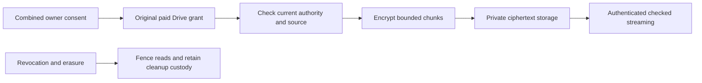

# Additive server-readable One copies

## Visual Map

## Contract

Background copies are version 2 of the existing `document_delivery` family.
They attach to the original Drive request and never create a second request,
checkout, payout denominator or Google permission. Historical requests and the
device-encrypted version 1 delivery contract retain their existing behavior.

The requester explicitly submits `oneCopyRequested=true`,
`activityAccepted=true` and
`activityDisclosureVersion=one-document-activity-v1`. The owner explicitly accepts
server copying with `oneCopyAccepted=true` on the existing Allow action. Existing
OAuth, Trusted membership and historical approvals do not grant copy consent.
New combined requests, including Trusted recipients, wait for the same combined
Allow before either delivery proceeds. Historical and Drive-only Trusted requests
retain automatic sharing.
Drive delivery continues independently when copying is unavailable.

The sharing drain discovers only exact approved bulk files with confirmed
`succeeded` or `preexisting` effects for the original recipient. Current paid
entitlement, relationship, request stop/revoke, owner generation and immutable
source binding are checked before source reads and atomically before publication.
Each binary source requires a frozen provider content identity: size,
modification time and MD5 checksum, plus SHA-256 and head revision when supplied.
Global Drive version is not a content revision: changing an ACL can increment it.
The producer checks source identity before and after reading and verifies the
complete original's checksums. Missing historical identity,
restricted downloads and unsupported Range transport are explicit
unavailable outcomes; they do not change the search's result set.

Google Docs, Sheets and Slides produce labelled PDF, XLSX and PPTX exports,
respectively. They are processing-time snapshots, with stable current provider
version and modification time checked before and after export, and `exportedAt`
recorded. They do not claim the frozen discovery revision's original bytes.
Google's 10 MiB export limit is surfaced as unavailable. A complete export is
hashed before chunking; a resumed export must match that stored representation
hash, so chunks from independently differing exports cannot be combined.

Each file has a random AES-256 key wrapped with the existing
`DRIVE_SHARING_KEY_V1` authenticated envelope. Original bytes are read in bounded
1 MiB ranges, encrypted with unique per-chunk nonces and authenticated request,
file, source and ordinal binding. Each stored frame contains the 12-byte nonce
followed by authenticated ciphertext and its 16-byte tag, including for tiny
files and short final chunks. The encrypted descriptor binds the complete frame
length/hash and the nonce prefix. Only ciphertext enters the existing qualified
private GCS object port. This mode is server-readable; it makes no zero-knowledge
claim. Source metadata, file keys and resulting hashes are encrypted in SQL.
Plaintext never enters logs, SQL or the cleanup inventory.

The object inventory is committed before initiating a resumable write. Its
encrypted session, dispatch marker and immutable generation survive uncertain
writes. A reserved incomplete chunk is not posted again. The existing cleanup
worker reconciles its session and removes the exact recorded object generation.
Active chunks hold cleanup with both a custody flag and PostgreSQL literal
`infinity` scheduling, so a compatible older application also cannot delete them.
Withdrawal or erasure releases both holds. A stale producer cannot publish,
change successor state or schedule deletion after its lease is replaced.
Release guards recognize the v2 reader separately from the historical v1 reader.
The first v2 deployment may retain a v1 baseline, but using it for rollback
requires a known pre-v2 serving API and empty v2 inventory, checked afresh;
any retained request or background cleanup row requires v2 readers. The legacy
intake flag does not fence v2 consent. Once a v2 API is serving, recovery preserves
v2 readers through a forward release rather than restoring an incompatible image.
Revoke, source connection changes, explicit grant expiry and account/request
deletion prevent late publication and future content reads. A request checkout
TTL or bulk receipt-retention deadline does not itself expire a One copy; absent
an explicit access deadline it remains until revoked or erased. Bytes already
delivered to a recipient's device cannot be recalled.

`GET /api/connectors/google_drive/sharing/requests/{id}/one-copy` returns copy
status and file metadata only to the original participants. Before payment the
recipient receives no file metadata. File references, bulk share ID/position and
a validated Open Drive link provide exact joining without filename inference.
Authenticated `/one-copy/files/{ref}/content?disposition=download` streams exact
original or labelled export bytes as `application/octet-stream`, with attachment
disposition, no-store and nosniff. Effective MIME and export labels stay in status
metadata. PDF-only preview is offered up to the existing 4 MiB renderer limit;
preview failure never changes or blocks the downloaded bytes. Each chunk is
entitlement-checked before and after the object read; vault authority is checked
again immediately before response emission. Server events distinguish content
requested from stream completed, without claiming the recipient saved a file.
The owner can read paginated activity after revocation. Events identify owner,
recipient or system role; approximate country is null without trusted ingress
evidence. Source-owner placement and recipient authority are checked around
storage reads and before plaintext emission.

Copying resumes from durable encrypted chunks. Full checksum verification reads
at most four chunks concurrently in hash order. Three exhausted verification
budgets end in explicit unavailable status rather than perpetual preparation;
normal copying slices do not consume verification failures. There is no added
discovery or download size filter, and verification is not an unlimited-size
guarantee: the focused fixture proves an original larger than 4 MiB.
Enrollment excludes ended grants and unsettled or refunded payment authority
before limiting each batch; locked authority is still checked again before
creating a job. Older ineligible requests cannot consume every enrollment slot.

The PostgreSQL owner is `document_delivery`; primary access is request/participant
and file-reference scoped. File/chunk rows grow with actual confirmed deliveries,
not the Drive catalogue. Activity expires after 90 days. Request/account deletion
cascades encrypted source/key records and preserves independent opaque cleanup
custody until deletion is observed. PostgreSQL remains the durable lease and
authority store; a future Redis admission cache may accelerate scheduling but
cannot replace consent, entitlement or publication transactions.

The nearest regressions are `tests/services/test_document_delivery_background.py`
and `tests/services/test_document_delivery_background_exports.py`.
It uses real isolated PostgreSQL and the existing signed-payment flow; only
Google, Stripe session transport and ciphertext storage are synthetic.
