# Agent-assessed Drive request packages

Continuous collection preparation and canonical packet reuse extend this
request workflow; see [continuous Drive packets](./drive-continuous-packets.md).
The live retrieval and 20 KiB excerpt below describe the fallback path; when
packages are enabled, indexed requests can reuse versioned facts and their
original-page evidence.

## User story

Chris asks for all Schwab statements covering September 1–October 9, 2026. The explicitly selected dates narrow the year in his sentence. AgentOne searches Manish's connected Drive, reads candidate contents, and assesses relevance and statement coverage. A recent file edit is never evidence of a recent statement period.

Manish sees the assessed package count, coverage summary and gaps, an agent assessment score, importance from 1–500, and an editable estimated price from $0.50–$500. His decision is **Allow or Deny**. There are no candidate checkboxes in this flow. The estimate is a model suggestion, not an objective market valuation; the assessment score is not a calibrated probability.

Allow binds the package revision, digest, exact selected source versions and edited integer-cent price. All selected batches freeze before checkout. Unrelated, uncertain and unreadable candidates do not silently enter the selected set. No-match and unavailable assessments cannot be purchased.

## Existing components reused

- The Documents manifest owns the Gemini planner and the content/package assessment instructions. No second routing model or independent prompt catalog is introduced.
- Durable owner search provides paginated provider candidates. This is live retrieval, not a new whole-Drive content index. In the Drive worker only, an in-process owner name index (Gear 1, wired in `hushh_mcp/services/drive_owner_index_port.py`) commits name matches in the first worker slice after the create-time Drive page; it holds file metadata in memory only, never content, and Drive stays the completeness authority. `DRIVE_OWNER_INDEX_ENABLED=false` turns it off.
- The package store encrypts per-file evidence on those existing result rows and a compact manifest on the search checkpoint. Original document text exists only during bounded reads/model calls.
- Existing owner review, payment obligations, bulk sharing workers and payout settlement own their established transitions.

## Visual Map

```mermaid
flowchart LR
  R[Request: words + selected dates + revision] --> S[Drive search: generation + completion]
  S --> C[Candidate: stable position + file digest]
  C --> E[Content observation: source version + hash + exact quotes]
  R --> A[Document assessment: include / exclude / uncertain]
  E --> A
  A --> P[Package: exact selected sources + coverage + estimate]
  P --> O[Owner Allow: package digest + edited price]
  O --> F[All selected batches frozen]
  F --> Q[Payment obligation]
  Q --> G[Version-checked exact viewer grant]
  G --> D[Delivery evidence + proportional settlement]
```

Each edge is request-, owner-, recipient-, revision- and connection-bound. Search completion proves candidate pagination completed; it does not prove Google's index contains every relevant file. Coverage completeness is the agent's evidence-based assessment within the retrieved corpus.

## Bounded execution

Each renewable search-result evaluation lease lasts 120 seconds. A worker reads at most six files with concurrency three, runs a bounded assessment, commits encrypted observations, releases the lease, and wakes the existing suggestions worker. Final assembly uses its own lease. Work survives worker restarts.

The content excerpt budget is 20 KiB per document; any truncation is explicit. Unsupported/unreadable files remain accounted for. A final assessment supports at most 120 included or uncertain candidates; exceeding the bound fails visibly rather than dropping candidates. Excluded candidates remain persisted and counted. No fixed request latency is promised: provider pages, file count, extraction, queue delay and model time all contribute.

## Evaluation contract

The executable `consent-protocol/scripts/eval_drive_package_assessment.py` runs 12 independently labeled synthetic cases, normally with three repetitions. It checks selected identities, decisions, actual content periods, abstention and price bounds. Cases cover generic filenames, a recently modified old statement, wrong issuer, incidental mentions, explicit date formats, incomplete retrieval, partial coverage, missing issuer, truncation and document prompt injection.

The report records fixture/manifest hashes, model alias/resolved model where available, failures, precision, recall, and two-stage latency. Failed reports are retained. Self-reported confidence never determines whether a test passes. The suite is a regression gate, not proof of whole-Drive recall or confidence calibration. Calibration requires a separate representative labeled holdout corpus.

## Rollout and compatibility

Migrations `consent-protocol/db/migrations/328_drive_request_packages.sql` and `consent-protocol/db/migrations/329_drive_request_cent_prices.sql` add the package evidence fields and cent-denominated price constraints after the existing direct-message delivery migration 327. The continuous-packet release extends the schema contracts through version 334.

`DRIVE_AGENT_PACKAGES_ENABLED` enrolls new requester-origin live Drive requests.
The October 13 Drive restoration sets it to `false` in UAT: new requests use
owner-first live Drive search and exact-file review, and continuous collection
and packet commerce stop. UAT migration 360 disables existing live collection
processing and packet availability without deleting evidence or payment history.
Other environments also default to `false` unless explicitly enabled. A sealed
`agent_package_required` marker persists the contract of an older request so
disabling enrollment cannot reinterpret its frozen or paid records.

Background preparation still requires the owner's current connected Drive and background permission. Current peer, request revision, expiration and connection generation are rechecked at work boundaries. Owner Allow remains a separate sharing decision.

## Research basis

Google documents separate full-text/name predicates from file creation/modification predicates and exposes paginated candidate results. Its native UI also offers content search and filters; neither document establishes that the API and native UI use identical ranking or natural-language expansion. See [Drive API search](https://developers.google.com/workspace/drive/api/guides/search-files) and [native Drive search](https://support.google.com/drive/answer/2375114).

[Gemini structured output](https://ai.google.dev/gemini-api/docs/structured-output) provides a schema contract; application evidence checks and labeled evals remain necessary for semantic correctness. USD amounts use integer cents and the $0.50 minimum from [Stripe's currency rules](https://docs.stripe.com/currencies#minimum-and-maximum-charge-amounts). The $500 product ceiling and importance scale are product choices, not industry requirements.
