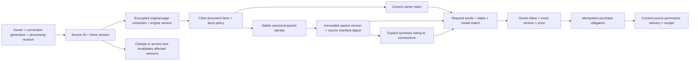

# Continuous Drive preparation and reusable packets

## User story

Manish connects Drive, enables background sync, and explicitly allows document
preparation. His private agent discovers the permitted collection, reads supported
documents, applies OCR to scanned pages, and prepares useful packets. Preparation
does not publish his private documents or approve any buyer.

Chris can ask for Schwab statements from 2026 with September 1–October 9, 2026
selected. Those dates narrow the sentence. Current indexed facts are reused;
the Documents agent evaluates relevance and actual statement periods. Chris can
also browse packet summaries Manish explicitly allows his connections to see.
Choosing a packet fixes its version and starts the existing owner approval flow.

Manish sees who asked, contents, coverage, material gaps and an editable estimate
from $0.50–$500. He chooses **Allow** or **Deny**. He never assembles or labels
the packet. Technical assessment and importance stay under View details.
Checkout and delivery retain the exact approved sources, version and price.

## Visual Map

These are persisted relationships, not a separate graph database. Page evidence,
facts, packet membership, immutable source references, encrypted request terms,
approval records, existing payment orders and delivery receipts own each edge.
Private facts, filenames and manifests stay encrypted. Public database columns
hold identities, versions, operational states and money needed for policy checks.

## Continuous execution and reuse

- Migration 332 adds explicit `live-drive-collection-v1` processing consent and
  encrypted bootstrap/change checkpoints. A Changes start token is obtained
  before discovery. Pages and cursor commit atomically; interrupted pages replay
  safely. Changes update affected files; deleted or inaccessible sources lose
  availability. Legacy background-on preferences do not widen processing consent.
- Migration 333 stores encrypted original-page evidence. Four-page batches resume
  after interruption. Text and scanned pages are accounted separately. Unsupported,
  unreadable, over-budget or partially extracted sources remain visible failures.
- Migration 334 stores document facts, canonical packet heads, immutable versions,
  exact membership and separately allowed listings. Equivalent requests reuse
  current evidence. Catalog requests reuse the exact prepared packet. New source
  versions invalidate affected packets without changing old approval terms.
- UAT's existing documents lane runs every minute with bounded work and prompt
  wakeups. Extraction, discovery, facts and packet construction receive reserved
  slices. No claim of an exact indexing duration is made before a collection runs.
- Status reports distinct discovered, indexed, failed and pending files; initial
  discovery/indexing timestamps, accumulated sync time and per-file indexing time
  remain distinct. Pausing displays freshness and stops further processing.

## Meaning and readiness

The existing Documents manifest owns meaning. Page observations include exact
locations. Document facts remain independent of buyer requests. Canonical grouping
uses issuer, subject/account, type and useful coverage; it does not create every
possible file combination. Request matching evaluates structured dates together
with prose. Filename and modification time never establish a statement period.

Readiness requires complete current evidence, explicit membership, accounted
coverage, and the runtime verifier. Construction and checking resume in bounded
batches; all source batches and a final compact global check must succeed. Scores
are assessments, not calibrated probabilities. Unknown coverage is shown as
Unable to verify; gaps as Incomplete. Provider fallback from an unfinished index
retains that limitation and cannot silently declare complete collection coverage.

## Limits and purchase boundaries

The collection supports source bytes up to 32 MiB and resumable original-page
processing. Large text projections may be limited while full original-page
evidence remains separately available. Model context limits fail explicitly.
The current exact-file purchase flow supports at most 120 documents per packet;
larger packets show the limit and cannot be listed or purchased. Nothing is
silently discarded to fit that limit.

Listing Allow approves summary visibility to current connections. It is not file
access or a buyer's purchase approval. Each buyer requires the existing exact
packet Allow/Deny. Different client retry IDs for the same buyer and packet
resume an existing active purchase flow under transaction locks. Source version,
recipient, permissions and existing access are rechecked before payment and by
the permission workers. Verified access to every approved file completes with
existing-access receipts and no charge. Partial or uncertain existing access
pauses checkout; automatic repricing of overlapping ownership is not implemented.
An in-flight checkout is never silently cancelled. Prior purchases never authorize
a new buyer.

## Evaluation and rollout

`tests/fixtures/drive_pipeline_eval` contains original synthetic PDFs and labels
written independently of model output. The runner counts errors/timeouts and
reports precision, recall, packet correctness, coverage, evaluator agreement,
pricing ranges, latency and cost when observed. Extraction-only runs cannot pass
the pipeline gate. Fixture discovery is not evidence about Google recall.
Provider grants and charges are not made by evaluation. Simulated delivery tests
must be distinguished from a buyer's observed receipt.

99.9% precision and Ready packet correctness remain targets. A fixed representative
holdout needs at least 2,995 independent error-free packet trials for a one-sided
95% lower bound of 99.9%; repeated small synthetic cases do not provide that
evidence. Pricing is assessed against separately authored acceptable ranges,
not claimed as a universal market price or 99.9% accurate estimate.

### Observed development results (October 13, 2026)

The actual worker model, `gemini-3.6-flash`, completed five original-PDF
regression requests: 5/5 packet decisions, 5/5 coverage decisions, 5/5 checker
decisions and 4/4 relevant selected documents; 18/19 extracted fact labels matched.
Request latency was p50 13.943 seconds and p95 20.791 seconds. Model token cost was
not observed. Provider/schema failures from earlier attempts were retained. These
cases informed fixes and are now regression data, not an untouched holdout.
They do not measure Google discovery recall or prove real buyer delivery.

A separate 110-page image-only PDF completed local OCR in 14.242 seconds,
with 110/110 pages and no missing pages over 28 resumable batches. This excludes
download, queueing, database writes and semantic model processing; it is not
whole-Drive indexing time. Real collection counts and timing come from status.

A fresh representative independently labeled holdout, authorized real-collection
validation and observed buyer delivery remain required before quality target
claims. No customer charge or Google permission grant was made for these evals.

Roll back with the registered migration rollback scripts and the prior images.
Disable processing/listings while retaining encrypted immutable purchase terms.
Do not reinterpret historical approvals. Production scheduler timing is unchanged.

## Primary references

- [Google Drive change tracking](https://developers.google.com/workspace/drive/api/guides/manage-changes)
- [Drive Changes list](https://developers.google.com/workspace/drive/api/reference/rest/v3/changes/list)
- [Drive search](https://developers.google.com/workspace/drive/api/guides/search-files)
- [Native Drive search](https://support.google.com/drive/answer/2375114)
- [Gemini structured output limits](https://ai.google.dev/gemini-api/docs/structured-output)
- [NIST exact binomial intervals](https://www.itl.nist.gov/div898/handbook/prc/section2/prc241.htm)
- [Stripe idempotency](https://docs.stripe.com/api/idempotent_requests)

Native Drive UI and API search ranking are not assumed identical. This release's
document facts and content-period checks are the private agent's own processing path.
