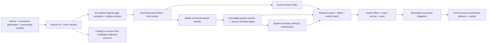

# Continuous Drive preparation and reusable packets

## User story

Manish connects Drive with background sync on. Packet preparation defaults on;
an explicitly saved Off setting stays off, including after reconnect. Agent One
discovers the permitted collection, reads supported
documents, applies OCR to scanned pages, and prepares useful packets. Preparation
does not publish his private documents or approve any buyer.

Chris can ask for Schwab statements from 2026 with September 1–October 9, 2026
selected. Those dates narrow the sentence. Current indexed facts are reused;
the Documents agent evaluates relevance and actual statement periods. Chris can
also browse packet summaries Manish explicitly allows his connections to see.
Choosing a packet fixes its version and starts the existing owner approval flow.

Manish sees who asked, contents, coverage, material gaps and an editable estimate
from $0.50–$500. He chooses **Allow** or **Deny**. He never assembles or labels
the packet. Technical assessment and importance stay under View details.
Checkout and delivery retain the exact approved sources, version and price.

### V1 request-search bridge

Brokerage-statement requests, including Chris's two recorded wordings, use a
bounded deterministic search plan instead of calling the Gemini query planner.
New non-catalog statement requests take this V1 path even when package enrollment
is enabled for other topics. The owner must still select exact file candidates;
the Allow/Deny-only verified statement packet belongs to V2.
The selected dates describe statement coverage, so Drive creation/modification
timestamps cannot qualify a file. Search first asks Drive for all stated concepts,
then pages through a broader union query; the result rows are unverified candidates,
not verified statements. The old all-words-in-filename gate does not discard
document-coverage candidates. A legacy automatic checkout waits for the complete
frozen selection and checks the buyer's current access before opening Stripe.
Unfrozen saved one-query statement jobs are retried with this plan, including
completed jobs when the owner opens review; frozen approvals and paid history
keep their original file set. Statement requests
cannot take the old trusted automatic sharing path while they await review.
This bridge does not certify a statement's content period or whole-Drive recall;
the indexed facts and packet verifier below own those claims.

### Request dates

One's `one_document_period` gene assesses authenticated request text independently
before the document-request card is built. It has no tools or document access.
The gene cites exact quotations; the host locates each quote uniquely within its
declared user message and validates calendar bounds and any supplied candidate
dates. The model does not calculate character offsets. Absolute dates need no
clock. Relative dates need a host clock
bound to this invocation and message; a UTC fallback cannot authorize a range.
An explicit current-message IANA timezone can apply to this read without changing
saved preferences. The gene still checks that the timezone expresses the request.

A clarification retains bounded original text only for the immediately following
user turn in the same conversation, for the same resolved person. The next answer
must supply current evidence; replacement requests discard superseded details.
Once a question is determined, the host returns it directly without another model
call. The question is bound to the authenticated owner, session, invocation and
current text; a repeated tool call cannot overwrite its continuation context.
Stop still takes precedence, and queued answers remain available for the next turn.
Missing clock authority has a typed recovery: fetch the current clock or ask for
the timezone, without accepting the assessor's unsupported relative date bounds.
Model failure produces no card. These provenance checks do not prove semantic
correctness: model replay separately grades date decisions, visible questions,
follow-up handling, failures and the additional assessment latency.

## Visual Map

These are persisted relationships, not a separate graph database. Page evidence,
facts, packet membership, immutable source references, encrypted request terms,
approval records, existing payment orders and delivery receipts own each edge.
Private facts, filenames and manifests stay encrypted. Public database columns
hold identities, versions, operational states and money needed for policy checks.

## Continuous execution and reuse

- Migration 332 adds explicit `live-drive-collection-v1` processing consent and
  encrypted bootstrap/change checkpoints. A Changes start token is obtained
  before discovery. Pages and cursor commit atomically; interrupted pages replay
  safely. Changes update affected files; deleted or inaccessible sources lose
  availability. Migration 335 preserves saved preparation settings across
  reconnects. The worker adopts the default-on setting in bounded batches for
  verified connections whose background access is enabled. Existing saved
  preparation Off and background Off settings are preserved; this default does
  not create a historical terms-acceptance or publication event.
- Migration 333 stores encrypted original-page evidence. Four-page batches resume
  after interruption. Text and scanned pages are accounted separately. Unsupported,
  unreadable, over-budget or partially extracted sources remain visible failures.
  Tall pages use bounded adaptive render resolution before OCR. The render
  policy is recorded per page; previously failed pages require targeted retry.
  A successfully rendered page still needs usable extraction and semantic checks.
- Migration 334 stores document facts, canonical packet heads, immutable versions,
  exact membership and separately allowed listings. Equivalent requests reuse
  current evidence. Catalog requests reuse the exact prepared packet. New source
  versions invalidate affected packets without changing old approval terms.
  During rolling policy upgrades, bounded reconciliation replays completed
  current-policy facts into membership if a retired worker finishes late. It
  preserves the immutable facts, rejects stale sources, and does no work when
  membership is already current.
- UAT's existing documents lane runs every minute with bounded work and prompt
  wakeups, and obeys its deadline. Each drain keeps 12 extraction and 2
  discovery jobs. Facts and packet construction run in their own slots beside
  them: `DRIVE_SEMANTIC_SLOTS` per worker process (default 12; a fixed 6
  before). At most `DRIVE_PACKET_SLOTS` (default 3) build packets, one per owner
  with a build due; a slot with no build due runs facts. Facts go to the least
  recently served owners first, one each, then extra jobs to owners with more
  work, up to `DRIVE_FACTS_OWNER_LEASES` (default 4) running jobs per owner
  across instances, never two on one document. These jobs wait on the model and
  use the worker's one database connection only for short transactions. An
  invalid value reads as 1; the lane still keeps one facts and one packet slot.
  Unused semantic capacity can advance further work in the same drain. No claim
  of an exact indexing duration is made before a collection runs.
- A bounded internal target API can register up to 50 live provider candidates
  and prioritize their ordinary extraction and facts jobs. It rechecks current
  owner authority and metadata, preserves discovery cursor and lease, and reuses
  valid extraction. Its first consumer is operator evaluation; scheduled FIFO
  does not yet select targets by predicted semantic value. Callers cannot supply
  document facts or bypass source/version/permission checks.
- Status reports distinct discovered, indexed, failed and pending files; initial
  discovery/indexing timestamps, accumulated sync time and per-file indexing time
  remain distinct. Pausing displays freshness and stops further processing.

## Meaning and readiness

The existing Documents manifest owns meaning. Page observations include exact
locations. Document facts remain independent of buyer requests. Canonical grouping
uses issuer, subject/account, type and useful coverage; it does not create every
possible file combination. Request matching evaluates structured dates together
with prose. Filename and modification time never establish a statement period.
Source facts distinguish reporting coverage from event, publication, scheduled
action, transaction and as-of dates. Packet checks retain those roles through
construction, compact final review and indexed request reuse. Drafts and other
useful undated documents can form a packet with no coverage-period claim; an
event date does not become a posting schedule or financial reporting interval.
Record status is also explicit, cited evidence. A document's assertion that it
was signed is distinct from completion evidence; typed signature placeholders
and drafting instructions cannot establish execution. The model preserves
draft, sample, request and pending qualifications through facts, canonical
context, packet descriptions and pricing. The final checker receives the cited
status and must explicitly assess it. A truthfully described draft may be Ready;
readiness does not make its described transaction or legal act completed.

Private packets are built progressively from available current facts; unrelated
files do not have to finish indexing first. Packet content readiness and purchase
availability are separate. A private packet can have verified content while the
initial collection scan is unfinished; it remains unavailable for listing until
provider enumeration has finished, change sync is fresh, and source/access checks
pass. Unrelated pending extraction does not block a verified packet after that
provider checkpoint. This does not establish
whole-collection recall or absence of undiscovered documents.

Readiness requires complete current evidence, explicit membership, accounted
coverage, and the runtime verifier. Construction and checking resume in bounded
batches; all source batches and a final compact global check must succeed. Scores
are assessments, not calibrated probabilities. Unknown coverage is shown as
Unable to verify; gaps as Incomplete. Provider fallback from an unfinished index
retains that limitation and cannot silently declare complete collection coverage.

Invalid dates, malformed output and unsupported quotations produce explicit
validation codes. The model gets one bounded retry with the original evidence
and field/page feedback. Host validation never invents replacement quotations
or silently converts invalid facts into valid ones. Exhausted retries remain
visible failures; policy upgrades can retry earlier failed facts. Model schema
validity and independently assessed factual correctness are separate measures.

For document facts, the model selects source-span references; the host resolves
them to exact supplied text and locations. Every page remains accounted for.
Packet construction must select or explicitly explain every supplied candidate,
including candidates retained from earlier batches. Duplicate exclusions point
to a selected document, and unresolved exclusions prevent Ready. The verifier
checks these explanations against the original group and substantive facts;
changing the title to a narrower period cannot excuse dropping a relevant month.
The final database commit checks the exact candidate set again. Evidence that
exceeds the bounded final-check context fails visibly instead of being truncated.

## Limits and purchase boundaries

The collection supports source bytes up to 32 MiB and resumable original-page
processing. Large text projections may be limited while full original-page
evidence remains separately available. Model context limits fail explicitly.
The current exact-file purchase flow supports at most 120 documents per packet;
larger packets show the limit and cannot be listed or purchased. Nothing is
silently discarded to fit that limit.

Listing Allow approves summary visibility to current connections. It is not file
access or a buyer's purchase approval. Each buyer requires the existing exact
packet Allow/Deny. Different client retry IDs for the same buyer and packet
resume an existing active purchase flow under transaction locks. Source version,
recipient, permissions and existing access are rechecked before payment and by
the permission workers. Verified access to every approved file completes with
existing-access receipts and no charge. Partial or uncertain existing access
pauses checkout; automatic repricing of overlapping ownership is not implemented.
An in-flight checkout is never silently cancelled. Prior purchases never authorize
a new buyer.

## Evaluation and rollout

`tests/fixtures/drive_pipeline_eval` contains original synthetic PDFs and labels
written independently of model output. The runner counts errors/timeouts and
reports precision, recall, packet correctness, coverage, evaluator agreement,
pricing ranges, latency and cost when observed. Extraction-only runs cannot pass
the pipeline gate. Fixture discovery is not evidence about Google recall.
Provider grants and charges are not made by evaluation. Simulated delivery tests
must be distinguished from a buyer's observed receipt.

99.9% precision and Ready packet correctness remain targets. A fixed representative
holdout needs at least 2,995 independent error-free packet trials for a one-sided
95% lower bound of 99.9%; repeated small synthetic cases do not provide that
evidence. Pricing is assessed against separately authored acceptable ranges,
not claimed as a universal market price or 99.9% accurate estimate.

### Authorized original-document evaluation

Preserve source metadata, connection generation, original-byte digests, extraction
receipts, page coverage, the model/prompt/facts-policy version and every failed
attempt. Independent reviewers label the original documents before seeing model
outputs. Agent-authored reference judgments are identified as such and are not
human gold labels. Compare schema completion, factual accuracy, packet membership
and coverage separately; unresolved judgments and pipeline failures stay in the
denominator. A development sample used to repair prompts is not a holdout.

The private evidence graph links each source receipt to its original bytes,
extracted pages, frozen model attempt, independent reference and semantic review.
References use file digests and JSON pointers so another authorized reviewer can
reproduce each connection. Actual persisted packet versions belong in this graph
only when their database receipts have been observed. Approval, purchase and
delivery remain explicitly unobserved until corresponding receipts exist.
Do not infer them from packet creation or a simulated test.

Real-document reports and titles stay outside the repository. Freeze each run
before corrections and append separately identified replays; never overwrite a
failed baseline with a later passing result. Whole-Drive counts and initial or
incremental indexing time come from live collection status, not sample timings.

The retained v4 development replay completed 24 Drive file records representing
22 unique byte originals. Independent agent-authored core-field labels passed
for 21 and failed for three; exact source
citations passed for all 24. A 208-page original completed in 913.402 seconds over
136 model calls. The short-document packet replay produced nine independently
correct Ready groups out of 16 proposed groups, two nonready groups and five
validation failures; six originals had no proposed canonical packet. These are
different denominators, and neither result proves the 99.9% target or delivery.

The first audit of actual saved v4 packets found three Ready versions with
correct membership, but only two with correct packet claims: a social-post draft
incorrectly used the advertised event dates as document coverage. Seven empty
historical versions also occurred. Those failed attempts are retained. Empty
heads are now retired and zero-document versions are hidden from the catalog;
immutable audit and purchase records are preserved. The v5 date-role replay is
recorded separately and must not replace or relabel the failed v4 baseline.

The actual v5 financial-packet audit then found four supported Ready packet
claims out of five: one draft was incorrectly described as executed. That
failed version remains in the private evidence graph. The v6 contract adds
cited record status and an explicit status check to current model responses,
while retaining historical manifest readability. Independent original-source
replays must assess whether the semantic error is corrected; a new field or a
passing structural test alone does not establish that result.

### Earlier development results (October 13, 2026)

The actual worker model, `gemini-3.6-flash`, completed nine original-PDF
regression requests over 13 unique synthetic PDFs. The original expanded run
recorded 8/8 relevant selected-document observations, 5/5 correct Ready packets,
9/9 checker decisions, and 73/75 matching fact labels. Overall packet and coverage
grading was 8/9. Request latency was p50 13.309 seconds and p95 27.711 seconds.
Model token cost was not observed.

The one coverage grading failure compared a correct explanatory gap sentence
with an ISO date-pair reference. A targeted replay correctly selected September's
statement, reported Incomplete, and identified October 1–9 as missing. The adapter
now serializes a single explicit, valid ISO gap range before exact comparison;
unparseable or ambiguous claims and wrong dates still fail. That captured replay
passes after offline regrading. The original nine grades remain unchanged;
this correction is separate evidence, not a replacement 9/9 claim.

The two original fact mismatches concern document-type labels on injected-note
PDFs. Both documents were correctly excluded. Their original raw labels were not
retained, so they are not dismissed as spelling differences; a targeted diagnostic
returned "meeting notes" for one and no document type for the other. Earlier
provider/schema failures and the original expanded failure report are retained.
These cases informed fixes and are development regression data, not an untouched
holdout. They do not measure Google discovery recall or prove real buyer delivery.

A separate 110-page image-only PDF completed local OCR in 14.242 seconds,
with 110/110 pages and no missing pages over 28 resumable batches. This excludes
download, queueing, database writes and semantic model processing; it is not
whole-Drive indexing time. Real collection counts and timing come from status.

A fresh representative independently labeled holdout, authorized real-collection
validation and observed buyer delivery remain required before quality target
claims. No customer charge or Google permission grant was made for these evals.

Roll back with the registered migration rollback scripts and the prior images.
Disable processing/listings while retaining encrypted immutable purchase terms.
Do not reinterpret historical approvals. Production scheduler timing is unchanged.

## Primary references

- [Google Drive change tracking](https://developers.google.com/workspace/drive/api/guides/manage-changes)
- [Drive Changes list](https://developers.google.com/workspace/drive/api/reference/rest/v3/changes/list)
- [Drive search](https://developers.google.com/workspace/drive/api/guides/search-files)
- [Native Drive search](https://support.google.com/drive/answer/2375114)
- [Gemini structured output limits](https://ai.google.dev/gemini-api/docs/structured-output)
- [NIST exact binomial intervals](https://www.itl.nist.gov/div898/handbook/prc/section2/prc241.htm)
- [Stripe idempotency](https://docs.stripe.com/api/idempotent_requests)

Native Drive UI and API search ranking are not assumed identical. This release's
document facts and content-period checks are the private agent's own processing path.

## UAT Drive search-match delivery (policy v2)

New requester-origin UAT automatic requests seal semantic-search policy version
2. Azure remains the centrally managed query planner; the complete supported
expression compiles to Drive `q`. Every unique in-scope, in-period provider
match can enter the existing payment/owner-authorized sharing queue. This mode
does not download document bodies, run OCR, or invoke per-file relevance
assessment. Media originals need no extraction parser to share. Results carry
`discoveryEvidence` under `drive_query_matches_v1`, never fabricated
`contentVerified`, citations or model confidence. Operational logs record the
policy and intentionally inapplicable assessment stage without private names.

The compiler retains every conjunction and negation, uses the authored literal
values rather than broad discovery aliases, and does not expand unrelated
folder descendants. Full provider pagination and file-ID deduplication remain
bounded and resumable. Explicit created/modified dates are pushed to Drive with
timezone-correct half-open bounds; default filename/created/modified precedence
remains a metadata filter, since a timestamp-only pushdown could lose valid
filename-dated records. Current metadata dates and sharing capability are
rechecked before a grant. A search hit is not proof that current file contents
remain unchanged. Content-period proof and account-relationship queries need
clarification instead of silent scope widening under this mode.

The frozen metadata period belongs only to the file inspection call. Permission
listing and Reader creation receive their own unchanged credential, resource-key
and current-authority arguments; inspection-only options never reach those
methods. The worker regression uses the real adapter signatures and verifies
both existing access without a new grant and one confirmed new grant, alongside
changed-source and forged-evidence refusals.

Version 1 requests, already queued checkpoints, packages and completed sharing
history keep their frozen contracts. This rollout does not replay old requests,
charge again, or reinterpret the historical 79-file candidate set. New requests
use v2 automatically for both existing and new UAT accounts. Rollback disables
new semantic enrollment; already sealed policies retain their own validation.
Production, voice, BYOK and content-analysis features are unchanged.

## Activity-date search-match delivery (policy v4)

New enrolled UAT requests use semantic plan v2 and `drive_activity_union_v1`.
One centrally configured managed planner interprets the request. The authored
instruction selects core-name tokens and flags eligible unquoted personal names;
the deterministic compiler freezes a primary query and, only for flagged positive entity-token groups,
one sparse fallback. The first primary page arms that fallback only below three
validated distinct rows, before date filtering. Primary retrieval still exhausts
all enabled corpora; each query has its own cursor and global file-ID deduplication.
There is no per-file model, content download, OCR, index or revision scan.

For the ordinary selected period, retrieval does not push a created/modified-only
restriction into Drive. Before results and continuation are atomically committed,
the deterministic gate accepts any returned created, modified, modified-by-me,
shared-with-me, viewed-by-me, photo-capture or explicit filename date in range.
These are different file events, not evidence of document coverage. Calendar days
are inclusive in the request timezone; a timezone-free photo uses its recorded
calendar day. Month/year filename intervals overlap the range; bare years require
the entire year. Ambiguous numeric dates use per-file captured creation/modification
anchors only under the documented 14-day/20-day thresholds, otherwise their union.
Explicit created-only and modified-only requests retain that restriction.
Qualifying evidence is frozen at discovery, not recomputed after a grant.

The durable scanner retains the 10,000-result and 1,000-page limits and resumes
across worker slices. Coverage separates scanned, date-excluded, deduplicated,
retained and delivered counts and reports partial coverage honestly. Existing
payment authority and progressive 25-file sharing batches remain independent.
Fresh My Drive inspections can reuse an explicitly complete, validated ACL;
missing/unusable or shared-drive ACLs still require permission listing. Existing
access remains distinguishable from app-created access. Uncertain writes use
GET-only reconciliation, never automatic reposting.

Migrations 439–440 add shared owner REST admission (at most ten start admissions
per second and eight concurrent calls, respecting lower configured limits),
owner-wide quota cooldown and common same-file claims. Ordinary worker slices
process at most 250 effects. Quota refusals have a separate six-attempt budget:
5 minutes, 30 minutes, 2 hours, 6 hours, then the first-refusal-plus-24-hour boundary.
Fresh retry times are clipped to request/access expiry. This is application
recovery policy, not a promised Google quota reset. Stop/removal and uncertain-write
reconciliation remain available during cooldown and policy pause.

Before enabling fresh mutators after migration, run
`consent-protocol/scripts/adopt_drive_permission_file_claims.py` in the target
runtime against its own database. It adopts existing uncertain effects from
sealed evidence without provider I/O and refuses incomplete adoption. Migration 440 rejects a dispatch transition without its keyed claim, including
transitions attempted by old workers. Dev/UAT migration steps run adoption before
new writers; the global unclaimed-uncertainty fence blocks fresh claims until
adoption completes. No old worker can start another unclaimed write after that
database fence is installed.

Binary copies ignore timestamp-only drift, including MD5-only historical source
identities, while preserving source binding, checksums, size and final byte
integrity. Native documents retain processing-time export-byte integrity rather
than treating global metadata version/time changes as content corruption.
Search membership, permission outcomes and copy outcomes remain distinct.
Erased jobs, payments and permissions are never reconstructed by this rollout.

`DRIVE_REQUEST_ACTIVITY_UNION_ENABLED=false` stops new policy-4 enrollment;
`DRIVE_REQUEST_ACTIVITY_UNION_PAUSED=true` pauses saved policy-4 planning, search,
fresh grants and copy production while preserving cleanup and reconciliation.
Policies 1–3 retain their saved contracts and semantic-plan-v1 digests. The
existing governed UAT workflow forwards repository variables
`DRIVE_REQUEST_ACTIVITY_UNION_UAT_ENABLED` (default true) and
`DRIVE_REQUEST_ACTIVITY_UNION_UAT_PAUSED` (default false) to the API and both
worker revisions, whose controls are attested before promotion. Configuration-only
rollback uses the same approved SHA with a justified backend scope; it does not
change consent or erase receipts. Query-planner prompt edits preserve the deployed
facts-policy fingerprint while unchanged facts instructions/schema/model/profile
remain pinned, preventing unrelated extraction work.

Detailed timeline logs are enabled in verified Dev/UAT/test, including optimized
UAT builds. Production and unknown/conflicting deployment identity suppress
verbose logs before payload projection; required sanitized warnings/errors remain.
Filter browser logs with `[DRIVE_REQUEST]` and server logs with `drive_rest.call`,
`drive_copy.step` and `drive_bulk_share.retry`. Correlated tags expose stages,
counts, fixed reasons, next retry times and elapsed time, never private queries,
filenames or credentials. The existing owner-authenticated request search GET
provides bounded exact frozen queries, digests, fallback state and date policy;
existing result pages expose frozen per-file date evidence. Requester/feed and
ordinary status/SSE projections do not carry these private diagnostics.

## Fixed financial period packets

Financial period preparation uses the product-authored `financial-records-v1`
query template, not Azure planning. Custom requests and other existing category
plans retain their own provider contracts. The exact literal OR template is in
`drive_financial_packet_query.py`; its bounded descriptor, actual query digest,
`query_source=predefined`, template version and `planner_executed=false` travel
through encrypted search checkpoints and any new frozen sale manifest.

For an eligible connected owner, preparation enrolls current-year two-month
periods, current first. Missing background preference defaults on; explicit Off,
revoked scopes and owner placement still fence all processing. Successful live
Drive verification enrolls new connections; the bounded existing worker enrolls
existing owners. The bounded enrollment scan advances an opaque-owner inspection
timestamp for refused placements, without touching OAuth freshness or reading
their files, so an ineligible prefix cannot pin eligible owners behind it.
Reopening an open preview older than five minutes requests a
refresh; completed open previews refresh daily. GET polling only reads saved
state. Date placement remains title date, else creation date, else modification
date; this is not proof of a statement's coverage period. There is no new index,
Drive folder, shortcut, move, delete or per-file cloud relevance assessment.

The search saves each page, deduplicates by Drive ID and immediately exposes all
original links through owner paging. The owner prepare response returns after
the first saved matched page; the same durable job continues the remaining pages.
Its bounded scheduler wake runs concurrently within the request, never detached.
Two owners can advance independently; a
slice can promptly continue within its existing page/deadline budget. Ordinary
requests retain priority. The same coordinator separately claims up to eight
saved candidates for local organizing; discovery never awaits it. Prefix reads
and the first 400 extracted characters use the existing Parth classifier and
pinned E5 adapter without threshold changes. Exact-source compatible cached
placements are reused, including owner corrections. Unsupported/unreadable
prefixes remain Needs review, other groups remain Other matches, and originals
are never discarded. A source version change cannot yield a current label.

Migration 416 adds the candidate-work scheduling fields and an advisory query
version for bounded legacy recovery. Unfrozen old-model preparations rotate only
after their live lease ends, recording the migration and retaining the previous
usable preview while the replacement starts. Completed sale versions and purchase
history are not rewritten; their existing owner results can be organized without
relabeling their historical query source. Expired unreferenced preview jobs are
collected in bounded batches; the current source job and retained previous-preview
job remain available beyond the temporary search TTL. Failed processing reports
its state instead of implying an empty Drive response. Owner search status stays
independent of sale readiness or availability.

Frozen legacy financial periods in the current year also receive a separate
`financial-records-v1` owner preview through the same bounded queue. Its encrypted
preparation records the frozen version it accompanies and a fresh discovery
revision; the old originals remain pageable while replacement work is pending.
Completion saves owner results independently of the older sale. A narrow
exception recovers an unavailable, empty financial sale when a newer complete
current-template search contains eligible originals. The existing period worker
admits already saved results without a UI visit or another provider read. It
requires the current owner and connection generation, a valid head lease, a
search begun after the period closed, complete query provenance, at most 120
discovery matches, and no request referencing the packet in any state. Every
selected original must retain affirmative sharing capability and a source
version; denied or unknown capability never becomes permission to share.

The same freeze writer verifies the old empty manifest's digest, appends the next
immutable version containing only eligible originals, and advances the head
atomically. It preserves the old version and listing byte for byte. For example,
51 discovery matches with four eligible originals produce a new sale count of
four, while the public discovery count remains 51. Nonempty versions and all
referenced packets are refused. Existing request bindings, prices, listings and
the owner's independent summary visibility choice are never transferred or
rewritten. The new version has no enabled listing until the existing listing
authority permits it; approval, payment and delivery gates still apply.

Migration 429 adds `sale_finalization_revision` to the existing packet head. It
records one finalization evaluation per discovery revision, including an
all-denied or unknown result that creates no new version, so unchanged evidence
does not spin the queue. A later explicit or scheduled discovery revision can
be evaluated independently. The receipt is owner/generation-fenced workflow
metadata, follows packet erasure and retention, and stores no source details.
Rollback removes only this additive receipt after the application is rolled
back; appended versions, listings and request history remain intact. Earlier
years are not automatically requeried. A legacy result does not count as current
preset coverage until the new preview's own provider search completes.
Before that preparation starts, owner preview reads label retained legacy links
as stale, with an unknown current match count and no completed preset scan;
reading or paging those links does not initiate preparation. Public discovery
counts can advance independently; `saleDocumentCount` continues to describe the
exact immutable sale version. Scalar summaries default ON under one owner
visibility preference and preserve recorded OFF choices; see
[the owning contract](../../../docs/reference/one/drive-public-financial-summary.md).

Tags live only in encrypted owner period-search metadata and bounded build
progress. They grant no listing, consent, payment or sharing authority and never
alter discovery proof or immutable purchase manifests. Code rollback retains the
additive queue columns and saved results; disable period preparation and let
owned leases drain before reverting the runtime. Synthetic loop timings prove
the fixture execution, not real Google Drive latency or personal-account recall.
After empty-sale recovery appends version two or later, retain the compatible
web parser during a backend rollback. Older web bundles accept only version one
and cannot render the repaired catalog; an old full-stack image is therefore
not a safe rollback target after that first append. Immutable versions must not
be deleted or relabeled to force compatibility.

Private connections listings remain current authority for new purchase effects
after the owner's exact-version Allow. Checkout, pending permission dispatch and
new existing-access completion recheck the sealed packet identity and manifest
digest against the current available version and enabled listing. Withdrawing
that listing or superseding the version stops those new effects. A price edit
does not reprice an already approved quote. Public summary visibility is separate
metadata authority and grants neither checkout nor original-file access.
Completed charges, grants and no-charge receipts retain their history and
idempotent replay; an uncertain provider write still uses its original read-only
reconciliation path, rather than issuing a new grant or charge. Exact server-bound
undated packets reuse the existing document-scope exception; ordinary requests
still require their date window.
