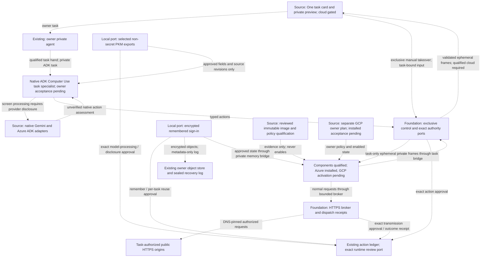

# Private browser runtime

## Visual Context

Use the [Founder/CTO diagram guide](../../../docs/reference/architecture/README.md#founder-and-cto-diagram-guide)
and [private-agent runtime map](../../../docs/reference/architecture/private-agent-north-star.md)
for the owner, hub and cloud boundary. This reference owns the Browser execution
mode, exact qualification and installed-journey evidence.

## Status and evidence

**25 October 2026, 19:45 UTC — both clouds have exact-image component evidence;
Azure owner installation and one Puppy response are verified. Installed Browser
journeys remain open.**

[Browser repair #8451](https://github.com/hushh-labs/hushh-research/pull/8451)
landed as `9174abfbe594`; [publication #8457](https://github.com/hushh-labs/hushh-research/pull/8457)
retains that executable. Continuity corrections
[#8459](https://github.com/hushh-labs/hushh-research/pull/8459) landed as `2a74d28cd0`
with exact hosted CI and landed smoke. Dev's subsequent deployment currently targets
`5ad9ef542d`; final cleanup activation and the newer application remain unaccepted.
The exact pod image is
`sha256:6e57f251081954e207311c5c2b8b44b36fa49caaf639518d370060039eeac423`.

One and Browser share one non-root owner container and lifecycle. GCP Cloud Run
retains Chromium's sandbox; Azure Container Apps explicitly disables it. The whole
owner pod is the compromise boundary. Broker and consent checks constrain normal
operations, not compromised code. No separate Browser service, VM or keepalive.

Both native component probes pass model-directed page observation, responsive
390×844 control, manual login with zero model observations, encrypted remember,
new-task restore, logout rejection, Forget, one reviewed save and joined Stop.
GCP uses `gemini-3.7-flash` and its native ADK integration; Azure uses
`AzureBrowserAdkModel` with the actual owner's `one-chat` deployment, backed by
GPT-5.6 Luna. There is no provider fallback. These probes use synthetic exact
consent and a local encrypted store; actual owner approval, active-task HTTP
control, reconnect and owner-cloud session recovery remain separate acceptance.

The reviewed interactive policy is limited to the controlled HTTPS fixture.
It is not broad website qualification. The fixture is temporary; expiry returns
unavailability rather than expanding destinations. Authenticated GitHub, selected
PKM disclosure and Browser-to-Files retain their own acceptance requirements.

Fresh synthetic recovery from installed digests `26bab163…c061809` and
`8b846022…68ac07` preserves identity, six encrypted records, consent, revocation
and 245,763 exact file bytes. Disposable compute, grants, active objects, copied
images and Azure deleted vault were removed and read back. GCP's seven-day
soft-delete retention remains explicit. This proves format recovery, not a normal
active-work drain. Azure's exact owner-approved Dev 30 update is verified; GCP
still serves its predecessor while the approved Files operation is reconciled.
Its completed bootstrap checkpoints do not establish image handoff; preserve the
held operation and do not replay the exhausted queue continuation.

The preceding `c26fd848…401c5b3` image failed login redirect continuity after the
POST succeeded. The corrected executor joins only explicit Chromium successor
requests under their original scope, refuses unknown parents, waits for final
navigation and closes on cancellation. Its delayed-redirect negative control fails
on the old code. Historical failures remain evidence and cannot qualify new images.
The [readiness memo](../../../docs/reference/quality/adk-orchestration-docs-audit.md)
separates source, application deployment and installed-owner results.

## Historical component evidence

The same immutable qualification image
`sha256:b48f66b6db71f845a23882c2ff6a8480a8057a4af9e4d518507098b32fbf24a4`
produced two real documentation/search frames on both services at 1 vCPU / 2 GiB.
Both documents returned HTTP 200. Joined Stop and supervisor exit zero passed;
disposable services/resource groups and temporary GCP repository grants were
removed and read back. Browser initialization was 7.145 seconds on GCP and 1.555
seconds on Azure. These individual component samples exclude cloud startup and
model execution; they are not capacity or installed-owner acceptance.

The preceding image `sha256:073b36655e49c369119ab7bfa33a5706437008dd8c574d380478eb10b8570ad4`
rendered successfully but failed bridge-close confirmation on both hosts. Its
original failure remains evidence. The repaired transport accepts only peer reset
or broken pipe after local handlers join; process-tree termination is independently
confirmed. Receipt version 2 records this shared boundary and exact sandbox mode.
Version 1 receipts retain their historical isolation meaning.

Startup, native ADK task execution, exact reviews, dispatch journaling, owner
control and encrypted remembered-session storage have source implementations.
The selected-information loader now retrieves only existing V2 exports for the
current pod recipient. Exact owner/app/grant, source revisions, expiry and
revocation are checked; decryption remains inside the pod. Missing grants refuse.
It does not create a grant or turn the replica into unrestricted context.

Browser work reuses the installed Files Cloud Tasks/Storage Queue transport and
its existing erasure inventory, under explicit `owner_files_queue_v1` approval.
One serial background consumer holds admitted work; queued Browser/Files work can
wait behind a fifteen-minute task. Publication is joined and identifier-only;
duplicates attach once, and replacement processes report interruption without
reconstructing a goal. Azure activation has its own typed configuration plan and
dev-only migration 970. GCP checks the live queue, worker incarnation and exact IAM
before drain and replacement. Existing timeout is preserved or an explicitly
approved request timeout supports the bounded Browser delivery.

The broker captures one ordinary HTTP attachment up to 4 MiB in pod memory.
**Save to Files** needs current Browser control and Files read/manage authority;
immutable bytes and destination are idempotent and decrypted readback verifies
SHA-256. Stop joins an admitted save; unsaved bytes and offers do not survive
restart. Blob/data downloads, large streams and multiple attachments are not
qualified. Session, interactive-policy, information and transfer joins still
need installed acceptance. No receipt or environment flag alone enables them.
Reconnect discovers existing work and uncertain outcomes; it never resubmits a
goal. Stop retains update admission until joined shutdown and sealed settlement.

The installed Azure attempt reached an uncertain outcome during active takeover;
it does not qualify direct control, login or reconnect. Its sampled working-set
peak was 873,693,184 bytes of 2 GiB, with zero container restarts and one missing
minute. These samples do not exclude a brief spike or establish a capacity limit.

The follow-up control correction separates a validated executor result from
permission to disclose its frame: settle the original action first, then recheck
owner authority and control epoch. Cancellation may retry only that exact receipt;
failed acknowledgement and genuinely interrupted execution remain uncertain.
The corrected handoff cases cover epoch change, cancellation, lost settlement
acknowledgement, failed persistence and revocation. The original controller fails
the focused negative control. This fixes the post-result control window; the
connected executor's earlier post-reply check and installed acceptance remain open.


The [agent-development procedure](./agent-development.md) owns registration;
the [readiness memo](../../../docs/reference/quality/adk-orchestration-docs-audit.md)
owns acceptance. Source checks are not installed-owner or deployment evidence.

The [Browser completion plan](../../../docs/future/personal-agent/browser-completion-plan.md)
specifies the remaining native Gemini/Azure and headless/takeover acceptance.
The public pilot refuses login, typed disclosures, PKM exports and remembered
sessions until their separate boundaries are qualified.

GCP Browser resolves the same owner inference binding as chat. An explicitly
configured dev bridge verifies the attached pod identity while retaining owner
custody and sealed BYOK precedence; it does not authorize Browser execution.
The [model project runbook](../../../docs/reference/operations/dev-pod-first-light-runbook.md#model-project-ownership)
owns this exception and its installed-access checks.

## Capacity observations

The existing owner-authenticated pod status response includes an additive
`resources` snapshot: cgroup-v2 memory usage, peak, limit and OOM counters;
cumulative CPU/throttling counters; and whole `/dev/shm` filesystem occupancy.
Readings are bounded numeric observations taken after local owner authorization.
`partial` and `unavailable` preserve missing evidence; an unlimited limit is
explicit. CPU rates require successive observations. Filesystem occupancy is not
Browser-only scratch usage, and the snapshot is not atomic. Use these readings
with request timings and provider observations for the capacity rehearsal;
source implementation alone does not qualify a size.

## Visual Map

Owner-container topology; dashed paths remain gated until composed owner acceptance.



## Browser within One

Browser is a capability owned by One. One delegates a website task to the
existing `agent_computer_use` specialist; the owner can preview or take control
of the same headless session. The product exposes browser pages, navigation and
page input. It provides no operating-system desktop, shell or host-computer
control. The existing identifier names the implementation; it does not broaden
the capability into general Computer Use.

Files transfers, selected PKM information, scheduled invocation, recovery and
updates connect through their existing authorities. Browser ownership grants
neither unrestricted access to the pod nor permission to bypass another tool's
confirmation. Task state and lifecycle belong to the private agent. Browser is not a separate
customer service or process-security boundary.

### Qualification and owner activation

The existing release may carry `browserQualifications`, one per qualified host.
The [release assembler](../../../scripts/deploy/assemble-pod-release.py) reads
optional reviewed receipt/checksum pins through `--browser-qualifications`;
the default is beside the deployment descriptor. Absence produces no qualification.
Receipt paths stay inside their reviewed source directory, reads are bounded,
and altered bytes, image/source mismatches, failed gates or duplicate hosts refuse
publication. A receipt records reviewed probe evidence; JSON validation does not
execute a probe or prove owner access.

| Boundary | Current source contract |
| --- | --- |
| Qualification | Immutable image, source, build tag, exact host, native model transport and public-policy digest; no future incarnation |
| Owner configuration | Separate `POD_COMPUTER_USE_ENABLED` and `HUSSH_BROWSER_POLICY_JSON`; exact approved pod/key and full page/static policy |
| Startup | Bind recovered key/current incarnation; compare actual installed digest and approved policy. Cloud Run/Container Apps identity, exact image and separately approved policy are required |
| GCP image-only update | Carry evidence from the captured approval; preserve owner enablement/policy, including their absence. Qualification cannot activate Browser |
| GCP Browser setup | Separate typed plan and approval v2 through the existing update operation; freeze owner, key, placement, service UID/generation, template, target, policy and qualification; configured only after serving readback |
| Azure Container Apps | Version 2 qualification recognizes the ordinary host and explicit sandbox-off mode. Exact owner activation/update composition is still required; image publication never grants activation |

GCP Browser setup now has its own typed plan through the existing approval,
lease and readback authority. `browserPlanDigest` and the `browser.v1` release
identity are distinct from Files; image-only approval cannot enable it. The
Settings review lists public destinations and model screen processing before
explicit approval. The pilot remains public research only: it does not authorize
login, submission, remembered sessions or private-information disclosure.

| Existing update API | Authority |
| --- | --- |
| `POST /api/one/personal-agent/update/browser-plan` | Read-only schema, release and actual cloud-template inspection; no installation or task grant |
| `POST /api/one/personal-agent/update/approve` with `browserPlanDigest` | Recompute the plan, then persist one owner/key/placement-bound operation under the existing registry CAS |
| Existing status and Feed | Follow that durable operation; review availability is not Browser readiness |

Parked dev migration **969**, reviewed exact-image qualification with its full
`public_policy`, and the default-off `HUSSH_POD_BROWSER_ENABLED` offer flag are
required before review. Approval replaces the same service only after authenticated
drain, preserves resource limits, and verifies the exact policy/image and 100%
traffic to the current ready revision. Lost responses are observed against the
retained approval, even if the hub publishes a newer target; they never authorize
another replacement. No install flag, shaped hash or release note substitutes for
these checks. No installed owner Browser acceptance is claimed.

The VM root update request is version 2 and commits target qualification or its
explicit absence. Its fixed RunCommand checks both updater and qualification
helper hashes before execution. An older host bundle cannot accept this request;
it needs separate host-maintenance qualification, not an implicit module repair
during an image update. Missing target evidence disables Browser readiness without
rewriting owner policy or preventing ordinary agent recovery.
Native Browser tasks close owned cached model clients after each continuation and
reuse the canonical private-telemetry refusal; ephemeral sessions are deleted.

### Execution boundary

`Dockerfile.pod` packages One, pinned Playwright and Chromium together.
The fixed root bootstrap drops to UID 10001 before One starts. The agent launches
a supervised Browser child under that same UID on demand. No privileged helper,
UID 10002 or namespace launcher participates in the active version 2 path.

Only trusted qualification/deployment metadata selects Chromium's mode. It is
enabled on GCP and explicitly disabled on Azure; no model flags or fallback retry
are accepted. The supervisor owns scratch and descendants, confirms joined stop,
and handles control-channel EOF and deadlines. Cached model clients and task
sessions have their own teardown; a frame alone cannot prove cleanup.

The broker validates public destinations, DNS/IP, protocols, redirects and
subresources during normal execution. It does not prevent a compromised Browser
from exercising the owner pod's privileges. Qualify the deployed pod identity's
least privilege against other owners, platform secrets and bootstrap authority.

Public research uses a fixed `HusshBrowser/1.0` transport profile. Before request
interception, the page CDP session overrides Playwright's generated client hints
and supplies unweighted language preferences; Chromium creates the approved wire
header. Qualify the emitted headers on the pinned browser. Unknown headers,
cookies and unapproved referrers still require their existing authority; do not
strip interactive information or broaden public access to conceal a mismatch.

Keep legacy isolation receipts below as historical evidence, not requirements or
claims about the new shared-container path. The earlier VM proposal is superseded
for this release; existing owners remain on their chosen services and resources.

### Built-in process qualification — 2026-10-20 UTC

**Historical version 1 isolation and VM probes.** These observations retain their
original boundaries; they do not qualify the current version 2 owner container.

| Target | Observed result | Qualification boundary |
| --- | --- | --- |
| Ordinary Cloud Run Gen 2 Job | The inherited syscall filter denied IPv4, IPv6, netlink, packet and VSOCK sockets. Landlock returned `ENOSYS` | The proposed Landlock filesystem mechanism is unavailable on this observed host. This is not a Chromium/frame or service qualification |
| Cloud Run namespace prerequisite | A separate disposable job at UID 10001 successfully executed both `unshare(CLONE_NEWUSER)` and `unshare(CLONE_NEWUSER \| CLONE_NEWPID \| CLONE_NEWNET)` before our guard | Supports testing a namespace filesystem boundary instead of Landlock. Does not prove mount setup, UID 10002, nested Chromium namespaces, a frame or production composition |
| Cloud Run protected headless frame | At UID 10002, bubblewrap's private filesystem/PID/network boundary and the inherited syscall filter passed. Chromium headless-shell rendered an 8,493-byte PNG and exited zero with its sandbox enabled. Public, metadata and private socket creation returned `EACCES`; agent path/environment were absent | Exact synthetic image `sha256:c8f107828583641a8de8785a9807af0677eabc964bf50f90fc9fa072fc38f5a6`. This proves protected rendering, not broker transport, ADK research, service readiness or Azure compatibility |
| Ordinary Azure Container App, 1 vCPU / 2 GiB, min 0 / max 1 | Separate UID 10002, zero inherited authority, Landlock ABI 3, world-readable unrelated-file denial, all five network families, and the external Unix datagram negative control pass. Worker exit and scratch removal pass | These process protections work; they do not establish a working browser |
| Azure Chromium prerequisite | The separate non-root `unshare(CLONE_NEWUSER)` check returns `EPERM` before our guard, on the ordinary application as well as Jobs. The earlier sandboxed Chromium attempt emitted no frame | Chromium's required sandbox remains unavailable. No weakened launch or readiness receipt is permitted |
| Azure whole-deployment VM candidate | Non-zonal westus2 `Standard_B2als_v2`, Ubuntu `24.04.202610160`, Docker 29.1.3, app limited to 1 vCPU / 2 GiB. Protected Chromium renders documentation/search with HTTP 200 and 24 broker requests. Stop, container removal, deallocation, power restart and resource-group absence pass | Synthetic image `sha256:b0a0b7f8207d3643b7160c9755aeb3acdabb497d4c6e8e4729438c71215a60ab`. No owner model, actual Gunicorn lifecycle, encrypted recovery or authenticated external wake is qualified |
| Full packaged pod image on Azure VM | The actual `Dockerfile.pod` image renders two public pages through 24 broker requests; disabled bootstrap drops all capabilities and starts no browser helper. Enabled bootstrap, private worker, stop, no OOM, deallocation and resource-group absence pass | Image `sha256:438433f083bc268767e51467000e2808b443631565958c8e1e3b43f61c47c4e1`, Cloud Build `f935b393-82ab-4f62-adc3-372a71d834d2`. Probe uses packaged code with a synthetic entrypoint, not Gunicorn, owner recovery or an installed release |
| Azure VM encrypted recovery | Northcentralus B2als_v2, same pinned OS/runtime and 1 vCPU / 2 GiB application limit. Actual workload identity, Key Vault wrapping and Blob recovery retain the same sealed key, log record, sequence and incarnation after confirmed deallocation/start. Sibling-container reads and key signing return 403. Protected public browsing and joined stop pass | Image `sha256:9d33df90e7a44aeadb745bcc4147b26c5b86942738ac997fcefbaadec392e9e7`, build `e92d766b-ea03-4561-a393-e1ab6dd912c4`, source archive `3a3451d933495714c5f370e09c8b8f36165c0afb47854882c430f25cb63c86b3`. Synthetic entrypoint, not Gunicorn or an installed owner task. Resource group, deleted vault, source object and image absence verified |

The Azure VM receipt records initialization at **0.759 s**, documentation frame at
**2.544 s** and search frame at **2.153 s**. Deallocated-to-running VM power state
took **22.021 s**; the application had been removed before this power cycle, so
this is not an agent wake measurement. The probe group was deleted and verified
absent. No owner information or customer resource changed.

The packaged-image probe initializes Browser in **0.909 s** and returns page/frame
results in **1.758 s / 1.371 s**, excluding image pull and cloud startup. Its VM,
ACR, role assignment and resource group were deleted; the GCP source object and
qualification image were also removed with absence readback. This frozen image
predates the subsequent model-adapter and task-shutdown corrections, so its receipt
qualifies the unchanged protected executor only.

The combined Azure component now completes public research with the actual native
ADK runner, protected Chromium and the disposable VM's workload identity. Image
`sha256:3e493b96cd8eb3cfdec3a05537b52194159bdb777abbd1fca08a31bc740cfe29`
(source `70e154e956`, build `743bdebf-d731-45ff-8872-6263eb283f5d`) receives
HTTP 200, returns two native screenshots to GPT-6 Luna and finishes in **13.723 s**,
excluding cloud provisioning/startup. Four model calls use **10,745 input / 255
output tokens**. Under the 1 vCPU / 2 GiB application limit, resize to 390 × 844,
owner scrolling, observation suppression, fresh handback and joined stop pass
without OOM. These control checks occur after component completion; active-task
takeover and owner HTTP reconnect remain unverified. Synthetic exact grants do
not replace hub-confirmed owner consent. Deallocation/start preserves the original
encrypted identity, record and incarnation; start-to-running is **11.104 s**,
not an end-to-end agent wake measurement. Resource group, deleted vault, temporary
model deployment and scoped grant are verified absent. Existing owner selection
and installations are unchanged.

The first combined attempt's temporary Luna capacity of one returned HTTP 429
before any model-directed action. The same image passed after qualifying capacity
50 against observed quota 250; retain the failed receipt and do not retry effects
to overcome model throttling. Azure Monitor still refuses the metrics query, so
burst-credit and sustained CPU measurements remain unavailable. Earlier native
adapter qualification separately fixed empty legacy safety fields; nonempty
safety checks retain exact review.

The combined GCP component now passes on ordinary Cloud Run Gen 2 with the exact
attached qualification identity and explicitly approved dev Gemini bridge. Image
`sha256:c0f3051e118fe018ad77d61657fabc2c81bc67d57ca742d6f3835c1b13907a10`
(build `a41600b9-d3fa-4dde-b9de-793f0a251604`, source `70e154e956` plus the
hash-recorded Gemini adapter) completes the same public research in **47.644 s**,
excluding image pull and cloud startup. Three Gemini 3.8 Flash calls use **13,510
input / 182 output tokens**; actual `navigate` and `take_screenshot` calls return
HTTP 200 and two screenshot continuations. The 67,004-byte frame matches the Azure
fixture. Resize to 390 × 844, owner scroll, observation suppression, fresh handback
and joined stop pass after model completion. This synthetic-entrypoint test does
not prove active-task HTTP takeover, real owner approval, reconnect or GCP cloud
custody recovery. The private service and temporary repository grant are verified
absent. Existing owner services and their selections remain unchanged.

Two actual protocol defects were isolated before that pass: the selected native
API rejects the optional excluded-action lists with HTTP 400, and Gemini 3.8 emits
new native verbs missing from pinned ADK 2.9's legacy method table. The owned
`GeminiBrowserToolset` extends the official toolset through its public request
hook, mapping the supported native verbs onto the same consented `PodComputer`.
Coordinates scale once through ADK; unsupported verbs, the incompatible native drag
schema and malformed coordinates refuse before execution. `PodComputer.search`
still refuses implicit destinations. Action, information, epoch and broker checks
are unchanged. The nearest suite passes eight cases; removing native aliases or
restoring the excluded list fails the corresponding regression checks. Four
changed/owning modules typecheck and the architecture ratchet has zero regressions.

The fresh 22:05 UTC dev ledger read confirms 966 is registered in the dev manifest
but not applied; 965, 967 and 968 are also absent. Real owner Browser approval
requires 966 through the governed deployment. GCP configuration approval also
requires newly parked dev migration 969; its isolated PostgreSQL tests are not a
live migration receipt. Its rollback refuses automatic removal of retained
approval/recovery semantics; disable new offers and recover forward. Neither this component receipt nor
a shaped qualification JSON may replace exact-release validation and owner approval.

VM startup now checks a root-owned, bounded `/run/hussh-host/pod.json` against
fixed-address Azure IMDS before resolving encrypted custody. The manifest binds
the expected VM resource/UUID, explicit user-assigned identity, owner, immutable
image and installation generation. VM metadata verifies the host identity; it does
not independently attest the image or establish customer readiness. The VM
installer must require this read-only mount and confirm registration before
publishing the host. An absent directory preserves existing Cloud Run/Container
Apps startup; conflicting or changed installation metadata refuses registration.
The VM token transport bypasses proxies, refuses redirects and bounds reads.
The first live identity check matched the VM, resource group, subscription and
Linux fields but rejected Azure's public-cloud name casing. Source now normalizes
that field's casing only, rejects other clouds/non-string values and preserves
safe diagnostic reasons. All 55 focused identity cases pass. The rebuilt image's
live recovery preserves the 60-byte sealed identity envelope and original log
record through deallocation/start: initial custody **10.661 s**, restored custody
**1.852 s**, provider start-to-running **10.841 s**. Browser initialization is
**0.910 s**, with public page/frame results **0.689 / 1.291 s** and 36 broker
requests. Neither run OOMs; both containers are removed. These are component
timings, not owner wake or end-to-end task latency. Azure Monitor returned 400,
so burst-credit consumption and sustained CPU performance remain unmeasured.
The original casing refusal is retained as a negative control. This qualification
changes no owner installation, image, model or region.

Docker's default `/proc` submounts prevented bubblewrap from mounting its private
proc namespace. The qualified transformation removes only those `/proc` entries,
retains other masked/read-only paths and supplies equivalent AppArmor denials.
It does not use `systempaths=unconfined`, privileged mode, host networking or
`SYS_ADMIN`. AppArmor's effective hash is
`7e4043148e70c7867600ee4c79c8f038e71a7cef7bb2d23f6b44fd302f76e3a9`;
seccomp is `fc543d68d4b46b8a42e23b62ce8aaddd9e3e313f96a4f29fbe6fb9d23233e5e2`.
The fixed bootstrap drops its limited UID/GID capabilities before agent and browser
execution. Browser descendants retain the inherited network/mount restrictions.

Before a customer offer, install root-owned, versioned host policy and verify it
after every boot; qualify the actual immutable pod image and worker lifecycle;
then prove full application recovery, authenticated owner wake, idle deallocation,
updates and erasure. The synthetic identity/custody receipt above does not qualify
those product paths. The diagnostic wrapper and temporary policy installation
are not the production host runner.

The internal `azure_vm_power_authority.py` port retains a bounded power cycle in
the existing registry's `backend_metadata.vmPower`. Dev-only migration 967 binds
it to the exact VM, pod incarnation, keys and image; unresolved cycles fence
conflicting placement, update and erasure admission. Requests are journaled before
dispatch. Only confirmed nondispatch permits replacement; an uncertain provider
response must be reconciled. Deallocation is an intermediate state, not completion:
authenticated recovery and release of the same sealed drain fence are required.
`azure_vm_lifecycle.py` now composes authenticated drain, provider power and
verified recovery. The existing owner wake route selects recorded VM hosts before
HTTP or Container Apps probes. Wake adopts the same registry operation; it never
creates a new drain cycle. `/pod/info` reports the verified VM installation;
upgrade status separately proves the current owner-session lease is held.
Unchanged encryption/signing keys, image, incarnation and the original sealed
idle cursor are required before release. Historical release survives another
restart without being rewritten as a new receipt. Original ARM operation URLs
settle through bounded GETs; an unknown response cannot trigger another POST.
Cancellation joins the provider thread before releasing registry authority.
The normal host installer is now authored in `browser_runtime/azure_host`: pinned
container policy, original pod entrypoint, root-owned installation, memory-only
signing-secret hydration and direct Gunicorn TLS. Atomic certificate renewal
changes new handshakes without interrupting existing connections. The deterministic
VM/network plan and ownership readback live beside the existing Azure setup plan;
a generic create-only skip is not an ownership receipt. Focused tests cover image,
identity, credential recipients, policy, teardown and interrupted renewal.
Disposable normal-entrypoint qualification now passes trusted HTTPS, the machine
wall, exact CORS, durable keys, held authority, authenticated drain, deallocation
and same-key restart. Image `sha256:9af375f6e1db1d94b870c1b27383a82662f41520214343ead4073b1823033600`
uses Cloud Build `dda35172-7d8b-4478-b638-03c0955aa0d0`. Initial HTTPS readiness
was 75.202 s after installer acknowledgement; restart power state took 20.574 s
and subsequent HTTPS 24.467 s. These exclude provisioning and are not chat
latency. Group, deleted vault, DNS, disposable caller, uploaded build source and
the task-only qualification image/package absence are verified.
The customer VM offer and unattended idle trigger remain unavailable. Exact
broker grants, installed owner Browser/model execution, updates and erasure still
need their own receipts; retained idle-cursor presence was not positively proved
by this run. No existing owner changed.

Image-only VM replacement has a distinct fixed host action. It binds the original
configuration, installation, target digest, operation and retained idle cursor;
the existing JIT worker must authenticate and retain that drain before dispatch.
It prefetches immutable bytes, stops and joins the existing service, verifies
container absence, atomically promotes configuration, then starts the same unit.
No package installation or policy/custody/resource change occurs. Interrupted
stopping/promotion requires reconciliation; an exact acknowledged retry does not
restart again. Host acknowledgement reports `application_verified=false` until
the existing controller independently verifies recovery and installed identity.
This new action is source-tested, not live owner-update acceptance.
Its fixed request can now be prepared from retained configuration/updater hashes;
the full host configuration never needs to leave the VM. The in-memory plan binds
the complete import (including its ephemeral reader credential), RunCommand and
exact image-tag Merge bodies. The VM uses the `pod` repository, distinct from
Container Apps' `consent-protocol-pod`. Registry publication freezes placement,
workload and signing identities, host configuration and any power cycle.
The installed dev journal still refuses this version-three plan. Forward dev
migration 968 now admits only its three ordered, payload-bound requests through
the existing setup job. Current lease, host/signing identity and authenticated idle
evidence are rechecked for every dispatch. A completed phase cannot be repeated,
including after the same owner operation receives another setup-job identifier.
Unknown outcomes fence later stages and replacement workers. The nearest 33
VM/legacy checks pass against real PostgreSQL, including existing Container Apps
behavior under the new migration; removing payload or cross-job fences fails the
regressions. Dev migration-lane checks also pass. The forward publication guard
requires the three successful request receipts after worker exit, the exact root
payload commitment, unchanged identity/keys and target recovery/release. It retires
only a terminal old-image power marker, preserving its receipt in the update
verification. Pending power still fences replacement. A fresh read of the dev
ledger confirms 967/968 remain unapplied; neither installs a customer host.

The local image-update executor now joins the existing setup-worker cancellation
boundary and rechecks the authenticated live drain before every cloud write. It
retains the fixed host acknowledgement, verifies the target image and unchanged
keys after restart, and releases only the original sealed idle cursor. The nearest
19 plan/real-journal cases pass with synthetic provider transport, including
withdrawn drain, missing host acknowledgement, changed recovery key and joined
cancellation. Removing the fresh drain check fails the regression. Both modules
and the handoff client typecheck. The handoff client also rechecks the caller's
guard after token acquisition; removing it fails both prepare/release cancellation
controls. All 47 affected handoff/plan/real-journal cases pass. Owner-JIT composition
and atomic publication also pass with real PostgreSQL and synthetic provider
transport, both without a prior power cycle and after a completed cycle. Changed
keys, host, root hash, configuration, release or lease cannot publish. The backend
also reconstructs a completed update from exact retained journal, host and sealed
release reads without replaying provider writes. A second host read fences
replacement between observations, and each maintenance request rechecks current
lifecycle authority. Credential failure or cancellation after idle restores old
agent admission only after an atomic no-dispatch proof; the lease remains blocked
for repair. Any dispatched/uncertain effect retains its fence. Eleven nearest
cases pass, including the real backend's recovery and cancellation paths; nine
changed source modules typecheck. Earlier 119 compatibility and 48 authority/plan
cases remain valid for their unchanged boundaries. The backend remains unavailable
to customers; the hosting offer, first-install wake, remaining uncertain-operation
repair and installed owner acceptance are not qualified.

The existing update publisher now retains the authenticated idle marker, committed
prefix, exact committed-state hash and original runtime epoch under its current
lease. VM preparation refuses absent, partial, altered or reordered cursors; older
image-only runtimes may still omit them. Receipt mutation cannot change the retained
copies. The nearest update/handoff suites pass 62 cases; the moved handoff cases
also pass in their owning suite. Restoring metadata-only retention fails the
regression. Retention is historical evidence, not proof of a presently held fence:
the VM dispatcher must reverify the authenticated drain immediately before action.
The helper typechecks; the broad legacy provisioning module still has 11 unrelated
typing findings. No live VM update is enabled by this correction.

The shared Azure factory now recognizes an explicitly retained VM host through
the typed adoption contract; it never infers VM hosting from a name or redirects
it into Container Apps operations. Observation checks the exact VM, generation,
UAMI and image tags, distinguishes denied reads from confirmed absence, and joins
cancelled readers. Provider power state does not establish application health.
Generic orphan adoption, key rotation and metadata replacement are refused for
VM hosts. Customer attachment, update and erasure still need their exact-key,
owner-approved lifecycle composition before an offer becomes available.

The existing pod handoff now reports the retained sealed idle cursor separately
from the current runtime's idle receipt. VM recovery can release only that exact
cursor; lost release responses reconcile from the same sealed marker, including
after restart. Legacy failed-update retries keep their previous behavior. The
coordinator verifies recovered identity, image and current admission before
requesting release; provider `running` never establishes application recovery.

`task_lifecycle.py` owns execution, expiry and joined shutdown; authenticated owner
operations remain in `task_runtime.py`. Completed tasks now join browser teardown,
sealed settlement and permit release before public completion. Their bounded
result is shown only in the authenticated owner task card; it never becomes One's
transcript or hub telemetry. The model/screens review explicitly includes keeping
the result in the encrypted owner log. A new `browser_task_closed_v1` record is
written only after joined shutdown. Same-incarnation restart recovers its terminal
code and completed result without executing the task again. A lost append response
is reconciled with the original frozen payload. If readback also fails, the task
keeps that intent and update permit; a later owner read repairs it through the
sealed log's conditional append. Stale reads cannot duplicate completion or
overwrite a committed result with failure. Joined teardown is not repeated.
Old completion records that still describe an active browser recover as uncertain;
a replacement incarnation receives metadata only. Log erasure fences result access.
Cancel, expiry and update drain join one
close operation. Its terminal sealed checkpoint and private-reference cleanup
precede permit release; model completion cannot overwrite a chosen cancellation.
An unconfirmed close retains admission and permits a later explicit repair retry.
The focused regression holds driver shutdown behind a barrier while model
completion and update drain race owner cancellation.

The Unix datagram negative control closes a reviewed bypass: denying `connect`
alone does not prevent addressed Unix datagrams. New sockets admit stream types
only. Connected Unix socketpairs additionally admit `SOCK_SEQPACKET`, which
Chromium's sandbox uses for local IPC; standalone sequenced-packet sockets and
datagrams remain denied. Standard nonblocking/close-on-exec flags are preserved.
The nearest regression passes and fails against the former stream-only guard.
Probe output
contains fixed outcomes and synthetic hashes, never owner information or keys.
Source coverage also checks missing-guard refusal before Chromium starts.
The guard's `/proc/self` filesystem rule identifies its installing process;
descendant Chromium processes require their own qualified observation boundary.
Do not broaden that rule to all of `/proc` or treat the guard-only result as
proof of Chromium compatibility.

The Azure probe used the same immutable Playwright component image recorded
below with an exact synthetic source bundle; it did not install a pod release.
Its program is `11bc9bfb79ffa0028e17f2c13f3892637496a2298bd56a9512b47bea4785a746`;
bundled guard `d05564ef49928cdd69254d3a8aac9bc603336cd203197df1e91ec71e072dfaec`
and probe `4e1518dc2c8af5e3c2be84224ca84615f616e87a76e3e720b0d15cfa7ef4f37c`.
Later local refactoring is not an exact-image cloud qualification.
The GCP job and identity and all four Azure resource groups were removed with
absence readback. The initial GCP `actAs` propagation failures and delayed log
readback remain recorded; the successful execution was not rerun to recover logs.
Owner resources, images and browser/debug sessions were unchanged.

Standard owner-only filesystem permissions are another possible mechanism, not
an admitted fallback. The pod index now uses a private directory and restricts
SQLite/WAL/SHM to 0600; the image applies umask 077 before imports. A complete
private-file/mount inventory and browser-UID read tests remain necessary before
that mechanism can replace Landlock. Chromium's independent sandbox requirement
still applies on both clouds.

`namespace_probe.py` and `Dockerfile.namespace-probe` qualify an alternative
filesystem mechanism inside the same service: unprivileged bubblewrap with a
fresh root, PID/proc and network namespaces, read-only browser dependencies and
private temporary mounts. The browser remains UID 10002 with no new privileges;
its own sandbox stays enabled. This is a synthetic probe, not a production
readiness receipt. The startup implementation below now supplies host UID
separation; changing only the UID inside a user namespace would not do so.

The protected frame used Cloud Build `9884acbe-485f-4f52-99d1-785d230d5e6d`.
Frame SHA-256 is
`773e8d158a728e97815d0eb189cb4d7ccb34872ba2c5627c714711a9779be1ba`.
Job, disposable identity and qualification image absence were read back.
The earlier full-Chrome attempt exited 21 without a frame; it remains a failed
receipt. The passing probe matches [Playwright's default headless-shell executor](https://playwright.dev/python/docs/browsers#chromium),
without disabling Chromium's sandbox or lifting the network restrictions.

`connected_transport.py` adds bounded duplex messages over one preconnected Unix
stream. Network replies can arrive while a browser action waits; unknown replies,
oversized frames and cancellation fence the connection without replay. Existing
typed requests and task/consent/dispatch authorities retain their ownership.
`namespace_bridge_probe.py` qualifies that transport with the existing Playwright
executor against a fixed synthetic page. It does not contact a website or model,
issue a readiness receipt, or install the production runtime.

Cloud Build `6e24ae6a-b9d0-4b36-ae52-e1da118bedde` produced bridge-probe image
`sha256:bd64daa0803a811c8f128ade17208e216037ab0d53ed83138e7758dc8b471b7f`.
The GCP job initialized the real `SandboxedPlaywrightExecutor`, loaded a parent-served
HTML fixture through the preconnected Unix stream, and returned four distinct
1280×720 frames after navigation, click, typing and scrolling. All namespace and
direct-socket controls passed; worker exit was zero and its process group was
absent. Job, identity and image absence were read back. This proves the synthetic
transport and input path, not public-network broker policy, ADK research or owner
service readiness.

Later local review fixed concurrent bridge shutdown: all external Stop callers
now join one bounded cleanup, instead of returning on an early closed flag.
The regression fails against the probe's earlier transport snapshot. Local probe
acceptance also now requires socket-creation denial and verified cleanup before
emitting a passing code. The cloud receipt's raw fields satisfy these conditions,
but its digest does not qualify the newer source. A completed production image
still requires exact-image acceptance; do not rebuild this synthetic probe merely
to relabel the prior evidence.

### Fixed in-pod launcher

**Historical version 1 launcher.** The active version 2 path is
`container_worker.py` with `owner_entrypoint.py`; the separate identity and
namespace mechanism described below is retained qualification history only.

`Dockerfile.inpod` extends an immutable pod image with pinned Playwright and
Chromium headless-shell. Its fixed bootstrap forks a clean helper before
application imports, drops all capability sets, and executes One as UID 10001
and the helper as UID 10002. No root supervisor remains. The current
`Dockerfile.pod` also packages the protected launcher and browser dependencies;
startup composition remains disabled without both qualification and approved
owner policy. Packaging does not establish installed owner acceptance.

The helper accepts only launch/stop and one connected task descriptor over an
inherited Unix sequenced-packet channel. It accepts no command, mount, environment
or executable from a task. Its trusted namespace setup needs local Unix and
`NETLINK_ROUTE` operations; it is not exposed to page input. The worker adds the
stricter inherited syscall filter before importing Playwright or reading task
metadata. Its private root omits `/app`, One's virtual environment and host
temporary storage. Scratch is bounded to 256 MiB and shared memory to 64 MiB.
These allocations count against the container's memory, not a separate browser
memory budget.

Launch and stop have deadlines. A lost helper channel fences the generation;
no receipt is invented to release update admission. The helper has a twenty-minute
cleanup backstop, distinct from the shorter task execution limit. The Gunicorn
exit hook closes the shared launch channel and terminates the master before it
can replace a failed worker using the previous generation's channel.

The nearest 34 launcher, descriptor, transport, identity and update-boundary cases
pass. Negative controls reproduce the missing inherited descriptor, network-family
denial, HTTP framing and premature update-permit release defects. This local
evidence does not qualify actual Gunicorn restart, detached-descendant teardown,
model access or either installed owner service. The disposable in-pod probe uses
the real bootstrap/launcher but a synthetic agent driver and public-site policy;
it must not be reported as that missing production composition.

The fixed bootstrap explicitly clears close-on-exec on its inherited channel:
`dup2(fd, fd)` alone leaves the flag unchanged. If launch fails and worker shutdown
cannot be confirmed, `BROWSER_LAUNCH_STOP_UNCONFIRMED` keeps update admission held,
including failures before an executor reaches the task runtime.

### Typed worker bridge and site access

`connected_executor.py` connects the existing execution and session ports to the
preconnected stream. The trusted launcher supplies the immutable binding to both
ends; commands cannot choose another owner, task or incarnation. The pod retains
the real network broker, current admission checks and dispatch receipts. Worker
errors expose stable codes only. A lost reply during observation is also
uncertain, because page scripts can transmit information without a mouse action.
Peer closure initiates worker termination and joins broker/channel cleanup.

Page-resource bursts now wait in a bounded worker queue before dispatch. The
six-resource regression failed against the earlier four-call transport limit.
The worker permits at most 512 requests over its lifetime; waiting requests have
a deadline. Queue expiry means no dispatch, while reply loss never authorizes
replay. This adapter does not issue readiness or install itself in pod startup.

The public-site qualification probe uses only fixed documentation/search URLs,
same-origin static resources and the existing public-address-pinned broker. It
contains no model, login, owner information or production approval policy. A
rendered frame alone is insufficient: the probe also requires successful document
HTTP responses and worker/process-group teardown. Recorded results apply to the
exact source snapshot and image used.

**GCP public-site result — 2026-10-20 09:54 UTC:** immutable synthetic image
`sha256:f91166cae1b9f5d658c20fba020a48b4a7a8f4b85ebfee3dbd8f0ac3c6e8cbd7`
ran the real UID 10001 bootstrap and UID 10002 launcher/worker. Chromium's sandbox
and worker restrictions stayed enabled. The actual pinned-address broker served
39 requests; both documentation and search-result documents returned HTTP 200.
The two PNGs were 145,494 and 72,981 bytes. Browser initialization took 3.452 s;
navigation/frame times were 1.212 s and 2.061 s. These exclude cloud provisioning
and are individual synthetic samples, not owner cold-start or percentile claims.
Stop was acknowledged; job, disposable identity and image absence were read back.

The probe exposed missing HTTP/1.1 framing: raw `httpcore.Request` does not add
`Host`. The broker now derives Host and Content-Length from the validated
destination and exact approved body, while refusing worker-supplied routing and
framing headers. The real serializer regression fails without that correction.
Earlier failed build and launch receipts remain retained. Compressing the explicit
source allowlist removed the observed oversized inline-script build stall; this
does not establish an undocumented Cloud Build size limit.

Site admission is an owner/task allowlist, not a claim that a website has
allowlisted Hussh. CAPTCHA, authentication rejection and website automation
restrictions require an honest intervention/unavailable result. Never disguise
the client or bypass a restriction to manufacture acceptance. Login uses owner
takeover with model observations suppressed; passwords must not be requested in
One's conversation. Selected non-secret PKM information retains separate
processing and destination-disclosure consent. Automatic Secrets injection is
not part of the qualified capability.

### Historical provider-managed qualification

These superseded provider-managed probes began at `fd4770c16e`, with frozen main
`f47a4832dbc` and ADK `42bb9823005`. No owner information, model calls or owner
installation entered these probes. They do not qualify the built-in deployment.

| Probe | Immutable provenance | Result and cleanup |
| --- | --- | --- |
| GCP native sandbox | Build `053c57b0-5325-4ee9-bd0f-c9eebd454121`; image `sha256:f88b082d4c438e647a5fc751af7bc836f865e11fd16880efb898f5a0de1a43ed`; source `18bbea69af3354e941e6aa853d0eb4a67ac2194592023718aa84e871e729fc24` | Root execution; UID/GID changes refused `EPERM`; no Chromium frame. Job, temporary identity, image/tag and source archive removed |
| Azure identity | Ubuntu image `sha256:68ee22004a9109b44973313b02ff7b1de250f1de0f5ecb628d73f579aaff33ac`; bundle `10505a548b9cd71abc4a38a625369702fd88867a851ccf8764eec0a616c9face`; controller `e5744691ebda19ca0003b71ae1054e5f356cff904ffd615f5094b3df6cff741e` | Workload identity, UID/GID 10002, zero capabilities and tmpfs passed. Source readback accepts only observed empty defaults; no CLI identity fallback |
| Azure Chromium | Playwright image `sha256:72bd171a9ffc2b4b59532aaa6210e21014d07093120dc25528870c0b840da1f0`; bundle `a471410c772e4f4ba95db264ed63edb860a2afe4f5d69cfc1b727143c6ceffac`; controller `7a2f30c0c54040ebd56ca9f4c2dae42f5d7de43459338cc2552252bc9c14a326` | Namespace denied; no frame. Scratch, native sandbox and resource group removed |
| Azure network follow-up | Bundle `9c78a4975196978b4166e8c45314b31d062187954b82f8962bef5a4f8d7c72b4`; controller `36780e0310871112e5097c2ad974cf80da165239b0824e66f55145a595a47ead` | TCP/UDP deny policy readback passed, but destination probes only timed out. Enforcement unqualified; sandbox/group absence confirmed |

GCP executions share prefix `browser-probe-20261006-4d7b-`: `cfls5` failed the
missing `/bridge` mount; `pw5kc` ran `/bin/echo` in 164 ms; `nm2lm` verified
write/environment flags but refused that mount; `zdncq` passed an existing-path
mount then refused root Chromium; `9rlhw` refused supplementary-group clearing;
`tv4gn` confirmed root real/effective/saved IDs and refused UID/GID change.
Diagnostic invocation latency is not browser startup latency. No sandbox snapshot
was saved. Azure RBAC readback found no assignments for all ten disposable principals.

The retained GCP probe checks synthetic mount, frame and direct-network boundaries:

```bash
cd consent-protocol
.venv/bin/python -m hushh_mcp.services.pod_browser.gcp_probe
```

Outside the native launcher it returns `GCP_NATIVE_SANDBOX_REQUIRED`, exit 2,
which is unavailable, not a pass. Native execution stdout/filesystem APIs are not
qualified private preview transports. Timeouts or policy readback cannot establish
network denial; a further native Azure probe would need correlated `egressDecisions`.
Never disable Chromium sandboxing or syscall filtering to turn these failures green.

Historical provider contracts: [GCP sandbox CLI](https://docs.cloud.google.com/run/docs/reference/sandbox-cli),
[Google Scion integration](https://github.com/GoogleCloudPlatform/scion/blob/main/pkg/runtime/cloudrun_sandbox_runtime.go),
[Azure sandbox API](https://raw.githubusercontent.com/Azure/azure-rest-api-specs/main/specification/app/data-plane/ContainerApps/preview/2026-09-01-preview/containerappssandbox.json),
[Azure network controls](https://learn.microsoft.com/en-us/azure/container-apps/sandboxes-egress-policies).

## One agent, bounded browser process

Browser is a tool capability of One, in the owner's pod image and service. One
delegates through the authored ADK specialist; this is not a second autonomous
agent, separate customer deployment or always-on browser service. Headless work
and interactive preview use the same page. Taking control does not start a second
browser.

One and Browser run under the same unprivileged owner identity. The whole
container is the compromise boundary. The Browser dependency virtualenv is
packaging, not isolation. Ordinary website requests use the broker; consent checks
cannot contain a compromised process. GCP keeps Chromium's internal sandbox on;
Azure Container Apps uses its explicitly reviewed sandbox-off mode.

Both clouds share image, task/control contracts, owner custody and update
lifecycle. Provider adapters retain genuine differences: Cloud Run concurrency is
a request limit, while Container Apps' HTTP setting is a scaling threshold.
Neither label proves identical throughput. Keep minimum zero, maximum one and
one agent worker; preserve selected owner configurations until exact approval.

### Capacity and future workspace contract

Compare 1 vCPU / 2 GiB and 2 vCPU / 4 GiB on the same completed candidate.
Only try 4 vCPU / 8 GiB after a smaller profile fails and host support is verified.
Select the smallest common passing profile with at least 25% observed memory
headroom during bounded overlapping Browser/chat/Puppy/Files work. Awake fixture
Stop/status must settle within two seconds. Only the selected profile receives
the ten-minute soak. These are pilot measurements, not arbitrary-workload promises.

Capacity is independent of sleeping policy. Larger CPU/RAM does not authorize an
always-on floor. Workspace/cache bytes also need their own budget: Cloud Run's
default writable filesystem consumes RAM; Azure scratch is ephemeral. Neither is
durable repository storage. Historical namespace scratch limits do not constrain
the active shared-container path; its scratch budget still needs qualification.

Future coding uses task-owned bounded scratch, encrypted periodic checkpoints,
revision references and existing owner recovery/erasure authority. Cancellation
must join workers and dispose scratch. Restart restores only authorized durable
state; shutdown hooks alone cannot guarantee persistence. Reserve bounded queued
admission for heavy work before enabling it. This release includes no cloning,
shell execution, dependency installation or autonomous coding, and adds no unused
toolchains to the image.

Compare total operating costs: useful awake work, relay/idle grace, retained
storage/custody, queues, images, networking and model calls. Browser adds awake
time, any approved size change, screen/action model usage and preview bandwidth.
Do not charge the same container twice or describe an unmeasured bundle as free.

## Implemented foundation

| Owner | Current contract |
| --- | --- |
| `hushh_mcp/agents/computer_use/agent.yaml` | Manifest-owned task instructions; development only, discovery withheld, rollout off. Invocation, observation and control are distinct declarations, not issued grants. |
| `one_adk/computer_use_agent.py` | Requires the gate, the selected native Gemini or Azure Browser ADK transport and task-bound processing terms. ADK observations pause during owner control; only approved-origin frames and origin-only URLs reach the model. No function-only or cross-provider fallback. |
| `services/pod_browser/control.py` | Owner/incarnation/expiry checks, sequence fencing, exclusive takeover and explicit handback, dispatch-before-execution, uncertain-outcome stop. Sixty agent calls or fifteen active minutes require continuation; unattended observation cannot extend the ten-minute idle grace. |
| `services/pod_browser/network.py` | Exact-origin HTTPS policy, public DNS/IP enforcement through the existing transport, bounded request/response sizes, no ambient proxy or automatic retry. Redirects and subresources need their own admission. Transmission commitments cover destination, method, headers and body. |
| `services/pod_browser/inpod_launcher.py`, `connected_executor.py`, `connected_transport.py` | Production launch and private bridge in the pod image. Task-bound envelopes and host-side receipt checks reject unresolved network effects even if the worker returns a valid screenshot. `container_worker.py` supervises the same-UID Browser subtree; the broker is normal application policy. |
| `services/pod_browser/playwright_executor.py` | One page, trusted per-cloud Chromium mode, service workers/WebSockets blocked, ordinary bounded HTTP attachments captured in host memory for owner-approved Save to Files; Chromium downloads remain disabled. Chromium Fetch interception brokers each redirect hop and preserves response-header multiplicity. Frames/workers/objects are restricted; multi-target authentication is unqualified. No silent mode or provider fallback. |
| `Dockerfile.pod` | Current integrated pod image contains pinned Playwright/Chromium. The browser starts on demand under the owner identity; cloud qualification remains bound to the exact image and configuration. |
| `services/pod_browser/mailbox_executor.py`, `worker_identity.py`, `browser_runtime/Dockerfile` | Historical provider-managed sandbox probes and their tests. They are not the production launcher. Preserve them as qualification provenance while their probe callers remain; their older failures do not describe the current in-pod executor. |
| `services/pod_browser/information.py`, `consent.py` | Typed selected-field exports and exact private commitments over the existing ledger. Export revision, PKM content revision and PKM manifest revision are distinct. Authenticated runtime routes require injected authoritative export/review ports; cloud startup remains gated. |
| `services/pod_browser/session_state.py`, `sessions.py` | Bounded encrypted persistent sign-in objects, current-admission reuse, metadata-only recovery, CAS publication and generation-fenced Forget. Owner-only retention routes and controls remain cloud gated. |
| `services/pod_browser/scratch.py`, `mailbox.py` | Historical isolated-worker scratch/bridge contract. The active same-UID supervisor owns TemporaryDirectory cleanup; portable storage budgets still need qualification. |

The broker's authority ports must be backed by the **existing** approval/action
ledger. Synthetic test adapters are not runtime authority. A typed `completed`
model result is not a verified submission receipt. Pending/uncertain effects
must survive recovery and prohibit replay.

## Information and sign-in boundary

One's manifest instructs the specialist to select the task's non-secret fields.
`ScopedProjectionReader` requires a current V2 scoped export from the existing
grant owner: exact owner/task/incarnation, recipient, scope, export revision,
source content/manifest revisions, expiry and revocation. The pilot accepts
bounded scalar projections only; Secrets, runtime credentials, wallet and identity
domains are refused. Neither a replica nor conversational memory authorizes reads.
The production loader must perform these checks against its authoritative sources.

Model processing and website disclosure are independent exact reviews. Private
values stay in pod/browser memory; the action ledger stores keyed commitments.
Processing binds the provider/transport and screen origins. Disclosure additionally
binds the destination, source revisions, action sequence/control epoch and request
commitment. Changed terms need renewed approval, including autosaving input.
No pod principal can confirm a review. Cached task approvals recheck current
admission and their consumed ledger receipt; website disclosure is single use.
Browser consume can acknowledge the same exact consumed receipt after a lost
response. It never renews expiry or replays an action; an expired, unconsumed
confirmation remains refused. The real PostgreSQL composition check covers
loss before and after ledger commit, owner confirmation, duplicate task discovery,
takeover/handback and joined update drain. Its browser and model ports are test
substitutes, so it does not establish cloud or installed-owner acceptance.

Public research permits navigation keys (Tab, arrows, scrolling keys and Escape).
Text entry, paste, Enter and browser shortcuts remain unavailable in that pilot;
the broker independently restricts every resulting website request.

Manual takeover suppresses model screenshots, URLs, page text, tools and errors.
Only explicit handback and a fresh observation allow processing again. Model URLs
contain the origin only, excluding callback codes. Runtime routes must use the
owner-only session control port, never expose state through ADK tools, and drain
browser tasks through the existing update permit before replacing an image.

Remembering requires opt-in for the selected origins/account. The initial adapter
retains persistent cookies and local storage, preserving cookie scope/security and
website expiry. Session-only cookies remain live and end with the browser. There
is no product expiry extension or keepalive. IndexedDB, passkeys, profiles, caches,
popups, iframe/worker authentication and arbitrary SSO recipients are unsupported.
Each additional SSO origin needs admission and processing consent. Restored state
is stored sign-in information; website rejection still requires owner login.

Serialized state is limited to **1 MiB**, then AES-GCM sealed with a browser-purpose
key derived from existing owner custody. Bounded cloud reads reject excess bytes
before materializing the body. Oversized retention fails without stopping the
current browser task. No session values enter model context, hub storage, telemetry
or the sealed log; that log holds opaque intents, object references and lifecycle
metadata. Publication uses the observed log sequence. Lost publication responses
retain inventoried ciphertext until quiescent cleanup can establish its status.

Forget immediately blocks reuse and closes affected live contexts, then records
a generation tombstone and requests deletion of every inventoried object, including
failed saves. Pending saves/restores cannot supersede it. The receipt distinguishes
live fencing, durable persistence and deletion requests. Physical removal remains
subject to cloud retention; Forget does not remotely log out a website. Erasure
inventory includes these objects and requires drained/fenced writers.

Same-custody restart can rebuild metadata and restore current encrypted objects
with fresh admission and per-task site/account reuse approval. Record-only
cross-custody migration and standby synchronization **refuse browser-session
history on both send and receive**, including forgotten history, until encrypted
object/key transfer is qualified. This blocks those operations; it does not claim
update/recovery parity. Update drain, object continuity, and orphan cleanup still
need runtime integration and immutable-image acceptance.

## Local verification

The nearest browser/ledger/erasure suites exercise exact processing/disclosure,
revocation, owner/incarnation mismatch, login observation suppression, approved
screen origins, altered ciphertext, bounded state, Forget races and restart
metadata. A separate synthetic Chromium fixture verifies redirect interception,
multiple `Set-Cookie` headers, official expiry, local-storage restoration and
unapproved recipients without owner credentials or real network responses. It
also proves that an admitted secondary origin cannot load an embedded frame under
the pilot's conjunctive CSP:

```bash
cd consent-protocol
# Optional local tool: pinned Playwright 1.63.0 and its Chromium must be installed.
.venv/bin/python scripts/ops/browser_privacy_fixture.py
```

The fixture uses the browser image's namespace packages and does not hydrate the
core pod's environment. Its pinned SDK can also run in an isolated local tool
environment; it is not a dependency installed on the private agent.

The original fixture failed because Playwright route interception missed redirect
hops; Chromium Fetch interception corrected it. These results qualify the local
adapter only. They do not prove native sandbox isolation, owner-cloud storage/IAM,
real login/SSO compatibility, provider retention or live update acceptance.

## Historical provider-managed isolation probes

### GCP

See the [consolidated native-probe receipts](#historical-provider-managed-qualification).
The built-in protected launcher is the candidate path; the deployed owner
runtime has not installed or qualified it. Native root/`EPERM` findings describe
the superseded sandbox adapter.

### Azure

See the [consolidated native-probe receipts](#historical-provider-managed-qualification).
The former enrollment/personal-identity blockers were resolved for synthetic
workload execution. Namespace and network findings did not qualify Chromium.
The whole-deployment VM candidate has its own independent acceptance requirements.

### Responsive owner control — source only

The preview fits its containing screen without restarting the task. During
exclusive owner control, **Fit this screen** and Phone/Tablet/Desktop sizes may
reflow the remote page within 320–1920 by 240–1080 CSS pixels. Resize uses the
existing input route and approval authority, advances the control epoch before
dispatch, and commits dimensions only after a matching frame. A lost outcome
remains uncertain; resizing never resumes the agent.

Mouse, touch and keyboard input require a painted frame for the current epoch
and dimensions. Reconnect, failed streams and layout changes invalidate old
coordinates. Explicit handback obtains a fresh observation before model work.
Historical task records without viewport metadata retain their original geometry
and do not offer resizing. Focused fixtures establish these contracts, not live
cloud preview latency or isolation.

## Remaining release gates

1. Prove each cloud's explicit execution mode, ephemeral bridge, immutable image,
   bounded teardown and resource use. Readiness is trusted-side evidence; it must never
   be supplied by a browser, model or client-selected cloud.
2. Qualify the composed signed admission, browser permissions, exact reviews,
   update draining, recovery and cancellation against the installed cloud image.
   Native Gemini screenshots must remain ephemeral: do not widen the sealed
   session record budget or persist screens in One transcripts or hub storage.
3. Expose the composed task hand only after the native model and cloud capability
   pass. Source includes task status/preview/control routes, the responsive One
   task card, takeover and observation suppression; these still need installed
   cloud acceptance. Handback requires a fresh observation. Frames are separate
   from model calls and preview leases must expire.
4. Qualify the composed encrypted session/information ports and grant loader
   against cloud account erasure, orphan cleanup and update continuity. Bounded
   background and budget continuation and scoped Files transfer need installed
   evidence. Local cookie/redirect fixtures pass; real owner preview,
   authentication and cloud recovery remain unverified. No customer login or
   retention is enabled.
5. Prove controlled research, preparation and reviewed submission, uncertain
   outcomes, revocation/recovery, malicious pages, cross-owner refusal, update
   draining and idle wake. Measure cold/warm latency, 429 outcomes, memory,
   preview bandwidth and actual cost components separately on both clouds.

One active task/page per owner remains the pilot target. The earlier GCP
2 vCPU / 3 GiB sandbox probe was a diagnostic allocation, not an owner default.
Current qualification limits the application to 1 vCPU / 2 GiB; Azure's VM host
is 2 vCPU / 4 GiB and billed at host capacity. A different hosting configuration
requires an owner-visible offer; these are not proven production minimums.
The controlled-fixture p95 input-to-frame target is 250 ms, not a result.
Warnings do not shut down service. Main integration is authorized only after the installed dev gates pass. UAT,
production and stable publication remain outside this release authorization.
