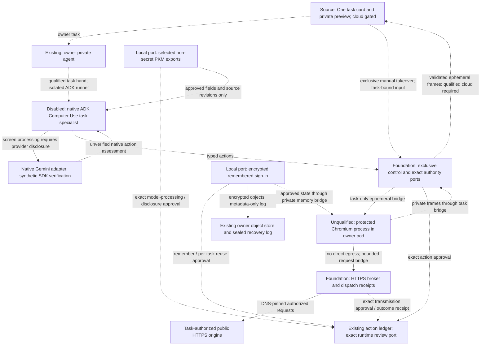

# Private browser runtime

## Status and evidence

**2026-10-20 UTC — disabled pilot; not a usable owner browser capability.**
The committed information/session foundation is `f407f849b`. The resumed working
candidate composes authenticated owner task routes, exact reviews, ephemeral
preview, takeover and remembered-session controls with an isolated native ADK
runner. One exposes only a metadata-returning task hand from a qualified runtime;
its transcript never receives screenshots, selected values or website sessions.
Neither cloud has a qualified launcher/bridge, so default startup provides no
browser runtime. Owner-admitted task rediscovery returns bounded metadata only. A current
owner can inspect or stop an old task, but cannot renew its expired processing
grant by reconnecting. Original authorization still gates frames, input and resume.
Preview/review Back closes the feature layer before leaving chat; it never stops
the task implicitly. Sealed recovery keeps uncertain effects uncertain rather than
replaying them. No owner pod or serving image changed in this implementation slice.

The [agent-development procedure](./agent-development.md) owns registration;
the [readiness memo](../../../docs/reference/quality/adk-orchestration-docs-audit.md)
owns acceptance. Source checks are not cloud isolation or deployment evidence.

The [Browser completion plan](../../../docs/future/personal-agent/browser-completion-plan.md)
specifies the next native Gemini/Azure model adapters and headless/takeover
qualification. Its target paths are not implemented capability claims.

### Browser within One

Browser is a capability owned by One. One delegates a website task to the
existing `agent_computer_use` specialist; the owner can preview or take control
of the same headless session. The product exposes browser pages, navigation and
page input. It provides no operating-system desktop, shell or host-computer
control. The existing identifier names the implementation; it does not broaden
the capability into general Computer Use.

Files transfers, selected PKM information, scheduled invocation, recovery and
updates connect through their existing authorities. Browser ownership grants
neither unrestricted access to the pod nor permission to bypass another tool's
confirmation. Task state and lifecycle belong to the private agent even when
execution uses a separate isolation boundary.

Packaging Chromium in the pod's release is compatible with this product
boundary. Packaging it in the key-holding process or container is not evidence
of isolation. The owner approved qualification inside the existing pod service
and image on 2026-10-19, replacing the requirement to use provider-managed sandbox
products. One remains the agent authority; the owner can fence it with Take
control or Stop. This product decision does not weaken secret, workload-identity,
network or process separation.

The first built-in slice adds an irreversible, separate-UID Linux process guard
and synthetic probe. Before receiving private information, the worker must close
unrelated descriptors, scrub its environment, require verified tmpfs, deny direct
network sockets and process inspection, and restrict filesystem access to browser
binaries/libraries and task scratch. Only the inherited connected Unix channel
reaches the existing broker. Chromium's own sandbox remains enabled. Kernel
support, a real frame, broker traffic and teardown must pass on each actual
image/configuration; neither the guard's presence nor an environment flag issues
a positive readiness receipt. These new files are not production composition.

The provider-managed probes below remain historical evidence of their specific
failures. They do not establish the behavior of ordinary Cloud Run or Container
Apps with this built-in process boundary.

### Built-in process qualification — 2026-10-20 UTC

| Target | Observed result | Qualification boundary |
| --- | --- | --- |
| Ordinary Cloud Run Gen 2 Job | The inherited syscall filter denied IPv4, IPv6, netlink, packet and VSOCK sockets. Landlock returned `ENOSYS` | The proposed Landlock filesystem mechanism is unavailable on this observed host. This is not a Chromium/frame or service qualification |
| Cloud Run namespace prerequisite | A separate disposable job at UID 10001 successfully executed both `unshare(CLONE_NEWUSER)` and `unshare(CLONE_NEWUSER \| CLONE_NEWPID \| CLONE_NEWNET)` before our guard | Supports testing a namespace filesystem boundary instead of Landlock. Does not prove mount setup, UID 10002, nested Chromium namespaces, a frame or production composition |
| Cloud Run protected headless frame | At UID 10002, bubblewrap's private filesystem/PID/network boundary and the inherited syscall filter passed. Chromium headless-shell rendered an 8,493-byte PNG and exited zero with its sandbox enabled. Public, metadata and private socket creation returned `EACCES`; agent path/environment were absent | Exact synthetic image `sha256:c8f107828583641a8de8785a9807af0677eabc964bf50f90fc9fa072fc38f5a6`. This proves protected rendering, not broker transport, ADK research, service readiness or Azure compatibility |
| Ordinary Azure Container App, 1 vCPU / 2 GiB, min 0 / max 1 | Separate UID 10002, zero inherited authority, Landlock ABI 3, world-readable unrelated-file denial, all five network families, and the external Unix datagram negative control pass. Worker exit and scratch removal pass | These process protections work; they do not establish a working browser |
| Azure Chromium prerequisite | The separate non-root `unshare(CLONE_NEWUSER)` check returns `EPERM` before our guard, on the ordinary application as well as Jobs. The earlier sandboxed Chromium attempt emitted no frame | Chromium's required sandbox remains unavailable. No weakened launch or readiness receipt is permitted |

The Unix datagram negative control closes a reviewed bypass: denying `connect`
alone does not prevent addressed Unix datagrams. New sockets admit stream types
only. Connected Unix socketpairs additionally admit `SOCK_SEQPACKET`, which
Chromium's sandbox uses for local IPC; standalone sequenced-packet sockets and
datagrams remain denied. Standard nonblocking/close-on-exec flags are preserved.
The nearest regression passes and fails against the former stream-only guard.
Probe output
contains fixed outcomes and synthetic hashes, never owner information or keys.
Source coverage also checks missing-guard refusal before Chromium starts.
The guard's `/proc/self` filesystem rule identifies its installing process;
descendant Chromium processes require their own qualified observation boundary.
Do not broaden that rule to all of `/proc` or treat the guard-only result as
proof of Chromium compatibility.

The Azure probe used the same immutable Playwright component image recorded
below with an exact synthetic source bundle; it did not install a pod release.
Its program is `11bc9bfb79ffa0028e17f2c13f3892637496a2298bd56a9512b47bea4785a746`;
bundled guard `d05564ef49928cdd69254d3a8aac9bc603336cd203197df1e91ec71e072dfaec`
and probe `4e1518dc2c8af5e3c2be84224ca84615f616e87a76e3e720b0d15cfa7ef4f37c`.
Later local refactoring is not an exact-image cloud qualification.
The GCP job and identity and all four Azure resource groups were removed with
absence readback. The initial GCP `actAs` propagation failures and delayed log
readback remain recorded; the successful execution was not rerun to recover logs.
Owner resources, images and browser/debug sessions were unchanged.

Standard owner-only filesystem permissions are another possible mechanism, not
an admitted fallback. The pod index now uses a private directory and restricts
SQLite/WAL/SHM to 0600; the image applies umask 077 before imports. A complete
private-file/mount inventory and browser-UID read tests remain necessary before
that mechanism can replace Landlock. Chromium's independent sandbox requirement
still applies on both clouds.

`namespace_probe.py` and `Dockerfile.namespace-probe` qualify an alternative
filesystem mechanism inside the same service: unprivileged bubblewrap with a
fresh root, PID/proc and network namespaces, read-only browser dependencies and
private temporary mounts. The browser remains UID 10002 with no new privileges;
its own sandbox stays enabled. This is a synthetic probe, not a production
launcher or readiness receipt. The production image still needs a trusted startup
path separating host UID 10001 (One) from host UID 10002 (Browser); changing only
the UID inside a user namespace does not establish that separation.

The protected frame used Cloud Build `9884acbe-485f-4f52-99d1-785d230d5e6d`.
Frame SHA-256 is
`773e8d158a728e97815d0eb189cb4d7ccb34872ba2c5627c714711a9779be1ba`.
Job, disposable identity and qualification image absence were read back.
The earlier full-Chrome attempt exited 21 without a frame; it remains a failed
receipt. The passing probe matches [Playwright's default headless-shell executor](https://playwright.dev/python/docs/browsers#chromium),
without disabling Chromium's sandbox or lifting the network restrictions.

`connected_transport.py` adds bounded duplex messages over one preconnected Unix
stream. Network replies can arrive while a browser action waits; unknown replies,
oversized frames and cancellation fence the connection without replay. Existing
typed requests and task/consent/dispatch authorities retain their ownership.
`namespace_bridge_probe.py` qualifies that transport with the existing Playwright
executor against a fixed synthetic page. It does not contact a website or model,
issue a readiness receipt, or install the production runtime.

Cloud Build `6e24ae6a-b9d0-4b36-ae52-e1da118bedde` produced bridge-probe image
`sha256:bd64daa0803a811c8f128ade17208e216037ab0d53ed83138e7758dc8b471b7f`.
The GCP job initialized the real `SandboxedPlaywrightExecutor`, loaded a parent-served
HTML fixture through the preconnected Unix stream, and returned four distinct
1280×720 frames after navigation, click, typing and scrolling. All namespace and
direct-socket controls passed; worker exit was zero and its process group was
absent. Job, identity and image absence were read back. This proves the synthetic
transport and input path, not public-network broker policy, ADK research or owner
service readiness.

Later local review fixed concurrent bridge shutdown: all external Stop callers
now join one bounded cleanup, instead of returning on an early closed flag.
The regression fails against the probe's earlier transport snapshot. Local probe
acceptance also now requires socket-creation denial and verified cleanup before
emitting a passing code. The cloud receipt's raw fields satisfy these conditions,
but its digest does not qualify the newer source. A completed production image
still requires exact-image acceptance; do not rebuild this synthetic probe merely
to relabel the prior evidence.

### Historical provider-managed qualification

The working slice starts at `fd4770c16e`, including frozen main `f47a4832dbc`
and local ADK `42bb9823005`. The earlier controlled Chromium cookie/redirect,
restoration and unapproved-recipient fixtures remain local evidence only; they
were not repeated to claim cloud acceptance.

| Native gate | Current evidence | Remaining proof |
| --- | --- | --- |
| GCP | Native worker UID/GID 0; required identity change refused with `EPERM`. Current CLI has no user selector; Google's Scion integration documents the restriction | Supported non-root execution, sandboxed Chromium, private bridge and denied network access |
| Azure | Workload identity, fixed UID/GID 10002, zero capabilities, no-new-privileges and tmpfs scratch pass. Pinned Chromium aborts with namespace denial and “No usable sandbox” | Supported namespace isolation without disabling seccomp, enforced network denial, Chromium/frame, private bridge and installed lifecycle |

The Azure personal-identity 403 is resolved for the workload-identity probe; this
is not an owner Browser enablement. Actual issuer expiry is preserved, and no CLI
identity fallback enters the pod. The API mirrors HTTP policy and materializes two
empty source collections. Validation accepts only those demonstrated defaults;
changed types, identities, images, nonempty collections and unknown fields refuse.
The unsupported exec user override was removed; configured non-root execution is
independently checked by the fixed synthetic command.

The successful Azure source bundle is
`10505a548b9cd71abc4a38a625369702fd88867a851ccf8764eec0a616c9face`;
controller program `e5744691ebda19ca0003b71ae1054e5f356cff904ffd615f5094b3df6cff741e`.
The synthetic Ubuntu image is pinned to
`sha256:68ee22004a9109b44973313b02ff7b1de250f1de0f5ecb628d73f579aaff33ac`.

The separate Chromium probe used the fixed Microsoft Playwright image
`sha256:72bd171a9ffc2b4b59532aaa6210e21014d07093120dc25528870c0b840da1f0`.
It produced no frame: the sandboxed process exited with namespace denial. The
worker identity and memory scratch passed, scratch was removed, and native
termination and resource-group absence were confirmed. Its source bundle is
`a471410c772e4f4ba95db264ed63edb860a2afe4f5d69cfc1b727143c6ceffac`;
controller `7a2f30c0c54040ebd56ca9f4c2dae42f5d7de43459338cc2552252bc9c14a326`.
A TCP connection was accepted under HTTP Full inspection; this alone proves
neither a request reaching the destination nor its denial. Current source also
requires explicit TCP/UDP default deny. The network-only follow-up accepted that
strict readback, then observed only timeouts for all three destinations. Actual
destination denial remains unqualified. Its source bundle is
`9c78a4975196978b4166e8c45314b31d062187954b82f8962bef5a4f8d7c72b4`;
controller `36780e0310871112e5097c2ad974cf80da165239b0824e66f55145a595a47ead`.
Teardown and resource-group absence were confirmed again. Future qualification
must collect the same sandbox's `egressDecisions` before teardown and correlate
provider denial with the fixed targets and probe window. Timeouts and policy
readback alone cannot establish enforcement.

[Playwright's sandbox guidance](https://playwright.dev/python/docs/docker#crawling-and-scraping)
requires selected namespace syscalls. Azure's [native API schema](https://raw.githubusercontent.com/Azure/azure-rest-api-specs/main/specification/app/data-plane/ContainerApps/preview/2026-09-01-preview/containerappssandbox.json)
provides RuntimeDefault or Unconfined, without a custom-profile field. Disabling
filtering is not this pilot's remediation. Retain the native gate and obtain a
supported restricted namespace mechanism before another Chromium attempt.
Sandbox termination and disposable resource-group absence were read back. Earlier
failed receipts remain retained. Existing owner resources, keys, hosting and images
were unchanged; no private information or model calls entered qualification.
Scoped RBAC readback found zero remaining assignments for all ten disposable
principals used by this slice.

No Browser readiness receipt or owner installation was issued. Resolve supported cloud
identity, memory-only broker transport, denied egress and teardown independently
before enabling either adapter.

## Visual Map

Target topology; all dashed paths remain gated and unavailable.



## Implemented foundation

| Owner | Current contract |
| --- | --- |
| `hushh_mcp/agents/computer_use/agent.yaml` | Manifest-owned task instructions; development only, discovery withheld, rollout off. Invocation, observation and control are distinct declarations, not issued grants. |
| `one_adk/computer_use_agent.py` | Requires the gate, exact native Gemini transport and task-bound processing terms. ADK observations pause during owner control; only approved-origin frames and origin-only URLs reach the model. No function-only fallback. |
| `services/pod_browser/control.py` | Owner/incarnation/expiry checks, sequence fencing, exclusive takeover and explicit handback, dispatch-before-execution, uncertain-outcome stop. Sixty agent calls or fifteen active minutes require continuation; unattended observation cannot extend the ten-minute idle grace. |
| `services/pod_browser/network.py` | Exact-origin HTTPS policy, public DNS/IP enforcement through the existing transport, bounded request/response sizes, no ambient proxy or automatic retry. Redirects and subresources need their own admission. Transmission commitments cover destination, method, headers and body. |
| `services/pod_browser/mailbox_executor.py` | Task-bound strict envelopes and an out-of-band termination port. Host-side receipt checks reject unresolved network effects even if the sandbox returns a valid screenshot. |
| `services/pod_browser/playwright_executor.py` | One page, Chromium sandbox enabled, service workers/WebSockets blocked, downloads disabled. Chromium Fetch interception brokers each redirect hop and preserves response-header multiplicity. Frames/workers/objects are restricted; multi-target authentication is unqualified. No direct or unsandboxed fallback. |
| `services/pod_browser/worker_identity.py` | Before worker IPC or Chromium, require the fixed non-root identity, zero permitted/effective/ambient capabilities and `no_new_privs`. Refuse unavailable privilege dropping; never run the browser as root. |
| `browser_runtime/Dockerfile` | Browser-only probe definition, pinned Playwright, explicit source copies and fixed UID/GID. No core pod, recovery, provider SDK or credentials. The earlier probe image was built; the revised identity guard is not image-qualified. |
| `services/pod_browser/information.py`, `consent.py` | Typed selected-field exports and exact private commitments over the existing ledger. Export revision, PKM content revision and PKM manifest revision are distinct. Authenticated runtime routes require injected authoritative export/review ports; cloud startup remains gated. |
| `services/pod_browser/session_state.py`, `sessions.py` | Bounded encrypted persistent sign-in objects, current-admission reuse, metadata-only recovery, CAS publication and generation-fenced Forget. Owner-only retention routes and controls remain cloud gated. |
| `services/pod_browser/scratch.py`, `mailbox.py` | Require Linux tmpfs on the actual open descriptor, private task scratch, and command/network cleanup on close. macOS fixtures do not qualify native cloud scratch. |

The broker's authority ports must be backed by the **existing** approval/action
ledger. Synthetic test adapters are not runtime authority. A typed `completed`
model result is not a verified submission receipt. Pending/uncertain effects
must survive recovery and prohibit replay.

## Information and sign-in boundary

One's manifest instructs the specialist to select the task's non-secret fields.
`ScopedProjectionReader` requires a current V2 scoped export from the existing
grant owner: exact owner/task/incarnation, recipient, scope, export revision,
source content/manifest revisions, expiry and revocation. The pilot accepts
bounded scalar projections only; Secrets, runtime credentials, wallet and identity
domains are refused. Neither a replica nor conversational memory authorizes reads.
The production loader must perform these checks against its authoritative sources.

Model processing and website disclosure are independent exact reviews. Private
values stay in pod/browser memory; the action ledger stores keyed commitments.
Processing binds the provider/transport and screen origins. Disclosure additionally
binds the destination, source revisions, action sequence/control epoch and request
commitment. Changed terms need renewed approval, including autosaving input.
No pod principal can confirm a review. Cached task approvals recheck current
admission and their consumed ledger receipt; website disclosure is single use.

Manual takeover suppresses model screenshots, URLs, page text, tools and errors.
Only explicit handback and a fresh observation allow processing again. Model URLs
contain the origin only, excluding callback codes. Runtime routes must use the
owner-only session control port, never expose state through ADK tools, and drain
browser tasks through the existing update permit before replacing an image.

Remembering requires opt-in for the selected origins/account. The initial adapter
retains persistent cookies and local storage, preserving cookie scope/security and
website expiry. Session-only cookies remain live and end with the browser. There
is no product expiry extension or keepalive. IndexedDB, passkeys, profiles, caches,
popups, iframe/worker authentication and arbitrary SSO recipients are unsupported.
Each additional SSO origin needs admission and processing consent. Restored state
is stored sign-in information; website rejection still requires owner login.

Serialized state is limited to **1 MiB**, then AES-GCM sealed with a browser-purpose
key derived from existing owner custody. Bounded cloud reads reject excess bytes
before materializing the body. Oversized retention fails without stopping the
current browser task. No session values enter model context, hub storage, telemetry
or the sealed log; that log holds opaque intents, object references and lifecycle
metadata. Publication uses the observed log sequence. Lost publication responses
retain inventoried ciphertext until quiescent cleanup can establish its status.

Forget immediately blocks reuse and closes affected live contexts, then records
a generation tombstone and requests deletion of every inventoried object, including
failed saves. Pending saves/restores cannot supersede it. The receipt distinguishes
live fencing, durable persistence and deletion requests. Physical removal remains
subject to cloud retention; Forget does not remotely log out a website. Erasure
inventory includes these objects and requires drained/fenced writers.

Same-custody restart can rebuild metadata and restore current encrypted objects
with fresh admission and per-task site/account reuse approval. Record-only
cross-custody migration and standby synchronization **refuse browser-session
history on both send and receive**, including forgotten history, until encrypted
object/key transfer is qualified. This blocks those operations; it does not claim
update/recovery parity. Update drain, object continuity, and orphan cleanup still
need runtime integration and immutable-image acceptance.

## Local verification

The nearest browser/ledger/erasure suites exercise exact processing/disclosure,
revocation, owner/incarnation mismatch, login observation suppression, approved
screen origins, altered ciphertext, bounded state, Forget races and restart
metadata. A separate synthetic Chromium fixture verifies redirect interception,
multiple `Set-Cookie` headers, official expiry, local-storage restoration and
unapproved recipients without owner credentials or real network responses. It
also proves that an admitted secondary origin cannot load an embedded frame under
the pilot's conjunctive CSP:

```bash
cd consent-protocol
# Optional local tool: pinned Playwright 1.63.0 and its Chromium must be installed.
.venv/bin/python scripts/ops/browser_privacy_fixture.py
```

The fixture uses the browser image's namespace packages and does not hydrate the
core pod's environment. Its pinned SDK can also run in an isolated local tool
environment; it is not a dependency installed on the private agent.

The original fixture failed because Playwright route interception missed redirect
hops; Chromium Fetch interception corrected it. These results qualify the local
adapter only. They do not prove native sandbox isolation, owner-cloud storage/IAM,
real login/SSO compatibility, provider retention or live update acceptance.

## Historical provider-managed isolation probes

### GCP

The earlier native Cloud Run sandbox design could read the launcher's filesystem.
It required a browser-only launcher in a separate container with no private mounts,
secrets, provider credentials or recovery material, with sandbox direct egress denied.
The candidate task-only mailbox must be memory-backed, excluded from snapshots
and artifacts, and erased on every terminal path before private use.

`gcp_probe.py` is a controlled native probe, not a service deployment recipe.
It checks a synthetic bind-mount round trip, Chromium startup/frame capture,
and denied host-loopback, metadata and direct-public sockets. Timeouts do not
count as network-denial evidence. It does not prove broker browsing, private
sessions, live preview, teardown, provider transport or component provenance.

Local invocation:

```bash
cd consent-protocol
.venv/bin/python -m hushh_mcp.services.pod_browser.gcp_probe
```

Outside a native Cloud Run sandbox launcher this returns
`GCP_NATIVE_SANDBOX_REQUIRED`, exit 2. That is an unavailable result, not a pass.
The existing operator identity ran an isolated synthetic job under a temporary
identity without project roles. No owner pod was changed. Build
`053c57b0-5325-4ee9-bd0f-c9eebd454121` succeeded for the earlier seven-file digest
`sha256:f88b082d4c438e647a5fc751af7bc836f865e11fd16880efb898f5a0de1a43ed`.
The seven-file source commitment is
`18bbea69af3354e941e6aa853d0eb4a67ac2194592023718aa84e871e729fc24`.

**First gate failed; Computer Use remains unavailable.** These executions used
that immutable image; diagnostic process success is not browser acceptance:

| Execution | Actual outcome |
| --- | --- |
| `browser-probe-20261006-4d7b-cfls5` | Original `/bridge` destination failed before execution: `FetchSpec failed: loading container: file does not exist`. |
| `browser-probe-20261006-4d7b-pw5kc` | Native `/bin/echo` control passed in 164 ms. This is sandbox invocation, not browser startup latency. |
| `browser-probe-20261006-4d7b-nm2lm` | Write and environment flags passed; every nonexistent `/bridge` mount failed. |
| `browser-probe-20261006-4d7b-zdncq` | Existing/same-path mount invocation passed. Chromium refused root with sandboxing enabled; no frame was produced. |
| `browser-probe-20261006-4d7b-9rlhw` | Clearing supplementary groups refused with `EPERM`. |
| `browser-probe-20261006-4d7b-tv4gn` | Native real/effective/saved UID/GID were all 0, supplementary groups empty; fixed UID/GID change still refused with `EPERM`. Launcher help exposes no user-selection flag. |

Source corrects the mount path and explicitly checks the worker identity before
IPC/browser initialization. This is a fail-closed guard, not proof of a working
privilege drop on this substrate. Google's current [sandbox CLI](https://docs.cloud.google.com/run/docs/reference/sandbox-cli)
has no user selector, and Google's [Scion integration](https://github.com/GoogleCloudPlatform/scion/blob/main/pkg/runtime/cloudrun_sandbox_runtime.go)
documents root execution without identity-change capabilities. Changing IAM or
the image's `USER` does not establish a supported identity change. A native
identity mechanism and Chromium namespace compatibility need provider-backed evidence before the
probe can progress. Direct-egress denial, mailbox round trip, frame/preview,
resource peaks and teardown remain unverified. No sandbox was exported or saved.
After retaining the synthetic receipts, the task-owned job, temporary identity,
probe image/tag and source archive were removed. Existing owner resources,
release channels and application traffic were unchanged.

### Azure

The earlier Early Access blocker is stale: Azure Sandboxes reached general
availability in September 2026. Fresh read-only stable `2026-07-01` and preview
SandboxGroups requests succeeded during the earlier inventory; no group existed in that readback. The legacy
`SandboxPreview=NotRegistered` flag does not prove current unavailability.

The earlier personal-identity execution 403 is historical. The October 19
workload-identity probe above passes native creation, strict policy/source readback
and non-root synthetic execution. These are separate from Chromium, enforced
network-denial and private-bridge qualification. Both the public alias and its
resolved image must not be trusted interchangeably: the controlled probe imports
an immutable digest and binds its exact disk ID before execution.

Real owner information and remembered logins remain refused. Native exec stdout
and filesystem APIs are synthetic-probe channels only; they are not an accepted
private frame/session transport. No alternate executor or unsandboxed fallback
is permitted.

Native cloud contracts: [GCP sandbox execution](https://docs.cloud.google.com/run/docs/code-execution),
[GCP resource allocation](https://docs.cloud.google.com/run/docs/configuring/services/sandboxes),
[Azure SandboxGroups](https://learn.microsoft.com/en-us/azure/container-apps/sandboxes-overview),
[Azure network controls](https://learn.microsoft.com/en-us/azure/container-apps/sandboxes-egress-policies).

### Responsive owner control — source only

The preview fits its containing screen without restarting the task. During
exclusive owner control, **Fit this screen** and Phone/Tablet/Desktop sizes may
reflow the remote page within 320–1920 by 240–1080 CSS pixels. Resize uses the
existing input route and approval authority, advances the control epoch before
dispatch, and commits dimensions only after a matching frame. A lost outcome
remains uncertain; resizing never resumes the agent.

Mouse, touch and keyboard input require a painted frame for the current epoch
and dimensions. Reconnect, failed streams and layout changes invalidate old
coordinates. Explicit handback obtains a fresh observation before model work.
Historical task records without viewport metadata retain their original geometry
and do not offer resizing. Focused fixtures establish these contracts, not live
cloud preview latency or isolation.

## Remaining release gates

1. Prove each cloud's isolation, ephemeral bridge, immutable image, bounded
   teardown and resource use. Readiness is trusted-side evidence; it must never
   be supplied by a browser, model or client-selected cloud.
2. Qualify the composed signed admission, browser permissions, exact reviews,
   update draining, recovery and cancellation against the installed cloud image.
   Native Gemini screenshots must remain ephemeral: do not widen the sealed
   session record budget or persist screens in One transcripts or hub storage.
3. Expose the composed task hand only after the native model and cloud capability
   pass. Source includes task status/preview/control routes, the responsive One
   task card, takeover and observation suppression; these still need installed
   cloud acceptance. Handback requires a fresh observation. Frames are separate
   from model calls and preview leases must expire.
4. Qualify the composed encrypted session/information ports and grant loader
   against cloud account erasure, orphan cleanup and update continuity. Bounded
   background and budget continuation and scoped Files transfer need installed
   evidence. Local cookie/redirect fixtures pass; real owner preview,
   authentication and cloud recovery remain unverified. No customer login or
   retention is enabled.
5. Prove controlled research, preparation and reviewed submission, uncertain
   outcomes, revocation/recovery, malicious pages, cross-owner refusal, update
   draining and idle wake. Measure cold/warm latency, 429 outcomes, memory,
   preview bandwidth and actual cost components separately on both clouds.

One active task/page per owner remains the pilot target. GCP 2 vCPU / 3 GiB
combined and Azure 1 vCPU / 2 GiB browser budgets require an owner-visible offer;
they are unmeasured probe allocations, not minimums or changes to existing pods.
The controlled-fixture p95 input-to-frame target is 250 ms, not a result.
Warnings do not shut down service. No main/UAT/production or stable release is
authorized by this implementation record.
