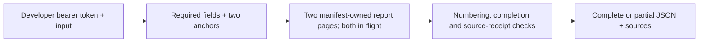

# Public professional profile synthesis API

`POST /api/v1/professional-profile/synthesize` generates the requested 360-point
professional and academic report with the managed Vertex Gemini model and native
Google Search grounding. It is a stateless developer API, separate from the
owner-only `/api/one/profile-research` onboarding feature.

## Visual Map



## Request

Use a valid developer bearer token. The existing Developer API enable switch,
token revocation and restricted product-client route rules apply. No new token,
vault access or subject consent is fabricated by supplying a name.

| Field | Required | Format |
| --- | --- | --- |
| `name` | Yes | Nonblank string, at most 160 characters |
| `dob` | Yes | Valid `YYYY-MM-DD` calendar date, not after today's UTC date |
| `gender` | Yes | Nonblank self-described string, at most 80 characters |
| `school` | At least two of these three | Nonblank string, at most 240 characters |
| `college` | At least two of these three | Nonblank string, at most 240 characters |
| `company` | At least two of these three | Nonblank string, at most 240 characters |

Whitespace is trimmed; blank optional fields count as absent. Every pair is
accepted, as are all three. Without a company, school and college are both
required. Unknown fields, invalid dates and control characters are rejected.
Input validation returns sanitized `422` without echoing submitted values.

```bash
curl --max-time 750 "$BACKEND_URL/api/v1/professional-profile/synthesize" \
  -H "Authorization: Bearer $HUSHH_DEVELOPER_TOKEN" \
  -H 'Content-Type: application/json' \
  --data '{
    "name": "Example Person",
    "dob": "1998-01-11",
    "gender": "self-described",
    "school": "Example School",
    "college": "Example College"
  }'
```

Use the backend origin directly; no web or native proxy is introduced. The
request may take several minutes. Keep the client and ingress request deadlines
above the 660-second generation budget. Disconnects are not a resumable job;
do not automatically repeat a request whose provider outcome is unknown.

## Response

The JSON response includes:

- `status`: `complete` only when all numbered points 1–360 were received in
  normally finished output and no output-contract failure was detected;
  otherwise `partial`, with exact `missing_points` and fixed `failures` reasons.
- `points`: ordered `{number, section, evidence_tag, markdown}` entries, with
  section determined from the requested eight ranges of 45 points each.
- `report_markdown`: executive dashboard and the model-authored points.
- `sources`: native grounding source titles and HTTPS URLs.
- `search_suggestions_html`: the provider's Search Suggestions. Clients that
  display a grounded report must also display these suggestions according to
  Google's grounding requirements; never interpolate arbitrary model HTML.
- `provider: "vertex_ai"`, the actual `model`, a correlated `request_id`,
  `verification: "model_generated_not_independently_verified"`, and
  `persisted: false`.

Generation consists of two assigned 180-point report pages using the same
manifest-owned instruction, both admitted immediately. Each page
permits one continuation only for missing numbered/tagged points. The complete
invocation has a 660-second budget; individual provider requests have a
600-second deadline and SDK retries are disabled. The request-scoped SDK uses its supported HTTPX
transport with connector retries disabled, avoiding the aiohttp implicit
disconnect replay. The current managed runtime owns the model/project binding;
no stale bridge-project or retired fleet model is hardcoded here. There is no assessment model, ranking stage, automatic
retry of a failed provider call, or hidden identity lookup. Existing received
points survive an incomplete continuation or a failure of the other part.
Truncated output and source-free `PUBLIC-RECORD-VERIFIED` claims remain explicitly
partial even if 360 numbered markers exist; fields are never silently relabeled.
No received points results in sanitized `503`, not a fabricated report or an
assertion of no public matches. The route is limited to three requests/hour by
the existing limiter key. This is process-local unless shared rate-limit storage
is configured; it is not a cluster-wide billing limit.

All success and error responses are private/no-store. Credentials, request
inputs, provider text and reports are not logged. No subject input or report is
written to a database, PKM, durable job or report cache. Existing authentication
usage metadata and rate-limit storage retain their normal behavior.
Source retrieval does not independently validate
the model's factual claims or evidence labels. Input DOB and gender do not
authorize private-record access or personality inference. The instruction
excludes private contacts, identifiers, financial details, inferred friendships,
personal routines, empirical scorecards and astrology-based psychological claims.

## Ownership and verification

The authored instruction is the Career Agent's internal
`agent_career_professional_synthesis` child in
`hushh_mcp/agents/career/agent.yaml`. It is not registered as a new One router or
chat/voice action. `ManagedGeminiRuntimeBinding` owns project, ADC and locations;
the fleet model alias resolves at invocation time. No project or credential is
hardcoded in this service. Local explicit Vertex configuration uses the same
supported runtime bindings as the rest of the backend.

API contract regressions are in `tests/test_professional_profile_synthesis.py`.
Run:

```bash
cd consent-protocol
.venv/bin/python -m pytest tests/test_professional_profile_synthesis.py -q
.venv/bin/python scripts/generate_product_agent_registry.py --check
.venv/bin/python -m pytest tests/test_agent_manifests.py tests/test_product_agent_registry_v2.py -q
```

This is backend-only. No web screen, native bridge, new persistence, migration,
or owner onboarding behavior changes. Rollback removes the synthesis router;
existing owner research and saved resumes are unaffected. Code and local tests
do not establish deployment or a live authenticated external-client journey.
