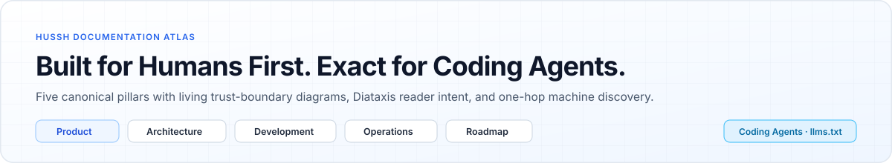
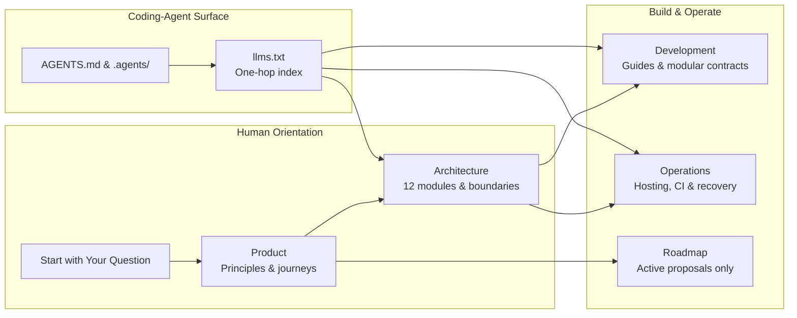

  <picture>
    <source media="(prefers-color-scheme: dark)" srcset="assets/brand/docs-hub-hero-dark.svg" />
    <source media="(prefers-color-scheme: light)" srcset="assets/brand/docs-hub-hero-light.svg" />
    
  </picture>

# Private Agent One documentation

One is your private agent. Hussh provides the consent protocol, encrypted personal-capital infrastructure, and sovereign runtimes connecting your information, chosen AI models, and everyday services.

Every page starts with human clarity (purpose, visual boundaries, and live status) before transitioning cleanly to exact technical contracts for engineers and coding agents.

## Choose your path

| Question | Pillar | Reader Intent |
| --- | --- | --- |
| What can One do, and what stays under my control? | [Product](product/README.md) | Explanation & user journeys |
| How do devices, sandboxes, storage, and consent connect? | [Architecture](architecture/README.md) | Visual atlas & trust boundaries |
| How do I set up, build, test, or integrate with Hussh? | [Development](development/README.md) | Tutorials, how-to & contracts |
| How do I host, release, monitor, and recover the platform? | [Operations](operations/README.md) | Runbooks & acceptance truth |
| What future designs are proposed rather than live? | [Roadmap](roadmap/README.md) | Active unimplemented proposals |

## Visual Map

## Go straight to a subsystem

- **Subsystem modules:** Open the [12-module architecture map](architecture/README.md#modules) for Clients, One, Identity, Memory, Files, Connections, Sharing/MCP, Hosting, Browser, Puppy, Finance (Kai), and Delivery.
- **Package-local references:** Standalone implementation specs remain in the [backend protocol docs](../consent-protocol/docs/README.md) and [web and mobile app docs](../hushh-webapp/docs/README.md).
- **Authoring & brand rules:** Every documentation change follows [the documentation standard](development/documentation.md) and the [brand and compatibility contract](operations/brand-and-compatibility-contract.md).

<strong>For coding agents: machine discovery and verification</strong>

- Start at [AGENTS.md](../AGENTS.md), [llms.txt](../llms.txt), and the [development-system guide](../.agents/README.md).
- Verify all documentation edits locally with `./bin/hushh docs verify` and `python3 scripts/licenses/verify_apache_surface.py`.

