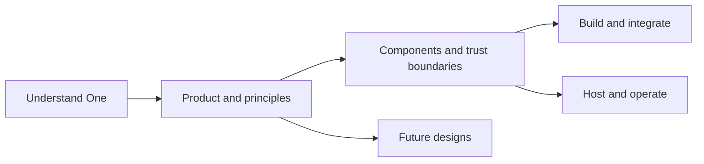

# Private Agent One documentation

One is your private agent. Hussh provides the platform, consent contracts and
infrastructure that connect your information, chosen models and services.

Choose the question you want to answer:

| Explore | Start here |
| --- | --- |
| What can I do, and what stays under my control? | [Product](product/README.md) |
| How do clients, agents, storage and consent connect? | [Architecture](architecture/README.md) |
| How do I build or extend the system? | [Development](development/README.md) |
| How do I host, release and recover it? | [Operations](operations/README.md) |
| What is proposed rather than available? | [Roadmap](roadmap/README.md) |

## Visual Map

For a particular subsystem, use the [module map](architecture/README.md#modules).
Implementation references also remain available in the
[backend package](../consent-protocol/docs/README.md) and
[web and mobile package](../hushh-webapp/docs/README.md).

Coding agents start at [AGENTS.md](../AGENTS.md) and the
[development-system guide](../.agents/README.md). Documentation changes follow
[the authoring guide](development/documentation.md); public naming follows the
[brand and compatibility contract](operations/brand-and-compatibility-contract.md).
