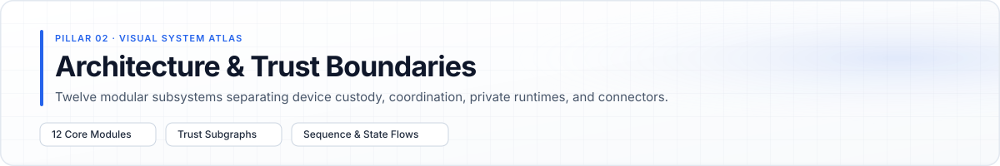
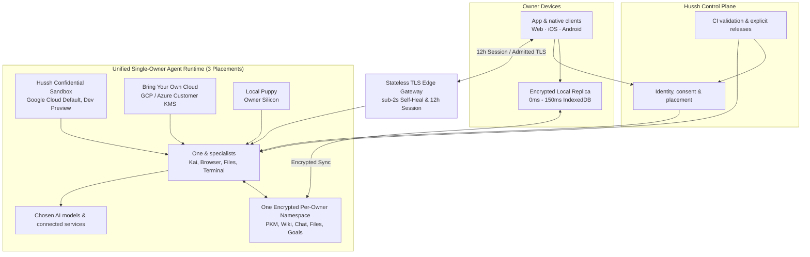

  <picture>
    <source media="(prefers-color-scheme: dark)" srcset="../assets/brand/pillar-architecture-dark.svg" />
    <source media="(prefers-color-scheme: light)" srcset="../assets/brand/pillar-architecture-light.svg" />
    
  </picture>

# Architecture

[Documentation](../README.md) · **Intent:** Explanation & technical reference

Start with [how the system works](system.md), then jump directly to the module that owns your question. Every subsystem below separates human intent and trust boundaries from deep coding-agent contracts.

> [!NOTE]
> Architecture pages describe verified source contracts. Live availability in a given environment depends on explicit release admission and acceptance under [Operations](../operations/README.md).

## Visual Map

## Modules

| Area | Status | Purpose |
| --- | --- | --- |
| [App and native clients](modules/clients.md) | `Live` | Coherent web, iOS, and Android experience with local vault unlock, `0ms - 150ms` (`<100ms` target) encrypted local read replica (`hushh-owner-ui-cache`) for Chats, Files, and Personal Wiki, and reviewed actions. |
| [One and specialists](modules/one.md) | `Live` | Root ADK agent coordinating bounded specialists under existing consent authority. |
| [Identity, vault and consent](modules/identity.md) | `Live` | Strict separation between identity proof, client key custody, and permission to act. |
| [Memory and PKM](modules/memory.md) | `Live` / `Preview` | Owner-private agent memory, Personal Wiki (Dev), and encrypted PKM domain authority. |
| [Files and documents](modules/files.md) | `Live` | Encrypted file explorer and bounded document workflows with separate processing approval. |
| [Connected services](modules/connections.md) | `Live` / `Preview` | Scoped OAuth and MCP connections with prompt-injection quarantine for background prep. |
| [Sharing and MCP](modules/sharing.md) | `Live` | Scoped Information Exchange and recipient-bound encrypted exports without exposing full memory. |
| [Hosting and lifecycle](modules/hosting.md) | `Live` / `Preview` | Single unified runtime across Hussh Confidential Sandbox (Google Cloud default, Dev Preview), Bring Your Own Cloud (GCP/Azure), and Local Puppy; Hussh Shared retired on Dev cutover lanes. |
| [Browser](modules/browser.md) | `Preview` | Supervised Chromium inside a qualified owner container with direct owner takeover and approvals. |
| [Puppy](modules/puppy.md) | `Live` | Trusted local-computer model relay bound to an owner's BYOC pod or Hussh Confidential Sandbox Edge Gateway relay. |
| [Finance specialist](modules/finance.md) | `Live` | Kai financial analysis under One's task authority with explicit provenance and degraded states. |
| [Delivery and operations](modules/delivery.md) | `Live` | Exact-source validation, Merge Queue admission, and separate environment releases. |

## Detailed views and references

- [System and runtime views](views/README.md): composition, execution, hosting, and information boundaries.
- [Private-agent requirements](../product/principles/private-agent-requirements.md): target custody and owner authority; requirements are distinct from rollout claims.
- [Repository orientation](../development/repository-map.md): locate the implementing packages.
- [Engineering architecture principles](engineering-principles.md): concrete module and ownership rules.
- [Implementation references](../development/references.md): API, routes, persistence, and specialist contracts.
- [Roadmap](../roadmap/README.md): active unimplemented designs.

## Further reading

- [AI Reference](ai/README.md)
- [API Contracts](../development/contracts/api-contracts.md)
- [Back navigation graph](../development/contracts/back-navigation-graph.generated.md)
- [Bring your own AI: the person's own model key on their own agent](bring-your-own-ai.md)
- [The private agent in the person's own Azure subscription](byoc-azure.md)
- [Cache Coherence Reference](../development/contracts/cache-coherence.md)
- [CRD And Financial Verification API](crd-scraping-api.md)
- [Data Model Governance](data-model-governance.md)
- [Data Provenance Ledger](data-provenance-ledger.md)
- [The deployment standard](deployment-standard.md)
- [ADR: WorkOS Enterprise SSO Integration](enterprise-sso-workos-adr.md)
- [Hussh Kai Index](finance/README.md)
- [Frontend Native Surface Map](../development/contracts/frontend-native-surface-map.md)
- [ADR: Proposed hosted Confidential Space memory runtime and key custody](hosted-confidential-memory-custody-adr.md)
- [Hussh Research: HushhTech UAT Client Disposition Matrix](hushh-tech-uat-client-disposition-matrix.md)
- [HushhTech UAT Client](hushh-tech-uat-client.md)
- [Hussh IAM Reference](identity/README.md)
- [Serialized Interaction Runtime](interaction-runtime.md)
- [Interface-to-agent routing: what actually reaches an agent](interface-to-agent-routing.md)
- [Live Memory source journal backend contract](live-memory-journal-backend-contract.md)
- [Live Memory P0 acceptance stories and evidence](live-memory-p0-acceptance-stories.md)
- [Live Memory source admission contract](live-memory-source-contract.md)
- [ADR: Continuous living memory and an owner-controlled always-on runtime](living-memory-freshness-adr.md)
- [Loading Policy (App-Wide)](loading-policy.md)
- [Memory workspace and private-analysis boundary](memory-workspace.md)
- [Modules](modules/README.md)
- [Hussh One Index](one/README.md)
- [One Location Agent](one-location-agent.md)
- [One Location Place Taxonomy](one-location-place-taxonomy.md)
- [Paid-answer UAT provider review, 13 October 2026](paid-answer-provider-review-2026-10-13.md)
- [Personal Gmail Information Requests](personal-gmail-information-requests.md)
- [PKM Cutover Runbook](pkm-cutover-runbook.md)
- [ADR: PKM Storage and JSONB Boundaries](pkm-storage-adr.md)
- [The pod data door: how a keyless pod reads a DB-backed specialist](pod-data-door.md)
- [Moving a private agent between clouds](pod-migration.md)
- [Personal World Model and the Preference Subscription Fabric](preference-subscription-fabric.md)
- [Private Agent One: plan of record](private-agent-one-plan-of-record.md)
- [Public Profile Discovery and One-time PKM Claim](public-profile-discovery.md)
- [Request scope recovery evidence, 13 October 2026](request-scope-recovery-2026-10-13.md)
- [Route Contracts](../development/contracts/route-contracts.md)
- [Runtime DB Fact Sheet (Sanitized)](runtime-db-fact-sheet.md)
- [Runtime Topology Maintenance](runtime-topology-maintenance.md)
- [Schema Migration Discipline (Expand/Contract)](schema-migration-discipline.md)
- [UI contracts: Back and Search contribution scaffold](../development/contracts/ui-contract-contributor-guide.md)
- [Architecture and shared explanations](wiki-architecture-parity.md)

<strong>For coding agents: architecture verification & boundary rules</strong>

- Always inspect the owning module page (`docs/architecture/modules/*.md`) before modifying cross-surface contracts, trust boundaries, or storage schemas.
- **Read Plane vs Compute Plane:** Passive UI reads hydrate from the owner-scoped encrypted IndexedDB replica (`hushh-webapp/lib/storage/encrypted-owner-ui-cache.ts`, `hushh-webapp/lib/files/files-cache.ts`, `hushh-webapp/lib/agent/agent-chat-history-cache.ts`) while sandboxes pre-warm silently behind the Edge Gateway.
- **Active tracking tracks:** [Agent Sandbox microVM pool](../roadmap/personal-agent/agent-sandbox-microvm-plan.md) · [#9744](https://github.com/hushh-labs/hushh-research/issues/9744) · [#9511](https://github.com/hushh-labs/hushh-research/issues/9511) · [#9736](https://github.com/hushh-labs/hushh-research/issues/9736) · [#9517](https://github.com/hushh-labs/hushh-research/issues/9517) · [#9370](https://github.com/hushh-labs/hushh-research/issues/9370) · [#5507](https://github.com/hushh-labs/hushh-research/issues/5507).
- Verify Mermaid changes and links locally via `./bin/hushh docs verify`.

