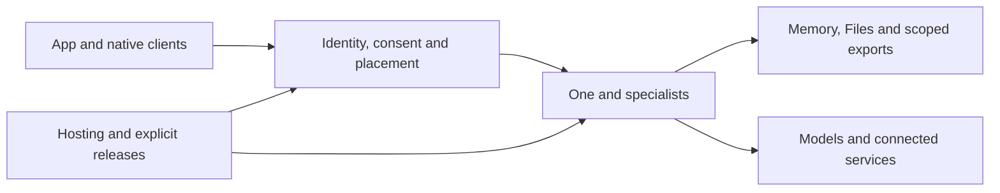

# Architecture

[Documentation](../README.md)

Start with [how the system works](system.md), then follow the component that owns
your question. These diagrams describe current source contracts, not a promise
that every environment has enabled or installed every capability.

## Visual Map

## Modules

| Area | Purpose |
| --- | --- |
| [App and native clients](modules/clients.md) | Provide a coherent web, iOS and Android experience with local unlock, navigation and reviewed actions. |
| [One and specialists](modules/one.md) | Coordinate a person’s task through one root ADK agent and bounded specialist tools. |
| [Identity, vault and consent](modules/identity.md) | Keep identity proof, key custody and permission to act separate. |
| [Memory and PKM](modules/memory.md) | Let One retain useful personal context while keeping durable storage and disclosure under owner control. |
| [Files and documents](modules/files.md) | Organize encrypted files and process explicitly selected content through bounded document workflows. |
| [Connected services](modules/connections.md) | Connect accounts and refresh their permitted access without making a connector an unrestricted copy of a person’s life. |
| [Sharing and MCP](modules/sharing.md) | Let people and external agents request specific information without exposing the whole memory store. |
| [Hosting and lifecycle](modules/hosting.md) | Place One in an explicitly selected runtime and keep updates, recovery and removal accountable to its owner. |
| [Browser](modules/browser.md) | Allow One to research and interact with websites in the same owner container while preserving direct owner control. |
| [Puppy](modules/puppy.md) | Run a supported model on an owner-approved trusted computer through its private pod binding. |
| [Finance specialist](modules/finance.md) | Use Kai for bounded financial understanding under One’s task and consent authority. |
| [Delivery and operations](modules/delivery.md) | Validate code, admit authorized changes and explicitly release a frozen application revision. |

## Detailed views and references

- [System and runtime views](views/README.md): composition, execution, hosting and information boundaries.
- [Private-agent requirements](../product/principles/private-agent-requirements.md): target custody and owner authority; requirements are distinct from rollout claims.
- [Repository orientation](../development/repository-map.md): locate the implementing packages.
- [Engineering architecture principles](engineering-principles.md): concrete module and ownership rules.
- [Implementation references](../development/references.md): API, routes, persistence and specialist contracts.
- [Roadmap](../roadmap/README.md): unimplemented designs and active work.

## Further reading

- [AI Reference](ai/README.md)
- [API Contracts](../development/contracts/api-contracts.md)
- [Back navigation graph](../development/contracts/back-navigation-graph.generated.md)
- [Bring your own AI: the person's own model key on their own agent](bring-your-own-ai.md)
- [The private agent in the person's own Azure subscription](byoc-azure.md)
- [Cache Coherence Reference](../development/contracts/cache-coherence.md)
- [CRD And Financial Verification API](crd-scraping-api.md)
- [Data Model Governance](data-model-governance.md)
- [Data Provenance Ledger](data-provenance-ledger.md)
- [The deployment standard](deployment-standard.md)
- [ADR: WorkOS Enterprise SSO Integration](enterprise-sso-workos-adr.md)
- [Hussh Kai Index](finance/README.md)
- [Frontend Native Surface Map](../development/contracts/frontend-native-surface-map.md)
- [ADR: Proposed hosted Confidential Space memory runtime and key custody](hosted-confidential-memory-custody-adr.md)
- [Hussh Research — HushhTech UAT Client Disposition Matrix](hushh-tech-uat-client-disposition-matrix.md)
- [HushhTech UAT Client](hushh-tech-uat-client.md)
- [Hussh IAM Reference](identity/README.md)
- [Serialized Interaction Runtime](interaction-runtime.md)
- [Interface-to-agent routing — what actually reaches an agent](interface-to-agent-routing.md)
- [Live Memory source journal backend contract](live-memory-journal-backend-contract.md)
- [Live Memory P0 acceptance stories and evidence](live-memory-p0-acceptance-stories.md)
- [Live Memory source admission contract](live-memory-source-contract.md)
- [ADR: Continuous living memory and an owner-controlled always-on runtime](living-memory-freshness-adr.md)
- [Loading Policy (App-Wide)](loading-policy.md)
- [Memory workspace and private-analysis boundary](memory-workspace.md)
- [Modules](modules/README.md)
- [Hussh One Index](one/README.md)
- [One Location Agent](one-location-agent.md)
- [One Location Place Taxonomy](one-location-place-taxonomy.md)
- [Paid-answer UAT provider review, 13 October 2026](paid-answer-provider-review-2026-10-13.md)
- [Personal Gmail Information Requests](personal-gmail-information-requests.md)
- [PKM Cutover Runbook](pkm-cutover-runbook.md)
- [ADR: PKM Storage and JSONB Boundaries](pkm-storage-adr.md)
- [The pod data door — how a keyless pod reads a DB-backed specialist](pod-data-door.md)
- [Moving a private agent between clouds](pod-migration.md)
- [Personal World Model and the Preference Subscription Fabric](preference-subscription-fabric.md)
- [Private Agent One — plan of record](private-agent-one-plan-of-record.md)
- [Public Profile Discovery and One-time PKM Claim](public-profile-discovery.md)
- [Request scope recovery evidence, 13 October 2026](request-scope-recovery-2026-10-13.md)
- [Route Contracts](../development/contracts/route-contracts.md)
- [Runtime DB Fact Sheet (Sanitized)](runtime-db-fact-sheet.md)
- [Runtime Topology Maintenance](runtime-topology-maintenance.md)
- [Schema Migration Discipline (Expand/Contract)](schema-migration-discipline.md)
- [UI contracts: Back and Search contribution scaffold](../development/contracts/ui-contract-contributor-guide.md)
- [Architecture and shared explanations](wiki-architecture-parity.md)
