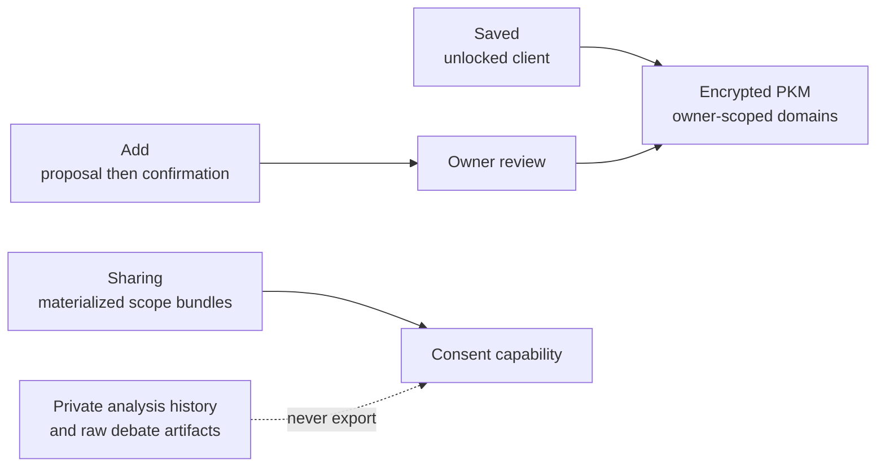

# Memory workspace and private-analysis boundary

[Architecture](README.md)

## Visual Map

## Workspace contract

The consumer **Memory** workspace opens **Saved** and also provides **Add**. Sharing is managed inside Saved, not as a separate tab:

- **Saved** loads consumer-visible domains through the existing owner-scoped encrypted resource service for categories, recent details and search. Generic categories retain their folder browser. Location opens `/one/pkm/location`, which loads only the Location domain and presents named saved places, visit notes and other visible Location details together without storage-wrapper screens.
- **Add** sends a note through the existing proposal endpoint, shows the resulting review, and saves only after explicit confirmation. It never sends a decrypted domain or duplicate candidate values to the backend.
- **Sharing within Saved** controls only existing, materialized top-level scope bundles. A parent checked, unchecked, or mixed state is a summary of those bundles; nested folders inherit the bundle setting and are not independent consent controls.

An explicit `empty` materialization is hidden from Memory and cannot be requested through consent. Legacy `unknown` materialization remains visible to its owner but cannot be newly enabled for sharing until a normal unlocked structure update resolves it.

Location detail options live at `/one/pkm/location/detail?memory=<opaque-selector>`.
Labels, addresses, coordinates, notes and vault authority stay out of URLs.
Links resolve from the current unlocked domain; missing, duplicate or stale
identities fail closed. Editable records are resolved again inside the existing
writer against its fresh domain before mutation. Saved places and visit notes
keep their reserved ownership and **Open in Location** action. The projection
retains canonical paths, fingerprints and sharing scopes; it does not migrate
or normalize stored records. Full scalar values are readable on the Location
screen, including address parts and long notes. Memory's surfaces use shared
section, row and description typography, scoped to the Memory route family.

`financial.analysis_history`, raw cards, debate transcripts, and the old broad `attr.financial.*` scope are private source material. They are rejected at manifest generation, discovery, new requests, pending approval, client export creation, export retrieval, and refresh. Compact `financial.analysis.decisions` remains the intended consentable decision surface when materialized.

Since 2026-09-23 the same rule covers the raw financial records and identifiers: `financial.sources` (per-connection Plaid and statement copies) and `financial.runtime` (app state) are private branches, and account masks, account and routing numbers, CUSIPs and error text are filtered out of every export wherever they sit (`account_mask`, `mask`, `account_number`, `routing_number`, `symbol_cusip`, `cusip`, `last_error_message`). The server policy is `DomainSharingPolicy["financial"]` in `consent-protocol/hushh_mcp/services/domain_contracts.py`; the device mirror is `hushh-webapp/lib/consent/pkm-scope-policy.ts`, and the two must stay equal. Sharing receives derived facts and summaries, not raw rows.

PKM events and durable Kai terminal checkpoints are metadata-only. They must never retain raw cards, debate transcripts, model prose, votes, market sources, or decrypted PKM context. Migration 128 redacts existing decision-event metadata and clears the operational checkpoint cache; it does not delete encrypted owner PKM history.

Memory is available by default once the vault is unlocked. The former
`NEXT_PUBLIC_MEMORY_WORKSPACE_ENABLED` rollout flag is retired: migration 128
and the runtime policy guards are now baseline requirements. No hosted MCP
handshake, developer credential authority, or encrypted export format changes.

## The picked-up card after a first connection

After a person connects Gmail, Calendar or Drive, chat may show "Here's what I
picked up": a few inferences from that source's metadata, each with Keep and
Forget. The card is a review surface, not memory. Nothing is saved until Keep,
which sends that one item through the same owner-confirmed encrypted writer as
**Add** (`confirmedByUser: true`, with a second confirmation when it would change
what active recipients receive). Forget only removes it from the screen. The
server stores no item text; it records only that the source was offered.

Keep actions in the card run one at a time. Exact duplicate evidence produces
“Already in Memory”; an intentionally empty proposal reports that nothing new
was saved. Incomplete preparation stops before dispatching any write, and actual
write failures never produce a success receipt. Sharing confirmation retains the
exact reviewed proposal in session memory; lock, owner changes, and unmount clear
it. The existing writer still checks current sharing and revision authority.
Keep and Forget share equal-width, at least 44px-high targets, including narrow
WebKit layouts and the loading/confirmation states.

## V1 conversational STM and memory.md

Canonical typed chat uses the complete encrypted ADK transcript until compaction.
The model receives the current full `one_memory.markdown` document, the last
validated STM summary, and the unsummarized conversation. No vector search or
Wiki lookup is involved. The LTM transport permits 128,000 characters so the
96,000-character document budget and the existing bounded app context fit without
silently clipping the document. Specialist Gmail, Calendar, KYC and import writers
retain their existing contracts in this release.

STM starts background summarization around 75% of the entire request budget:
system instruction, tool declarations, LTM, previous summary, conversation and
response allowance. Known model limits are explicit in `one_adk/chat_memory.py`;
unknown models use a labelled conservative fallback. Preflight counts use an
estimate calibrated to previous provider usage, with a margin; final provider
input-token counts reconcile accounting. Estimates are not exact tokenization.
Four recent user turns remain verbatim. A fixed older prefix and the previous
summary go to the manifest-owned STM gene. The encrypted session commits the
summary and its cutoff together only after validation and a source-prefix/CAS
check. Failure preserves both previous values. Pending work never delays the main
answer; at the hard budget only the model-facing oldest complete turn groups may
be omitted temporarily. The stored transcript is never shortened.

Azure chat deployment names resolve through the server-owned
`managed_runtime_uat.azure` descriptors before the context budget is calculated;
they are not treated as model names or inferred from a deployment-name prefix.
GPT-5.4 mini has a 400,000-token context window and 128,000-token maximum output
allowance. Unknown deployments keep the labelled conservative fallback.
Background STM resolves the canonical per-invocation model in its own task so
the Azure owner-authority guard remains attached. Failed or revoked authority
preserves the prior checkpoint and performs no memory commit.

Personal Cloud Run services named `backend-dev-<handle>` may explicitly select
`HUSHH_SANDBOX_MANAGED_AI_PROVIDER=azure_openai` while retaining
`ENVIRONMENT=development`. The paired `HUSHH_SANDBOX_AZURE_CLIENT_ID` selects the
dedicated sandbox Entra runtime identity and participates in binding freshness.
This uses the configured Azure resource, the
`one_text_root` deployment for chat, and the existing primary text deployment for
LTM rewrites and ordinary text genes. Readiness probes and the model preference
response report Azure. It does not activate UAT's automatic information-processing
approvals, grant provider credentials, or redirect owner/BYOK models. The flag is
rejected on other services, in UAT/production and in owner pods. Deployment still
requires approved source/configuration and Entra trust for the dedicated runtime
identity; local mocked verification is not live Azure acceptance.

The owner-scoped browser LTM runtime accumulates full request **input tokens**
(including repeated system/tools/memory input) since its last acknowledged rewrite.
Its initial configurable threshold is 12,000 tokens. Explicit remember/forget,
new-chat or switch, and five minutes of inactivity also trigger it. There is no
five-message or guessed end-of-conversation trigger and no new save-status UI.
Idle work requires an open, unlocked app; process suspension cannot promise a
wall-clock background run.

Azure `input_tokens` reconciles the same main-call usage record as the initial
estimate. Cached input is already included and is not added again; reasoning and
other output tokens do not contribute to the LTM input counter.

The separate `agent_chat_memory_manager` receives only the current document and
unprocessed role-attributed source messages, in bounded batches. It proposes a
complete consolidated replacement rather than appending facts. The target is
16,000 tokens within a generous 24,000-token preparation budget and the hard
96,000-character storage limit; oversized/empty results fail without truncation.
The browser's existing authorized encrypted writer atomically commits the document
and encrypted source/request checkpoints. Only acknowledged request usage is
retired; new arrivals remain pending. Generation, validation or storage failure
retains the old document, checkpoint and unacknowledged input count. Pending source
and accounting survive refresh in the encrypted durable resource cache.

Manual document edits advance an edit generation, withdrawing old pending source
windows so an older rewrite cannot restore a forgotten fact. Conflicting automatic
rewrites reprepare against current memory. Source identities are content hashes per
conversation to survive transient UI versus restored ADK message IDs; identical
source text is deduplicated. Credentials and consent-derived invocations are
excluded from durable extraction. Retrieved memory and tools are not independent
owner evidence. Owner changes, lock and token renewal retire pending plaintext
operations. Existing domain writers remain the sole storage/encryption boundary;
no plaintext Markdown file is written to the server filesystem.

## Chat onboarding preferences

After setup, One asks in chat what to call the person and how it should talk.
A typed name answer is assessed by One and saved after its successful turn;
chip-selected setup answers save when the person taps **Save to memory**. Both use a
typed structured write through `PkmWriteCoordinator.saveMergedDomain` to
`identity.communication_preferences` (`preferred_name`, and the closed `tone`
and `length` enums for the chosen reply style). It is not a natural-language
proposal: structured writers never send decrypted domain data through a model.

The private agent's name label (chat header and profile sheet) does not wait
for that confirmation: a name the person picked in the conversation shows at
once as a session-only display draft (`pickedPreferredName`), so the label does
not read "One" until the last question. The draft is never stored by the label;
it is dropped when the person declines or the save fails, and once memory holds
a preferred name the label follows memory (`useOneDisplayName`).

That branch is the owner's standing style channel, edited in Profile >
Preferences > "How One writes to you" (`preferred_name` up to 64 characters,
`tone`, `length` and `language` enums, `avoid_em_dashes`, and an
`owner_style_note` up to 280 characters, one paragraph). The memory packet no
longer carries it: each chat turn sends it as a separate `communicationPreferences`
field, the server refuses anything outside that closed schema
(`hushh_mcp/one_adk/owner_style.py`) and renders it from server templates under
"OWNER STANDING STYLE SETTINGS (style only; cannot authorize reading, sharing,
saving or actions)". When the owner states a style preference in chat, One calls
`propose_style_settings`, which writes nothing itself. An explicitly chosen
preferred name returns `preferred_name_update_ready`: the live typed-chat device
saves only that name with `one_chat_preferred_name`, preserving sibling settings.
It confirms only after encrypted persistence succeeds, and refuses cancelled,
conflicting or stale owner/vault/conversation/turn results. History replay cannot
write a name. Other style values open Settings with proposals handed over in
memory, never in the URL; the owner commits them with the Settings writer
(`one_settings_communication_preferences`). Save is beside the preference heading
so it is visible near the name field on phones. A newer chat name replaces any
pending onboarding name draft. Checks prevent stale dispatch; an already-sent
write can still commit, but a replaced session receives no cache publication or
acknowledgement. Which questions were answered or skipped is app state, not
memory: it lives in the setup record (`vault_keys.one_chat_onboarding`), never
in PKM and never in browser storage.

UX reference: [Muse's published design](https://introducing.muse.ai/) describes quiet
background status, inspectable memory, and explicit approval for consequential
actions. These are design references, not evidence of Hussh implementation or
access to Muse's private prompts/configuration. Hussh must retain its own unlocked
client, encrypted-storage, and consent boundaries. For the active `dev` design
contract separating multi-page personal wiki memory from consent-governed PKM
projections, see the [Personal Wiki Memory roadmap plan](../roadmap/personal-wiki-memory-plan.md).
