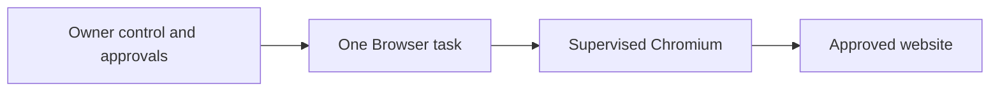

# Browser

[Modules](README.md)

[Architecture](../README.md) · [Documentation](../../README.md)

Allow One to research and interact with websites in the same owner container while preserving direct owner control.

## Visual Map

## Principal journey

View the session, take control, log in manually, hand back after a fresh observation or stop the task.

## Components and dependencies

The ADK specialist composes a bounded task, broker, action approvals, session storage and supervised Chromium process.

## Trust boundary and limits

Development admission and exact image, host, model and policy qualification remain required. One and Browser share a non-root compromise boundary. Chromium sandbox is enabled on GCP and explicitly disabled on Azure. Application checks do not contain compromised Browser code. Manual login suppresses model observations; unknown external effects must not replay.

## Implementation and operation

- [Browser execution contract](../../../consent-protocol/docs/reference/private-browser-runtime.md)
- [Installed acceptance](../../operations/acceptance/private-agents.md)
