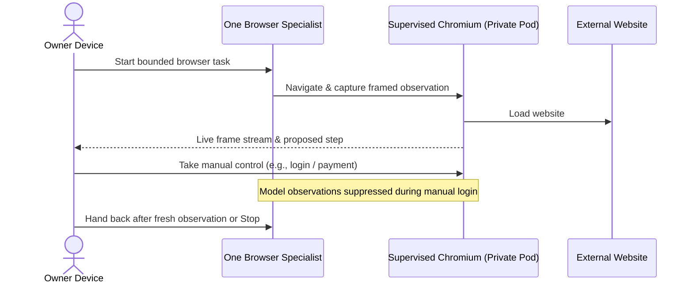

# Browser

[Modules](README.md) · [Architecture](../README.md) · [Documentation](../../README.md)  
**Status:** `Preview` · **Intent:** Explanation & trust-boundary reference

Browser (Computer Use) lets One research and interact with live websites inside an owner's qualified private runtime while keeping visual supervision, manual login takeover, sensitive-action approvals, and immediate stop controls in the owner's hands.

## Visual Map

## Owner journey

1. **Watch live:** Follow every step through streamed frames and explicit task status rather than blind background clicks.
2. **Take over safely:** Click to take direct control for logins, sensitive forms, or payments; model observation pauses while you enter credentials manually.
3. **Approve or stop:** Confirm sensitive site actions explicitly or halt the task at any instant without replaying uncertain side effects.

One's admitted Browser hand prepares an invocation for the current owner. An
accepted receipt refreshes the existing Browser task card, where approval and
controls remain available. AG-UI and opt-in native ADK Chat use the same discovery
callback; native notices are deduplicated by invocation, call and task. Reconnect
rediscovers the existing task.

## Saved website logins

**Status: source candidate.** Memory → Website logins manages the reserved
`credentials` PKM domain. Each record has its own encryption key, an owner vault
wrap and, when enabled, a wrap for the current private pod. The plaintext PKM
index contains bookkeeping only. Labels, approved origins and username hints
remain inside the encrypted domain's `summary`; passwords, authenticator setup
keys and private notes live in `secrets`.

During an approved Browser task, native ADK identifies the sign-in surface and
explicit input targets. The private credential hand returns opaque handles for
the verified HTTPS origin. The broker enforces the saved record's policy:

| Policy | Behavior |
| --- | --- |
| Automatic | Use a single eligible login during the approved task, within the owner's unexpired custody grant. |
| Ask before sign-in | Require an exact owner review before the private fill. |
| Unlocked vault only | Require the owner picker and a task-bound, one-use sealed payload; no persistent pod wrap. |

An ambiguous match requires owner selection. Unsaved logins, passkeys and CAPTCHA
retain manual takeover. Autonomous network authority covers only the exact
verified native sign-in POST and its observed same-origin GET redirects.
Other submissions retain their existing review requirements. Unsupported forms
return to owner control. The private hand keeps passwords and TOTP values out of
model arguments and task transcripts. Protected entry suppresses model
observations and previews. Before the private hand resumes model observation, it
verifies field cleanup and refuses exact secret echoes in native DOM text, live
form values and open shadow roots. Closed shadow roots and embedded documents are
refused because this guard cannot inspect their complete rendered content.

Manual Resume uses the owner's explicit handback, its existing field-clear check
and a fresh observation.

This check does not attest arbitrary canvas or image pixels, or script changes
after observation resumes. Those limits remain part of the pending qualification;
the source candidate's readiness flags remain closed.

The owner selects a custody access duration when saving, may renew it, and can
remove or rotate a record. Source revisions, record generations, recipient keys,
consent expiry and revocation are checked again at use. Removing a login stops
future credential use; **Forget** separately removes a remembered Browser
session. Changing the vault passphrase rewraps the existing master key.

Sharing starts from the selected record's owner controls. The owner reviews a
registered recipient and chooses summary or secret details. The existing Consent
Protocol issues an exact item grant and recipient-encrypted V2 export. These
records remain unavailable to external discovery, broad requests and wildcard
grants. A shared snapshot does not silently share later password changes.
Revocation stops future reads, but cannot recall a recipient's decrypted copy.

Controlled Chromium and PostgreSQL checks exercise the candidate. They do not
qualify either cloud image, prove process containment or certify destruction of
every immutable runtime copy. Installed image qualification and physical-device
acceptance remain required; qualification flags stay closed without that proof.

## Trust boundary and limits

> [!CAUTION]
> **Shared Container Compromise Boundary:** Inside a private pod or Hussh Confidential Sandbox (Google Cloud `gVisor`), One and supervised Chromium share a non-root container boundary. Chromium's internal sandbox is enabled on Google Cloud and explicitly disabled in reviewed Azure BYOC Container Apps configuration; application checks alone do not contain compromised browser code.

- Development admission plus exact image, host, model, and policy qualification remain mandatory before enabling Browser.
- Manual login suppresses model observations; uncertain external side effects never auto-replay.

## Implementation and operation

- [Browser execution contract](../../../consent-protocol/docs/reference/private-browser-runtime.md)
- [Installed acceptance](../../operations/acceptance/private-agents.md)
- Tracking issues: [#9511](https://github.com/hushh-labs/hushh-research/issues/9511) · [#9744](https://github.com/hushh-labs/hushh-research/issues/9744)

<strong>For coding agents: Browser runtime invariants</strong>

- **Control epoch fencing:** Every browser input, takeover, handback, and download route must enforce incarnation and control-epoch monotonicity.
- **No blind replay:** Unknown post-click states must settle safely and ask the owner rather than re-submitting forms or payments.
- **Verification:** Run browser runtime and capability contract tests in `consent-protocol/tests/`.

