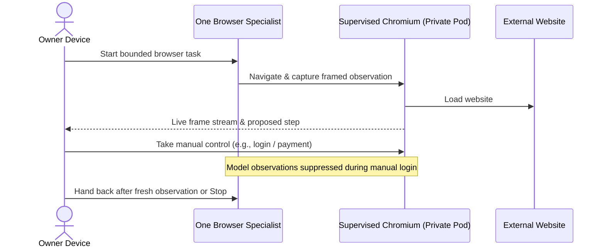

# Browser

[Modules](README.md) · [Architecture](../README.md) · [Documentation](../../README.md)  
**Status:** `Preview` · **Intent:** Explanation & trust-boundary reference

Browser (Computer Use) lets One research and interact with live websites inside an owner's qualified private runtime while keeping visual supervision, manual login takeover, sensitive-action approvals, and immediate stop controls in the owner's hands.

## Visual Map

## Owner journey

1. **Watch live:** Follow every step through streamed frames and explicit task status rather than blind background clicks.
2. **Take over safely:** Click to take direct control for logins, sensitive forms, or payments; model observation pauses while you enter credentials manually.
3. **Approve or stop:** Confirm sensitive site actions explicitly or halt the task at any instant without replaying uncertain side effects.

One's admitted Browser hand prepares an invocation for the current owner. An
accepted receipt refreshes the existing Browser task card, where approval and
controls remain available. AG-UI and opt-in native ADK Chat use the same discovery
callback; native notices are deduplicated by invocation, call and task. Reconnect
rediscovers the existing task.

## Saved website logins

**Status: source candidate under the owner-reviewed Secrets refactor.** Website
logins live in the existing encrypted `secrets.items` area in Memory, with
`sec_<16-hex>` identifiers. One and Search Console use
[`WebsiteCredentialItemV1`](../../../contracts/pkm/website-credential-item.v1.json):
the existing `value` password and `credential` metadata gain versioned exact
origins, an optional verification-code seed, a remembered-session preference and
an item revision. Edits preserve unrelated Secrets records and unknown encrypted
fields. The plaintext PKM sidecar remains bookkeeping only.

Passwords and verification-code seeds unlock only with the owner's personal
key. There is no standing pod password wrap or automatic background sign-in.
Native ADK identifies the current sign-in surface and explicit targets. The app
shows fixed security chrome naming the verified site: **Sign in to this site?**
with **Allow** and **Type myself**. The owner selects a matching Secrets record
on the unlocked device. Allow seals one short-lived, single-use, domain/task/
control-epoch-bound lease directly to an ephemeral key held by the active
Sandbox Browser worker. The Hub, chat history and AI model never receive its
plaintext. A metadata check of current source revisions conveys no password
custody or execution authority.

Canonical migration467 admits `browser.credential_fill` through the existing
single-use private action ledger. It preserves the owner-confirmation, trusted
activation and resource-binding checks and qualifies historical replay against
exact validated successor constraints. Application rollback preserves review
history; SQL rollback refuses while credential-fill receipts remain. No live
migration or installed qualification is implied by this source candidate.

The hardened private entry hand retains exact HTTPS-origin and masked-target
checks, owner approval, model-observation suppression, replay fencing and
immediate owned-buffer cleanup. A bound native authentication POST and accepted
same-origin GET redirects retain the existing effect journal. Other writes still
require their own review. Unsupported forms, passkeys and CAPTCHA retain manual
control. **Type myself** uses existing private takeover; explicit Resume retains
field cleanup and a fresh safe observation.

**Stay signed in for this site** defaults off. The saved-login path may retain
only that origin's revocable session cookies through the existing encrypted
Browser session store when the owner opts in. Passwords and verification-code
seeds never become remembered session state. **Forget** and **Pause when I'm
offline** / Session-only lockdown retain their existing immediate fences.

Completed, cancelled and superseded sign-in/review prompts settle to bounded
static activity receipts in the existing owner-encrypted ADK chat journal.
Receipts contain enums and opaque task/operation identifiers, at most 256 UTF-8
bytes each. Historical restoration renders a one-line receipt without mounting
live task controllers or polling an idle Browser.

Sharing reuses owner-started exact `attr.secrets.items.<sec_id>` grants and the
existing PostgreSQL Consent Protocol and recipient-encrypted V2 exports.
External discovery, broad Secrets requests and wildcard grants stay refused.
Source revision, recipient key, expiry and revocation are checked at use;
refresh cannot manufacture a new grant or extend its original expiry. Revocation
stops future reads but cannot recall a recipient's already-decrypted copy.
Search Console's temporary link/audit bridge remains a separately tracked
[#9736](https://github.com/hushh-labs/hushh-research/issues/9736) retirement before
Production; this source change does not claim that retirement is complete.

An explicit unlocked-device import can recover records from the superseded
`credentials` candidate into canonical Secrets. It preserves the old ciphertext,
uses stable import identity, and verifies the canonical write before reporting
success. Removing the obsolete writer and standing custody never deletes old
encrypted records or reinterprets their grants as Secrets authority.

Controlled source tests and synthetic Chromium probes do not qualify a serving
Sandbox image, prove OS/UID containment or certify erasure of every immutable
runtime copy. Saved-login qualification stays closed without exact installed
image/host/model evidence. Phase 3 Confidential Sandbox acceptance on Dev and
UAT across Web, iPhone and Android remains separate. Azure and Puppy qualification
stay paused until the dedicated pod/hardware handoff under
[#9511](https://github.com/hushh-labs/hushh-research/issues/9511#issuecomment-7209970731).

## Trust boundary and limits

> [!CAUTION]
> **Shared Container Compromise Boundary:** Inside a private pod or Hussh Confidential Sandbox (Google Cloud `gVisor`), One and supervised Chromium share a non-root container boundary. Chromium's internal sandbox is enabled on Google Cloud and explicitly disabled in reviewed Azure BYOC Container Apps configuration; application checks alone do not contain compromised browser code.

- Development admission plus exact image, host, model, and policy qualification remain mandatory before enabling Browser.
- Manual login suppresses model observations; uncertain external side effects never auto-replay.

## Implementation and operation

- [Browser execution contract](../../../consent-protocol/docs/reference/private-browser-runtime.md)
- [Installed acceptance](../../operations/acceptance/private-agents.md)
- Tracking issues: [#9511](https://github.com/hushh-labs/hushh-research/issues/9511) · [#9744](https://github.com/hushh-labs/hushh-research/issues/9744)

<strong>For coding agents: Browser runtime invariants</strong>

- **Control epoch fencing:** Every browser input, takeover, handback, and download route must enforce incarnation and control-epoch monotonicity.
- **No blind replay:** Unknown post-click states must settle safely and ask the owner rather than re-submitting forms or payments.
- **Verification:** Run browser runtime and capability contract tests in `consent-protocol/tests/`.

