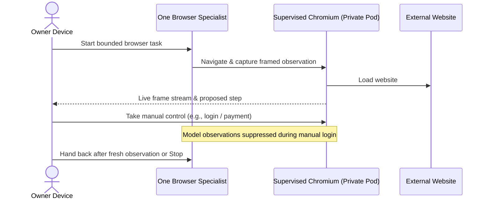

# Browser

[Modules](README.md) · [Architecture](../README.md) · [Documentation](../../README.md)  
**Status:** `Preview` · **Intent:** Explanation & trust-boundary reference

Browser (Computer Use) lets One research and interact with live websites inside an owner's qualified private runtime while keeping visual supervision, manual login takeover, sensitive-action approvals, and immediate stop controls in the owner's hands.

## Visual Map

## Owner journey

1. **Watch live:** Follow every step through streamed frames and explicit task status rather than blind background clicks.
2. **Take over safely:** Click to take direct control for logins, sensitive forms, or payments; model observation pauses while you enter credentials manually.
3. **Approve or stop:** Confirm sensitive site actions explicitly or halt the task at any instant without replaying uncertain side effects.

## Trust boundary and limits

> [!CAUTION]
> **Shared Container Compromise Boundary:** Inside a private pod, One and supervised Chromium share a non-root container boundary. Chromium's internal sandbox is enabled on GCP and explicitly disabled in Azure's reviewed configuration; application checks alone do not contain compromised browser code.

- Development admission plus exact image, host, model, and policy qualification remain mandatory before enabling Browser.
- Manual login suppresses model observations; uncertain external side effects never auto-replay.

## Implementation and operation

- [Browser execution contract](../../../consent-protocol/docs/reference/private-browser-runtime.md)
- [Installed acceptance](../../operations/acceptance/private-agents.md)

<strong>For coding agents: Browser runtime invariants</strong>

- **Control epoch fencing:** Every browser input, takeover, handback, and download route must enforce incarnation and control-epoch monotonicity.
- **No blind replay:** Unknown post-click states must settle safely and ask the owner rather than re-submitting forms or payments.
- **Verification:** Run browser runtime and capability contract tests in `consent-protocol/tests/`.

