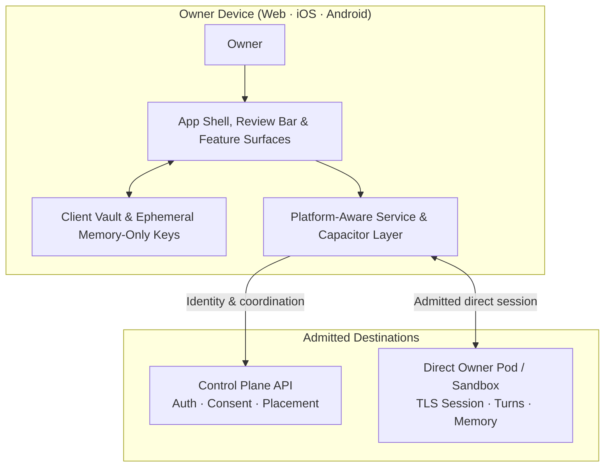

# App and native clients

[Modules](README.md) · [Architecture](../README.md) · [Documentation](../../README.md)  
**Status:** `Live` · **Intent:** Explanation & module reference

Hussh delivers one unified experience across **Web, iOS, and Android** where the owner's device remains the sole home of the Master Vault Key, local biometric unlock, deterministic Back navigation, and explicit action review.

## Visual Map

## Owner journey

1. **Open & orient:** Launch Web, iOS, or Android with warm cache-first rendering bound strictly to the validated session owner.
2. **Unlock locally:** Unlock the personal vault on-device via passphrase or biometric passkey; the Master Vault Key never leaves device memory.
3. **Act & review:** Converse with One, inspect pending drafts or consent requests, and confirm or cancel sensitive actions with predictable Back navigation back to the origin screen.
4. **Recover safely:** Switching accounts or locking the vault immediately clears in-memory credentials and invalidates stale in-flight requests.

## Trust boundary and limits

> [!CAUTION]
> **Session Is Not Vault Authority:** Being signed into the app does not unlock personal vault capital or grant consent to disclose information. Every cached screen must stay strictly bound to the current validated owner and vault session epoch.

- Client caches never persist plaintext personal capital to browser storage.
- Native plugins (iOS Swift and Android Kotlin) own platform-specific biometrics, keystore, deep links, and notifications without bypassing consent contracts.

## Implementation and operation

- [Web and native implementation](../../../hushh-webapp/docs/README.md)
- [Route contracts](../../development/contracts/route-contracts.md)
- [Cache coherence reference](../../development/contracts/cache-coherence.md)

<strong>For coding agents: client invariants and checks</strong>

- **Tri-flow parity:** Any cross-platform route or connector change must cover Web, iOS, and Android (or declare N/A explicitly with reason).
- **Owner-epoch fencing:** Every async client read/write must verify validated auth owner and vault session epoch before mutating UI state.
- **Required local checks:** `cd hushh-webapp && npm run typecheck && npm run verify:ui-contracts && npm run ui:doctor`.

