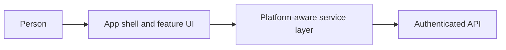

# App and native clients

[Modules](README.md)

[Architecture](../README.md) · [Documentation](../../README.md)

Provide a coherent web, iOS and Android experience with local unlock, navigation and reviewed actions.

## Visual Map

## Principal journey

Open a task, unlock when required, review its effect and retain a meaningful return destination.

## Components and dependencies

The service layer and platform transports connect the UI to admitted backend routes. Native plugins own platform-only behavior.

## Trust boundary and limits

A signed-in screen is not vault or consent authority. Cache state must remain owner-bound.

## Implementation and operation

- [Web and native implementation](../../../hushh-webapp/docs/README.md)
- [Route contracts](../../development/contracts/route-contracts.md)
