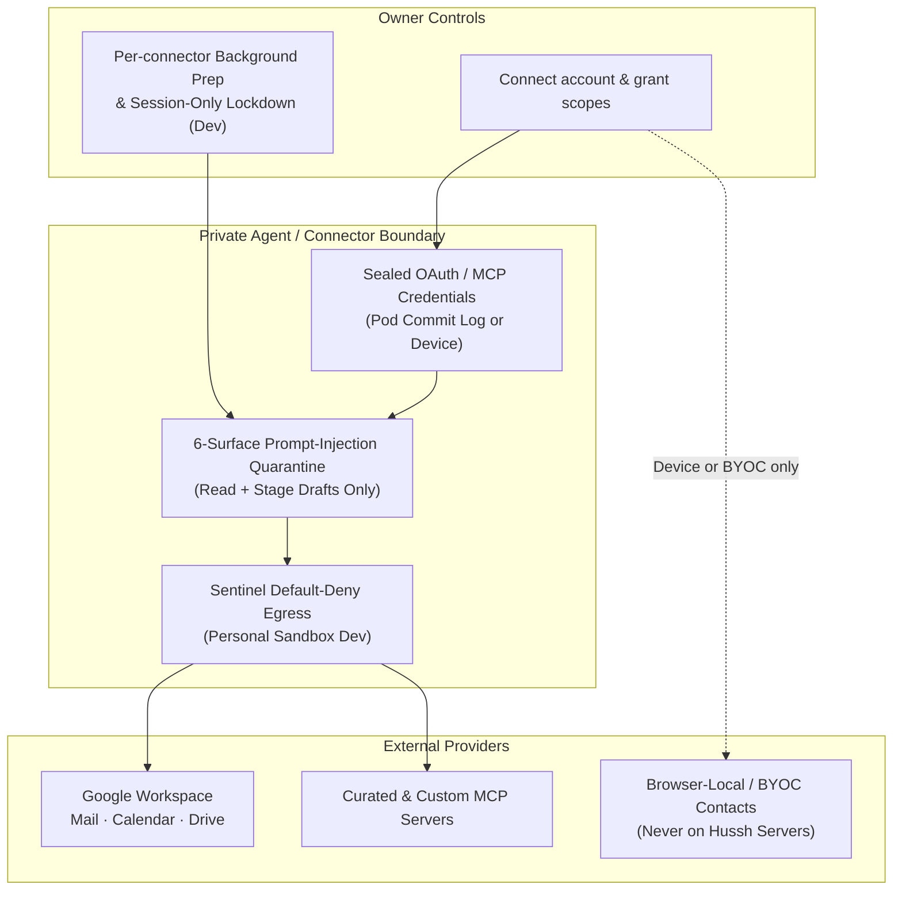

# Connected services

[Modules](README.md) · [Architecture](../README.md) · [Documentation](../../README.md)  
**Status:** `Live` (Foreground & BYOC Connectors) · `Preview` (Quarantined Background Prep & Per-Connector Toggles on Dev) · **Intent:** Explanation & module reference

Connected services let One work across Gmail, Google Calendar, Google Drive, Contacts, financial accounts, and custom MCP servers using least-privilege grants, without turning a connector into an unrestricted copy of your digital life.

## Visual Map

## Owner journey

1. **Connect with clarity:** Link a service with explicit scope explanations (for example, read-only vs drafts/changes after confirmation).
2. **Customize background help (Dev preview):** Linking a connector enables quiet background preparation by default; owners can toggle individual connectors in the detailed connector view or pause all offline wakes via **Session-only lockdown** in Hosting.
3. **Review every outbound action:** Even during automated background preparation, untrusted content from Mail, Calendar, Drive, Contacts, External MCPs, or Browser cannot trigger sends, deletes, or shares; drafts wait cleanly for your tap.
4. **Repair or disconnect:** Expired grants or revoked credentials fail visibly with a clear reconnect path rather than silent stale answers.

## Trust boundary and limits

> [!CAUTION]
> **Universal 6-Surface Prompt-Injection Quarantine & Contacts Privacy:** Background turns reading untrusted external text structurally strip all outbound mutation tools at the runtime boundary. Contact lookups (`people.googleapis.com`) never run on Hussh-operated servers; they stay strictly browser-local or inside customer-owned BYOC agents.

- Provider caches never become durable PKM memory without consented curation or save.
- Unclassified custom MCP tools fail closed during quarantined background turns.

## Implementation and operation

- [Connector catalog](../one/curated-mcp-connectors.md)
- [Owner-approved email](../one/gmail-owner-approved-email.md)

<strong>For coding agents: connector security invariants</strong>

- **Contacts law:** Never reference `people.googleapis.com` in any Hussh-operated server module (`test_contacts_never_reach_the_server.py` fails CI immediately).
- **Quarantine & config:** Background prep reads `PodConfig` (`session_only_lockdown`, `background_prep_<connector>`, `background_daily_wake_cap`) and enforces `hushh_mcp/operons/background_quarantine.py`.
- **Verification:** Run `test_contacts_never_reach_the_server.py`, `test_stage2a_autonomous_wake_and_quarantine.py`, and `connectors-panel.test.tsx`.

