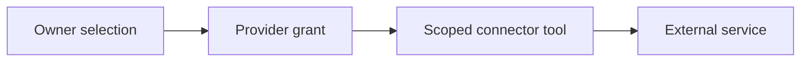

# Connected services

[Modules](README.md)

[Architecture](../README.md) · [Documentation](../../README.md)

Connect accounts and refresh their permitted access without making a connector an unrestricted copy of a person’s life.

## Visual Map

## Principal journey

Choose a service, grant its required scopes, run the approved operation and retain a repair or revocation path.

## Components and dependencies

Connection services, OAuth callbacks, scoped credentials and specialist tools implement the provider boundary.

## Trust boundary and limits

A missing grant, expired credential or expanded scope requires intervention. Provider caches do not become PKM memory without a consented save.

## Implementation and operation

- [Connector catalog](../one/curated-mcp-connectors.md)
- [Owner-approved email](../one/gmail-owner-approved-email.md)
