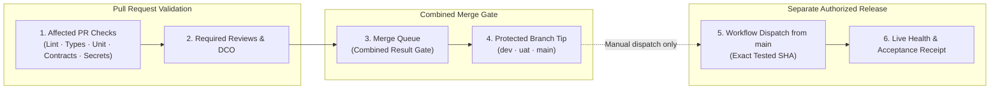

# Delivery and operations

[Modules](README.md) · [Architecture](../README.md) · [Documentation](../../README.md)  
**Status:** `Live` · **Intent:** Explanation & governance reference

Hussh separates **code validation**, **merge admission**, and **environment deployment** into independent, auditable gates. Merging code never silently deploys any environment, and every rollout targets one exact, CI-verified commit.

## Visual Map

## Owner journey

1. **Validate locally first:** Reproduce affected lint, type, UI contract, docs, and unit gates before opening a PR.
2. **Pass combined queue validation:** GitHub's Merge Queue validates the exact combined merge candidate before updating `dev`, `uat`, or `main`.
3. **Promote deliberately:** Operators explicitly dispatch environment workflows from `main` targeting an exact validated SHA, keeping Dev, UAT, and Production isolated.
4. **Confirm live provenance:** Verify running Cloud Run revisions, pod image digests, and live smoke checks before claiming rollout complete.

## Trust boundary and limits

> [!IMPORTANT]
> **Merges Deploy Nothing:** `main` owns trusted release workflows; protected `dev`, `uat`, and `main` histories supply application revisions. Historical receipts never substitute for live GitHub team membership or current-head validation.

- Pure documentation PRs skip heavy runtime build/test lanes via path filters and never disturb running UAT or Production workloads.
- Current production admission retains independent review, compatibility, and rollback gates.

## Implementation and operation

- [CI and deployment contracts](../../operations/releases/ci.md)
- [Branch governance](../../operations/releases/branch-governance.md)
- [Environments](../../operations/environments.md)

<strong>For coding agents: CI & release gate invariants</strong>

- **Pre-PR gate:** Run `./bin/hushh agents pre-pr --base-ref origin/<base>` (or affected checks) and `./bin/hushh agents review-route --pr <num> --apply` on every PR.
- **No silent suppression:** Never weaken branch protection, skip DCO signoff (`git commit -s`), or bypass Merge Queue / required checks.
- **Verification:** Follow `.agents/skills/repo-operations/references/admin-release-sop.md` and `verify-before-claim`.

