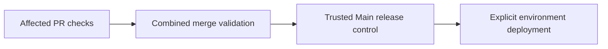

# Delivery and operations

[Modules](README.md)

[Architecture](../README.md) · [Documentation](../../README.md)

Validate code, admit authorized changes and explicitly release a frozen application revision.

## Visual Map

## Principal journey

Open a complete PR, pass affected checks, validate its combined merge result, then separately request deployment.

## Components and dependencies

Main owns trusted workflow execution; protected Dev, UAT and Main histories supply application revisions. Live GitHub teams grant current authority.

## Trust boundary and limits

Merges deploy nothing. Historical receipts do not grant current permission. Required review, exact-source authority, compatibility and rollback remain independent. Current production admission does not require a preceding UAT deployment.

## Implementation and operation

- [CI and deployment contracts](../../operations/releases/ci.md)
- [Branch governance](../../operations/releases/branch-governance.md)
