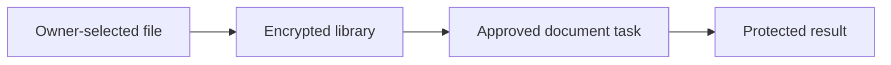

# Files and documents

[Modules](README.md)

[Architecture](../README.md) · [Documentation](../../README.md)

Organize encrypted files and process explicitly selected content through bounded document workflows.

## Visual Map

## Principal journey

Select a destination, transfer exact bytes, organize the file and authorize any model processing separately.

## Components and dependencies

The private library owns encrypted metadata and object custody; folder indexes are rebuildable hints. Documents processing has its own tasks and worker lifecycle.

## Trust boundary and limits

File chunks and catalogs are not recovery-log entries. A successful upload is not proof of later integrity or restoration. Shared and private Files have separate admission gates.

## Implementation and operation

- [Files operations](../../operations/hosting/private-files-library.md)
- [Protected document delivery](../one/protected-document-delivery.md)
