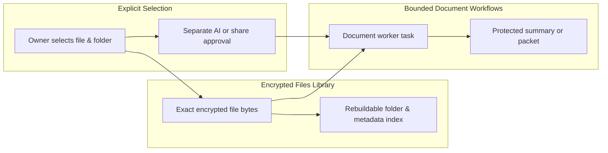

# Files and documents

[Modules](README.md) · [Architecture](../README.md) · [Documentation](../../README.md)  
**Status:** `Live` · **Intent:** Explanation & module reference

Hussh Files gives people an encrypted personal document library and bounded document-processing workflows, keeping raw file storage custody strictly separate from optional AI inspection or external sharing.

## Visual Map

## Owner journey

1. **Upload & organize:** Choose a destination folder and upload exact encrypted bytes into your private library (or Shared Files where admitted).
2. **Authorize processing separately:** Storing a file never grants automatic model reading; document analysis or packet preparation runs only when explicitly approved.
3. **Share with receipts:** Export or deliver protected documents through explicit consent grants rather than sharing raw storage buckets.

## Trust boundary and limits

> [!NOTE]
> **Separate Custody from Recovery Logs:** File chunks and folder catalogs are not commit-log recovery entries. Folder indexes are rebuildable hints, and Shared Files versus Private Pod Files maintain independent admission gates.

- An upload receipt proves exact byte storage, not future recovery without verified backup/restoration checks.
- Private Files requires a supported private pod or Personal Sandbox runtime.

## Implementation and operation

- [Files operations](../../operations/hosting/private-files-library.md)
- [Protected document delivery](../one/protected-document-delivery.md)

<strong>For coding agents: Files module invariants</strong>

- **Surface boundary:** Never mount private pod Files runtime routes on the shared multi-tenant hub.
- **Index rebuildability:** Treat folder index state as derived and repairable (`/api/one/pod/files/repair-index`), never as the sole source of file integrity.
- **Verification:** Run pod files, protected document delivery, and wiki/file bridge pytest suites.

