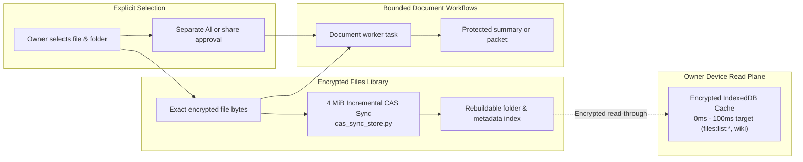

# Files and documents

[Modules](README.md) · [Architecture](../README.md) · [Documentation](../../README.md)  
**Status:** `Live` · **Intent:** Explanation & module reference

Hussh Files gives people an encrypted personal document library and bounded document-processing workflows, keeping raw file storage custody strictly separate from optional AI inspection or external sharing.

## Visual Map

## Owner journey

1. **Upload & organize:** Choose a destination folder and upload exact encrypted bytes into your private library across Hussh Confidential Sandbox (Dev preview), BYOC, or Local Puppy (legacy Shared Files remains only on non-cutover UAT/Prod lanes). Folder views and Personal Wiki on `/one/files` render in `0ms - 150ms` (`<100ms` target) from the device's encrypted IndexedDB cache (`hushh-owner-ui-cache`) without blocking behind a waking sandbox.
2. **Authorize processing separately:** Storing a file never grants automatic model reading; document analysis or packet preparation runs only when explicitly approved.
3. **Share with receipts:** Export or deliver protected documents through explicit consent grants rather than sharing raw storage buckets.

## Trust boundary and limits

> [!NOTE]
> **Separate Custody from Recovery Logs:** File chunks and folder catalogs are not commit-log recovery entries. Folder indexes are rebuildable hints. Legacy `Shared Files` versus Private Pod Files applies only to non-cutover UAT/Prod lanes; on Dev cutover lanes, Files runs inside the owner's single-owner namespace with `0ms - 150ms` (`<100ms` target) encrypted IndexedDB read-through caching (`hushh-webapp/lib/files/files-cache.ts`) and `4 MiB` incremental CAS workspace sync (`consent-protocol/hushh_mcp/services/pod_workspace/cas_sync_store.py`).

- An upload receipt proves exact byte storage, not future recovery without verified backup/restoration checks.
- Private Files requires a supported private pod or Hussh Confidential Sandbox runtime.

## Implementation and operation

- [Files operations](../../operations/hosting/private-files-library.md)
- [Protected document delivery](../one/protected-document-delivery.md)
- Tracking issues: [#9744](https://github.com/hushh-labs/hushh-research/issues/9744) · [#9370](https://github.com/hushh-labs/hushh-research/issues/9370)

<strong>For coding agents: Files module invariants</strong>

- **Surface boundary:** Keep legacy Shared hub isolation intact on non-cutover UAT/Prod lanes and never mount private pod Files runtime routes on the shared multi-tenant hub; on Dev cutover lanes, `/one/files` reads through `hushh-webapp/lib/files/files-cache.ts` (`files:list:<parent>:live`, `files:wiki:overview:v1`) backed by `consent-protocol/hushh_mcp/services/pod_workspace/cas_sync_store.py` (`<= 4 MiB` chunks).
- **Index rebuildability:** Treat folder index state as derived and repairable (`/api/one/pod/files/repair-index`), never as the sole source of file integrity.
- **Verification:** Run pod files, protected document delivery, and wiki/file bridge pytest suites.

