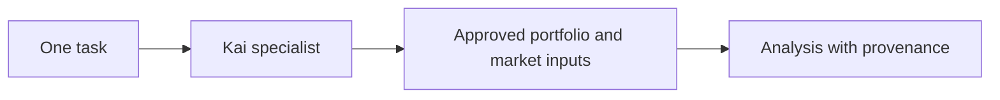

# Finance specialist

[Modules](README.md)

[Architecture](../README.md) · [Documentation](../../README.md)

Use Kai for bounded financial understanding under One’s task and consent authority.

## Visual Map

## Principal journey

Connect or select financial information, request an analysis and inspect the result and any degraded inputs.

## Components and dependencies

Portfolio import, provider services and finance tools support the specialist. Existing Kai identifiers remain compatibility contracts.

## Trust boundary and limits

Financial analysis does not imply permission to execute a trade. Provider freshness, access and degraded outcomes remain explicit.

## Implementation and operation

- [Finance contracts](../finance/README.md)
- [Accuracy contract](../finance/kai-accuracy-contract.md)
