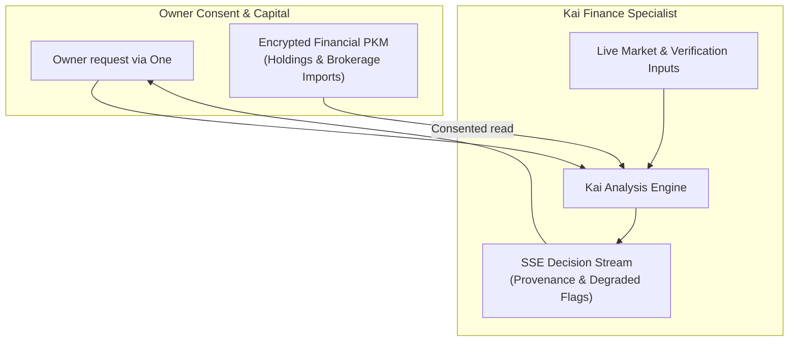

# Finance specialist

[Modules](README.md) · [Architecture](../README.md) · [Documentation](../../README.md)  
**Status:** `Live` · **Intent:** Explanation & module reference

**Kai** is One's dedicated finance specialist. Under One's task and consent authority, Kai helps people import holdings, monitor markets, and generate multi-perspective portfolio analyses with explicit data provenance and transparent degraded states.

## Visual Map

## Owner journey

1. **Import or connect safely:** Upload brokerage statements or link financial connections into your encrypted Vault without exposing credentials to unconsented surfaces.
2. **Analyze with transparency:** Stream structured recommendations showing exact ticker quality, filtered symbols, and any degraded upstream provider signals.
3. **Stay in full decision control:** Review insights and provenance calmly; Kai never places trades or moves funds on your behalf.

## Trust boundary and limits

> [!CAUTION]
> **Analysis Never Authorizes Execution:** Financial analysis grants zero authority to execute trades, initiate transfers, or mutate external brokerage accounts. Missing or stale market inputs must surface explicitly (`analysis_degraded`, `degraded_agents`) rather than fabricating certainty.

- Existing Kai route, package, and stream identifiers remain compatibility contracts under [brand and compatibility contract](../../operations/brand-and-compatibility-contract.md).

## Implementation and operation

- [Finance contracts](../finance/README.md)
- [Accuracy contract](../finance/kai-accuracy-contract.md)
- [Streaming contract](../../development/streaming/streaming-contract.md)

<strong>For coding agents: Kai contract invariants</strong>

- **Streaming parity:** Preserve required SSE decision event markers (`short_recommendation`, `analysis_degraded`, `degraded_agents`, `analysis_mode`) verified by `scripts/verify-doc-runtime-parity.cjs`.
- **Vault sovereignty:** Holdings remain encrypted in PKM (`financial` domain); never log plaintext balances or ticker allocations.
- **Verification:** Run Kai analysis, streaming contract, and Plaid vault sync test suites.

