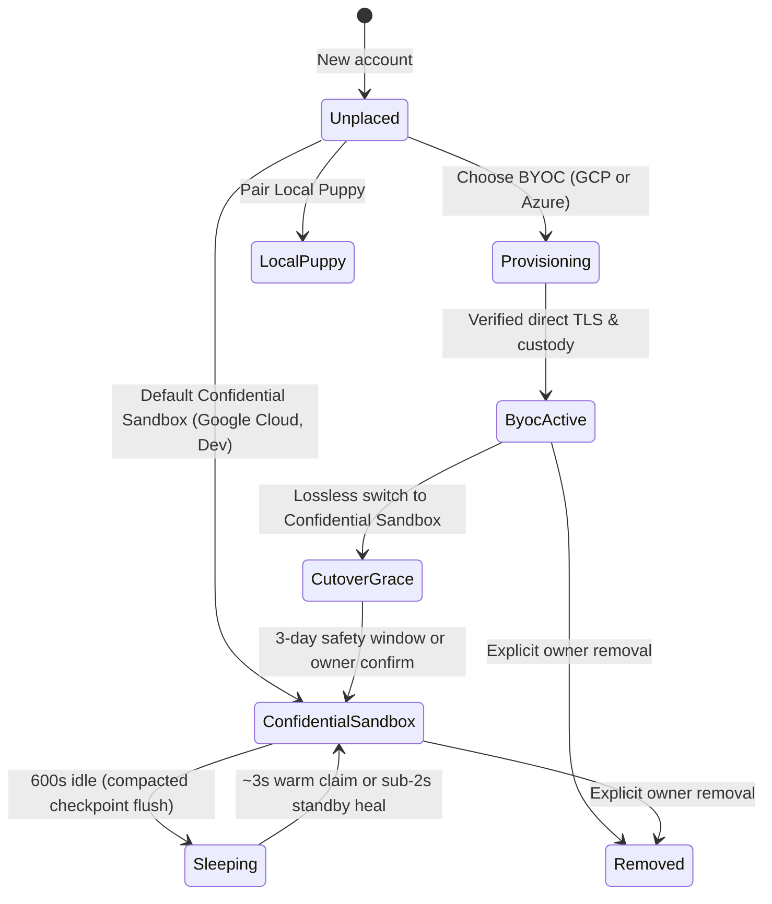

# Hosting and lifecycle

[Modules](README.md) · [Architecture](../README.md) · [Documentation](../../README.md)  
**Status:** `Live` (BYOC GCP/Azure & Local Puppy; legacy Shared on UAT/Prod) · `Preview` (Hussh Confidential Sandbox & Unified Wake Coalescer on Dev) · **Intent:** Explanation & lifecycle reference

People run One on one unified single-owner runtime across three placements: **Hussh Confidential Sandbox** (Google Cloud default at `$0` idle compute, Dev preview), **Bring Your Own Cloud** (Google Cloud or Microsoft Azure with customer KMS), and **Local Puppy** (owner silicon). On Dev cutover lanes, `Hussh Shared` and legacy GCP-to-Azure hosted-pod migration UI are retired. Every placement transition, upgrade, wake, and removal stays strictly accountable to the owner.

## Visual Map

## Owner journey

1. **Choose deliberately across 3 placements:** New accounts select among **Hussh Confidential Sandbox** (Google Cloud default, Dev preview), **Bring Your Own Cloud** (Google Cloud or Azure), and **Local Puppy** (`Hussh Shared` is retired on Dev cutover lanes; `unknown`, `unplaced`, and `pending` never collapse into Shared).
2. **Switch without data loss (Dev preview):** Moving from BYOC or legacy placement into Confidential Sandbox exports and verifies the sealed commit log head (with clean-shutdown compacted `OwnerRecoveryProjection` checkpoint flushes) and preserves a 3-day safety window on the prior cloud. Legacy hosted-pod GCP-to-Azure migration UI is retired on Dev cutover lanes.
3. **Wake quietly and read immediately (Dev preview):** One cloud-neutral Zero-Content Wake Coalescer wakes `ace` (`Hussh Confidential Sandbox`), `user_gcp`, and `user_azure` identically (~3s fast path for Circle/goal triggers; 15-minute quiet batching for routine connectors; bounded daily wake caps). Returning clients reuse 12-hour `pst1.` placement-bound sessions across wakes while rendering Chats, Files, and Personal Wiki in `0ms - 150ms` (`<100ms` target) from the device's encrypted IndexedDB replica (`hushh-owner-ui-cache`).
4. **Relay, upgrade, or remove transparently:** Puppy pairs through the Edge Gateway WebSocket relay (`/u/{hushh_id}/api/one/puppy/relay`) across both Confidential Sandbox and BYOC placements; BYOC updates require owner approval for the exact release; removal reconciles only deployment-owned resources and warns before cloud-only data loss.

## Trust boundary and limits

> [!IMPORTANT]
> **Distinct Placement States & Hard Sandbox Isolation:** `unknown`, `unplaced`, and `pending` are distinct states that never collapse into Shared. Hussh Confidential Sandboxes on Dev run single-use Google Cloud gVisor-isolated containers (no Azure sandbox pool claim) with zero mounted service-account tokens, stateless Edge Gateway TLS routing, `<2s` Kubernetes pod-termination inspection (`SANDBOX_HYDRATION_FAILED` plus automatic dead-standby replacement), compacted shutdown recovery checkpoints, and an out-of-sandbox Sentinel default-deny egress proxy.

- Managed Hussh Confidential Sandbox warm-pool claims and lossless multi-cloud cutover remain **Dev Preview** until UAT acceptance passes ([#9744](https://github.com/hushh-labs/hushh-research/issues/9744)).
- `Session-only lockdown` in Hosting immediately refuses offline background wakes on private pods.

## Implementation and operation

- [Private deployment operations](../../operations/hosting/dev-pod-first-light-runbook.md)
- [Deployment standard](../deployment-standard.md)
- [Moving a private agent between clouds](../pod-migration.md)
- [Agent Sandbox pool and Terminal plan](../../roadmap/personal-agent/agent-sandbox-microvm-plan.md)
- [Floci multi-cloud wire verification](../../development/quality/floci-multicloud-wire-verification.md)
- Tracking issues: [#9744](https://github.com/hushh-labs/hushh-research/issues/9744) · [#9511](https://github.com/hushh-labs/hushh-research/issues/9511) · [#9736](https://github.com/hushh-labs/hushh-research/issues/9736) · [#9517](https://github.com/hushh-labs/hushh-research/issues/9517) · [#9370](https://github.com/hushh-labs/hushh-research/issues/9370) · [#5507](https://github.com/hushh-labs/hushh-research/issues/5507)

<strong>For coding agents: hosting & wake invariants</strong>

- **Runtime classification:** `hosted_ace_runtime()` is `private_pod_runtime() == True` and `owner_cloud_agent() == False`; never blur those predicates (`test_personal_sandbox_harness_parity.py`). Cutover UI gating uses `isPooledSandboxSwitchAvailable()` in `hushh-webapp/lib/one/owner-cloud.ts`.
- **Stateless Edge Gateway & self-heal:** `consent-protocol/hushh_mcp/services/agent_sandbox/edge_gateway_app.py` routes `/u/{hushh_id}/...` HTTP and `WS /u/{hushh_id}/api/one/puppy/relay` passthroughs to the claimed sandbox IP, inspects Kubernetes pod termination in `<2s` (`inspect_pod_termination` -> `SANDBOX_HYDRATION_FAILED`), and automatically replaces dead pre-activation standbys.
- **Shutdown checkpoint & 12h sessions:** `consent-protocol/pod_server.py` flushes a compacted recovery checkpoint (`OwnerRecoveryProjection.recover(log, force_save=True)`) on clean shutdown, and `consent-protocol/hushh_mcp/services/pod_session_authority.py` issues 12-hour `pst1.` placement-bound browser sessions (`SESSION_TTL_SECONDS = 43200`) reused across wakes.
- **Zero-content wake law:** `/api/one/pod/wake/signal` rejects any PII/content/token keys (`ZeroContentViolationError`) and dispatches authenticated OIDC `POST /pod/tick` across `ace`, `user_gcp`, and `user_azure`.
- **Verification:** Run `./bin/hushh protocol floci` (Tier-1.5 multi-cloud storage, KMS custody, and prefix-gateway wire conformance; distinct from live cloud qualification), `test_pod_wake_reachability.py`, `test_stage2a_autonomous_wake_and_quarantine.py`, and `hosting-placement-states.test.tsx`.

