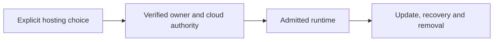

# Hosting and lifecycle

[Modules](README.md)

[Architecture](../README.md) · [Documentation](../../README.md)

Place One in an explicitly selected runtime and keep updates, recovery and removal accountable to its owner.

## Visual Map

## Principal journey

Select hosting, verify AI access, provision or resume the recorded operation, then approve exact updates or removal.

## Components and dependencies

Shared, GCP Cloud Run and Azure Container Apps use different provider authorities under existing placement and lifecycle contracts.

## Trust boundary and limits

Unknown, unplaced and pending are distinct states. Managed hosting and cross-cloud transfer are not generally available. Removal reconciles only deployment-owned resources; cloud-only information loss must be reviewed.

## Implementation and operation

- [Private deployment operations](../../operations/hosting/dev-pod-first-light-runbook.md)
- [Deployment standard](../deployment-standard.md)
