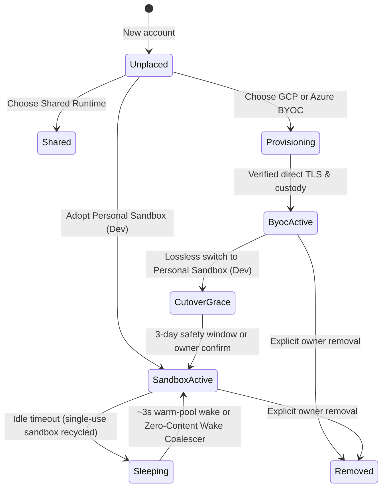

# Hosting and lifecycle

[Modules](README.md) · [Architecture](../README.md) · [Documentation](../../README.md)  
**Status:** `Live` (Shared & GCP/Azure BYOC) · `Preview` (Personal Sandbox & Unified Wake Coalescer on Dev) · **Intent:** Explanation & lifecycle reference

People explicitly choose where One runs: **Shared Runtime**, **Owner-Cloud BYOC** (Google Cloud or Microsoft Azure), or an isolated **Personal Sandbox** (Dev preview). Every placement transition, upgrade, wake, and removal stays strictly accountable to the owner.

## Visual Map

## Owner journey

1. **Choose deliberately:** Shared is never silently forced; private placement records exact cloud coordinates, identity, and custody keys.
2. **Switch without data loss (Dev preview):** Moving between clouds exports and verifies the sealed commit log head before activating the new host, preserving a 3-day safety window on the prior cloud.
3. **Wake quietly when needed (Dev preview):** One cloud-neutral Zero-Content Wake Coalescer wakes Personal Sandbox, GCP BYOC, and Azure BYOC identically (~3s fast path for Circle/goal triggers; 15-minute quiet batching for routine connectors; bounded daily wake caps).
4. **Upgrade or remove transparently:** BYOC updates require owner approval for the exact release; removal reconciles only deployment-owned resources and warns before cloud-only data loss.

## Trust boundary and limits

> [!IMPORTANT]
> **Distinct Placement States & Hard Sandbox Isolation:** `unknown`, `unplaced`, and `pending` are distinct states that never collapse into Shared. Personal Sandboxes on Dev run single-use gVisor-isolated containers with zero mounted service-account tokens, stateless Edge Gateway TLS routing, and an out-of-sandbox Sentinel default-deny egress proxy.

- Managed Personal Sandbox warm-pool claims and lossless multi-cloud cutover remain **Dev Preview** until UAT acceptance passes.
- `Session-only lockdown` in Hosting immediately refuses offline background wakes on private pods.

## Implementation and operation

- [Private deployment operations](../../operations/hosting/dev-pod-first-light-runbook.md)
- [Deployment standard](../deployment-standard.md)
- [Moving a private agent between clouds](../pod-migration.md)

<strong>For coding agents: hosting & wake invariants</strong>

- **Runtime classification:** `hosted_ace_runtime()` is `private_pod_runtime() == True` and `owner_cloud_agent() == False`; never blur those predicates (`test_personal_sandbox_harness_parity.py`).
- **Zero-content wake law:** `/api/one/pod/wake/signal` rejects any PII/content/token keys (`ZeroContentViolationError`) and dispatches authenticated OIDC `POST /pod/tick` across `ace`, `user_gcp`, and `user_azure`.
- **Verification:** Run `test_pod_wake_reachability.py`, `test_stage2a_autonomous_wake_and_quarantine.py`, and `hosting-placement-states.test.tsx`.

