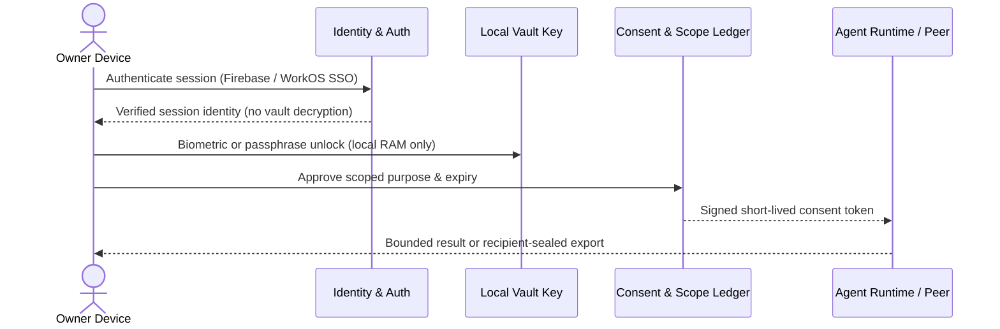

# Identity, vault and consent

[Modules](README.md) · [Architecture](../README.md) · [Documentation](../../README.md)  
**Status:** `Live` · **Intent:** Explanation & trust-boundary reference

Hussh separates **who you are** (identity proof), **what you hold** (client-side vault key custody), and **what an agent or peer may do** (purpose-bound, revocable consent tokens). No single credential collapses these three boundaries.

## Visual Map

## Owner journey

1. **Sign in:** Establish verified identity across devices without unlocking encrypted personal capital.
2. **Unlock vault:** Derive the Master Vault Key locally in memory when reading or writing sovereign Vault domains.
3. **Grant scoped consent:** Approve a specific scope, recipient, and duration; every grant can be inspected and revoked immediately.
4. **Revoke or erase:** Revoking a subject, session, or account propagates tombstones across the control plane and private pods cleanly.

## Trust boundary and limits

> [!CAUTION]
> **Three-Plane Custody Boundary:** Authentication alone grants neither vault decryption nor data disclosure. Encryption at rest protects storage custody; whenever an owner explicitly approves model processing, provider disclosure must remain transparent and consented.

- **Unified Agent-Custody + Sovereign BYOK Hierarchy:** One unified owner key hierarchy spans PKM, Personal Wiki ([#9370](https://github.com/hushh-labs/hushh-research/issues/9370)), Rolling Main Chat (`X-Hussh-Chat-Key` `hck1.` for interactive turns), Files, Connectors, and Goals ([#9517](https://github.com/hushh-labs/hushh-research/issues/9517)).
- **Master Vault Key:** Strictly on the owner's unlocked device; never transmitted to Hussh servers or cloud KMS.
- **Pod Custody Key & Zero Hub/Disk Plaintext:** Keys unwrap strictly into ephemeral sandbox RAM (`.pod_key_once` unlinked immediately on load via `HUSSH_UNLINK_POD_PRIVATE_KEY_AFTER_LOAD`) for opted-in connectors, agent memory, wiki, and local drafts, with 12-hour `pst1.` placement-bound browser session tokens across wakes, offline `pod_mode()` DEK-sealed Goal parity, and optional **Session-only lockdown** on Dev preview to block offline wakes. Zero plaintext touches the central Hub or disk.
- **Encrypted Local Read Replica (`hushh-owner-ui-cache`):** Browser IndexedDB stores only AES-256-GCM ciphertext sealed with an HKDF-SHA256 subkey derived in RAM from `vaultKey` (salt `ownerId`, info `hussh-ui-read-cache-v1`, AAD `hussh-ui-read-cache-v1|<ownerId>|<namespace>`). Ciphertext is retained across page reload and idle `lockVault()` so passive UI views render immediately once unlocked, and is purged on explicit sign-out, confirmed owner mismatch, or explicit vault reset/erasure.
- **Scoped Consent Tokens:** Signed, short-lived, scope-bound, and audited on every access.

## Implementation and operation

- [Identity contracts](../identity/README.md)
- [Consent lifecycle](../../../consent-protocol/docs/reference/consent-protocol.md)
- [Consent scope catalog](../identity/consent-scope-catalog.md)
- Tracking issues: [#9744](https://github.com/hushh-labs/hushh-research/issues/9744) · [#9517](https://github.com/hushh-labs/hushh-research/issues/9517) · [#9370](https://github.com/hushh-labs/hushh-research/issues/9370)

<strong>For coding agents: IAM and vault verification rules</strong>

- **Fail-closed defaults:** Missing consent tokens, expired scopes, mismatched owners, or invalid signatures must refuse explicitly rather than degrading silently.
- **Zero plaintext leaks:** Never persist decrypted PKM payloads or raw vault keys to server logs, localStorage, or unencrypted caches. Keep `hushh-webapp/lib/storage/encrypted-owner-ui-cache.ts` (`hushh-owner-ui-cache` AES-256-GCM replica) and `consent-protocol/hushh_mcp/services/pod_session_authority.py` (12h `pst1.` placement-bound tokens) within owner-scoped custody bounds.
- **Verification:** Route security changes through `iam-consent-governance` and `security-audit` suites plus hub route-class guard tests.

