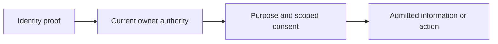

# Identity, vault and consent

[Modules](README.md)

[Architecture](../README.md) · [Documentation](../../README.md)

Keep identity proof, key custody and permission to act separate.

## Visual Map

## Principal journey

Authenticate, establish the current account authority, unlock selected information and approve a bounded request.

## Components and dependencies

Identity services, client vault handling, scoped tokens and cleanup operations share explicit ownership contracts.

## Trust boundary and limits

Authentication alone grants neither vault access nor disclosure. Provider processing must be disclosed; encryption does not imply provider blindness.

## Implementation and operation

- [Identity contracts](../identity/README.md)
- [Consent lifecycle](../../../consent-protocol/docs/reference/consent-protocol.md)
