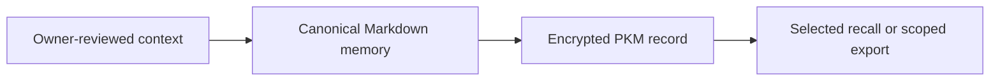

# Memory and PKM

[Modules](README.md)

[Architecture](../README.md) · [Documentation](../../README.md)

Let One retain useful personal context while keeping durable storage and disclosure under owner control.

## Visual Map

## Principal journey

Review and save context, encrypt the update, then explicitly recall or disclose the information needed for a task.

## Components and dependencies

In shipped UAT and production, chat memory is one canonical Markdown document in the encrypted PKM `one_memory` domain (`one.memory.md.v1`, 96,000-character limit). On `dev`, the encrypted Personal Wiki (`<prefix>/wiki/v1/`, reserved `one_wiki` namespace) adds cited page/claim memory (`hot.md <= 8,000` characters plus bounded ADK recall tools) and per-owner `migration_state` cutover while structured PKM domains remain the sole external consent and disclosure authority.

## Trust boundary and limits

Operational state, provider caches and discovery metadata are not durable personal memory. Both `one_memory` and `one_wiki` remain owner-private (`shareable: "never"`); only confirmed or conflict-free projections written into ordinary PKM domains participate in external `attr.*` scopes. Scopes govern external requests; possessing memory is not permission to share it.

## Implementation and operation

- [PKM storage and contracts](../../../consent-protocol/docs/reference/personal-knowledge-model.md)
- [Memory workspace](../memory-workspace.md)
- [Personal Wiki Memory roadmap plan](../../roadmap/personal-wiki-memory-plan.md)
