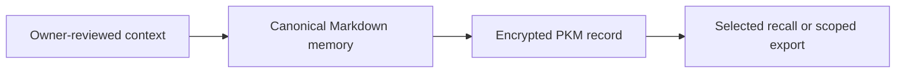

# Memory and PKM

[Modules](README.md)

[Architecture](../README.md) · [Documentation](../../README.md)

Let One retain useful personal context while keeping durable storage and disclosure under owner control.

## Visual Map

## Principal journey

Review and save context, encrypt the update, then explicitly recall or disclose the information needed for a task.

## Components and dependencies

Current chat memory is one canonical Markdown document in the encrypted PKM one_memory domain. Its schema is one.memory.md.v1 and its present limit is 96,000 characters. Derived exports are compatibility views.

## Trust boundary and limits

Operational state, provider caches and discovery metadata are not durable personal memory. A proposed independent wiki/blob store is not the current implementation. Scopes govern external requests; possessing memory is not permission to share it.

## Implementation and operation

- [PKM storage and contracts](../../../consent-protocol/docs/reference/personal-knowledge-model.md)
- [Memory workspace](../memory-workspace.md)
