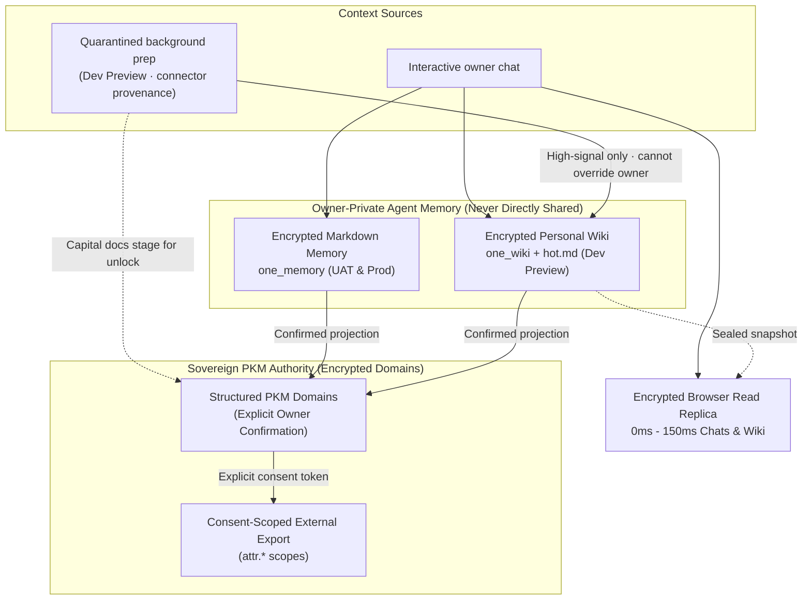

# Memory and PKM

[Modules](README.md) · [Architecture](../README.md) · [Documentation](../../README.md)  
**Status:** `Live` (PKM & Markdown Memory) · `Preview` (Personal Wiki & Autonomous Curation on Dev) · **Intent:** Explanation & module reference

Hussh separates **sovereign personal capital** (structured encrypted PKM domains governed by consent scopes) from **owner-private agent memory** (working context and Personal Wiki pages that help One serve you without automatically exposing your life to external requesters).

## Visual Map

## Owner journey

1. **Remember naturally:** Share preferences, commitments, or notes with One, or review quiet connector takeaways tagged with explicit provenance (`from Mail`, `from Calendar`, `from Drive`). Rolling Main Chat and Personal Wiki ([#9370](https://github.com/hushh-labs/hushh-research/issues/9370)) render immediately (`0ms - 150ms`) from the device's encrypted IndexedDB replica (`hushh-owner-ui-cache`) across reload and idle lock without blocking behind a waking sandbox.
2. **Stay protected from poisoning:** External connector text can never overwrite owner-stated preferences or consent rules, and low-signal noise (newsletters, promos, OTPs) is filtered out.
3. **Control Vault capital:** Financial, tax, or identity records discovered in background prep never silently overwrite the Sovereign Vault; they stage as encrypted 1-tap proposals for your next unlock.
4. **Forget cleanly:** Revoking a fact appends a durable tombstone and triggers provider-memory erasure/rebuild where consented.

## Trust boundary and limits

> [!IMPORTANT]
> **Possessing Memory Is Not Permission to Share It:** Both `one_memory` and `one_wiki` are strictly owner-private (`shareable: "never"`). Only confirmed projections written into structured PKM domains participate in external `attr.*` consent scopes.

- Operational metadata, provider caches, and discovery hints are never durable personal memory.
- In shipped UAT and Production, chat memory is one canonical Markdown document in encrypted `one_memory` (`one.memory.md.v1`, 96,000-character limit). On Dev `Hussh Confidential Sandbox`, the encrypted Personal Wiki (`<prefix>/wiki/v1/`, reserved `one_wiki` namespace, `hot.md <= 8,000` chars) and Rolling Main Chat share one encrypted per-owner namespace (`one_wiki` plus `OwnerRecoveryProjection`) without Hub plaintext, and clean sandbox shutdown flushes a compacted recovery checkpoint (`OwnerRecoveryProjection`).

## Implementation and operation

- [PKM storage and contracts](../../../consent-protocol/docs/reference/personal-knowledge-model.md)
- [Memory workspace](../memory-workspace.md)
- [Personal Wiki Memory roadmap plan](../../roadmap/personal-wiki-memory-plan.md)
- Tracking issues: [#9370](https://github.com/hushh-labs/hushh-research/issues/9370) · [#9744](https://github.com/hushh-labs/hushh-research/issues/9744) · [#9517](https://github.com/hushh-labs/hushh-research/issues/9517)

<strong>For coding agents: memory custody & PKM invariants</strong>

- **Zero-loss upgrades:** Any PKM schema evolution must prove zero-loss migration with historical fixtures and rollback under `pkm-upgrade-rehearsal`.
- **Commit-log isolation & local read replica:** Pod memory records are sealed with owner AAD; replay must filter strictly by `hushh_id` and respect tombstones in sequence order. Client read-through caches for Rolling Main Chat (`hushh-webapp/lib/agent/agent-chat-history-cache.ts`) and Personal Wiki (`hushh-webapp/lib/files/files-cache.ts`) store only AES-256-GCM ciphertext in `hushh-owner-ui-cache` across reload and idle lock.
- **Verification:** Run `pod_memory`, `wiki_memory`, and `pkm` pytest suites plus `test_pod_config.py`.

