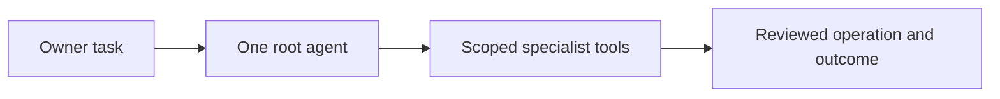

# One and specialists

[Modules](README.md)

[Architecture](../README.md) · [Documentation](../../README.md)

Coordinate a person’s task through one root ADK agent and bounded specialist tools.

## Visual Map

## Principal journey

Ask One; its specialist dispatch uses the task’s existing consent and returns an accountable outcome.

## Components and dependencies

The canonical ADK tree composes specialists, scoped tools, task state and owner model access.

## Trust boundary and limits

A specialist does not acquire wider information or action authority merely by being called. The engineering fleet in .agents is a different system.

## Implementation and operation

- [Agent hierarchy](../one/one-agent-hierarchy.md)
- [Agent implementation](../../../consent-protocol/docs/reference/agent-development.md)
