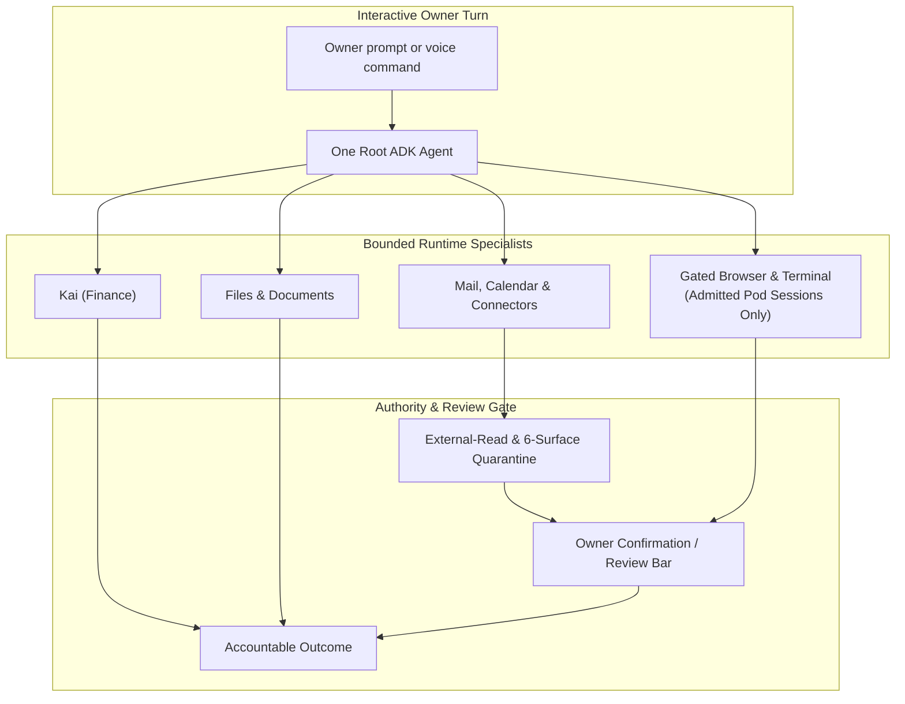

# One and specialists

[Modules](README.md) · [Architecture](../README.md) · [Documentation](../../README.md)  
**Status:** `Live` · **Intent:** Explanation & module reference

**One** is the single root personal agent that understands a person's goal, routes work to bounded specialists (finance, documents, mail, calendar, location, sharing, and gated pod tools), and returns verified, reviewable outcomes without silently widening permission.

## Visual Map

## Owner journey

1. **Ask once:** State a goal in chat or voice (for example, review an upcoming trip or analyze holdings). Passive inspection of Chats, Files, and Personal Wiki renders in `0ms - 150ms` (`<100ms` target) from the device's encrypted IndexedDB replica while the runtime pre-warms silently for active turns, Browser, Terminal, Connectors, and Goals.
2. **Bounded delegation:** One invokes only the specialist needed under the task's existing consent scope and active hosting mode.
3. **Quarantined external reads:** Once a turn reads untrusted external text (mail, calendar, Drive, external MCP, or browser), outbound side effects cannot execute silently; they stage for explicit owner approval.
4. **Cancel or confirm:** Stop an active stream cleanly or approve a staged draft/action with verifiable receipts.

## Trust boundary and limits

> [!IMPORTANT]
> **No Privilege Escalation Through Delegation:** Calling a specialist never widens data access, consent scope, or model authority. The runtime product specialists are completely separate from the `.agents/` engineering fleet used to build this repository.

- Pod-mode sessions expose Browser and stateful Terminal tools only when an admitted sandbox invocation binds their isolated runtime hands.
- Background autonomous wakes (Dev preview) run under a hard 6-surface tool quarantine that structurally strips outbound send, delete, share, payment, and Vault-write tools at the runtime boundary.
- **Offline `pod_mode()` Goals custody parity ([#9517](https://github.com/hushh-labs/hushh-research/issues/9517)):** Scheduled background Goals (`scheduled_goal` wake trigger via `pod_scheduled_runtime.py`) execute inside the owner's DEK-sealed `pod_mode()` custody boundary without requiring an interactive browser `X-Hussh-Chat-Key` or exposing plaintext to central Hub or disk, while keeping the 6-surface external-read quarantine intact.

## Implementation and operation

- [Agent hierarchy](../one/one-agent-hierarchy.md)
- [Agent implementation](../../../consent-protocol/docs/reference/agent-development.md)
- [Interface-to-agent routing](../interface-to-agent-routing.md)
- Tracking issues: [#9744](https://github.com/hushh-labs/hushh-research/issues/9744) · [#9511](https://github.com/hushh-labs/hushh-research/issues/9511) · [#9517](https://github.com/hushh-labs/hushh-research/issues/9517)

<strong>For coding agents: orchestration invariants and checks</strong>

- **External-read barrier:** Preserve invocation-local external-read barriers and 6-surface background tool quarantine when adding or modifying specialist tools.
- **Offline scheduled Goals custody:** Keep `consent-protocol/hushh_mcp/services/pod_wake_coalescer.py` (`scheduled_goal` surface) and `consent-protocol/hushh_mcp/services/pod_scheduled_runtime.py` aligned so scheduled Goals run under DEK-sealed `pod_mode()` custody without Hub or disk plaintext.
- **Role boundary:** Keep product agents under `consent-protocol/hushh_mcp/` and development subagents under `.agents/subagents/`.
- **Verification:** Run affected ADK/orchestration pytest suites and `mypy --config-file pyproject.toml --ignore-missing-imports`.

