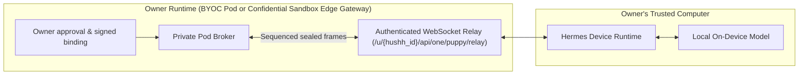

# Puppy

[Modules](README.md) · [Architecture](../README.md) · [Documentation](../../README.md)  
**Status:** `Live` (BYOC & Hussh Confidential Sandbox Edge Relay) · **Intent:** Explanation & module reference

**Puppy** lets an owner run a supported local AI model on their own trusted computer and connect it privately to their BYOC pod or Hussh Confidential Sandbox (as the third placement, Local Puppy on owner silicon) through an authenticated, end-to-end sealed relay.

## Visual Map

## Owner journey

1. **Pair a trusted computer:** Approve a signed device binding between your BYOC pod or Hussh Confidential Sandbox (via the stateless Edge Gateway WebSocket passthrough `/u/{hushh_id}/api/one/puppy/relay`) and your local machine.
2. **Run local inference:** Choose your paired computer's model for private turns; frames stream through the authenticated relay bound to your pod session, preserving device-role session continuity across disposable sandbox wakes.
3. **Cancel, reconnect, or revoke:** Stop an active turn cleanly, resume an invocation after brief network blips, or revoke the device immediately from pod settings.

## Trust boundary and limits

> [!IMPORTANT]
> **Private Placements Only & Zero Silent Cloud Fallback:** Puppy operates with an owner's BYOC pod or Hussh Confidential Sandbox (never legacy multi-tenant Shared runtime), and a failed or offline local model never silently falls back to a cloud AI provider without the owner's choice.

- A device binding record proves enrollment only, not installed local model readiness.
- Revoking a device subject immediately closes active relay sockets and appends a durable revocation tombstone.

## Implementation and operation

- [On-device runtime](../ai/puppy-one-on-device.md)
- [Device connection](../ai/puppy-one-rendezvous.md)
- Tracking issues: [#9744](https://github.com/hushh-labs/hushh-research/issues/9744) · [#5507](https://github.com/hushh-labs/hushh-research/issues/5507)

<strong>For coding agents: Puppy relay invariants</strong>

- **Role separation:** Device-role sessions admit direct `/api/one/puppy/relay` (BYOC) and Edge Gateway passthrough `/u/{hushh_id}/api/one/puppy/relay` (`consent-protocol/hushh_mcp/services/agent_sandbox/edge_gateway_app.py`); presenting a device bearer on app-role routes (`/api/one/pod/status`, `/config`, `/turn`) must refuse with `role_mismatch`.
- **Harness & grading:** Follow `.agents/skills/puppy-one-harness/SKILL.md` when extending local model capability probes.
- **Verification:** Run Puppy relay, broker, and session role-enforcement pytest suites.

