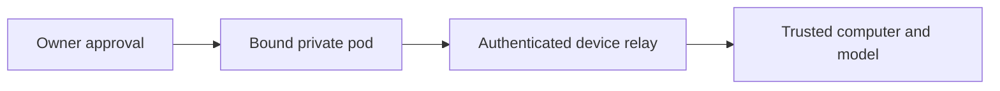

# Puppy

[Modules](README.md)

[Architecture](../README.md) · [Documentation](../../README.md)

Run a supported model on an owner-approved trusted computer through its private pod binding.

## Visual Map

## Principal journey

Connect the device, grant the bounded session, receive an answer, cancel or reconnect to the same invocation.

## Components and dependencies

The relay binds the owner, device session and sequenced sealed frames. Hermes owns the device runtime.

## Trust boundary and limits

Puppy is BYOC-only. Shared cannot silently use its relay, and cloud inference is not a fallback for a failed local answer. A binding record is not proof of a completed installed-model journey.

## Implementation and operation

- [On-device runtime](../ai/puppy-one-on-device.md)
- [Device connection](../ai/puppy-one-rendezvous.md)
