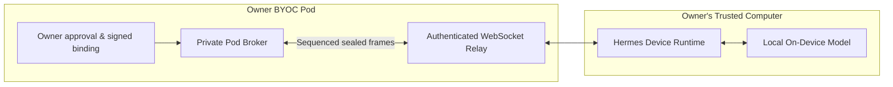

# Puppy

[Modules](README.md) · [Architecture](../README.md) · [Documentation](../../README.md)  
**Status:** `Live` (BYOC Only) · **Intent:** Explanation & module reference

**Puppy** lets an owner run a supported local AI model on their own trusted computer and connect it privately to their BYOC pod through an authenticated, end-to-end sealed relay.

## Visual Map

## Owner journey

1. **Pair a trusted computer:** Approve a signed device binding between your BYOC pod and your local machine.
2. **Run local inference:** Choose your paired computer's model for private turns; frames stream through the authenticated relay bound to your pod session.
3. **Cancel, reconnect, or revoke:** Stop an active turn cleanly, resume an invocation after brief network blips, or revoke the device immediately from pod settings.

## Trust boundary and limits

> [!IMPORTANT]
> **Strictly BYOC & Zero Silent Cloud Fallback:** Puppy operates exclusively with an owner's BYOC pod. Shared runtime can never silently invoke Puppy, and a failed or offline local model never silently falls back to a cloud AI provider without the owner's choice.

- A device binding record proves enrollment only, not installed local model readiness.
- Revoking a device subject immediately closes active relay sockets and appends a durable revocation tombstone.

## Implementation and operation

- [On-device runtime](../ai/puppy-one-on-device.md)
- [Device connection](../ai/puppy-one-rendezvous.md)

<strong>For coding agents: Puppy relay invariants</strong>

- **Role separation:** Device-role sessions admit only `/api/one/puppy/relay`; presenting a device bearer on app-role routes (`/api/one/pod/status`, `/config`, `/turn`) must refuse with `role_mismatch`.
- **Harness & grading:** Follow `.agents/skills/puppy-one-harness/SKILL.md` when extending local model capability probes.
- **Verification:** Run Puppy relay, broker, and session role-enforcement pytest suites.

