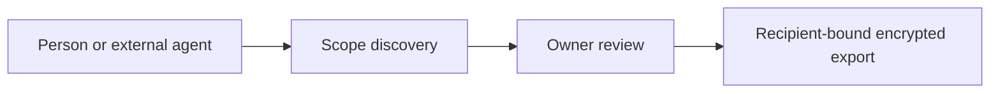

# Sharing and MCP

[Modules](README.md)

[Architecture](../README.md) · [Documentation](../../README.md)

Let people and external agents request specific information without exposing the whole memory store.

## Visual Map

## Principal journey

Discover an available scope, request consent, wait for approval and retrieve the authorized encrypted export.

## Components and dependencies

Scope metadata, consent lifecycle, recipient binding and export services define the contract. MCP and the developer API expose those existing boundaries.

## Trust boundary and limits

A query is not a consent grant. Payment does not authorize processing or widen a scope. Free and paid requests retain identity, expiry and revocation requirements.

## Implementation and operation

- [MCP integration](../../../packages/hushh-mcp/README.md)
- [Scope catalog](../identity/consent-scope-catalog.md)
