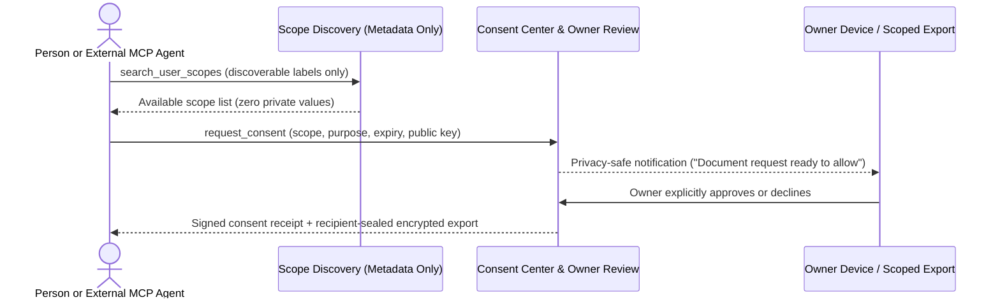

# Sharing and MCP

[Modules](README.md) · [Architecture](../README.md) · [Documentation](../../README.md)  
**Status:** `Live` · **Intent:** Explanation & module reference

Sharing and MCP let people, trusted circles, and external AI agents request **one bounded slice of information** and receive a recipient-sealed export with full provenance, without ever exposing your entire vault or memory store.

## Visual Map

## Owner journey

1. **Discover safely:** External agents see only advertised scope names, never private values or private memory domains.
2. **Review with context:** Requests arrive with clear scope, requester identity, and expiration; lockscreen push relays carry zero PII.
3. **Seal strictly to recipient:** Approved exports encrypt directly to the requester's public key and record an immutable receipt.
4. **Revoke anytime:** Revoking a grant immediately stops further access and leaves an auditable record.

## Trust boundary and limits

> [!CAUTION]
> **Discovery and Payment Are Never Consent:** Searching scopes does not reveal private content. Paying for an information packet never authorizes processing or widens a scope; free and paid requests keep identical identity, expiry, and revocation gates.

- Owner-private `one_memory` and `one_wiki` domains are never directly requestable (`shareable: "never"`).
- Information Exchange ([#9736](https://github.com/hushh-labs/hushh-research/issues/9736)) executes through the unified single-owner runtime across `Hussh Confidential Sandbox`, `BYOC`, and `Local Puppy`, retiring divergent Shared versus Pod Drive/Gmail executors on cutover lanes.
- External MCP developers use the `@hushh/mcp` package under the same core consent lifecycle.

## Implementation and operation

- [MCP integration](../../../packages/hushh-mcp/README.md)
- [Scope catalog](../identity/consent-scope-catalog.md)
- Tracking issues: [#9736](https://github.com/hushh-labs/hushh-research/issues/9736) · [#9744](https://github.com/hushh-labs/hushh-research/issues/9744)

<strong>For coding agents: MCP & export contract invariants</strong>

- **Core MCP lifecycle:** Maintain parity across `search_user_scopes`, `request_consent`, `check_consent_status`, `get_encrypted_scoped_export`, and `prepare_campaign_context`.
- **Recipient binding:** Scoped exports must bind ciphertext to the requester's verified identity/key and refuse replayed or expired tokens.
- **Verification:** Run `@hushh/mcp` package checks (`scripts/ci/orchestrate.sh mcp-package`) and consent export pytest suites.

