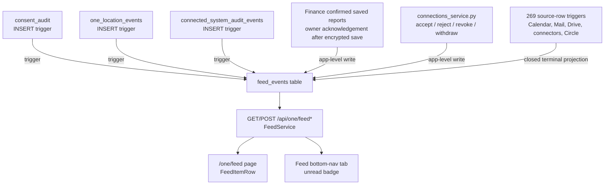

# One Feed Notification Model

[One](README.md)

## Visual Map



Feed is the cross-domain activity surface for One: a single, paginated,
read/unread-tracked list of what happened across Consent, Location, Kai,
KYC, Connected Systems, and Connections. It replaced the top-bar
`ActivityInbox` bell (which only ever surfaced Consent + background-task
activity) with a real bottom-nav tab and a dedicated route, `/one/feed`.

### Location and Connect selection

The canonical admission and operation rules live in
`consent-protocol/contracts/feed/activity-policy.v1.json`; grouped SQL, current
source facts and the generated browser policy apply them before pagination,
search and unread counts. The event catalogs below describe recorded facts,
not a promise that every publisher creates a visible notification.

Current decisions and important outcomes share one mixed timeline. Location
requests and resulting shares link only through verified source IDs. Every
confirmed active emergency has its own Live row, even for the same sender.
Quiet share expiry/revoke updates do not create unread attention. Ended grants
open dated history rather than a map. Clear cannot hide active incidents. A separate paginated `live_incidents`
collection selects every confirmed current incident independently of history
pages; it never selects only the newest incident from a sender.

Private Check-In groups the owner's confirmed grants by the existing client
operation ID. Recipient views remain per grant. Existing source records do not
retain the full intended audience or failures, so Feed does not claim a complete
or partial operation total or offer a retry action. Nearby Check-In stays solely on the map. Routine GPS,
search, polling, views and ordinary status changes remain suppressed. Recorded
Circle deletion cannot revive an older addition after source cleanup. Missing
legacy source authority never becomes permission for an active destination.


## Chat conversation presentation

Circle photo sends show the original from mounted-view memory on the Send tap,
with an explicit pending status until the server confirms delivery. Transcript
confirmation reconciles the same sender/client identity even when the POST
response is late; uncertain retries reuse the entire sealed payload unchanged.
At most four sent originals remain in the mounted thread, and object URLs are
released on hide, background, access loss, and unmount.

New photo content may include a JPEG thumbnail of at most 1,536 bytes inside
the authenticated encrypted attachment metadata. It arrives with the message
and stays visible during the authorized original download; older messages still
use the original image path. Serialized UTF-8 content must fit the existing
24,000-character ciphertext limit, otherwise the optional thumbnail is omitted.
Original photo bytes and existing recipient/membership authorization are unchanged.
Recipients still wait for the sender's encrypted upload to commit.

Circle detail entry relays only the selected circle's display name and member
count while fresh reads resolve. Fresh overview can render before the member
page; pending members occupy a bounded roster placeholder. Relayed summaries
never grant controls or chat access, and detail authority is scoped to the
current person and in-memory unlock identity.

Circle messages share one Feed entry per Circle; received Direct Messages share
one entry per authenticated conversation. The API groups before applying the
cursor and page limit, using the newest immutable source event as the entry id.
Other admitted workflows group by verified source IDs under the shared Feed policy. `chat_thread_key`, `chat_message_count`
and `chat_unread_count` are computed response metadata, never trusted from
stored payloads. Feed unread counts count visible groups; the new-message count
means unseen Feed events. Opening Feed marks that presentation seen without
marking chat messages read. Dismissing the grouped entry hides it after ranking,
so older messages do not resurface; genuinely new activity can make the group
visible again. Clearing Feed updates server-owned rows through a source-id
snapshot watermark.

Client refresh/load-more deduplicates chat entries by thread key. Cursor
continuity still requires overlapping source ids, since a moved conversation
cannot prove there are no intervening events.

Chat delivery extends the existing migration 290 pipeline: modern installations
have their own encrypted preview key and durable provider acceptance receipt.
Circle and direct workers reuse the same registry, ownership fences and retry
contract. Committed Circle events wake the existing worker; its adaptive polling
repairs missed events and full batches drain immediately.

System presentation groups by conversation: web replaces an owner-key-scoped
card and requests renotification; Android retains MessagingStyle children and a
silent conversation summary; iOS uses the existing conversation thread.
Authoritative unread counts enrich alert and read payloads for supported badges.
Only a focused, readable matching conversation suppresses foreground sound.

Read cleanup preserves Circle sequence and direct source-time/exact-message
boundaries. Local web cleanup and native silent read synchronization persist a
key-scoped presentation frontier against delayed alerts. Silent read pushes are
limited to native platforms: Safari requires every Web Push to be user-visible.
The iOS extension can silence a stale accepted alert but cannot discard it
without Apple's restricted filtering entitlement. Physical delivery acceptance
is documented in the [release checklist](../../development/quality/circle-chat-notification-release-checklist.md).

## The `feed_events` table

Migration `consent-protocol/db/migrations/117_feed_events.sql` adds a single,
presentation-only table:

```sql
CREATE TABLE feed_events (
  id BIGSERIAL PRIMARY KEY,
  user_id TEXT NOT NULL,
  source_domain TEXT NOT NULL CHECK (source_domain IN
    ('consent','location','kai','kyc','connected_systems','connections')),
  event_type TEXT NOT NULL,
  actor_label TEXT,
  metadata JSONB NOT NULL DEFAULT '{}'::jsonb,
  source_row_id TEXT,
  read_at TIMESTAMPTZ,
  created_at TIMESTAMPTZ NOT NULL DEFAULT now()
);
```

`feed_events` is deliberately **not** a domain audit authority. Each domain's
own table (`consent_audit`, `one_location_events`,
`connected_system_audit_events`) or write path remains the source of truth
for its own compliance/business logic; `feed_events` exists only to give the
Feed route one uniform shape to paginate. Rows never carry ciphertext or
vault-protected content, only bounded, non-sensitive `metadata` a
human-readable line can be rendered from client-side (see
`hushh-webapp/lib/feed/feed-item-renderers.tsx`).

## Write paths (six domains, two mechanisms)

**Trigger-based** (existing durable per-domain event table, near-zero app
code — mirrors the established `consent_audit` NOTIFY-trigger pattern from
`011_consent_audit_notify_trigger.sql`):

- **Consent** — a trigger on `consent_audit` INSERT fans out `REQUESTED` /
  `CONSENT_GRANTED` / `REVOKED` rows.
- **Location** — a trigger on `one_location_events` INSERT fans out
  share/access lifecycle events, owner-scoped.
- **Connected Systems** — a trigger on `connected_system_audit_events` INSERT
  fans out terminal statuses (`approved`, `connected`, `rejected`, `failed`).

**App-level writes** (no existing durable event table to hook — this is new
tracking, added alongside each domain's existing mutation):

- **Finance** — after a requested analysis is saved to encrypted owner history
  outside Finance, the owner client acknowledges the exact completed run through
  `/api/kai/analyze/run/{run_id}/feed-result`. The server checks owner and terminal
  state and derives ticker/run ID itself. Parsing and terminal delivery alone do
  not establish a saved report or statement. Draft review stays in its source.
- **Connections** — `consent-protocol/hushh_mcp/services/connections_service.py`,
  at `accept_request` / `reject_request` / `remove_connection`.

Provider outcome projections use `FeedService.record_event` or best-effort SQL
functions; a Feed outage must not turn provider success into another write.
Relationship history in Connections uses the same transaction as its source
mutation and retains that existing atomic policy.

## Read/unread and pagination

- `GET /api/one/feed?cursor=&limit=` — keyset pagination (`id` cursor, not
  page numbers) because a live-growing append-only feed drifts under
  page-number pagination. Returns `{items, next_cursor, unread_count}`.
- `GET /api/one/feed/unread-count` — lightweight, polled by the bottom-nav
  tab badge (`hushh-webapp/lib/feed/use-feed-unread-count.ts`, 45s interval +
  an immediate refresh on `FEED_STATE_CHANGED_EVENT`).
- `POST /api/one/feed/read` — marks unread rows read up to a given `id`.
  Fired once when the Feed page opens (Instagram/Twitter's "opening the tab
  clears the badge" convention), not per item.
- `POST /api/one/feed/{item_id}/dismiss` and `/restore` — owner-scoped,
  idempotent presentation-only hide and versioned Undo; neither changes source
  activity. A dismissal returns a server token and `dismissed_ids`, every row it
  hid; the page hides exactly those. Undo restores exactly that set, and only
  while the token is current. Clear replaces tokens to supersede stale Undo.
  Older members of a displayed Consent bundle are hidden with the selected row.
  Removing a Drive outcome also hides earlier outcomes for that exact request.
  Removing any Drive request row also hides the rows of that request the Feed
  was folding behind it: the "Files are available" decision behind "No files
  were shared", or the Pay row behind a payment or outcome. So nothing older
  surfaces in its place after a refresh, on another device or after signing in
  again. The server runs the same fold as the page
  (`consent-protocol/hushh_mcp/services/feed_drive_fold.py`), and both test
  suites read `consent-protocol/tests/fixtures/feed_drive_fold_cases.json`.
  Drive rows the Feed shows remain independent history entries. Later activity
  remains visible.
- `POST /api/one/feed/clear` — marks the owner's current rows through
  `up_to_id` hidden and read in one server update, plus any newer Drive row the
  Feed was folding behind a cleared row. Newer visible rows remain visible.
  Hidden state survives sign-out and other devices, and disappears with the
  Feed rows on account deletion.
- `POST /api/one/feed/sos-cards/clear` — Clear also clears ended (revoked or
  expired) SOS cards. The clear is saved on the recipient's own received grant
  (`recipient_cleared_at`, migration 346) by the Location service, behind the
  vault owner token, so it holds on every device. The server never clears a
  live share and never touches another person's grant, and the sender's view of
  the grant does not include it. A clear an older release kept on one device is
  copied to the server once, then removed from that device. If the server
  cannot save a clear (a backend without this route, a failed request, or a
  locked vault), the cards still leave and the clear is kept on that device the
  same way, then copied on a later visit.

The Feed tab's icon is fixed (no spinner or live-task overlay): the tab is a
static navigational affordance, and unread state surfaces only through its
badge count, not an icon swap.

## Mixed timeline and search

Feed opens with its title and one search icon in the existing shell. Each active
emergency stays separately visible in Live. Current decisions and important
outcomes form one mixed dated timeline across agents. Routine search, sync and
progress do not appear. Empty sections disappear; there are no agent sections.
Ended emergencies become incident history, never a collapsed active-alert group.

Search opens one field and an All agents selector. Scope changes work without a
query and combine with text/date filters. Emergencies stay pinned across scopes.
The authored Feed policy owns public scope names, classified-agent exceptions and
bounded action aliases; the generated browser copy must match it. Finance,
Advisor, Drive, KYC, Cards, Location, Consent and Connect stay distinguishable even
when source events share a backend domain.

`POST /api/one/feed/search` derives owner identity from Firebase auth and matches
admitted workflow labels before pagination. Exact matches rank before word
prefixes and substrings; ties use source time and ID. The match CTE is materialized
once to avoid per-row rank rescans. HMAC cursors bind owner, criteria, source
revision and a captured ID boundary. New arrivals wait for refresh; material
changes invalidate the cursor. Search never marks events read or changes push,
subscriptions or preferences. The normal browse read path pauses during search.

One confident contact/client or exact authorized record can be Top Hit. Contact
name reads require an active owner relationship. Advisor client discovery also
requires verified RIA status, canonical roster membership and current workspace
consent. Scope is a view filter; it never grants client or source access.

Bounded scalar labels exclude coordinates, private notes, document contents and
protected financial values. Finance statement/report labels are read within the
current unlocked owner session. Feed reads the existing device report history;
an analysis-completed receipt means the run finished, not that another device
has the report. Missing local results use the existing unavailable state. Saved
statements and institutions open exact read-only details inside Feed, without
changing the active statement or initiating provider reconnect.

Search uses existing confirmed contact and roster names. This release adds no
relationship-alias editor or storage. A family alias is matchable only if it is
already an authorized source label; Feed never invents a relationship. Unique
adjacent transpositions offer explicit suggestions; ambiguous names produce no
fabricated identity.

Private Drive filename lookup uses the existing connector proxy and four
vault-authorized, no-store POST endpoints under
`/api/one/feed/files`: `owner/search`, `requester/search`, `owner/file`
and `requester/file`. These Feed adapters reuse existing Drive owner, participant,
identity and payment guards without changing Drive writes. Search
criteria stay in request bodies. Each page scans at most 100 encrypted confirmed
request-delivery candidates and returns at most 20 matches, with an authenticated
owner/query/snapshot cursor even when an intermediate page has no matches. The
UI offers continuation and does not claim complete no-results while a cursor or
source failure remains. Provider names are matched in full; display labels use
the existing bounded filename presentation. No filename index, document contents,
URL query or persistent result cache is created.

Owner history and recipient access are distinct: the owner retains authorized
request-associated filename history after sharing ends; the recipient must still
have a confirmed file grant, required payment and the same verified identity.
The source is reread after identity verification and on every file tap. Standalone
bulk shares without a request, filename typo suggestions and global filename
ranking across unscanned candidate pages are not supported by this lookup.

Receipt terms search confirmed document-payment milestones within their current
group. A payment-only match opens the exact request's read-only receipt after a
fresh participant lookup. Requester receipts come from the current owner payment
source; owner earnings come from the exact payout receipt. Requester test/live/legacy mode remains source-backed. The existing owner
receipt does not expose payment mode, so Feed calls it a recorded receipt and
never infers a mode or settlement method. A Feed event alone
never establishes payment, delivery, saved status or a returned transfer.

Query caches and result-return snapshots stay in the owner/auth/vault episode's
memory, fenced by Feed invalidation. Return preserves query/scope and scroll;
fresh Feed navigation starts at All. Source decisions still recheck their own
state when opened. See the [Feed UI contract](../../../hushh-webapp/docs/ui-contracts/feed.md)
and [visual QA contract](../../../hushh-webapp/docs/ui-contracts/feed-visual-qa.md).

SMS liveness and Clear eligibility follow the server's received-grant status.
While a live SOS is visible, Location status refreshes on the shared 10-second
cadence, paused while hidden. Device clock skew cannot end a live emergency.

The source mechanisms remain distinct while presentation is mixed:

1. `useFeedActionables` reads current authorized domain services for consent,
   document, Location, connection, KYC and Finance review actions. Review opens
   the exact request; its source owns approval and stale-state validation.
2. `feed_events` retains admitted outcomes and immutable dated workflow steps.
   The server groups before pagination. A matching current actionable uses the
   same operation key and suppresses a duplicate history representative.

Both row kinds are built on the canonical `SettingsGroup` + `SettingsRow` list
primitives (`FeedRow` for history, `FeedActionableRow` for the actionable
zone), so the feed shares the app's list vocabulary.

Each confirmed active SMS incident uses its own grant and original confirmed
sent time. No sender-level collapse can conceal an incident. Ended incidents
retain exact recorded history; recipient Clear and retention update their
preferences atomically without revoking access or revealing older cleared rows.


## Person identity and responsive rows

Connect, Location People/Circle rosters, and both Feed zones use
`ConnectionPersonAvatar`. Person lists use a 40px circular leading visual and
a 68px text/separator inset. Compact rows use a 16px name, 13px description,
and a separate timestamp line. On narrow phones, relationship actions move
below the name instead of compressing it; interactive targets remain at least
44px even when the action looks like secondary text. These are shared React
and CSS contracts for web and the iOS/Android Capacitor containers.

Photo reads prefer a nonblank `actor_identity_cache.custom_photo_url`, then
`photo_url`. Pending connection-request DTOs include optional
`counterpartPhotoUrl`; Circle member-invite DTOs include optional
`inviterPhotoUrl` and `inviteePhotoUrl`. Web proxies and native HTTP transport
preserve these additive fields. Image failure, replacement, and removal reset
the avatar loading state and reveal the same initials used by Connect.
The live Feed passes the Circle inviter photo through unchanged and uses the
same avatar component as Connect for person cards. Person-to-person Consent
Center entries resolve the requester's public person reference to its active
account identity before the Feed uses the current `counterpart_image_url`.
Removed photos and inactive or unresolvable profiles fall back to initials,
not a stale request-time image; system and developer entries keep their domain icon.

Feed photo sanitization preserves complete bounded PNG/JPEG/WebP data URLs
(up to 300 KiB decoded, matching the upload contract). It never truncates
base64 to the general metadata text limit. Invalid/oversized data, SVG, and
unsupported schemes are omitted; HTTP(S) URLs remain bounded to 1024
characters. A failed identity read must not resurrect a stored photo snapshot.

Migration `202_feed_counterpart_identity.sql` adds a server-only companion
table, `feed_event_counterparts`, linking a Feed event to its registered
counterpart. An AFTER INSERT trigger resolves the source event with the
viewer's audience checks. This link survives short-lived Location source
cleanup and resolves the current photo at read time; it grants no location
access and is not part of the public Feed DTO. Feed deletion or counterpart
account deletion cascades the link; migration 201's tombstone/write guards
apply. Historical event copy remains historical rather than being rewritten
when a profile changes.

Reads resolve at most the requested Feed page, materializing counterpart IDs
before joining the indexed identity cache. Retained legacy sources can still
be resolved during a rolling migration. Legacy sources already purged before
the identity link existed cannot be reconstructed; their rows keep initials
or a domain icon, never another person's guessed photo.

Migrations 203–204 remove the Location audit-table scan from identity resolution.
Grant keys use the existing grant index; numeric audit keys retain their primary-key
lookup. Request, referral, and arbitrary legacy metadata keys inspect only the
viewer's owner/recipient events through indexes, then apply the original exact
source and audience checks. Legacy lookup cost can still grow with that viewer's
own history. No source records or identities are backfilled inside these migrations.

Apply through migration 204 before running the explicit resumable backfill outside
the schema transaction:

```bash
cd consent-protocol
python scripts/backfill_feed_counterpart_identity.py --apply --expected-database <exact-database-name> --batch-size 250 --max-batches 20
```

Without `--apply` it is a dry run. Output contains counts and cursors, not
identities or photos. The down migration is
`db/migrations/rollback/202_feed_counterpart_identity.rollback.sql`; it removes
only this derived feature and preserves Feed history. New readers fall back
to legacy source enrichment on an older schema.

Migration 203 builds the recipient/event-type index concurrently, as a single
statement outside a transaction. Migration 204 refuses to install the new resolver
if that index is missing or invalid. If a concurrent build is interrupted, an
`IF NOT EXISTS` retry can leave the invalid index in place. With migration runners
stopped, run `rollback/203_feed_counterpart_recipient_index.rollback.sql`, then run
the **203 SQL file itself** outside a transaction, and retry the release. Merely
retrying ledger mode after dropping the index is insufficient: 203 may already be
recorded as applied. Do not change an accepted migration checksum or delete ledger
history to repair the index.

To roll back this optimization, execute
`rollback/204_feed_counterpart_indexed_lookup.rollback.sql` first, then
`rollback/203_feed_counterpart_recipient_index.rollback.sql` outside a transaction.
This restores the 202 resolver and preserves all Feed events and counterpart links.

Automated proof includes the actual-component Feed fixture, Circle layout
contracts, image lifecycle unit tests, and
`tests/test_feed_counterpart_identity_postgres.py` and
`tests/test_feed_counterpart_lookup_postgres.py` against unique disposable
PostgreSQL databases. Set `FEED_IDENTITY_POSTGRES_TEST_URL` to a local disposable
server's admin database and run those tests explicitly. The lookup regression
checks buffer accesses with 250,000 unrelated audit rows in custom and generic plan
modes, source compatibility, concurrent-index failure recovery, and rollback.
Browser emulation and these fixtures do not replace
authenticated user review or physical iOS/Android acceptance.

## Useful agent outcomes (migration 269)

The Feed reports authoritative outcomes, not each helper/tool invocation. The
additive, forward-only `269_feed_agent_outcomes.sql` preserves existing consent
bundle, Calendar/Mail success and Drive request/payment publishers. It adds:

| Source | Feed-worthy transition and audience | Replay key / noise filter |
| --- | --- | --- |
| Calendar proposals | failed, owner | proposal ID; status change only |
| Reviewed Gmail mailbox proposals | executed/failed, owner | proposal ID; execution persists terminal status before sensitive proposal cleanup |
| CRM audit | create/update/delete succeeded or partial; disconnect succeeded, owner | intent ID or event ID; successful reads stay quiet |
| Custom connector connection | connected, needs reauthentication, revoked, owner | connector + generation + status; placeholder and refresh updates stay quiet |
| Drive owner search | completed/limited/failed/stopped, owner | job ID + event type; request-bound completed searches use existing request outcome instead |
| Reviewed Drive directive ledger | settled share/trash success, failure or unconfirmed, owner | directive ID; requires the reviewed-action context revision |
| Standalone Drive bulk sharing | final owner summary; confirmed recipient notice | share + final revision; stopped uses stable stop timestamp and waits for every in-flight effect; request-origin jobs retain their existing aggregation |
| Drive question | withdrawn or returned to pending for retry, owner | request + revision + type; no question/answer/error content |
| Consent audit | denied, withdrawn, timed out, owner | bundle or request + event type; wording does not imply all bundle items resolved alike |
| Circle invitation/membership | declined to inviter, withdrawn to invitee, left to owner, membership ended to affected member | invite ID or membership generation; cleanup after deletion stays quiet |
| Circle deletion | owner and previously active members | circle ID; one deletion row, no removal fanout |

Connections withdrawal writes both participants' history in the existing source
transaction, with counterpart labels and `actor_is_self`, only after the guarded
pending update succeeds. A retry or lost race writes no additional history.
Migration 269 extends the existing indexed counterpart resolver
to withdrawals, preserving both audiences' current photos and server-only identity
mappings; it does not place user IDs or photo snapshots in Feed metadata.

Analysis/import workers keep canonical streaming outcomes immutable and close
generators in the owning task. Feed suppresses raw parsing, cancellation and
progress outcomes. A report-ready entry is acknowledged only after encrypted
save; statement review and saved-source records use their exact existing
Finance identities. Failed saves never announce a saved result.

The Feed projection cannot mask provider success or cause a repeated write.
Projection failures are best effort; relationship transactions retain their
existing atomic policy. CRM partial status can mean a successful mutation whose
readback failed; Drive bulk partial/failed can include uncertain provider writes.
Both prompt review before retrying instead of asserting the action did not happen.
Unconfirmed Drive writes and possibly partial Mail
changes ask people to check the provider before retrying. No query, filename,
mailbox ID, label ID, account label, credentials, provider errors, holdings,
HMAC or terminal payload is copied into Feed.

Drive and custom connector rows remain visible with the CRM build flag disabled.
Links use the existing chat, Profile connector/my-data panes, Consent, Calendar,
Mail, Kai and Circle management surfaces. Routine reads, reasoning, Memory and
Wallet updates remain quiet. No new API endpoint, table, retention policy or
domain authority is introduced.

Rollback: `db/migrations/rollback/269_feed_agent_outcomes.rollback.sql` removes
only the new triggers/functions, preserving source state and delivered history.
The release manifest and three environment schema contracts register version 269.
Real PostgreSQL tests cover transitions, audience, content boundaries, replay,
bulk-stop races, migration replay, projection failure and rollback/reapply.

## Caching

`FeedPage` (`hushh-webapp/components/feed/feed-page.tsx`) loads its first
page through `useStaleResource` under `CACHE_KEYS.FEED_LIST(userId)`
(`CACHE_TTL.SHORT`), so a revisit renders the last-known page instantly while
a background refresh runs, matching every other cache-coherent route.
Pagination beyond the first page ("load more") stays a live, uncached fetch
appended to local state — only the first page needs an instant warm render.
On refresh, row reuse compares the presentation metadata as well as the domain,
event, actor, timestamp, and read state. Consent bundles can update their details
under the same event ID, and counterpart photos are resolved at read time; those
updates must reach the visible row even when no new event is appended.
Opening the feed calls `FeedService.markRead` (clearing the unread badge via
`dispatchFeedStateChanged`) but deliberately does **not** force-refresh the
list: the rows on screen keep their unread styling for the current visit and
only read as seen on the next open, matching Instagram's "opening clears the
badge, the items you're looking at stay highlighted" behavior. `FEED_LIST`,
`FEED_UNREAD_COUNT`, and `CONNECTIONS_INCOMING` (the actionable zone's
connection-requests read) are all covered by `CacheService.invalidateUser`, so
sign-out and account deletion purge them with the rest of the session. The page
keeps no Feed rows in browser storage. Its only device keys are per account:
the sound choice, and older releases' Clear watermark and SOS clears (or an SOS
clear the server could not save yet) that wait for their server copy. Account
delete and reset remove all of them
(`forgetFeedDeviceState`); sign-out keeps them. An Undo toast belongs to the
session that removed the row: sign-out or an account switch retires it, so a
late tap restores nothing.

## Device system chat notifications

Direct and Circle messages use a durable outbox committed with the message.
A two-second read grace period avoids interrupting someone already reading the
chat. Workers claim one recipient at a time with a renewed 60-second lease and at most
five attempts. They recheck source age, read state and current access before each
device send. Direct messages require an active connection and no block in either
direction; Circle messages require the original membership generation and an
unmuted Circle. Messages older than one day are suppressed, and provider TTL/APNs
expiration uses the original message time. Provider acceptance is recorded per
installation/account, so a successful device is not retried when another device
fails or its token rotates. Acceptance is neither device delivery nor a read
receipt. A committed read clears delivered notifications on the reading device
through that sequence or timestamp, retaining newer unread messages. Android
conversation groups include a silent summary and alert only for child messages. A crash between provider acceptance and the ledger commit can still
cause a retry; deterministic browser/Android event tags and APNs collapse IDs
reduce repeated tray entries. Different messages retain distinct event identities.

Notification previews use independent installation P-256 keys, ephemeral ECDH,
HKDF-SHA256 and AES-256-GCM. The envelope is
`[keyId, ephemeralUncompressedPoint, nonce, ciphertextAndTag]`, all binary fields
base64url encoded; HKDF info is `hussh-chat-preview-v1:<keyId>` and authenticated
context is `<keyId>:direct:<conversationId>:<messageId>` or
`<keyId>:circle:<circleId>:<clientMessageId>`. Plaintext is bounded to 1800 UTF-8
bytes and exists only while preparing/rendering the notification. Circle message
snippets are sealed by the sender. Canonical sender name, stable sender reference,
Circle name and avatar are separately sealed by the server as `chat_identity`;
renderers take Circle identity only from that envelope. Direct chat retains its
existing server-managed storage encryption; this change does not turn it into
client end-to-end encrypted chat. Neither preview key can open the vault/history.

The Android app replaces the vendor FCM service with one service that still
forwards Capacitor foreground/token events. Preview-capable Android installations
receive high-priority data messages and render native MessagingStyle notifications
with sender name, avatar, conversation grouping, sound and a validated tap target.
Legacy Android tokens retain automatic generic FCM alerts during rollout. Android
uses a software P-256 preview key encrypted by a nonexportable Android Keystore
AES key, supporting API 24+. Private lock-screen visibility exposes generic copy
when Android's user settings hide sensitive contents.

The iOS app embeds `ChatNotificationService.appex`. APNs alerts carry
`mutable-content` and a generic fallback; the extension decrypts only preview
keys and creates an incoming INSendMessageIntent communication notification with
sender avatar/name and conversation/Circle threading. Its narrow shared Keychain
item uses AfterFirstUnlockThisDeviceOnly. The app and extension must both have
the `com.hussh.app.chatnotifications` Keychain access group; communication
notifications capability must be enabled in signing profiles. Release CI passes
`HUSSH_APP_ENTITLEMENTS` only to the app, preserving the extension's own entitlement
file. A device reboot before its first unlock, extension deadline or unavailable
preview leaves generic copy. iOS controls Focus, sound and lock-screen visibility.

Web push uses its existing foreground acknowledgement bridge. When no visible
page accepts a message, the service worker decrypts its nonexportable IndexedDB
preview key and shows a system notification with the sender/Circle and avatar.
Native and web paths fence preview key identity across account switching; logout
clears only the matching account's installation keys and unregisters that device.
Browser logout and key rotation also close delivered alerts carrying the old key,
without closing another account's notifications.
Denied native permission offers device Settings; foreground resume revalidates
registration without automatically requesting permission. Key-storage failure
preserves generic token registration. Missing/unsupported/oversized avatars use
initials on native surfaces and the app icon on the web. Avatar preprocessing
accepts bounded local rasters and only allowlisted HTTPS Google identity-image
hosts, with no redirects. Payload budgeting leaves room below provider limits;
optional avatar/preview information is omitted before sacrificing the alert.

Release verification requires real devices and correctly provisioned builds:

1. Apply migration 290 and deploy the workers; install the new app builds and
   enable notifications from Feed.
2. Send direct and Circle text/photo messages while the recipient app is
   foregrounded, backgrounded, terminated, offline then reconnected, and locked.
   Verify sender name/avatar, Circle title, preview, normal sound and correct tap.
3. Verify two devices on the same account; rotate a token and switch accounts.
   Confirm no sender/preview from the previous account and no removal of the
   other device on logout.
4. Read before dispatch, block/disconnect, mute/leave/rejoin a Circle, delete an
   account, deny permission then allow it in Settings, and simulate one transient
   device send failure. Confirm suppressed messages and bounded retries.
5. Archive/sign the app and extension in Xcode with production APNs capabilities.
   Android force-stop and device power/notification restrictions, and Apple Focus
   or system restrictions can prevent immediate delivery; no push provider can
   guarantee a visible alert in those states.

Automated coverage uses disposable PostgreSQL migration replay/rollback, device
ownership and retry tests, real Firebase wire encoding, browser/Python crypto
interoperability with tampering/context negative controls, service-worker owner
rotation, cold navigation and permission/logout contracts. These checks do not
replace signed iOS builds or real device FCM/APNs delivery acceptance.

### Verification and release acceptance

Automated verification exercises the production chat components and service worker,
real Firebase payload encoding, preview cryptography, and isolated PostgreSQL
migration/service transactions. Browser service/auth/navigation fixtures are
synthetic ports; they do not establish authenticated-route or physical-device
acceptance. Signed iOS builds and real Android/iOS/Web Push delivery with the app
backgrounded or closed remain required release checks.

Rollout must follow migration 290's backward-compatible registry contract in
`docs/development/contracts/api-contracts.md`, then complete the device checklist
above. A successful compile or provider acceptance does not establish system
notification delivery on a physical device.

## Connection and Circle chat experience

Direct chat preserves reply, edit, reaction, emoji and voice actions. Circle uses
the shared conversation composer and both surfaces use the app's chat bubbles.
Their composers use 16px text, 44px actions and bounded multiline growth. Desktop
Enter sends, Shift+Enter adds a newline, mobile Enter adds a newline, and active
IME composition never sends. Circle photos are decoded before Send is enabled;
an invalid image can be removed without losing its caption. The in-app image
viewer has a 44px close action. Both surfaces use existing accent, surface,
safe-area and keyboard contracts, including short phone/landscape layouts.

Direct chat shows inbox and conversation together on desktop and navigates
between them on phones. Its shared dock remains the composer owner; measured
dock height reserves multiline/reply clearance above the keyboard. Reads check
the bottom marker against the visible dock both before and after authentication.
Conversation drafts survive selection changes; pending
requests are fenced by owner and selection generation. An uncertain send retains
its text and original client UUID, with an explicit retry. The server rechecks
connection/block permissions and returns the original message on a matching
retry. A different body or sender/conversation using that UUID receives a generic
409. Concurrent retries commit one message, Feed projection and push outbox row.
Definitive refusals unlock the draft for correction. This draft recovery is
in-memory state, not a cross-device draft store.

Date separators, grouped sender avatars/names, wrapped long text and real read
receipts are consistent. Incoming realtime refreshes preserve older history and
the reader's scroll position; own successful sends and the latest-messages action
return to the end. Pagination restores the visible anchor and keeps its cursor
after new messages or retries. No online/device-delivery claim is synthesized.

Fetching messages does not mark them read. Both chats require a focused,
foreground, visible conversation at the end, with no blocking authored layer,
Radix modal or image viewer. Direct reads use the captured message's exact
`(created_at,id)` boundary; equal timestamps do not swallow a later unread row.
A message arriving during a read gets a trailing read when it becomes visible.
Circle reads retain their sequence boundary. Read completion clears only the
matching owner's delivered notifications through the boundary. For direct
notifications, the exact last message is cleared together with strictly older
millisecond timestamps, conservatively retaining a different unread event in the
same millisecond.

Verification uses production React components, CSS and fonts with explicit
synthetic auth/navigation/service seams. Browser contracts cover 320px through
1440px, light/dark, phone landscape, simulated native keyboard insets, modal read
guards, IME, navigation races, uncertain retries and realtime/history behavior
in Chromium, WebKit and mobile Chrome. These are component/browser proofs;
authenticated app review, physical-device keyboards and actual FCM/APNs delivery
remain release acceptance work. The disposable PostgreSQL tests execute real
migrations and concurrent service transactions, including tuple-bound reads and
permission failures.
