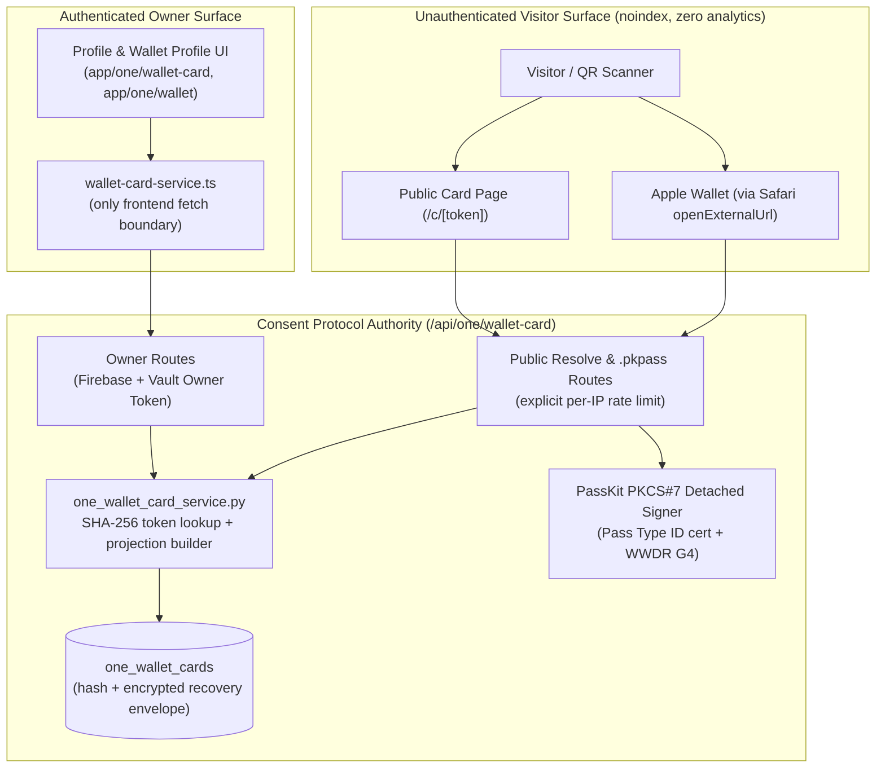

# Wallet Profile Card Contract

[One](README.md) · [Wallet](wallet.md) · [API Contracts](../../development/contracts/api-contracts.md)

**Status:** Live | **Intent:** Reference | **Audience:** Product, Backend, Frontend, Mobile, and Security

Wallet Profile lets a Hussh One owner publish a compact, revocable identity card at `/c/[token]` and optionally install it as a signed Apple Wallet pass (`pass.com.hushh.app.one`). It is an additive, isolated sharing plane separate from the encrypted PKM store, the Wallet payment/membership collection ([Wallet](wallet.md)), the Information Marketplace catalogue, and RIA advisor profiles.

> [!IMPORTANT]
> **Privacy & Isolation Guarantee:** Plaintext share tokens are never stored in the database; public resolution hashes the presented token with SHA-256 and compares in constant time. Paused cards return the exact same `404` response as unknown tokens. Per-scan telemetry (visitor IP, user agent, geolocation, or referrer) is strictly prohibited; only aggregate `scan_count` and coarse `last_scanned_at` are recorded.

## Visual Architecture

## Public Status Semantics

| Card State | HTTP Status | Response Contract |
| --- | --- | --- |
| `active` | `200 OK` | Allowlisted `card_payload` projection only (never `user_id`, `pass_serial`, or internal IDs). |
| `paused` or unknown token | `404 Not Found` | Identical generic body so paused cards remain indistinguishable from nonexistent tokens. |
| `revoked` | `410 Gone` | `{"status":"revoked"}` so `/c/[token]` renders an honest "no longer shared" state. |
| Expired (`expires_at` passed) | `410 Gone` | `{"status":"expired"}` so `/c/[token]` renders an expired-link state. |
| Signing material missing | `503 Service Unavailable` | Returned by `.pkpass` download; UI falls back gracefully without serving invalid passes. |

## Core Lifecycle & PassKit Design

1. **Dedicated Plane:** Wallet Profile uses its own table (`one_wallet_cards`), routes (`/api/one/wallet-card/*`), and feature flag (`ONE_WALLET_CARD_ENABLED`). It never reads or writes `pkm_default_available_projections`.
2. **Automatic Provisioning:** After `VAULT_OWNER` bootstrap, the app calls `POST /api/one/wallet-card/ensure` (`INSERT ... ON CONFLICT DO NOTHING`). Existing cards are never overwritten, unpaused, or restored by later sign-ins or backfills.
3. **Token Security & Recovery:** Tokens are `secrets.token_urlsafe(32)`, stored as SHA-256 hashes (`share_token_hash`) and optional AES-GCM owner recovery envelopes (`share_token_envelope`) bound to owner and digest when `EXTERNAL_CONNECTOR_CREDENTIAL_KEY` is configured. Revoked cards never emit a share token.
4. **Preview-as-Visitor Parity:** `GET /api/one/wallet-card/preview` invokes the exact same server projection builder used by the unauthenticated public resolve endpoint.
5. **Pass Construction (`generic` style, no web service):** Passes omit `webServiceURL` and `authenticationToken` entirely (no APNs/device registration). Passes carry a QR barcode pointing to `/c/[token]` and are signed with PKCS#7 detached signatures chained through Apple WWDR G4 using `cryptography`.
6. **Wallet Collection Variants:** `.pkpass` download supports `variant=profile|referral|nws` (default `profile`). Referral links come strictly from the owner's server-side referral authority; referral and NWS variants print only card name and holder name, with stable local serial suffixes (`-referral`, `-nws`).
7. **Crawler & Analytics Exclusion:** Public responses carry `Cache-Control: private, max-age=0, must-revalidate` and `X-Robots-Tag: noindex, nofollow, noarchive`. `/c/[token]` emits zero analytics and is disallowed in `robots.txt`.

## Apple PassKit Certificate Provisioning & Recovery

Apple Pass Type ID certificates (`pass.com.hushh.app.one`) expire after roughly one year and require monitored rotation. Provisioning is automated through `scripts/ci/provision_wallet_pass_certificate.py` using the Admin App Store Connect API key (`APPSTORE_CONNECT_API_KEY_P8_B64`, `_KEY_ID`, `_ISSUER_ID`).

- **Pre-flight Dry Run:** Always run without `--apply` first. The dry run verifies the Pass Type ID, builds a throwaway CSR, and checks project-level Secret Manager IAM write permissions (`projects.testIamPermissions`) across every target project before making an irreversible certificate mint call.
- **Secret Delivery:** Certificate PEM (`WALLET_PASS_CERT_PEM`), private key PEM (`WALLET_PASS_KEY_PEM`), and WWDR G4 PEM (`WALLET_PASS_WWDR_PEM`, `OU=G4`, valid through `2030-12-10`) are piped strictly via stdin through `scripts/ops/upsert_gcp_secret.py` (never argv, shell variables, or disk files) and mounted via `--set-secrets` in Cloud Run.
- **Partial-Publish Recovery (Critical):** Minting a Pass Type ID certificate consumes a finite Apple account slot. If mint succeeds but secret writes fail on one GCP project, **do not re-run the provisioning script** (re-running mints another certificate and burns a slot). Instead:
  1. Identify a healthy project whose `WALLET_PASS_CERT_PEM` and `WALLET_PASS_KEY_PEM` match.
  2. Pipe `WALLET_PASS_KEY_PEM`, `WALLET_PASS_CERT_PEM`, and `WALLET_PASS_WWDR_PEM` from the healthy project into the failed project via `scripts/ops/upsert_gcp_secret.py --stdin`.
  3. Re-run the provisioning script **without** `--apply` until it reports `already-provisioned` and exits `0`.
  4. Keep `ONE_WALLET_CARD_ENABLED` off until step 3 is clean.

---

For coding agents: Schema, routes, closed allowlist, copy contract, and hard prohibitions

### Exact Identifiers

| Key | Value |
| --- | --- |
| User-facing name | Wallet Profile |
| Pass Type Identifier | `pass.com.hushh.app.one` |
| Table & migrations | `one_wallet_cards` (`132_one_wallet_card.sql`, `285_one_wallet_card_auto_provision.sql`, rollback `132_one_wallet_card_down.sql`; migration `286` indexes referral opens) |
| Feature flag & secrets | `ONE_WALLET_CARD_ENABLED`, `WALLET_PASS_CERT_PEM`, `WALLET_PASS_KEY_PEM`, `WALLET_PASS_WWDR_PEM` |
| Backfill script | `consent-protocol/scripts/backfill_one_wallet_cards.py` (dry-run by default; `--apply` fills missing rows only) |

### Owner & Public Routes

- **Owner (`Depends(require_vault_owner_token)` + `token_data["user_id"] == user_id`):**
  - `GET /api/one/wallet-card` (card + status, never plaintext token)
  - `POST /api/one/wallet-card/ensure` (create missing card or recover existing link; never overwrites edits or unpauses)
  - `POST /api/one/wallet-card` (idempotent create/update of `card_payload`)
  - `POST /api/one/wallet-card/rotate` (mint new token, bump `share_token_version`, immediately invalidate old token)
  - `POST /api/one/wallet-card/pause`, `POST /api/one/wallet-card/resume`, `DELETE /api/one/wallet-card`
  - `GET /api/one/wallet-card/preview` (byte-identical visitor projection via shared builder)
- **Public (no auth, explicit forwarded-IP rate limit):**
  - `GET /api/one/wallet-card/public/{share_token}`
  - `GET /api/one/wallet-card/pass/{share_token}.pkpass` (`Content-Type: application/vnd.apple.pkpass`, optional `variant=profile|referral|nws`)

### Closed `card_payload` Allowlist

Unknown keys are rejected, never silently dropped. URL fields require `https://` and reject `javascript:`, `data:`, and userinfo (`@`). All text is escaped at render time.

| Key | Max Length | Notes |
| --- | --- | --- |
| `full_name` | 80 | Primary pass field |
| `username` | 30 | 3 to 30 lowercase letters/digits separated by single dots; reserved words rejected; display label only |
| `headline` | 120 | Secondary pass field |
| `organisation` | 80 | Auxiliary pass field |
| `location_label` | 80 | Coarse city/region only; never coordinates |
| `summary` | 400 | Back field |
| `skills` | 12 x 40 | Array of strings |
| `email` / `phone` | 254 / 32 | Validated contact shape |
| `website` / `linkedin` / `github` / `portfolio` | 300 each | `https://` only |
| `preferred_contact` | 16 | One of `email`, `phone`, `linkedin`, `website` |

### Frontend & Copy Boundaries

- All frontend network calls route through `hushh-webapp/lib/services/wallet-card-service.ts` (never raw `fetch()` in `app/**` or `components/**`).
- `/c/[token]` is registered in `isPublicRoute()` with `mode: "hidden"` chrome, bypassing `OneAuthGate`/`VaultLockGuard`.
- Add-to-Wallet hands off to Safari via `openExternalUrl()` because WKWebView cannot import `.pkpass` files; non-iOS clients show share-link actions.
- Profile settings row uses one vault-unlock-free string (**"Apple Wallet"** / "Share your profile with a scan."). Prohibited copy: "Share everything", "Your complete identity", "All your data in one scan", "Unlimited profile access", "Your entire PKM".

### Hard Prohibitions

1. Never read, write, or alter `pkm_default_available_projections`, the Information Marketplace catalogue, or RIA advisor profiles.
2. Never log plaintext share tokens, private keys, or `card_payload` values.
3. Never add a custom Capacitor plugin, iOS Wallet entitlement, Wallet web service, APNs registration, or per-scan telemetry rows.
4. Account deletion cascade must remove the user's `one_wallet_cards` row.

