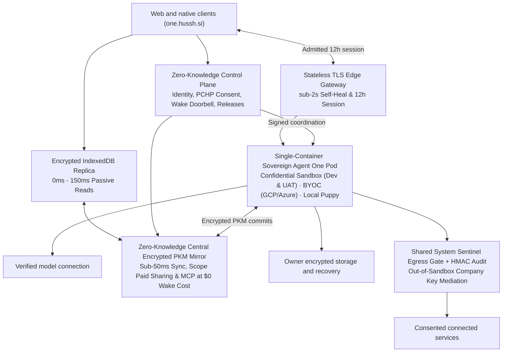

# How Private Agent One works

[Architecture](README.md) · [Product principles](../product/principles/README.md)

The clients provide one experience across web, iOS and Android. The control plane
coordinates identity, consent, placement and releases. One executes through the
selected runtime, calling bounded specialist tools rather than granting a model
unrestricted access to accounts or storage.

## Visual Map

## Responsibilities

| Component | Owns | Does not establish |
| --- | --- | --- |
| App and native shell | Interaction on `one.hussh.si`, local unlock, `0ms - 150ms` (`<100ms` target) encrypted IndexedDB read replica (`hushh-owner-ui-cache`), approved encryption, review | Authority merely because a control is visible |
| Zero-knowledge control plane | Identity (`id.hussh.si` / `id.hussh.ai`), placement, PCHP consent grants, zero-content wake doorbells, marketplace settlement, and releases | Permission to read any owner's plaintext |
| Zero-Knowledge Central Encrypted PKM Mirror | Durable owner-encrypted ciphertext for `hussh` One accounts (`<50ms` cross-device sync, `get_encrypted_scoped_export` MCP, and Scope Paid Sharing without waking sleeping pods; customer-bucket isolation reserved for BYOC) | Any `hussh`-held vault decryption key |
| Single-container sovereign runtime | `One` and bounded specialists (`Kai`, `Nav`, Mail, Calendar, Drive, Files, Browser, Scheduled Tasks, Live Voice) inside a single `2 vCPU / 4 GiB` container (`$0/hr` asleep) across Confidential Sandbox (Dev and UAT), BYOC, and Local Puppy | New authority from a model's request or shared-hub fallback for sovereign pod state |
| Shared Sentinel egress gate | Out-of-sandbox destination allowlisting, tamper-evident HMAC audit logs, and stateless injection of `hussh` operator secrets (Google Web OAuth, Plaid, market data, and model keys) outside user pods | Storage of user tokens or plaintext payloads |
| Delivery tooling | Exact-source validation, digest-verified TestFlight signing inputs, and explicit releases | Automatic deployment when source merges |

## A turn through the system

The client establishes its owner and current account authority and unlocks information when required. Passive UI reads (Chats sidebar, Rolling Main Chat, Files, and Personal Wiki) render immediately in `0ms - 150ms` (`<100ms` target) from the device's owner-scoped encrypted IndexedDB replica (`hushh-owner-ui-cache`) across reload and idle lock without blocking behind a waking sandbox. Active turns route over 12-hour `pst1.` placement-bound sessions through the stateless TLS Edge Gateway while sandboxes pre-warm silently in the background. One uses its existing ADK tree to select a specialist or tool. That tool validates the operation's consent, owner binding and current state. Consequential effects require the applicable review; uncertain outcomes are reconciled rather than replayed.

The [runtime view](views/runtime.md) details composition. The
[information boundaries](views/information-boundary.md) distinguish encrypted
memory, operational metadata and provider processing. The
[deployment view](views/deployment.md) explains cloud placement.

## Source and availability

The current root agent is One; Kai is its finance specialist. Some implementation
identifiers retain Kai-era names for compatibility. These names do not define a
second top-level product.

Dev cutover lanes retire `Hussh Shared` into `Hussh Confidential Sandbox` (Google Cloud default, Dev Preview) alongside `Bring Your Own Cloud` (GCP/Azure) and `Local Puppy`, while UAT and Production retain existing `Shared` and `BYOC` separation until Phase 4 acceptance ([#9744](https://github.com/hushh-labs/hushh-research/issues/9744)). Missing placement is not Shared. Browser and Puppy require their own installed acceptance. Read [capability availability](../product/capabilities.md) before interpreting a source diagram as a deployment promise. Related tracking issues: [#9744](https://github.com/hushh-labs/hushh-research/issues/9744) · [#9511](https://github.com/hushh-labs/hushh-research/issues/9511) · [#9736](https://github.com/hushh-labs/hushh-research/issues/9736) · [#9517](https://github.com/hushh-labs/hushh-research/issues/9517) · [#9370](https://github.com/hushh-labs/hushh-research/issues/9370) · [#5507](https://github.com/hushh-labs/hushh-research/issues/5507).
