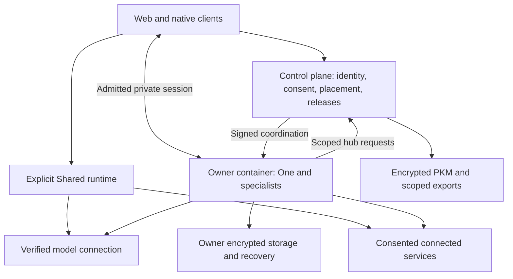

# How Private Agent One works

[Architecture](README.md) · [Product principles](../product/principles/README.md)

The clients provide one experience across web, iOS and Android. The control plane
coordinates identity, consent, placement and releases. One executes through the
selected runtime, calling bounded specialist tools rather than granting a model
unrestricted access to accounts or storage.

## Visual Map

## Responsibilities

| Component | Owns | Does not establish |
| --- | --- | --- |
| App and native shell | Interaction, local unlock, approved encryption, review | Authority merely because a control is visible |
| Control plane | Identity, placement, consent, grants, operations and releases | Permission to read every owner's plaintext |
| One and specialists | Task coordination and bounded execution | New authority from a model's request |
| PKM and export services | Encrypted memory, scope metadata and consented exports | General plaintext model access |
| Owner storage | Qualified recovery and Files custody | A working backup without verified restoration |
| Delivery tooling | Exact-source validation and explicit releases | Automatic deployment when source merges |

## A turn through the system

The client establishes its owner and current account authority, unlocks information
when required, and submits a task to the admitted runtime. One uses its existing
ADK tree to select a specialist or tool. That tool validates the operation's consent,
owner binding and current state. Consequential effects require the applicable
review; uncertain outcomes are reconciled rather than replayed.

The [runtime view](views/runtime.md) details composition. The
[information boundaries](views/information-boundary.md) distinguish encrypted
memory, operational metadata and provider processing. The
[deployment view](views/deployment.md) explains cloud placement.

## Source and availability

The current root agent is One; Kai is its finance specialist. Some implementation
identifiers retain Kai-era names for compatibility. These names do not define a
second top-level product.

Shared and private hosting have distinct custody and capability contracts.
Missing placement is not Shared. Browser and Puppy require their own installed
acceptance. Read [capability availability](../product/capabilities.md) before
interpreting a source diagram as a deployment promise.
